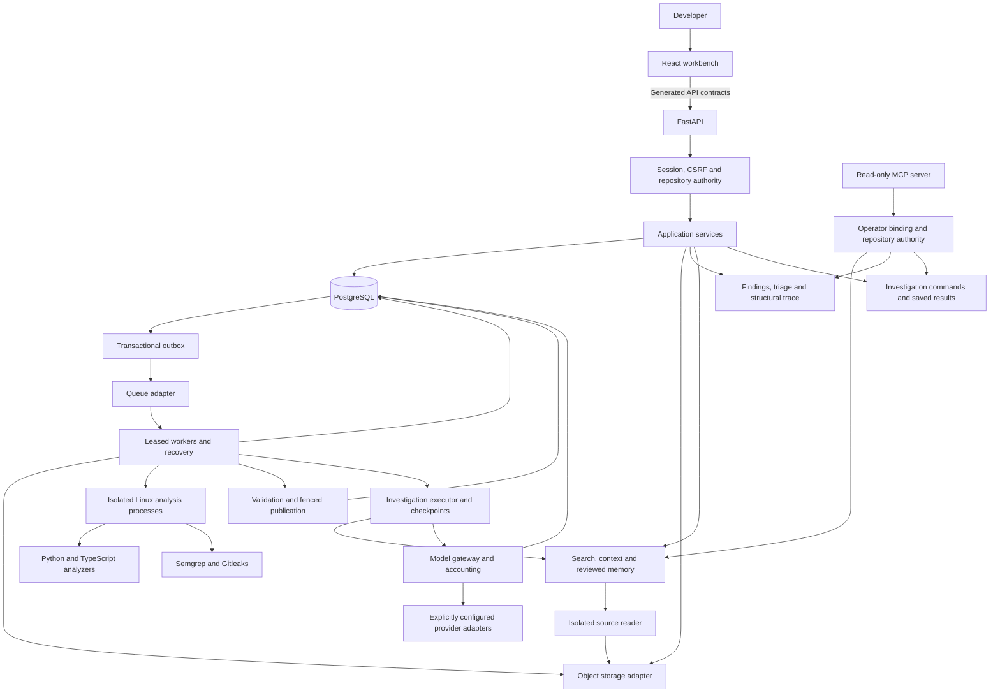

<div align="center">

# CodeSPY

**Inspect source. Follow structure. Review evidence.**

A source-code inspection workbench for Python, JavaScript and TypeScript repositories.

[Architecture](#architecture) · [Capabilities](#capabilities) · [Local development](#local-development) · [Verification](#verification) · [Technical records](#technical-records)

</div>

---

CodeSPY turns a source archive into an immutable snapshot, a file inventory and bounded structural reports. Scanner results are stored with source-linked evidence and human triage records. A React workbench brings these records together with code search, context assembly and investigation views.

The central distinction is **what the source establishes, what analysis infers, and what remains unknown**. Static call candidates are not observed execution paths. A matching quotation does not prove a security claim. An empty findings list does not establish that a repository is secure.

> **Development status:** Development is temporarily paused. CodeSPY is a local prototype with implemented source-analysis, retrieval, reviewed-memory, investigation and read-only MCP workflows. Live provider quality, the complete upload-to-saved-investigation journey and hosted deployment remain unqualified.

## Capabilities

| Area                | Implemented                                                                                                                                      | Current boundary                                                                                                                              |
| ------------------- | ------------------------------------------------------------------------------------------------------------------------------------------------ | --------------------------------------------------------------------------------------------------------------------------------------------- |
| Source intake       | ZIP admission, path and expansion checks, immutable snapshots, file hashes and inventory                                                         | Inventory coverage is separate from analysis coverage                                                                                         |
| Structural analysis | Python, JS, JSX, TS and TSX parsing; symbols, imports, call candidates and framework-boundary reports                                            | Bounded static analysis; dynamic behavior can remain unresolved                                                                               |
| Security scanning   | Isolated Semgrep and Gitleaks adapters; offline npm/uv advisory assessment; durable result storage                                               | Scoped configuration, start/status/cancel/retry and published-run mapping exist; registered runtimes and capability catalogs must be injected |
| Findings and review | Scoped list/detail services, evidence references, append-only triage events and optimistic projections                                           | Isolated redacted excerpts and current-support views are implemented; cross-instance cursor continuity remains incomplete                     |
| Feature tracing     | Deterministic, bounded neighborhoods from one published structural run, with actual file locations and omission reasons                          | Follows retained graph edges; does not invent route-handler links or prove exploitability                                                     |
| Retrieval           | Verified source-view services, recognized-secret redaction, chunking, exact search, PostgreSQL full-text search and rank-fusion helpers          | Durable indexing and API/UI/MCP reads have scoped local evidence; live provider-backed dense retrieval remains unqualified                    |
| MCP                 | Official SDK stdio server (`python -m app.mcp`) exposing 13 read-only tools across retrieval, findings, graph, trace, memory, and investigations | Recorded SDK, subprocess, PostgreSQL and isolated-reader checks passed; manual desktop-host acceptance remains pending                        |

### Interface

The workbench contains archive intake and inventory, structural reports, findings and triage, retrieval/context tools, repository memory and investigation views. Findings views consume generated API types so their fields match backend responses.

The interface uses focused hash-addressed panes, preserves drafts between views and supports dark/light themes. Shared dialogs, keyboard tabs and explicit recovery states connect to the existing services. Model and scanner availability describe configured capabilities; a visible control does not establish live access. See [workspace verification](docs/acceptance/frontend-workspace.md).

## Repository memory

Writers submit memory candidates for review. An owner or administrator with current
repository write access can accept them for reuse, inspect history and archive or
supersede them. Candidates expire after seven days; accepted memories expire after
ninety days. Historical memories remain labeled hints and do not establish current
source findings.

The workbench includes review controls and a context-selection preview. Configured
model memory is disabled by default. Provider-backed context composition has bounded
packing and dispatch-time authority checks. Both durable investigation modes have
connected source/tool/report recovery tests using synthetic model responses. See [memory and context behavior](docs/acceptance/reviewed-memory-context.md).

## Security investigations

Investigations run asynchronous, node-based security analysis jobs against admitted source snapshots.
Execution is backed by PostgreSQL authority (`investigation_jobs`, `investigation_evidence`, `investigation_reports`).
The workflow enforces:

- **Recoverable execution:** immutable call identities, checkpoints and retained encrypted results support replay. Ambiguous dispatch outcomes require durable-state recovery and accounting reconciliation; they are not automatically sent again.
- **Budget accounting:** reservations, settled usage, uncertain holds and debt remain explicit. Cancellation does not make a potentially dispatched call free.
- **Source correspondence:** publication checks cited source identity, ranges and quotes. Unsupported claims are downgraded; matching source does not prove a security conclusion.
- **Events and history:** persisted sequence-paginated events support replay. The live SSE compatibility endpoint is a separate view; it is not a substitute for durable event pages.
- **Workbench and MCP:** the UI exposes lifecycle commands and saved results; MCP exposes authorized read-only status and result tools.

See [investigation acceptance criteria](docs/acceptance/investigations.md) and the [operator investigation runbook](docs/operator-investigation-runbook.md).

## Architecture

CodeSPY uses a **modular Python backend**, a **React frontend** and **PostgreSQL as the authority for persisted state**. Storage, queues, scanners and model interfaces sit behind typed ports and adapters.



Arrows describe implemented service boundaries, not deployment or live qualification. The worker composition receives operations, source readers, catalogs and model runtime explicitly. Missing configuration leaves the affected capability unavailable; the diagram does not imply that a provider or cloud service is active.

### How source becomes a report

1. **Admit:** validate the archive, record its identity and inventory its contents.
2. **Schedule:** persist work and outbox delivery together; a queue message carries notification rather than publication authority.
3. **Analyze:** a leased worker authenticates its inputs and passes bounded source to isolated trusted analyzers or scanners.
4. **Validate:** check result identities, source ranges, references, coverage and output limits.
5. **Publish:** commit the result and terminal lifecycle under database lease and fencing guards.
6. **Inspect:** read source-linked findings and reports under current repository permissions.

PostgreSQL time governs worker leases. Retries, cancellation and ambiguous commit recovery use durable state. Investigation recovery retains encrypted tool results, native continuation references and report drafts; connected tests use synthetic providers.

### Responsibilities

| Component                        | Responsibility                                                                                        |
| -------------------------------- | ----------------------------------------------------------------------------------------------------- |
| FastAPI and application services | HTTP contracts, authorization, transactions and lifecycle operations                                  |
| PostgreSQL                       | Source identities, jobs, outbox, reports, graphs, evidence and review records                         |
| Object storage                   | Admitted archive bytes through local or S3-compatible adapters                                        |
| Queue adapter and worker runtime | Delivery, claims, recovery and cleanup; in-memory and SQS adapters exist                              |
| Isolated analyzers               | Parse bounded source without executing uploaded application code                                      |
| React and TanStack Query         | Scoped reads, job status and review interactions through generated contracts                          |
| Retrieval/model ports            | Replaceable interfaces for search, context, embeddings and generation; live qualification is separate |

Redis, search-service containers and installed SDKs do not imply that those services participate in every application workflow. The complete source-analysis design is described in the [architecture notes](docs/architecture/README.md).

## Limits and evidence boundaries

| Resource                                    | Current bound                                                                               |
| ------------------------------------------- | ------------------------------------------------------------------------------------------- |
| Compressed ZIP                              | 100 MiB                                                                                     |
| Expanded archive                            | 1 GiB                                                                                       |
| Archive entries                             | 10,000                                                                                      |
| Archive nesting depth                       | 32                                                                                          |
| Expansion ratio                             | 100:1                                                                                       |
| Structural source selection                 | 128 eligible files / 16 MiB total / 2 MiB per file                                          |
| Separate structural configuration selection | 32 files / 1 MiB total / 256 KiB per file                                                   |
| Structural report                           | 1,000 graph nodes / 2,000 edges / 2 MiB JSON                                                |
| Findings publication                        | 1,000 findings, with explicit omission accounting                                           |
| Feature trace                               | Up to 2 graph hops, 100 nodes and 200 edges, including its finding node and attachment edge |
| Feature-trace deadline                      | 1 second for the asynchronous service operation                                             |

These are admitted resource limits, not throughput or latency benchmarks. Timeouts and isolation behavior require qualification on the actual worker platform.

Source is untrusted. CodeSPY does not execute uploaded application code or install its dependencies. Analysis is limited to supported languages, detector profiles and selected files. Omitted, unavailable and unresolved results must remain visible.

The isolated scanner toolchain has [documented dependency advisories](docs/acceptance/offline-scanner.md#dependency-advisories--29-october-2026). Isolation limits exposure; it is not a vulnerability-free guarantee or production activation approval.

Recognized-secret redaction is heuristic. Unusual, encoded or split secrets may remain undetected. A model-safe representation is a derived view, not permission to disclose it to an external provider.

## Local development

### Prerequisites

- **Python 3.12** — the workspace currently requires `>=3.12,<3.13`.
- **uv** — use the root `uv.lock` for the Python workspace.
- **Node.js 22** — frontend and analyzer manifests require `>=22.12,<23`; `.nvmrc` selects 22.
- **npm** — each JavaScript workspace has its own lockfile.
- **Docker with Compose v2** — required for disposable database and Linux-container qualification.

### Install trusted development dependencies

```bash
git clone https://github.com/aman-bhaskar-codes/CodeSPY.git
cd CodeSPY

uv sync --all-packages --all-groups --frozen
npm ci
npm --prefix tools/typescript-analyzer ci
npm --prefix tools/typescript-analyzer run build
npm --prefix frontend ci
```

Use a Node version manager to select the version in `.nvmrc` before running npm commands. These dependencies belong to CodeSPY itself; never install packages from an uploaded target repository.

### Check the code

```bash
make unit
uv run --frozen --all-packages --all-groups ruff check backend/app
uv run --frozen --all-packages --all-groups mypy --config-file backend/pyproject.toml backend/app

npm --prefix tools/typescript-analyzer test
npm --prefix frontend run typecheck
npm --prefix frontend run lint
npm --prefix frontend test
npm --prefix frontend run build
```

The `unit` target currently collects the core intake, structural and scanner suites. Retrieval and investigation test coverage is present in the repository but is not yet included in that target or all CI gates.

### Run the local intake and structure demo

With Docker running, build the trusted images and prepare an owned disposable test environment:

```bash
make admission-image structural-image
make source-prepare
make structural-test
make local-demo
```

In another terminal:

```bash
npm --prefix frontend run dev
```

The demo API listens on **`http://127.0.0.1:8000`** and the workbench on **`http://127.0.0.1:5173`**. It uses synthetic local identity and local service emulators. It does not activate every findings, retrieval or investigation workflow.

The application factory requires explicit settings and injected ports. Use the demo launcher rather than invoking it as a zero-argument Uvicorn factory.

After stopping the demo API and worker, remove only the environment owned by that harness:

```bash
make source-cleanup
```

Keep ownership files if cleanup fails. Do not remove unrelated containers or developer database volumes. See [database operations](docs/database.md) for the separate persistence test harness.

### Configuration and provider access

Use [.env.example](.env.example) as a reference. Local secrets, source archives and analyzed artifacts are excluded from version control.

Provider credentials remain owner-managed. Model identifiers, allowed regions, disclosure policy, price schedules and spend limits require explicit configuration and qualification. Dependencies or credentials alone do not make an integration operational.

No hosted deployment is included in the local demo. Cloud accounts, IAM, provider activation and hosting are managed separately by the owner. See the [runtime configuration guide](docs/SERVICES.md), [model runbook](docs/operator-model-runbook.md) and [budget operations](docs/operator-budget-runbook.md).

### Model configuration

Generation supports five configurable model slots through scoped routing and durable
usage accounting. Providers remain disabled until owner configuration and
qualification. See the [model connection runbook](docs/operator-model-runbook.md)
and [disabled configuration example](config/models.example.json).

## MCP integration

The local stdio server runs with `python -m app.mcp` from the backend directory.
It uses the official SDK and exposes thirteen typed, read-only tools for index
status, safe source views, search/context, reviewed memory, findings/evidence,
structural neighborhoods, feature traces and saved investigations/claims.

An operator-bound identity and repository allowlist restrict every call. Connected
requests use isolated database sessions and current repository/snapshot authority.
Hybrid retrieval runs without provider-backed query embeddings and reports lexical
fallback explicitly. No job, memory-write, shell, deployment or paid-model tools
are exposed.

Automated SDK and subprocess checks cover discovery, schemas, framing and bounds.
The acceptance record reports connected PostgreSQL and isolated-reader checks as
passed. Manual desktop-host registration/discovery remains pending; these are
separate from SDK adapter checks and hosted operation.
See the [operator guide](docs/operator-mcp-runbook.md) and
[acceptance evidence](docs/acceptance/mcp-integration.md). Remote HTTP and external
MCP connections remain disabled.

## Verification

| Area                      | Evidence and boundary                                                                                                                                                                                       |
| ------------------------- | ----------------------------------------------------------------------------------------------------------------------------------------------------------------------------------------------------------- |
| Workspace                 | [Frontend verification](docs/acceptance/frontend-workspace.md): component and intercepted-HTTP browser results, typing, lint, build and UI audit                                                            |
| Indexing                  | [Index interfaces](docs/acceptance/index-interface.md): real local API/database/worker/reader/indexer journey from a trusted admitted fixture                                                               |
| Investigations and memory | [Investigation recovery](docs/acceptance/investigations.md) and [reviewed memory](docs/acceptance/reviewed-memory-context.md): scoped database/container checks with synthetic providers                    |
| MCP                       | [MCP evidence](docs/acceptance/mcp-integration.md): recorded protocol, subprocess and connected storage/reader checks; manual host acceptance pending                                                       |
| Accounting and models     | [Accounting](docs/acceptance/model-accounting.md) and [model connections](docs/acceptance/model-connections.md): recorded constrained-role and synthetic transport results; live access remains unqualified |
| Complete product journey  | Single upload-to-saved-investigation browser journey, live model quality and hosted operation remain unqualified                                                                                            |

SQLite service tests do not establish PostgreSQL locking or publication guarantees. Mocked models and embeddings do not qualify real provider behavior. Historical acceptance records describe the commands and revisions they tested; they are not blanket guarantees for later changes.

## Repository layout

```text
backend/
  app/
    api/            HTTP application and contracts
    contracts/      Typed requests, results and versioned records
    security/       Sessions, CSRF and repository authority
    services/       Application behavior and publication
    repositories/   Scoped persistence operations
    workers/        Delivery, leased operations and recovery
    analyzers/      Structural extraction and reporting
    scanners/       Offline scanner execution and normalization
    ports/          Storage, queue, scanner and provider interfaces
    adapters/       Concrete integrations
    mcp/            Bounded read-only stdio server
  alembic/          Database migration history
  tests/            Unit, integration, concurrency and evaluation fixtures
  openapi.json      Exported API schema
frontend/           React workbench and generated API types
tools/              Trusted TypeScript analyzer and engineering utilities
infra/              Container definitions and infrastructure configuration
scripts/            Local launchers and owned-resource test harnesses
docs/               Architecture, capability limits and qualification records
```

## Technical records

- **Architecture:** [System boundaries](docs/architecture/README.md), [persistence decisions](docs/adr/0002-persistence.md), [structural analysis decisions](docs/adr/0003-structural-analysis.md).
- **Capabilities:** [Supported structural profile](docs/capabilities/structural-small-v1.md), [toolchain](docs/TOOLCHAIN.md), [service setup](docs/SERVICES.md).
- **Current integration:** [Workspace](docs/acceptance/frontend-workspace.md), [index interfaces](docs/acceptance/index-interface.md), [MCP](docs/acceptance/mcp-integration.md), [investigations](docs/acceptance/investigations.md), [memory/context](docs/acceptance/reviewed-memory-context.md).
- **Qualification:** [Persistence](docs/acceptance/persistence.md), [ingestion](docs/acceptance/ingestion.md), [structural analysis](docs/acceptance/structural-analysis.md), [offline scanners](docs/acceptance/offline-scanner.md), [dependency assessment](docs/acceptance/offline-dependencies.md), [durable findings](docs/acceptance/durable-findings.md).
- **Engineering references:** [Scanner qualification](docs/engineering/scanner-qualification.md), [REA investigation](docs/engineering/rea-investigation.md).

---

[Contributing](CONTRIBUTING.md) · [Security policy](SECURITY.md) · [MIT license](LICENSE)

Earlier component evidence remains in [findings and retrieval checks](docs/acceptance/retrieval-boundaries.md), [atomic index publication](docs/acceptance/index-publication.md) and [index reads](docs/acceptance/index-reads.md). Their historical limitations must be read alongside the newer integration records above.
