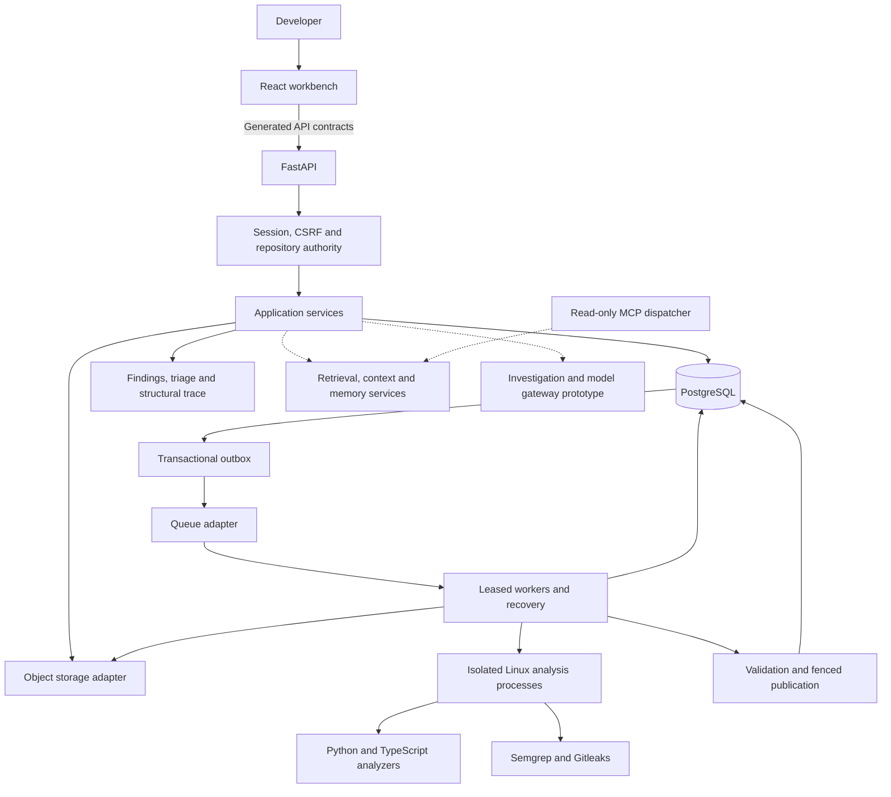

<div align="center">

# CodeSPY

**Inspect source. Follow structure. Review evidence.**

A source-code inspection workbench for Python, JavaScript and TypeScript repositories.

[Architecture](#architecture) · [Capabilities](#capabilities) · [Local development](#local-development) · [Verification](#verification) · [Technical records](#technical-records)

</div>

---

CodeSPY turns a source archive into an immutable snapshot, a file inventory and bounded structural reports. Scanner results are stored with source-linked evidence and human triage records. A React workbench brings these records together with code search, context assembly and investigation views.

The central distinction is **what the source establishes, what analysis infers, and what remains unknown**. Static call candidates are not observed execution paths. A matching quotation does not prove a security claim. An empty findings list does not establish that a repository is secure.

> **Development status:** a local prototype with an established intake and structural-analysis foundation. Public scan wiring, durable indexing and provider-backed investigations still need integration and qualification. The repository is not a hosted production release.

## Capabilities

| Area                      | Implemented                                                                                                                             | Current boundary                                                                                           |
| ------------------------- | --------------------------------------------------------------------------------------------------------------------------------------- | ---------------------------------------------------------------------------------------------------------- |
| Source intake             | ZIP admission, path and expansion checks, immutable snapshots, file hashes and inventory                                                | Inventory coverage is separate from analysis coverage                                                      |
| Structural analysis       | Python, JS, JSX, TS and TSX parsing; symbols, imports, call candidates and framework-boundary reports                                   | Bounded static analysis; dynamic behavior can remain unresolved                                            |
| Security scanning         | Isolated Semgrep and Gitleaks adapters; offline npm/uv advisory assessment; durable result storage                                      | Public scan startup and job-to-result tracking are not fully connected                                     |
| Findings and review       | Scoped list/detail services, evidence references, append-only triage events and optimistic projections                                  | Isolated excerpts, current-support aggregation and cross-instance cursor continuity remain incomplete      |
| Feature tracing           | Deterministic, bounded neighborhoods from one published structural run, with actual file locations and omission reasons                 | Follows retained graph edges; does not invent route-handler links or prove exploitability                  |
| Retrieval                 | Verified source-view services, recognized-secret redaction, chunking, exact search, PostgreSQL full-text search and rank-fusion helpers | Durable indexing and publication visibility are incomplete; dense retrieval is not live-qualified          |
| Memory and investigations | Memory services, typed model contracts, budget/checkpoint records, investigator loops and workbench screens                             | Investigation tools/providers are not fully connected; the API currently uses a deterministic test adapter |
| MCP                       | Read-only dispatcher with a trusted server-supplied identity and scoped service calls                                                   | Standalone stdio startup and client interoperability remain unqualified                                    |

### Interface

The workbench contains archive intake and inventory, structural reports, findings and triage, retrieval/context tools, repository memory and investigation views. Findings views consume generated API types so their fields match backend responses.

Some screens expose components whose complete runtime workflow is still being integrated. Their presence is not evidence that every backend capability is enabled.

## Architecture

CodeSPY uses a **modular Python backend**, a **React frontend** and **PostgreSQL as the authority for persisted state**. Storage, queues, scanners and model interfaces sit behind typed ports and adapters.



Solid arrows describe the established service boundaries and durable analysis path. Dashed arrows identify components whose complete runtime integration is still in progress. Individual worker operations require explicit application wiring and qualified runtimes.

### How source becomes a report

1. **Admit:** validate the archive, record its identity and inventory its contents.
2. **Schedule:** persist work and outbox delivery together; a queue message carries notification rather than publication authority.
3. **Analyze:** a leased worker authenticates its inputs and passes bounded source to isolated trusted analyzers or scanners.
4. **Validate:** check result identities, source ranges, references, coverage and output limits.
5. **Publish:** commit the result and terminal lifecycle under database lease and fencing guards.
6. **Inspect:** read source-linked findings and reports under current repository permissions.

PostgreSQL time governs worker leases. Retries, cancellation and ambiguous commit recovery use durable state. The newer investigation execution path does not yet provide the same recovery guarantees as the established analysis jobs.

### Responsibilities

| Component                        | Responsibility                                                                                        |
| -------------------------------- | ----------------------------------------------------------------------------------------------------- |
| FastAPI and application services | HTTP contracts, authorization, transactions and lifecycle operations                                  |
| PostgreSQL                       | Source identities, jobs, outbox, reports, graphs, evidence and review records                         |
| Object storage                   | Admitted archive bytes through local or S3-compatible adapters                                        |
| Queue adapter and worker runtime | Delivery, claims, recovery and cleanup; in-memory and SQS adapters exist                              |
| Isolated analyzers               | Parse bounded source without executing uploaded application code                                      |
| React and TanStack Query         | Scoped reads, job status and review interactions through generated contracts                          |
| Retrieval/model ports            | Replaceable interfaces for search, context, embeddings and generation; live qualification is separate |

Redis, search-service containers and installed SDKs do not imply that those services participate in every application workflow. The complete source-analysis design is described in the [architecture notes](docs/architecture/README.md).

## Limits and evidence boundaries

| Resource                                    | Current bound                                                                               |
| ------------------------------------------- | ------------------------------------------------------------------------------------------- |
| Compressed ZIP                              | 100 MiB                                                                                     |
| Expanded archive                            | 1 GiB                                                                                       |
| Archive entries                             | 10,000                                                                                      |
| Archive nesting depth                       | 32                                                                                          |
| Expansion ratio                             | 100:1                                                                                       |
| Structural source selection                 | 128 eligible files / 16 MiB total / 2 MiB per file                                          |
| Separate structural configuration selection | 32 files / 1 MiB total / 256 KiB per file                                                   |
| Structural report                           | 1,000 graph nodes / 2,000 edges / 2 MiB JSON                                                |
| Findings publication                        | 1,000 findings, with explicit omission accounting                                           |
| Feature trace                               | Up to 2 graph hops, 100 nodes and 200 edges, including its finding node and attachment edge |
| Feature-trace deadline                      | 1 second for the asynchronous service operation                                             |

These are admitted resource limits, not throughput or latency benchmarks. Timeouts and isolation behavior require qualification on the actual worker platform.

Source is untrusted. CodeSPY does not execute uploaded application code or install its dependencies. Analysis is limited to supported languages, detector profiles and selected files. Omitted, unavailable and unresolved results must remain visible.

Recognized-secret redaction is heuristic. Unusual, encoded or split secrets may remain undetected. A model-safe representation is a derived view, not permission to disclose it to an external provider.

## Local development

### Prerequisites

- **Python 3.12** — the workspace currently requires `>=3.12,<3.13`.
- **uv** — use the root `uv.lock` for the Python workspace.
- **Node.js 22** — frontend and analyzer manifests require `>=22.12,<23`; `.nvmrc` selects 22.
- **npm** — each JavaScript workspace has its own lockfile.
- **Docker with Compose v2** — required for disposable database and Linux-container qualification.

### Install trusted development dependencies

```bash
git clone https://github.com/aman-bhaskar-codes/CodeSPY.git
cd CodeSPY

uv sync --all-packages --all-groups --frozen
npm ci
npm --prefix tools/typescript-analyzer ci
npm --prefix tools/typescript-analyzer run build
npm --prefix frontend ci
```

Use a Node version manager to select the version in `.nvmrc` before running npm commands. These dependencies belong to CodeSPY itself; never install packages from an uploaded target repository.

### Check the code

```bash
make unit
uv run --frozen --all-packages --all-groups ruff check backend/app
uv run --frozen --all-packages --all-groups mypy --config-file backend/pyproject.toml backend/app --exclude '.* 2.py'

npm --prefix tools/typescript-analyzer test
npm --prefix frontend run typecheck
npm --prefix frontend run lint
npm --prefix frontend test
npm --prefix frontend run build
```

The `unit` target currently collects the core intake, structural and scanner suites. Retrieval and investigation test coverage is present in the repository but is not yet included in that target or all CI gates.

### Run the local intake and structure demo

With Docker running, build the trusted images and prepare an owned disposable test environment:

```bash
make admission-image structural-image
make source-prepare
make structural-test
make local-demo
```

In another terminal:

```bash
npm --prefix frontend run dev
```

The demo API listens on **`http://127.0.0.1:8000`** and the workbench on **`http://127.0.0.1:5173`**. It uses synthetic local identity and local service emulators. It does not activate every findings, retrieval or investigation workflow.

The application factory requires explicit settings and injected ports. Use the demo launcher rather than invoking it as a zero-argument Uvicorn factory.

After stopping the demo API and worker, remove only the environment owned by that harness:

```bash
make source-cleanup
```

Keep ownership files if cleanup fails. Do not remove unrelated containers or developer database volumes. See [database operations](docs/database.md) for the separate persistence test harness.

### Configuration and provider access

Use [.env.example](.env.example) as a reference. Local secrets, source archives and analyzed artifacts are excluded from version control.

Provider credentials remain owner-managed. Model identifiers, allowed regions, disclosure policy, price schedules and spend limits require explicit configuration and qualification. Dependencies or credentials alone do not make an integration operational.

No hosted deployment is included in the local demo. Cloud accounts, IAM, provider activation and hosting are managed separately by the owner.

## MCP integration

The current implementation is a read-only dispatcher in [`backend/app/mcp/server.py`](backend/app/mcp/server.py). Its tool catalog contains:

| Tool               | Purpose                                                   |
| ------------------ | --------------------------------------------------------- |
| `get_source_view`  | Request a model-safe view of an authorized source file    |
| `search_exact`     | Search indexed symbols and paths                          |
| `search_hybrid`    | Combine available retrieval channels                      |
| `assemble_context` | Package authorized search results within a context budget |
| `query_memory`     | Query the repository memory service                       |

The application supplies a trusted tenant/principal identity. Tool arguments cannot choose or override it, and underlying services still enforce repository access.

This dispatcher is not yet a qualified standalone MCP server. There is no supported one-command IDE registration or advertised `codespy://` resource catalog to document at present.

## Verification

| Check                                      | Current evidence                                                                                                  |
| ------------------------------------------ | ----------------------------------------------------------------------------------------------------------------- |
| Backend service-level regressions          | Passed locally, including cross-repository denial, revoked permissions, context identity checks and trace budgets |
| Strict backend typing and lint             | Passed locally                                                                                                    |
| API contract generation                    | Nested references resolve; generated frontend types are synchronized                                              |
| Frontend typing, lint and production build | Passed locally                                                                                                    |
| Findings rendering                         | Standalone server-rendering smoke cases passed; these are not browser acceptance tests                            |
| Frontend test suite                        | 22 tests passed on Node 22 with an independent exact-lock installation                                            |
| PostgreSQL and native containers           | 8 current migration/API-role regressions passed; native scanner container qualification was not rerun             |
| Live models and hosted operation           | Not qualified                                                                                                     |

SQLite service tests do not establish PostgreSQL locking or publication guarantees. Mocked models and embeddings do not qualify real provider behavior. Historical acceptance records describe the commands and revisions they tested; they are not blanket guarantees for later changes.

## Repository layout

```text
backend/
  app/
    api/            HTTP application and contracts
    contracts/      Typed requests, results and versioned records
    security/       Sessions, CSRF and repository authority
    services/       Application behavior and publication
    repositories/   Scoped persistence operations
    workers/        Delivery, leased operations and recovery
    analyzers/      Structural extraction and reporting
    scanners/       Offline scanner execution and normalization
    ports/          Storage, queue, scanner and provider interfaces
    adapters/       Concrete integrations
    mcp/            Read-only tool dispatcher
  alembic/          Database migration history
  tests/            Unit, integration, concurrency and evaluation fixtures
  openapi.json      Exported API schema
frontend/           React workbench and generated API types
tools/              Trusted TypeScript analyzer and engineering utilities
infra/              Container definitions and infrastructure configuration
scripts/            Local launchers and owned-resource test harnesses
docs/               Architecture, capability limits and qualification records
```

## Technical records

- **Architecture:** [System boundaries](docs/architecture/README.md), [persistence decisions](docs/adr/0002-persistence.md), [structural analysis decisions](docs/adr/0003-structural-analysis.md).
- **Capabilities:** [Supported structural profile](docs/capabilities/structural-small-v1.md), [toolchain](docs/TOOLCHAIN.md), [service setup](docs/SERVICES.md).
- **Qualification:** [Persistence](docs/acceptance/persistence.md), [ingestion](docs/acceptance/ingestion.md), [structural analysis](docs/acceptance/structural-analysis.md), [offline scanners](docs/acceptance/offline-scanner.md), [dependency assessment](docs/acceptance/offline-dependencies.md), [durable findings](docs/acceptance/durable-findings.md).
- **Engineering references:** [Scanner qualification](docs/engineering/scanner-qualification.md), [REA investigation](docs/engineering/rea-investigation.md).

---

[Contributing](CONTRIBUTING.md) · [Security policy](SECURITY.md) · [MIT license](LICENSE)
