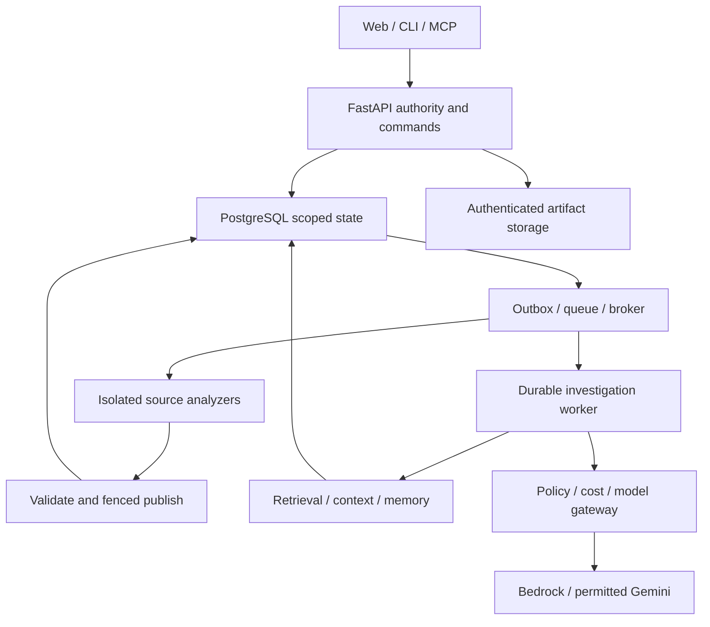
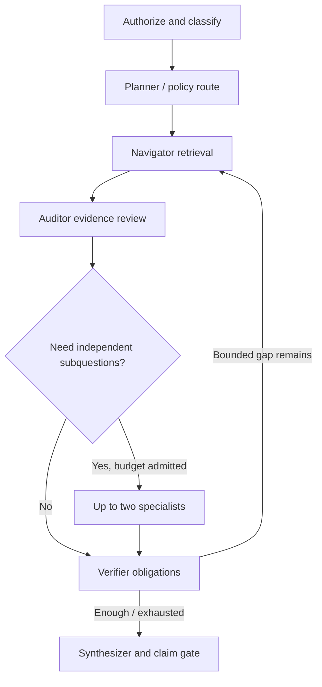

# CodeSPY — Revised Post-Phase-3 Engineering and Release Roadmap

**Date:** 20 October 2026. **Inspected main:** `b13a4f5dcc961d67b53bb381801eed3f54f1cdec`. **Purpose:** controlling architecture and execution roadmap from the repaired Phase 3 foundation to a working full-stack, AI-assisted invited alpha and subsequently a hosted SaaS. **Status:** proposed work, not implementation or a production-readiness certificate.

> For the executing engineer/agent: use `superpowers:executing-plans` package by package. Inspect current instructions and code before changing anything; reconcile drift, write meaningful regression/contract tests, implement a coherent vertical slice, run relevant checks, record observed evidence, and continue only when dependencies pass. This document supersedes the uploaded strategy where they differ. Detailed phase plans remain subordinate implementation specifications and must be rebased to the actual commit. No application code, service, scanner, model, AWS resource, credentials, browser session or external workspace was changed during this review.

**Product:** a source-first reverse-engineering workbench. Upload an archive or authorize a GitHub repository; inspect architecture, scope and evidence; review deterministic issues; ask bounded questions; receive cited answers, hypotheses and improvement proposals. Provide the same authorized core through web UI, CLI and MCP. “No detected issues” is never a guarantee that the repository is safe.

**Engineering approach:** one Python modular monolith with independently runnable API, broker and agent processes; isolated native parser/scanner tasks; PostgreSQL as lifecycle/authority/evidence/budget store; S3-compatible object storage for bytes; existing queue/outbox/fence design. Python and TypeScript are sufficient production languages. More frameworks are added only when an owned component needs them.

## 1. Critical assessment of your uploaded strategy

The strategy is a good architectural direction, but not yet a complete execution specification. Its strongest choices are retaining the working foundation, explicit coverage, private-provider policy, immutable evidence, finite budgets and local-first qualification. The repairs below make those choices concrete.

| Area | Assessment | Required correction in this roadmap |
|---|---|---|
| Baseline | Correctly names b13a4f5; earlier Phase 4 review targeted e985545 | Treat the repair as delivered; do not repeat old source/isolation/graph repairs blindly |
| Build order | Full model gateway before useful deterministic findings creates a wide dependency | Phase4 first; introduce small budget/provider-policy contracts early, complete generation gateway for Phase6 and embedding ledger before Phase5 dense calls |
| Phase numbering | Separate “Stage0–8” can be confused with completed phases | Keep phases4/5/6/7/10/11/12; use explicit work-package IDs; phases8/9 optional capability tracks |
| REA integration | Useful mechanism reference; mandatory whole upstream wrapper would add coupling | Native feature-trace service is required; pinned selective REA adapter is qualified separately and cannot become evidence/authorization authority |
| RAG | Appropriate hybrid design, insufficient lifecycle/privacy detail | Separate authenticated original bytes, model-safe chunks, building/sealed indexes and per-provider disclosure; define exact filter/fusion/packing semantics |
| Model names | Not assumed fabricated: official current docs list the proposed Gemini candidates and India Haiku profile | Keep them as documented candidates; account readiness, SDK behavior, price version and code-task evaluation remain gates |
| MCP | Specification2026-07-28 exists; root lock contains mcp2.3.0 | Package presence is not product conformance; test transport/authentication/tool schemas and retain service-level scope checks |
| Budget | Reservation/unknown-charge idea is strong; resource cost is not a hard bill cap | Define row-level reservation/attempt state machine; include hidden retries, embeddings, thinking/cache billing and stale price denial |
| Multi-agent | Six logical roles are sensible, but six unconditional model calls waste budget | Typed graph and two bounded specialist branches; use deterministic nodes and short path by default; measured branch-release gate |
| Findings | Separation from LLMs is right | Scope scanner categories, secret sinks, advisory freshness, support invalidation and false-fixed semantics explicitly |
| Privacy | “No secrets in prompts” cannot be universally guaranteed by a detector | Block recognized secrets and sensitive files; redact model views; disclose residual detection risk; require source-disclosure consent independently from read permission |
| AWS$30 | Plausible target for a small scheduled demonstration, unverified as a configuration | Price all retained and hourly resources; no fixed always-on service promise; static sample site remains fallback if live/private gate fails |
| Fargate | Correct billing distinction between task and container memory | Separate local Docker runner from cloud runner, execution role from application task role, and SG controls from DNS/endpoint policy controls |
| Retention | Seven days stated but backup/stopped-host/checkpoint behavior unspecified | Immediate logical denial, enumerated purge jobs, seven-day backup residual disclosure, deletion ledger replay before restore reopening |
| UX | Good screen inventory, little component/state behavior | Define user journeys, component contracts, accessible states, evidence/cost/provider views and progressive disclosure |
| Evaluation | Sensible targets but citation location and claim support are conflated | Zero normative wrong-scope/range cases; separate retrieval relevance, citation validity, claim support, abstention and agent utility |
| “Worldwide SaaS” | Invited alpha is a necessary milestone, not global production | Add hosted isolation, retention, abuse, metering, recovery, terms/provider eligibility and team workflow gates |

**Decision:** retain the strategy’s architecture, revise its dependencies and operational contracts, and execute this roadmap. Do not restart the project or add every available framework. The user’s “world-class” goal is translated into observable reliability, understandable interfaces, reproducible evaluation and honest capabilities.

## 2. Current evidence and what remains unverified

### 2.1 Repository state

Main contains PR17, “Repair Phase3 structural analysis and qualify the Phase4 baseline.” The repair includes `services/analysis_sources.py:locate_source/stage_source`, injected `AnalysisRunner`, isolated analyzer execution, `services/structural_results.py:materialize_result`, and `StructuralFinalizer.finish_analysis(lease, StructuralResultV1)`. Report, graph, evidence and terminal lifecycle now share the fenced transaction. Read/retry/configuration and source/transport bounds were repaired. Reuse these seams.

The schema is still `0011_structural_authority`,31 application tables. Do not carry the earlier Phase4 plan’s proposed43-table total, new source-attestation table or old prerequisite repairs into implementation as if they existed or were still automatically needed. The new Phase4 plan must preserve its useful scanner/policy/triage requirements while deleting already-resolved repairs and adapting to current helpers. New migrations start after actual head at execution.

Repository acceptance records225 Phase3 Linux tests,44 Phase2-at-head checks with one separate admission-image skip, and successful cleanup in [CI39360366079](https://github.com/aman-bhaskar-codes/CodeSPY/actions/runs/39360366079). Its head is27fbde4, an ancestor included in main. Two maximal synthetic profiles selected128 files/16MiB and repeated normalized output. Those are repository-recorded/CI results, not tests personally rerun here. Labels are agent-authored synthetic variants, not independent real-repository validation.

Browser UX, live GitHub authorization, real model calls, hosted isolation/privacy/retention and AWS deployment remain unexecuted. Local Docker is recorded unavailable; owned Linux CI is the qualified native/container environment. None of this means the entire SaaS is ready.

### 2.2 Preserve qualified limits

| Layer | Current limit / meaning |
|---|---|
| Archive |100MiB compressed,10,000 entries; existing expansion/path/exclusion policy |
| Structural source |128 eligible files,16MiB aggregate,2MiB/file |
| Config input |32 files,1MiB aggregate,256KiB/file, independent of source count |
| Structural persistence |1,000 nodes/evidence,2,000 edges/derivations;8MiB batch,2MiB report |
| Native runtime |1GiB memory/swap,2CPU,64PIDs;180s analysis, per-operation20s |
| Compiler transport |20MiB after JSON escaping; over-cap resolution explicitly unavailable/partial |
| Publication |Aggregate60s including locks and awaited COMMIT |
| Report reads |64KiB summary;≤100 rows/≤256KiB section/graph pages |

A full archive can be admitted while only a bounded subset is analyzed or indexed. Every UI/API exposes candidate, selected, processed, excluded, unsupported, omitted and expired scope separately. Larger repository support is a later versioned scale profile, not a marketing edit.

### 2.3 Actual toolchain versus planned capabilities

Inspected root lock: boto3 1.40.61, anthropic1.15.0, google-genai2.31.0, mcp2.3.0, pgvector Python0.5.1, OpenTelemetry SDK1.45.1. These are locked dependencies, not proof that provider/tool integrations exist. LangGraph is not in that lock and needs an explicit compatible dependency addition. Keep Python3.12 and frontend Node22/TS5.9.3; the React19/Vite/TanStack/hey-api/Radix/Tailwind tooling is already present. Select one graph renderer; use existing Cytoscape for source graphs initially, not two competing implementations.

Keep OpenTofu/HCL. `infra/terraform/versions.tf` currently contains setup declarations and no actual hosted resources. API, provider, queue, storage and cloud code must use typed ports rather than global SDK clients. Dormant Arq/Redis, alternative graph/rendering tools and experimental packages are not mandatory runtime services.

## 3. Release scope and architecture

### 3.1 Three release boundaries

1. **R1: local/CI source-analysis alpha.** Upload/GitHub fixture path, deterministic findings, scoped search, grounded investigations when configured, UI/CLI/MCP, no mandatory live provider for core tests. Another developer can reproduce the fixture journey.
2. **R2: invited AWS demonstration.** Public synthetic/consented sample reports always available; live backend windows only after cost/isolation/restore gates. Start owner+five invitees, one hosted analyzer at a time. Private hosted uploads stay disabled until privacy and retention qualification pass.
3. **R3: team SaaS beta.** Continuous availability, stronger service/IAM separation, managed database, tested deletion/recovery, abuse protection, metering and an approved operating budget. Public launch is separate from a portfolio demo.

The uploaded$30/month is retained as a **working planning ceiling for R2**, not a quotation or newly assumed owner commitment. R1 development/CI charges and external provider accounts must also be visible. If R2 costs do not fit, ship the full local product and static AWS samples; do not weaken private-code containment to fit a number.

### 3.2 Service responsibilities



API authenticates, authorizes, validates requests, applies quotas, submits durable work and reads published state. Broker owns source capabilities, native task scheduling, object validation and result publication. Agent owns reasoning state and read-only tool sequences; it cannot run a shell, change source, deploy, grant access or bypass budgets. Isolated source workers receive no DB/model credentials. Public-document fetcher has restricted egress and no private source/credential context. These are separate processes/roles from the same repository, not a collection of prematurely independent microservices.

### 3.3 Required invariants

- Scope every resource by organization, repository, snapshot and run/index/investigation as appropriate. Freshly verify principal/grants/provider consent before reading content or resuming work.
- Preserve original bytes, object version/digest, admission policy and persisted source file IDs. Immutable results are superseded by new runs, never overwritten to hide errors.
- Authorization at the data/service boundary applies to web, tools, memory, vector/lexical branches, exports, checkpoint resume and MCP. A filter after generation is too late.
- Untrusted source, comments, docs, web pages, tool descriptions and upstream outputs are data. The server’s tool catalog, policy and instruction hierarchy cannot be changed by retrieved text.
- Coverage, severity, human triage, support verification and confidence are separate concepts. Do not generate numerical confidence without a calibrated use case.
- Model proposals are not evidence. A citation’s existence proves neither relevance nor entailment. Runtime verification needs qualified runtime evidence, not a second model’s agreement.
- No partial visibility of a graph/findings publication or an incomplete index marked sealed. Checkpointing does not create exactly-once external calls.
- Enforce count, byte, time, token, cost, process and disk bounds at every boundary, including repairs/retries and callbacks.

## 4. Required components and module boundaries

Paths below are proposed future additions unless identified as existing. Names are implementation contracts; exact migration numbers are allocated only after inspecting current head for that phase.

| Component | Files/services | Responsibility |
|---|---|---|
| Current source boundary | Existing analysis_sources.py, ObjectStore, analyzer runner, structural_results/finalization | Reuse authenticated source and fenced publication; extend capabilities through new versions |
| Findings | adapters/scanners/{semgrep,gitleaks,osv}.py; services/findings.py, verification.py, triage.py; domain/policies | Safe tool observations, normalization, evidence, verification, immutable report and human triage |
| Feature traces | services/feature_traces.py; adapters/rea/static.py | Native bounded graph/evidence traces; optional pinned REA tool mapping |
| Derived source | services/source_views.py; repositories/derived_artifact_repository.py | Verified range artifacts and privacy-labelled model views, not API archive extraction |
| Indexing | retrieval/{chunking,indexing,lexical,vector,fusion,expansion}.py | Chunk manifests, hidden staged indexes, scoped retrieval/fusion |
| Context | services/context_builder.py; contracts/context.py | Budgeted evidence packet with citations/redaction maps and omission reasons |
| Memory | services/memory.py; domain/memory.py | Scoped working/episodic/semantic/procedural reuse with expiry/provenance |
| Models | ports/models.py; adapters/models/{bedrock,gemini,fake}.py | Native SDK calls behind common request/usage/error contracts |
| Routing/budgets | services/model_router.py, budgets.py; repositories/budget_repository.py | Provider eligibility, price-versioned atomic reservation/settlement |
| Agents | agents/{state,graph,nodes,checkpointing}.py; services/investigations.py | Durable bounded investigation graph and reviewed claim publication |
| Tools/MCP | tools/{registry,policies}.py; mcp/{server,client,auth}.py | Capability allowlists, typed tools, local and later authorized HTTP transports |
| Public research | adapters/research/{fetch,search}.py | Official-doc retrieval, bounded search, SSRF/egress containment |
| Product API | api/v1/{findings,search,investigations,memory,settings}.py | Thin routes using existing ApplicationPorts, authorization, CSRF protection and idempotency helpers |
| UI | features/{findings,search,investigations,evidence,settings}/ | Generated contracts, accessible views and explicit actions |
| Operations | observability/, scripts/, infra/terraform/modules/ | Safe telemetry, qualification, deployment plans, retention and restore |

Shared contracts extend existing strict frozen Contract and scoped identity types. No arbitrary “result JSON” is passed from models/tools into persistence. Models propose DTOs; services reconstruct admissible domain objects from known IDs and trusted registries.

### 4.1 Cross-component contract ledger

| Contract | Minimum required fields and bounds |
|---|---|
| SourceViewV1 | org/repo/snapshot/file identity; original hash/range; safe-view hash and redaction-map/version; availability/expiry;≤64KiB range response |
| SearchRequestV1 / SearchHitV1 | scope/index/profile/query≤4KiB, mode and filters, limit≤50; scoped chunk/source refs, branch ranks/score method, coverage/omissions; response≤256KiB |
| ContextPacketV1 | investigation/snapshot/policy/model capability, selected source/evidence/memory IDs and ranges, safe text≤256KiB aggregate, provider-specific token estimate/limits, omitted reasons, manifest digest |
| InvestigationSpecV1 | principal/repo/snapshot/index, question≤8KiB, allowed task/provider policy references, exact limits/config digest and idempotency key; no raw model URL or executable |
| ToolCapabilityV1 | versioned name/schema hash, read/command effect, accepted scope/data classes, output/count/byte/time bounds and fixed adapter identity |
| MemoryRecordV1 | principal visibility/kind/source scope, payload≤8KiB, supporting IDs, provenance/privacy policy, creation/expiry; no raw conversation or secret blob |
| ReportClaimV1 | typed claim text≤8KiB, evidence/counterevidence IDs≤32 each, category/method/disposition/limitations and immutable source scope |
| ModelRequestV1 / ModelResponseV1 | logical call/attempt/reservation/context identities; typed messages/output schema/limits; proposed result, usage and finish reason; aggregate response≤128KiB |
| EmbeddingRequestV1 / EmbeddingResponseV1 | scoped safe-text hash/profile/reservation, one bounded text input; exact dimension/normalization/vector, usage/provider identity; finite floats and expected dimension required |

All wire contracts use strict versioned Pydantic models and generated TypeScript, reject extra fields, and validate canonical bytes separately from field character lengths. IDs/cursors/context manifests are integrity references, not bearer authorization. New contracts are proposed; they are not claims that current routes already expose them.

## 5. Phase 4 — useful deterministic analysis before AI

### 5.1 Scanner and finding design

Reuse the earlier detailed Phase4 scanner/triage requirements, **rebased to b13a4f5**. Already-repaired source location/isolation/graph publication are regression gates, not new rewrites. Avoid inventing a new source attestation table merely to duplicate existing authenticated admission evidence.

Initial scanner pins remain SemgrepCE1.181.0 and Gitleaks8.30.1 candidates from the prior research; recheck release/security status and qualify exact Linux artifacts before installation. Runtime never pulls latest, Registry rules or target packages. Use own reviewed Semgrep rules and selected attributed Gitleaks rules; engine/rules terms are separate. Begin with a small declared set such as explicit Python shell=True, requests verify=False and classic-PAT-like patterns; broaden only with category-specific fixtures. JS/TS token/dependency support is not JS taint coverage.

ScannerPort.scan(ScannerRequestV1)→ScannerResultV1 is async and cancellation-aware. Request contains only source/config/tool identities and owned generated input references. Result contains safe observations, per-tool coverage, known rule IDs, authenticated ranges, exit/status and sanitized digest. No Secret, Match, source excerpt, raw message, raw report or value-derived secret fingerprint is retained. Use metadata/location fingerprints. Run tools in isolated offline processes with fixed argv, private env, count/byte/deadline/cleanup limits and selected-file aliases; preserve target admission exclusions. Exit/error/malformed/truncated output must not become clean success.

Dependency inventory initially supports package-lock3 and qualified uv.lock1/revision3. The current admission policy excludes .lock suffixes. Introduce a versioned future admission profile allowing exact uv.lock metadata while preserving sensitive/binary/generated/size exclusions and all V1 hashes; old excluded entries remain excluded until re-admitted. Preserve public-registry package/version instances, aliases, conditional/dev/directness unknowns. Do not install target dependencies or compare ecosystem versions lexicographically.

Use approved offline OSV exact-query evidence bundles for principal tests: tuple→complete provider answer→full advisory record/source/modified version. Explicit empty answer differs from missing cache key; withdrawn/stale/incomplete data cannot support current absence. A restricted separately authorized public importer can build new bundles without private repository identifiers. Broader OSV-Scanner/full offline DB is a later adapter option, not a hidden network fallback.

### 5.2 Finding and verification lifecycle

Persist tool observations separately from normalized finding occurrences. Same-run duplicate observations can collapse by exact identity; cross-tool equivalence needs a reviewed mapping and same affected entity, never title similarity. Across snapshots, suggest continuity conservatively without auto-transferring dismissals or fixed state.

Finding includes source/dependency ref, rule/advisory version, severity source, support/counterevidence, policy ID/version, limitations and a separate recommendation. Static recommendations have expected benefit, trade-off, effort category and source. LLM suggestions later remain labelled proposals.

Policies require nonempty obligations: source pattern→attested bytes/range+reviewed predicate; secret-like→selected format only, never active-key proof; dependency advisory→exact lock/query/record evidence, never reachability; candidate dataflow without qualified path→hypothesis/unresolved; runtime scenario→unavailable here. Missing/irrelevant/foreign/stale/deleted support cannot yield supported status. Current effective verification is recomputed when support availability changes, while historical publication remains immutable.

Triage: open, acknowledged, dismissed with enumerated reason, reopen and stale/unassessed; events append-only with expected_version and idempotency. Fixed-in-snapshot stays disabled until a genuine comparable-run workflow exists. A failed/narrower/different-rule scan never fixes a finding. No free-text triage sink until its privacy design exists.

### 5.3 Native feature-trace and REA mechanisms

Native FeatureTraceService.trace(scope, seed, relation_families, budget) produces evidence-backed subgraphs from retained symbols/imports/candidate calls/routes/findings. Default≤2 hops,100 nodes,200 edges,1s algorithm budget; preserve edge confidence class/coverage and deterministic ordering. Lack of path in a partial graph means unknown, not no relationship.

REA reference inspected at `58d6043303e722115f1da18b9505c24abeeab423`; package.json identifies rea-agents6.7.0 and MIT. Source commit does not verify npm package contents. Adapt its producer/target/authority/relationship-coverage distinctions, bounded feature tracing and claim-specific case obligations. Do not copy its upstream IDs into CodeSPY authority or require reconstruction obligations for every function.

Optional REA adapter: pin package version/integrity and image, compare packaged tools with source, use an independently qualified Node runtime satisfying the inspected package engine (Node22.19+ within its22 line; current project lower bound22.12 alone is insufficient), record license/third-party notices; expose only selected static operations via the MCP client. Each operation must declare input/output schema, no target execution/network, budgets and actual capability. Normalize output into CodeSPY evidence while preserving provenance and unknowns. If it invokes a model, native external tool or unqualified runtime path, it is not admitted as offline static evidence. No whole catalog is exposed to the agent. Adoption needs a differential fixture showing useful extra evidence without scope/privacy regressions; otherwise ship native traces and retain REA as engineering reference.

### 5.4 Work packages and exit gate

| ID | Deliverable | Required proof |
|---|---|---|
| P4.00 | Rebase old Phase4 plan; preserve repaired Phase3 and current31-table baseline | Existing native/publication/authorization regressions remain green; no duplicate repair subsystem |
| P4.01 | Typed scanner/profile contracts and needed admission metadata V2 | V1 identity replay unchanged; future uv metadata authenticated |
| P4.02 | Semgrep/Gitleaks isolated adapters and secret-safe normalization | Positive/negative, exits, Unicode/CRLF, malformed/flood/cancel and canary tests |
| P4.03 | Lock parsing and offline advisory evidence | Missing≠empty, version/alias/withdrawal/freshness/unsupported cases |
| P4.04 | Findings/evidence/verification schema and fenced atomic publish | Real PostgreSQL scoped FKs, role guards, complete set, cancel/fence/COMMIT recovery |
| P4.05 | Triage, bounded API/UI and native traces | Concurrent triage409, no false fixed, coverage-first zero-findings UI |
| P4.A | Optional REA MCP adapter qualification | Pin/source/package provenance and measured added static capability |

Exit: upload→structural report→cited findings→triage works without an LLM. At least20 positive/20 negative cases per advertised category, independent justification where available, frozen lineage splits, per-category TP/FP/FN and explicit synthetic limitations. Secret-sink, tenant/fence and source-range violations are zero-tolerance fixture gates. Do not require model integration to demonstrate Phase4 value.

## 6. Phase 5 — retrieval, safe context and memory

### 6.1 Verified source views and privacy boundary

Build SourceViewService over existing locate_source/stage_source and ObjectStore. Create broker-produced verified per-file/range artifacts for eligible selected files, bounded by admitted/selected profile. An API/source tool never repeatedly opens arbitrary archive paths. Derived objects bind org/repo/snapshot/file/hash/range, object version, transformation/privacy policy and availability. Use a new derived_artifacts registry if current object_records kind checks cannot represent these objects; do not edit old migrations or overload “source” to mean any generated object.

Maintain two distinguishable representations:

- Original source: exact bytes and ranges, readable only by authorized source-view services/UI where policy permits.
- Model-safe view: sensitive-path exclusions plus recognized-secret redaction and any configured additional privacy transforms; maps back to original file ranges, records redaction intervals and transform version. The model cannot request the unredacted variant by emitting a tool argument.

A scanner cannot prove arbitrary code contains no secrets. Block recognized values and test synthetic canaries, but disclose residual risk for unrecognized secrets before private source is sent to a model. Repository read permission, external-model disclosure permission and provider/region permission are separate. Embeddings also send code to a provider and must pass the same policy/budget checks. Never label a transformed excerpt a verbatim quotation of original source where bytes were redacted.

### 6.2 Chunking and index lifecycle

Chunker consumes authenticated source and retained syntax observations. Prefer module/class/function boundaries; split oversized units into contiguous range windows with explicit parent IDs and≤64-token overlap. Initial targets:768 tokens, ceiling1,024 tokens **under the embedding profile’s qualified tokenizer/counting convention**; if exact counting unavailable, enforce conservative byte bounds and label estimated counts. No token convention is assumed universal. Keep import/signature context as separate cited chunks rather than pretending disjoint text has one continuous range.

Chunk fields: scoped ID, file ID/hash, original byte range, source kind, symbol/ref key if known, safe text hash, redaction-map digest, chunker/tokenizer/privacy versions and token estimate. Raw source chunks, deterministic findings and generated summaries have different kinds and ranking/provenance. Summary absence cannot remove original source from evaluation denominators.

Index profile binds chunker, embedding provider/model/revision, dimensions, normalization, safe-view policy and retrieval version. Initial cap8,192 chunks/snapshot within selected128-file/16MiB corpus, plus bounded safe findings. If truncated, index coverage remains partial. A model/dimension/privacy change builds a new index; never mix embeddings or relabel old vectors.

Lifecycle: building→sealing→ready/partial_ready→superseded/expired/failed. Indexing uses bounded work units of≤64 chunks and≤300s/job through the existing queue/outbox;8,192 chunks is the build ceiling, not one unbounded15-minute job. Logical batch IDs and per-call reservations support resume without blindly repeating charged embeddings. Budget/deadline exhaustion yields an explicit partial index or waiting-for-funds state, never a falsely complete build. Insert bounded attempt-owned batches into invisible staging with source/config manifests and per-batch digests; record expected IDs/counts. Reconcile missing batches after interruption. Final seal verifies the complete manifest and current authority, then atomically changes visibility. No query reads building rows. This is an explicitly designed index lifecycle, not an accidental relaxation of graph/publication atomicity. Existing ResultBatchV1 caps remain unchanged; chunks are separate index entities, not8,192 evidence inserts shoved into one old batch.

### 6.3 Lexical, dense and graph retrieval

Start with exact path/symbol lookup and PostgreSQL full-text search. Store identifier-normalized text: split snake_case/camelCase, preserve path segments, and weight symbol/path higher than comments. Use tsvector+GIN and ts_rank with deterministic ties; call it PostgreSQL FTS, not BM25. Query strings become typed/bound parameters, never raw tsquery/SQL from model output. For short identifiers, supplement exact/prefix match with an explicitly bounded query, not global wildcard scans.

Dense candidate: Titan Text EmbeddingsV2, `amazon.titan-embed-text-v2:0`,1,024 dimensions with normalization enabled, subject to approved region/model readiness and code-retrieval evaluation. Exact pgvector similarity on authorized ready index rows is the initial baseline. SQL filters org/repo/snapshot/index/profile/availability **before ranking**. In a scoped subquery compute distance/order only for eligible rows; do not fetch global top-k then filter. Budget reservations precede embedding calls, including queries and reindexing. Add a separate EmbeddingPort.embed(EmbeddingRequestV1) -> EmbeddingResponseV1; Titan embeddings use their qualified native embedding invocation (InvokeModel), not Converse generation parameters. Initial on-demand path sends one text per call, concurrency≤2; never assume an array batch API from a generic framework. Python pgvector client version is separate from installed PostgreSQL extension version; verify both and provision extensions via controlled migration/operations role.

Initial query fan-out: exact/path≤20 candidates, lexical≤40, dense≤40. RRF score=sum(1/(60+rank)) across available lists, deterministic tie by stable chunk key. Absence of dense capability degrades explicitly to lexical; do not secretly send a private query to another provider. Keep retrieval mode and per-branch omissions in the response. RRF is a rank-combination choice, not a calibrated relevance probability.

Take top12 distinct source units, then optional graph expansion≤2 hops,100 nodes/200 edges, adding at most8 relevant chunks under remaining context allowance. Retain observed versus candidate relations and path evidence; same symbol spelling alone does not join services. Graph expansion contributes evidence, not an assertion of execution. Dedupe overlapping ranges, preserve possible counterevidence, and enforce total candidate cap100. No HNSW/reranker/OpenSearch initially. Add approximate index only after exact baseline latency fails a measured target and recall loss is acceptable on the same filtered corpus. A reranker needs an explicit quality/cost ablation.

### 6.4 Context packing

`ContextBuilder.build(scope, query, retrieval, model_capability, remaining_budget) -> ContextPacketV1` returns immutable selected IDs/ranges/safe text, provenance, ordering, omission reasons and token/accounting estimate. It never returns an arbitrary concatenated prompt without a manifest.

Per-request default combined input+reserved output16,000 tokens; output reserve≤2,000 initially. Reserve system/tool-schema/conversation overhead and provider-specific thinking/output allowances before evidence. Evidence budget is what remains, not a constant top-k. If insufficient: remove low-value duplicate material, narrow scope or abstain; do not cut a source citation into a different claim. Byte caps apply independently. Provider CountTokens/tokenizer is used only when qualified for that model; otherwise conservatively bound serialized bytes/overhead and decline requests whose maximum cost/context cannot be bounded.

Context order: question/scope, supported observations, directly relevant source, relevant counterevidence, limited prior memory, explicit missing/partial coverage. Retrieved material carries untrusted-data delimiters and source precedence, but delimiters are not the security boundary: tool policies and authorization enforce effects. Each model call records context manifest hash and privacy policy revision without logging full prompt/source by default.

### 6.5 Memory model and reuse rules

| Kind | Contents | Scope and lifecycle |
|---|---|---|
| Working/contextual | Current goals, selected evidence IDs, compact safe intermediate outputs, budgets and pending obligations | Investigation/thread; checkpointed, bounded; no private chain-of-thought or entire tool transcript |
| Episodic/past | Prior task result, useful tool sequence, unresolved questions, measured outcome | Principal-private by default, repo scoped; explicit opt-in reuse, default7-day expiry |
| Repository semantic | Facts/summaries with supporting evidence, source/config/index/policy versions and support status | Exact snapshot initially; no automatic cross-snapshot promotion; refresh/expire on support change |
| Procedural | Maintainer-reviewed prompts, task recipes, routing/tool policies | Git-versioned, no untrusted auto-writing into system instructions |
| Cache | Embeddings/query candidates/validated response material | Scoped optimization with expiry and policy digest; never authority/evidence |

MemoryRecord includes org/repo/snapshot, principal/visibility, kind, safe payload, supporting IDs, provenance, created/expiry, privacy/provider policy hash and status. Never store credentials, raw secrets or hidden reasoning. Memory query rechecks current permissions and support; “remembered” does not imply current truth. Default memory expiry is min(creation+7days, supporting source expiry); retrieval does not silently refresh it forever. No shared cross-tenant semantic cache of private code. Public dedupe is allowed only for explicitly public data under a reviewed policy; a digest match cannot grant access.

Writes: supported deterministic fact can enter semantic memory; generated hypothesis stays labelled proposed; episodic outcome is user/task history, not factual verification. User can list/delete memory by kind and repository. Reusing memory consumes context budget and undergoes current provider-disclosure policy. Same-file content may legitimately exist in two repositories but each has separate authorization and deletion identity.

### 6.6 Phase5 work packages and proof

| ID | Deliverable | Gate |
|---|---|---|
| P5.00 | Provider/disclosure policy, price-versioned ledger skeleton needed for embeddings | Concurrent embedding reservations and missing-price denial with fake provider |
| P5.01 | Verified source views/redaction maps and chunk manifests | Exact ranges, unknown-source rejection, no recognized secret canary in model-safe text |
| P5.02 | Lexical/exact search and replayable relevance corpus | Authorized relevance baseline, stale index and all-filter paths tested |
| P5.03 | Staged indexing/seal and optional qualified Titan exact vectors | Interrupted batches invisible; dimensions/profile mismatch rejected; live calls owner enabled only |
| P5.04 | RRF/graph expansion/context packet | Deterministic ties, scope preservation, context/byte/token bounds, missing counterevidence cases |
| P5.05 | Scoped memory and local read-only MCP service | Revocation/expiry/deletion/no cross-snapshot fact promotion; MCP schema tests |
| P5.06 | Retrieval ablations and UI search/evidence panel | Per-slice recall/nDCG, selected scope and indexing coverage visible |

Exit: a search finds source and counterevidence with exact admissible references. Lexical mode works without keys; dense mode is visibly unavailable until configured/qualified. Proposed Recall@10≥0.85 on a frozen source-question corpus with answerability/scope labels; report denominator and per-language/task slices. Do not disguise index omissions as “answer absent.”

## 7. Shared model gateway, routing and enforceable budgets

### 7.1 Providers and model registry

Use native AWS Bedrock Runtime Converse/ConverseStream via existing boto3 adapter, and official google-genai adapter. A common async ModelPort.generate(ModelRequestV1) -> ModelResponseV1 avoids binding domain/state to provider message classes. EmbeddingPort is distinct from generation and shares policy/accounting, not its request format. No second managed Bedrock Agents runtime or Knowledge Base is needed alongside custom LangGraph/PostgreSQL RAG. Native SDK transport can run in a bounded thread pool if synchronous; it must not block worker heartbeats.

Candidate registry checked against official docs20 October2026:

| Role | Candidate | Release policy |
|---|---|---|
| Private-code default | `in.anthropic.claude-haiku-4-5-20251001-v1:0` via Bedrock | India geography accepted only if repository permits Mumbai+Hyderabad routing; local JSON validation; no claim of account access |
| Economical permitted public tasks | `gemini-3.5-flash-lite` | Existing official model listing; qualify exact SDK/output/usage behavior and paid-service policy for private code |
| Stronger opt-in Gemini | `gemini-3.8-flash` | Explicit task/model permission, price/budget admission; not automatic after any failure |
| Stronger Claude | Separately reviewed available Bedrock model/profile | Disabled until approved geography, compatibility, price and matched-budget task evaluation |
| Dense embeddings | `amazon.titan-embed-text-v2:0` | Private-source disclosure policy applies; dimensions/profile version fixed; no automatic fallback to Gemini embeddings |

The Haiku India profile documentation explicitly excludes native structured outputs. Use Pydantic validation, at most one bounded repair call, or abstain. Do not change to a US/global profile merely to get JSON support. Semantic JSON validation remains necessary even where a provider supports schema-constrained output. A model alias can change backend behavior; record resolved/version information where available and rerun the small canary eval on catalog changes.

`ModelCapabilityV1` fields: provider, configured model/profile ID, API/SDK version, accepted data classes, permitted regions/destinations, input/output/total context limits, tool/JSON/stream/counting features, timeout, concurrency, price schedule version/effective time, request byte bounds and qualified task tags. No provider/model is enabled with zero guessed prices or an unknown data policy. Missing account model access is readiness unavailable, not permission to explore the owner AWS account.

`ModelRequestV1`: logical_call_id, scope/investigation/step, task class, context manifest hash, sanitized messages/tool schemas, allowed output schema, output/thinking caps, deadline and reservation_id. `ModelResponseV1`: proposed structured result, finish reason, input/output/cache/thinking usage where supplied, provider request ID, observed model identity, timestamps and accounting status. Error mapping distinguishes rejected-before-dispatch, invalid input, denied access, throttled, timeout/unknown outcome, malformed output and unavailable model. No provider error body is logged verbatim.

### 7.2 Policy-first routing algorithm

```text
task requirements + current repo/principal disclosure policy
  -> intersect allowed providers/models/geographies and server capability registry
  -> remove unready/stale-price/unsupported-context candidates
  -> apply task quality floor and measured expected cost/latency ordering
  -> pack provider-specific context and bound worst-case billed units
  -> atomically reserve global/provider/org/principal/investigation allowances
  -> persist call intent with stable ID and attempt number
  -> dispatch once using bounded SDK transport
  -> validate output schema, references and source disclosure policy
  -> settle observed usage or retain unknown-charge hold
```

Fallback may choose only a still-allowed model; it cannot broaden data class, geography, retention terms or repository consent. Content filtering/refusal is not bypassed by indiscriminately switching vendors. A throttled request may be retried only under bounded attempt/deadline/remaining reservation rules. UI shows active provider/model, optional escalation estimate and exhausted-budget reason. Policy snapshots explain historical decisions, while current policy controls resume and new disclosure.

Paid Gemini service policy must be reviewed against the current terms, not inferred from possessing an API key. Do not use unpaid/contributor modes permitting improvement use for private code. Bedrock access also requires explicit model-data processing acceptance; no provider is a magical local confidentiality guarantee.

### 7.3 Budget defaults and accounting

Retain the strategy’s conservative starting configuration, clearly labelled adjustable policy:

| Boundary | Default |
|---|---:|
| Combined model+embedding pool |$8/month |
| Claude pool |$5.50/month |
| Gemini pool |$2/month |
| Embedding pool |$0.50/month |
| Global daily model pool |$1 |
| Standard investigation |$0.20 |
| Owner-selected escalation max |$0.50 within the same pools |
| Provider attempts/investigation |6 including retries, output repair and branch calls |
| Tool calls / logical graph transitions |20 /12 |
| Simultaneous specialist branches |2 |
| Investigation wall deadline |180s; source scanning is a separate job |
| Aggregate model input/output |64,000/8,000 tokens including qualified billable reasoning allowances |
| Per-request packed input+reserved output |16,000 tokens plus independent byte cap checked before dispatch |

Budget caps can stop an investigation before the nominal token allowance. “Up to6 calls” is not a promise they always fit$0.20. Embedding indexing has its own reservation and chunk/token cap; it does not consume the investigation’s wall deadline. Provider counting calls, reranking, public search and cloud task costs are separately recorded where charged. A generation allowance is not a cap on the AWS bill.

Use integer USD micro-units; price table expresses rates per billing unit and round reservations upward. Preserve separate settled, reserved and uncertain totals. Atomic reserve locks allowance rows in consistent global→provider→org→principal→investigation order; if any ceiling fails, no partial reservation survives. Database time defines UTC accounting windows; UI may display local dates. Define policy for monthly rollover: unknown holds remain chargeable and are not silently erased at midnight.

Ledger states: reserved→dispatching→settled; or rejected_pre_dispatch→released; or dispatch_unknown→uncertain→settled/reconciled_conservative. Persist intent before external dispatch. Exactly-once provider inference is not assumed; request IDs support correlation, not a blanket deduplication guarantee. After an ambiguous dispatch, do not replay the same charged operation automatically. A separately approved new attempt reserves additional possible cost while the old hold stays. If actual usage metadata is absent, settle conservatively to the reserved ceiling until trusted reconciliation; expiration of a worker lease does not refund a possible charge.

Default per-provider attempt deadline45s within the investigation180s aggregate; connect timeout5s and bounded read/stream handling cannot extend the outer deadline. Transport concurrency≤2 per worker plus global/provider admission. Disable hidden SDK retries initially or count/reserve each actual attempt. Set explicit maxTokens/output limits; include provider billed reasoning/cache/write/read categories in conservative maximum. No enabling a model whose maximum billable path cannot be bounded under its settings. If observed usage exceeds reservation, record deficit, disable new spend for that policy/provider, and investigate; never hide it as negative usage. Cancellation stops future calls but can leave an in-flight charge/hold.

Tests: two branches racing for last funds; idempotent duplicate reserve/settle; changed request on same ID; worker death before/after dispatch/response; hidden retry disabled; malformed usage; output repair consumes a call; rollover; stale prices; revoked provider consent; uncertain cancellation. All can run with fake providers. Only a tiny owner-enabled real call verifies SDK/account/usage behavior; tests with no keys remain mandatory.

## 8. Phase 6 — durable investigations and bounded multi-agent reasoning

### 8.1 Graph and roles

Use LangGraph as the one reasoning graph, with a separately pinned compatible PostgreSQL checkpointer package. Pin graph/checkpointer/core dependencies through root lock after a tiny Python3.12 qualification; a GitHub monorepo CLI release is not the graph Python library version. No arbitrary `latest` installation. Run schema setup under controlled migration/operations role, never on API startup.

Graph state contains typed investigation spec, question, pinned snapshot/index/rules/tool/profile/privacy identities, public plan summary, evidence IDs, claim drafts, pending obligations, task queue, attempt/call/tool IDs, remaining quotas, deadlines and safe errors. Store concise decisions/provenance rather than hidden reasoning or full raw prompts.



Logical roles:

- Planner classifies architecture/explain-feature/find-issues/improve and selects scope. Simple classification is deterministic where possible.
- Navigator uses scoped search/range/graph tools, not a filesystem shell.
- Auditor examines deterministic findings, alternative bindings, counterevidence and coverage. It cannot invent a vulnerability from intuition.
- Researcher fetches approved public docs/advisories for a bounded public query; never includes private code, identifiers or secrets in external search by default.
- Verifier checks IDs/ranges, admissibility and policy obligations deterministically; optional model support assessment is an imperfect extra signal, not authority.
- Synthesizer returns structured claims, cited evidence, qualifications, recommendations and unresolved questions.

Implement two specialist subgraph paths sharing one ledger/limits, not six permanently running agents or separate independent budgets. Default short path remains single investigator+deterministic checks. Enable automatic branching only if held-out paired tasks show higher correct-supported task completion at matched spend, with no security/citation regression and within declared latency. Predeclare a pilot gate, e.g.≥10 percentage-point completion improvement on at least30 paired complex tasks; report counts/uncertainty and keep branching disabled if evidence is inconclusive. An interactive user may explicitly choose a qualified complex mode within the same caps.

### 8.2 Durability and side-effect boundaries

Investigation creation is an idempotent asynchronous command bound to principal, repo, snapshot and config. Queue workers schedule execution; LangGraph advances reasoning state. Recheck current repository/provider authority before every resumed step, retrieval disclosure or model dispatch. Checkpoint thread ID is an opaque bounded investigation key mapped through a scoped DB row, never user-supplied global identity.

Checkpointer writes must be fenced. A plain background PostgresSaver call that ignores current worker lease can overwrite a newer attempt. Use an application checkpointer wrapper with scoped lock, expected state revision and active-attempt/fence verification in the same transaction as checkpoint writes; adapt the saver connection boundary if needed. If that cannot be demonstrated against the selected library, implement a minimal supported saver backed by existing authority semantics before enabling resume. Serialize private checkpoint data using safe versioned JSON, no arbitrary pickle deserialization. Keep third-party checkpoint tables in a controlled schema and include them in migration/backup/deletion tests.

Model/tool invocation intent is committed before external effect; response record/outcome is idempotent by logical call+attempt. Read-only deterministic tools may replay when input/config/support still match. A charged/ambiguous model call uses the ledger policy in §7, never blind checkpoint replay. Tool outputs are bounded and persisted as safe references. A stale worker may finish computation but cannot publish state or settle someone else’s call.

Stop on deadline, user cancel, budget/step limit, no authorized next tool, revoked policy or insufficient evidence. Cancel sibling tasks when terminal stop occurs; settle/hold costs truthfully. Follow-up loop≤2 iterations within12 total transitions; repeats with no new evidence terminate unknown. Final state succeeded/partial/abstained/cancelled/failed distinguishes unsupported answers from infrastructure errors.

### 8.3 Claim gate and outputs

`ReportClaimV1` fields: claim ID/text, category observation/static_candidate/hypothesis/recommendation, supporting and counterevidence IDs, verification disposition/method, source scope, limitations and current support state. The model can propose references only from ContextPacket’s allowlist. Server rejects fabricated/foreign/unavailable IDs and exact quotations inconsistent with unredacted portions of cited range. Sentence/claim-level citation attachment is required, not one link appended to a long unrelated paragraph.

Syntactic citation/range validity is deterministic. Whether evidence entails a complex explanatory claim requires explicit review/evaluation and may remain partially supported; never equate valid IDs with proven semantics. Missing source→abstain or ask for narrower scope; conflicting evidence→present alternatives/contradiction; partial graph→qualify coverage; no issue found→bounded negative statement only. Suggestions include benefit, trade-off, effort class, prerequisite and uncertainty; no automatic patching or unexplained “best architecture” prescription.

Stream safe stage/tool/status events immediately. Buffer raw model token drafts until schema/citation/privacy validation before publishing answer blocks. A chat animation must not stream private/unvalidated content and later pretend retraction guarantees it was never disclosed.

### 8.4 Work packages and gate

| ID | Deliverable | Required proof |
|---|---|---|
| P6.00 | Model registry/native adapters and full reservation/usage paths | Mock failures, denied fallback, unknown-charge and tiny owner-approved live canary |
| P6.01 | Scoped investigation spec/state and checkpoint wrapper | Two-worker fence race, revoked grant, private thread access, safe serialization |
| P6.02 | Short-path investigator and tool call ledger | Cited answer/abstention, bounded repeats and crash/resume without duplicate paid dispatch |
| P6.03 | Two specialist branch implementation | Shared budget/cancel behavior and paired utility/cost evaluation; default stays short path |
| P6.04 | Claim validation, public research boundary and stream events | Prompt-injection, forbidden tool/URL, invented citation and withheld draft tests |
| P6.05 | Investigation UI + memory outcome publication | Visible provider/cost/coverage/unknowns; immutable result versus current support |

Exit: a repository question produces a supported qualified answer or explicit abstention, with recoverable state and correct budgets. No separate workflow framework, arbitrary execution agent or unbounded autonomous developer is introduced.

## 9. MCP, external research and tool security

### 9.1 MCP is an interface, not authority

Implement CodeSPY MCP read tools in Phase5 using the existing locked mcp2.3.0 SDK. Official specification2026-07-28 is the conformance target, not proof supplied by a dependency version. Run protocol negotiation/schema/transport/lifecycle tests. Local stdio comes first; configuration explicitly selects repository/principal scope and does not print secrets to stdout, which belongs to protocol frames. Logs use sanitized stderr.

Initial tools: `search_code`, `get_source_range`, `list_findings`, `get_evidence`, `graph_neighbors`, `trace_feature`, `get_investigation`, `list_claims`. Each has strict input/output schema, scoped IDs, byte/count caps, deadline and effect classification. Registry metadata is maintainer-controlled; client/tool annotations do not grant permission. Submit/cancel investigation tools are later explicit authorized command capabilities, not covert mutations hidden in read tools.

Expose no shell, SQL, raw storage keys, arbitrary filesystem root, unrestricted HTTP fetch, package installer, credential manager, deployment or message-sending tools. Source-range read is model-safe by default; an authorized user reading original source through UI does not automatically allow the model tool to read it.

Hosted Streamable HTTP is Phase7 optional until OAuth resource-server behavior passes: issuer, signature/algorithm, expiry, resource/audience, scope, revocation, client registration/PKCE/discovery as applicable and exact allowed origins. GitHub login sessions are not MCP bearer tokens. Use a standards-capable authorization service or a reviewed dedicated implementation; if unavailable, keep remote MCP off rather than bolt long-lived GitHub tokens onto it. Tokens intended for CodeSPY must never be passed through to REA/GitHub/model providers. Validate authorization for every HTTP request; session/thread IDs are not credentials. Enforce scope again inside application services.

MCP client boundary connects only to operator-allowlisted endpoints or pinned offline subprocesses. No model-supplied remote MCP server URL, dynamic catalog trust or automatic installation. Upstream prompt/tool output is untrusted; reconcile schema/profile drift before enabling a capability.

### 9.2 Public research environment

ResearchPort supports a curated official-document fetcher first and optional self-hosted SearXNG search. Search is “no provider API fee” only if self-hosted; compute, maintenance, rate limits and upstream terms still matter. Existing ddgs/searxng config does not establish a reliable free production dependency. Default offline fixture research works when external search is disabled.

Fetch constraints: HTTPS only; normalized host allowlist; no URL credentials, custom schemes, file links or private/link-local/metadata IPs; resolve and validate all IPv4/IPv6 destinations and redirects; revalidate on connection to resist rebinding; redirects≤3; response≤2MiB; timeout10s; text/HTML allowlist and bounded parsing. Reject downloads/archives/scripts. No target-controlled URL goes straight to fetch. Preserve canonical URL, fetch time, content digest and relevant extracted text; label external content as untrusted and possibly stale.

Public queries pass a deterministic disclosure policy: no source excerpts, private repo/path/package/customer names or credentials by default. If a necessary query cannot be generalized, skip the research and expose the missing context; do not leak it to improve answer quality. HTML parsing never executes scripts. Browser research is an optional owner-authorized development aid, not a requirement for code analysis. Product/runtime Playwright uses fresh isolated contexts later in Phase8, never the owner’s signed-in Chrome/AWS sessions.

## 10. Phase 7 — complete workbench, CLI and documentation

### 10.1 Product information architecture

Primary navigation: Repositories → selected Snapshot → Overview / Architecture / Findings / Search / Investigations / History; organization settings contain Access / Providers / Budgets / Retention. Keep the repository+snapshot visible in the header and citation inspector. Never silently switch to latest snapshot while a user is reading a historical report.

| Screen | Components and behavior | Required non-happy states |
|---|---|---|
| Repository/upload | UploadDropzone, size/count policy, GitHub App binding, selected ref/commit, consent review | Invalid archive, excluded files, missing grant, provider disabled, upload expired/retry |
| Admission/overview | Durable job timeline, inventory totals, structural/index/scan coverage cards | Queued, capacity wait, cancelled, partial, unsupported, failed, expired source |
| Architecture | FileTree, symbol search, lazy graph/list switch, relation legend and trace action | Empty retained graph, omitted files, ambiguous binding, traversal budget cutoff |
| Findings | Severity/category/triage filters, EvidenceBadge, source/dependency ref, recommendation panel | Scanner failed/partial, advisory stale/cache miss, source unavailable, concurrent triage conflict |
| Search | Scoped query, lexical/dense mode, ranked results and reason/provenance details | No authorized results, partial index, dense unavailable, stale profile, budget denial |
| Investigation | Question form, public plan/step events, evidence tray, answer claims, provider/spend meter | Abstention, conflicting evidence, throttled provider, budget/step exhausted, resumed/cancelled |
| Evidence inspector | Exact range/record/provenance, transformed-versus-original indicator, support state | Redacted range, no permission, expired support, mismatched snapshot |
| Provider/budget settings | Readiness without secret values; data disclosure/region policy; usage/holds | Missing configuration, unapproved terms, model unavailable, stale price, uncertain spend |
| Memory/history | Kind/visibility/expiry filters, pinned snapshot, delete action and audit | Stale memory, revoked grant, pending purge, historical result superseded |

Desktop uses resizable navigation/main/evidence panels; below900px use tabs/drawer; narrow mobile uses one focused column with accessible list alternatives. Show graph only when useful, not as the primary way to read every relationship. Lazy-load Monaco and graph code; cap rendered items/virtualize lists where measured. Retain safe text rendering; rendered Markdown strips/disallows raw HTML and unsafe links. No automatic source expansion or model calls on page mount.

### 10.2 UI engineering and design system

Use existing React, TypeScript, Vite, React Router, TanStack Query and Tailwind with Radix primitives. Query manages server data; URL owns shareable filters/snapshot; local component state handles panel state. Use Zustand only for genuinely shared ephemeral workspace state, not a duplicate server cache. Generated hey-api DTOs are the boundary; no hand-maintained second schema universe. Add React Hook Form/Zod only if complex validated forms demonstrably benefit; simple forms can reuse existing patterns.

Design tokens: semantic surface/text/border/focus/status colors,4px spacing scale, type sizes12/14/16/20/28px, readable code font, controlled panel widths, light/dark themes and reduced-motion support. Validate contrast rather than selecting colors by appearance alone. Status uses icon+label/text, not color alone. Every interactive element has keyboard behavior, visible focus and accessible name; error summaries link to fields; modal focus traps/returns; live progress uses polite aria-live. Target WCAG2.2AA for implemented journeys, verified by automated checks plus manual keyboard/screen-reader review, not a blanket conformance claim from axe alone.

Figma is useful for reviewed screen/state/token specifications after design-work authorization; create no redundant external workspace merely to satisfy a plugin list. Code tokens/components remain implementation authority. GitBook publishes versioned public docs from reviewed GitHub content later; it is not a separate source of runtime policy. Screenshots must use consented/synthetic source.

### 10.3 Backend integration and streaming

REST async commands return202 with durable IDs/status URL. Use Idempotency-Key on upload/analysis/index/investigation/triage commands; same key+different semantic request409. GETs bounded/keyset-paginated with cursors bound to scope/filter/sort/version. OpenAPI generation runs in CI and client drift fails the build.

SSE replays durable event sequence with Last-Event-ID, heartbeat and reconnect backoff. Freshly authorize at connect and periodically/before sensitive payload; revoke/expiry closes stream. Events contain IDs/stages/counts and validated answer blocks, no raw model/tool data. Polling JSON remains an equivalent fallback. After event retention gap, signal resync and query durable status instead of pretending no events were missed. Browser cookies HttpOnly/Secure/SameSite as appropriate, CSRF+exact origin on mutations, CORS allowlist and request body limits remain. Do not place access tokens in URL query strings.

API timeouts/cancel do not automatically cancel the durable job; explicit cancel command is separate. Frontend cancels obsolete HTTP queries on scope change but handles server job state independently. Download attachments use nosniff, safe generated filenames and checked export size. URLs referenced by models are not blindly followed.

### 10.4 CLI and package delivery

Thin CLI commands: `codespy doctor`, `repositories`, `upload`, `analyze`, `scan`, `search`, `investigate`, `status`, `export`. They call the same services/API, accept explicit repository/snapshot IDs, and emit stable JSON mode plus concise human summaries. Doctor shows missing runtime configuration without values; no automatic AWS login, key setup or destructive cleanup. Commands have exit classes for validation, authorization, unavailable dependency, failed job and partial result; document partial versus operational failure. CLI source reading is explicit scope, not unrestricted cwd access by an agent.

R1 packaging: trusted Docker/Compose development stack and exact uv/npm setup, fixture mode without paid credentials, annotated example.env with blank secrets and feature flags off, offline walkthrough, license/third-party notices, SECURITY/CONTRIBUTING/support policy, sample reports, reproducible tagged release. Include “what does not run yet.” Preserve owner-staged duplicates rather than sweeping them into commits.

## 11. Database, backend engineering and integration contracts

### 11.1 Data groups and ownership

The master roadmap fixes logical entities and invariants, not a fictional global table count for unimplemented phases. Allocate small additive revisions per phase after actual head; catalog counts and exact column/constraint specifications belong in that phase’s reviewed migration plan.

| Group | Logical tables/records | Key invariants |
|---|---|---|
| Findings | scan_specs,tool_runs,observations,findings,observation/evidence links,verification_checks,report,triage events/projection | Composite scope, immutable machine rows, same-run references, live worker guards |
| Derived source/index | derived_artifacts,index_profiles,index_builds,index_batches,source_chunks,chunk_embeddings,index_manifests | Snapshot/file FKs, profile/dimension agreement, invisible staging, authenticated manifest seal |
| Models/budgets | provider_policies,model_price_versions,budget_accounts,reservations,usage_events,model_calls/attempts | Integer money, consistent locks, idempotent effects, current permission before dispatch |
| Investigations | specs,runs,call_records,claims,claim_evidence,events,checkpoint authority mapping | Principal/repo/snapshot binding, fence/revision CAS, bounded JSON, immutable final claims |
| Memory | memory_records,memory_support,memory_lifecycle/events | Private visibility default, expiry/support/policy validation, delete propagation |
| Deletion/operations | deletion_requests,deletion_tasks,tombstones,resource_runs,cleanup_journal | Immediate denial, resumable idempotent purge, restore replay, exact owned-resource cleanup |

Each scoped row has organization and appropriate repository/snapshot/run keys, server-created IDs, created_at and schema/config versions. Foreign keys enforce same scope; JSON arrays do not pretend to be physical FKs. Use link tables where traceability/invalidation queries need joins. Nullable shape checks and role grants are explicit. Immutable history can retain minimal non-content audit metadata while private payloads are separately purgeable; do not promise physical source deletion if raw code remains embedded in an immutable JSON blob.

Indexes follow real queries: repository/snapshot created_at+ID history; run severity/category+ID finding lists; reverse evidence-support links; index profile/scope/availability; call logicalID/attempt unique; budget scope+period; due expiry/cleanup state; checkpoint thread+revision. SQL parameterization, transactions, EXPLAIN(ANALYZE,BUFFERS) on owned fixtures and realistic scoped pagination are required. No GIN on every JSON field, wide OFFSET scans, or extra vector DB by default.

### 11.2 Modular backend practices

FastAPI routes validate DTO/auth and delegate. Services own transactions, repositories own scoped SQL, pure domain policies own logic, adapters own external failure mapping. Never let repositories call model APIs or model nodes open arbitrary SQL. Inject ports through current ApplicationPorts/runtime composition. Pydantic settings distinguish local/test/hosted, require explicit qualified hashes and validate feature dependencies; missing provider fields disable a feature without breaking deterministic fixture mode.

Keep asyncio responsive. Native parsing/scanning stays in isolation. Synchronous SDK calls use bounded executor/semaphores and request timeouts, not unbounded `to_thread` fan-out. Queue/outbox remains the single durable scheduler; DB-time lease/fence remains authority. Graceful shutdown stops new dispatch, cancels/waits owned operations and leaves recoverable state for unknown outcomes. Stable safe error codes cross public boundaries; exception bodies and source never do.

### 11.3 Algorithms and data structures that earn their place

Reuse existing iterative traversal/SCC/condensation and identity/range handling. Use hash maps/sets for scoped identity and candidate dedupe; adjacency lists for bounded traces; heap/top-k ranking for candidates; interval maps for range overlap/redaction; deterministic RRF; bounded priority queues for independent investigation tasks; DB row locks/CAS for shared budgets/state. Include complexity in relevant modules, but measure bottlenecks before replacing PostgreSQL or building caches. No speculative dominator/CFG/PDG/taint/incremental engine is required to ship grounded source explanations.

### 11.4 Configuration and owner-filled activation

Provide versioned example.env/settings documentation with blank secret values and explicit feature dependencies; this review creates no actual credentials. Configuration is validated at startup without making paid/provider calls by default.

| Setting group | Proposed fields / handling |
|---|---|
| Environment/API | CODESPY_ENV, exact API/WEB_ORIGIN, allowed hosts, session/CSRF configuration; hosted cookies secure |
| Persistence | DATABASE_URL, source/derived bucket names, object endpoint/region and queue/DLQ URLs; secrets server-side only, separate runtime DB roles |
| Native capability | structural/scanner image IDs, toolchain/rules/profile digests, per-tool enable flags; no tag=latest or guessed hash |
| Models | BEDROCK_REGION, configured Claude profile, embedding model/profile; GEMINI_API_KEY blank or secret reference; provider/disclosure allowlist and qualified model registry |
| Prices/budgets | dated MODEL_PRICE_CATALOG, global/provider/daily/investigation micro-USD caps, attempt/token/time limits; missing price denies spend |
| Retrieval/memory | lexical/dense flags, index profile, chunk/context caps, retention/visibility settings; dense requires EmbeddingPort+budget/privacy readiness |
| Agents/MCP | agents flag, branch feature flag, tool allowlist, local stdio mode; remote MCP issuer/audience/scope config blank/disabled until reviewed |
| Ops | safe telemetry endpoint/level/retention, deletion schedule, window policy/kill switches; no prompt/source logging toggle enabled by default |

Only public API-origin/build metadata may enter VITE_* configuration; never provider keys, DB URLs, session secrets, source bucket capabilities or internal service credentials. Local secret files are ignored, mode-restricted and read only by the relevant service. Hosted secrets use owner-populated secret references/least-privilege roles. The provider settings UI edits policy and shows readiness, never echoes key values. No feature activates merely because a variable name exists; readiness includes its qualified dependencies and policy.

## 12. Phase 10 — AWS demonstration and hosted readiness

### 12.1 Deployment profiles and budget gate

Use AWS for app hosting/storage/transport and Bedrock, with Gemini as separately configured provider. Region target ap-south-1; model geography is a distinct setting. Infrastructure plans contain blank owner-populated secrets/configuration and no account access during planning. Owner handles credentials/model activation/subdomain. IaC review precedes a separately authorized apply/deployment.

**10A static showcase:** private S3 origin+CloudFront OAC/HTTPS for frontend and consented public sample reports. App clearly labels sample/offline mode when live API is closed. This remains useful within a tiny budget without pretending private upload/agents run24/7.

**10B scheduled invited backend:** small single EC2 control host with encrypted EBS/PostgreSQL/API/broker/agent processes and private S3+SQS/DLQ; Fargate handles untrusted analyzers. Window scheduler/watchdog and owner kill switch precede live enablement. Runtime ports and service contracts stay the same as R1. This is a cost-controlled demonstration with a shared-host failure domain, not hardened continuous multi-tenant production.

**10C managed hosted beta:** separate API/broker/agent services, private managed PostgreSQL with backups, load-balancing/TLS, least-privilege service identities, continuous retention/monitoring, stronger sandbox and justified network architecture. Requires a separate accepted cost/availability plan; do not force RDS/ALB/NAT/Multi-AZ into the$30 demonstration target.

### 12.2 Proposed AWS component map

| Service | Responsibility and controls |
|---|---|
| S3+CloudFront+ACM | Static frontend/sample site; private origin/OAC, approved CORS/cache policy, no cached private API/evidence responses |
| EC2+encrypted EBS (10B) | Control API/PostgreSQL/trusted broker/agent only during windows; separate Unix/service/DB identities, HTTPS reverse proxy; no untrusted target parsing |
| S3 private artifacts | Original/derived bytes and quarantine outputs; block public access, TLS, object versions/digests, scoped capabilities, lifecycle and explicit deletion |
| SQS+DLQ | Existing wakeup/outbox transport; at-least-once/fences, retention/redrive policy and safe metadata only |
| ECR+Fargate | Pinned analyzer/scanner images and one task per admitted hosted job; no broad app task role |
| Secrets Manager | Owner-managed OAuth/Gemini/provider settings where needed; no plaintext keys in repo/frontend/image/build logs |
| IAM/OIDC | CI short-lived deployment role only after authorization; API, broker, agent and execution permissions separate |
| EventBridge/Lambda | Window/watchdog/cleanup reconciliation independent of control host; minimal resource-scoped role |
| CloudWatch/OTel | Redacted control metrics/logs/traces with quotas/retention; no native raw source stdout capture |
| VPC endpoints/DNS controls | Exact ECR/S3/required service paths and policies; analyzer cannot reach DB/models/control host/general internet |

On a shared EC2 host, putting all containers behind the same broad instance role is not isolation. API must not obtain model/RunTask/PassRole privileges through IMDS. Use nonroot containers, network/host firewall rules denying untrusted service identities access to IMDS/container credentials, minimal instance bootstrap role and narrowly scoped worker identity injection. Prove isolation against an API-compromise test; if roles cannot be separated safely on10B, keep private mode disabled or move those services to10C task roles. Never claim “separate process” alone makes credentials private.

### 12.3 Cloud analyzer protocol

Add `CloudAnalysisRunner` beside existing local Docker runner, implementing the same bounded request/result semantics. Do not require Docker-inside-Fargate or expose Docker socket. Broker seals input manifest, launches allowlisted task definition/image, polls through a scoped control identity, enforces deadline, validates result and uses existing DB finalizer. Persist resource ownership/task ARN before dispatch intent and reconcile uncertain RunTask outcomes by idempotent client token/owned metadata. No broad prefix-based task termination.

Fargate CPU2 requires task memory at least4GiB; an inner1GiB container memory ceiling does not reduce allocation billing. Qualify chosen platform/architecture and actual per-container/task limits. Scanner tasks have no application task role; execution role supports only required image pull/bootstrap, not exposed application capabilities. ECS Exec is disabled. No model/DB/queue credentials or credential-bearing sidecars.

Provide short-lived exact-object input capabilities and bounded output capability generated by the trusted broker, expiry within task lifecycle (e.g.10min), nonce/attempt binding and content-size checks. Output upload policy enforces a strict size limit (e.g.≤8MiB) and unique attempt key; avoid unbounded version accumulation/repeated overwrite amplification. Treat output as untrusted quarantine, not published evidence. Validate schema, scope, digests, nonce, complete set and safe payload before publication, then delete provisional material. Malformed/private content never becomes a retained raw scanner report. Test abandoned output cleanup, capability expiry and wrong-key/upload-size attempts.

Private tasks have no public IP/default internet route, cannot connect to control/DB/queue/model endpoints, and can reach only necessary private S3/ECR paths. ECR image-pull dependencies and optional logs endpoints must be enumerated explicitly; no accidental NAT fallback. Endpoint policies restrict bucket/account/resources; allowing an entire AWS service can still permit exfiltration to attacker-owned resources. SGs do not alone stop DNS exfiltration. Use qualified Resolver DNS Firewall/domain allowlist or another tested DNS design and block unauthorized protocols/destinations. Test randomized attacker domains and private endpoint names, not merely TCP443 to an external host.

Do not route raw scanner stdout/stderr to CloudWatch by default. The entrypoint supervises/caps private pipes and emits only known status/count metadata; output artifacts remain quarantined and bounded. A compromised process must not gain a new external channel through telemetry. Fargate containment is not a proof of safe target-code execution; this roadmap still forbids running target packages/scripts.

### 12.4 Cost model and independent window controller

Before10B activation, produce a reproducible **Mumbai estimate** with dated prices/units for EC2, EBS retained while stopped, snapshots/backups, public IPv4, S3 storage/requests, SQS, ECR, Fargate allocated CPU/memory/startup, every endpoint×AZ×hour, DNS controls, DNS/domain, CloudWatch, data transfer, model usage and taxes/headroom. Identify persistent versus window-only resources. The$14 infrastructure+$8 models+$8 headroom split from the strategy is an envelope, not evidence those units fit.

Interface endpoints accrue hourly costs while provisioned even if control host is stopped; some endpoint/log resources can dominate a small budget. Window-only endpoints may reduce idle cost but introduce creation/readiness/cleanup complexity; choose them only after lifecycle tests. S3 gateway endpoints differ from hourly interface endpoints. No fixed quoted rate from another region is used as Mumbai price. No credits counted as free recurring capacity.

Start policy ceilings:≤40 control-host hours/month,≤10 aggregate analyzer task-hours/month, hosted analyzer concurrency1,≤5GiB artifacts, owner+5 invitees, model pool$8. Startup/failed/overdue tasks consume hours. Admission checks remaining resource reservations as well as model dollars. CloudWatch, task-hour and logical request counters support denial, not instantaneous billing accuracy.

Window states: closed→preparing→ready→closing→closed, with failed_cleanup state. Independent watchdog can stop dispatch/terminate exact owned overdue tasks/stop host/reconcile transient endpoints even if API/DB host is down. No new window while cleanup unresolved. Keep essential encrypted data/deletion tombstones; never delete a volume because window expired. AWS Budgets is delayed monitoring, not an immediate hard cap. Headroom and bounded resources reduce overspend risk; no absolute cloud-bill guarantee is made.

If the full private live estimate or privacy controls fail, default10A+R1 remains releaseable. Do not advertise a dead API as a full working cloud app; label sample mode and offer local/demo-window access clearly.

## 13. Retention, deletion, backups and support validity

Default private source/derived views/chunks/embeddings/checkpoints/memory retention target7 days, configurable downward; exact product policy must disclose which metadata survives. Retention is not just S3 lifecycle. Add availability/expires_at and content-reference boundaries so immutable reports can retain minimal explanation while private bytes are purged.

On delete/revocation/expiry:

1. Revoke read/model/tool/index/memory access immediately through current authorization/availability predicates; mark dependent support stale/unavailable.
2. Append deletion tombstone and create idempotent tasks for S3 versions/derived objects, chunks/vectors, memory, checkpoints/call payloads, exports and caches. Include in-flight attempts; deny late publication/disclosure.
3. Delete private payloads without deleting required scoped minimal audit metadata or invalidating FK explanations. Do not leave a copy of source embedded in a supposedly immutable report/checkpoint.
4. Confirm purge with scoped object/table inventory and safe counts. Retry interrupted cleanup without re-exposing data.
5. Retain tombstones outside the restored-data failure domain. On restore, replay deletions/expiry before opening traffic, retrieval or MCP.

For hosted private mode, propose logical denial immediately and active-store purge within24h; backups can contain encrypted deleted material until their explicitly disclosed expiry, initially≤7 days. These are release targets requiring demonstration, not current guarantees. Versioned S3 needs deletion of noncurrent versions/markers as applicable; EBS snapshots/WAL/checkpointer data are included. A stopped demo host cannot run its own purge: independent maintenance scheduling must execute purge within its deadline or private mode must remain off. “Will delete on next demo window” does not satisfy a24h commitment.

Backups: encrypted PostgreSQL base/WAL strategy appropriate to10B or managed RDS in10C, bounded retention, artifact manifest and object availability consistency, isolated restore test. Initial10B targets RPO≤24h/RTO≤4h for small demo data, measured under declared conditions; no zero-loss promise. Record backups’ cost and recoverability separately from compliance claims. Source expiry/consent changes invalidate derived index/memory/context; historical supported decision remains qualified as historical and current view becomes stale.

## 14. Development workflow, CI/CD and observability

### 14.1 Delivery discipline

Use short branches/isolated worktrees when implementation begins, inspect status and preserve owner work. Conventional Commits name concrete changes. PRs lead with user-visible problem/behavior and actual validation; no fabricated human authorship, artificial activity, invented reviewers or unexecuted “all passing.” Small coherent PRs can implement one package or a tightly related pair; never one unreviewable full-platform merge.

Tests should cover behavior/failure boundaries, not mirror implementation. Record failing regression before risky fix, then focused checks, affected compatibility and required integration/evaluation. Do not weaken safety assertions, skip real DB tests because unit tests pass, or broaden scope to make CI green. Use debugger/DevTools for authorized debugging; keep examples reproducible without a signed-in developer session.

### 14.2 Pipeline stages

1. Frozen root lock/dependency checks, formatting/lint/type and unit/property tests.
2. Historical schema catalogs at0004/0009/0011 plus each new phase head in owned isolated DBs; current behavior at current head separately.
3. Real PostgreSQL/queue/storage/native container integration and concurrency/fencing tests.
4. OpenAPI generation→hey-api client→no-drift check; frontend unit/component/type/lint/build.
5. Offline fixture evaluations, injection/secret/tenant/advisory/budget/checkpoint tests, resource-bound qualifications.
6. Authorized fresh-context Playwright/accessibility tests; no owner Chrome reuse. Owner-enabled tiny live-model/provider checks are separately labelled.
7. Build trusted image contexts only, pin base/artifact identities, generate SBOM/third-party notices and provenance, run image/dependency checks. Known high-risk issues require a documented disposition; do not install a broad runtime scanner just to generate a badge.
8. Prepare IaC plan and migration/backout sequence. Deploy only authorized reviewed immutable artifacts via least-privilege short-lived CI role; no secrets printed in artifacts.

Migrations use expand-compatible application changes; no API startup DDL/checkpointer setup. Take validated backup, apply migration under migration role, deploy compatible readers then workers/features, smoke test, gradually enable. Rollback feature flags/enqueues, drain/cancel attempts and retain expanded schema/history; do not downgrade populated immutable evidence casually. An old binary unable to parse new envelopes must not share their queue without a capability-aware drain/rollout design.

Existing commands remain useful during implementation:

```bash
uv lock --check
uv run --frozen --all-packages --all-groups ruff check backend/app backend/tests scripts
uv run --frozen --all-packages --all-groups mypy --config-file backend/pyproject.toml backend/app
uv run --frozen --all-packages --all-groups pytest -c backend/pyproject.toml backend/tests/phase3/unit
uv run --frozen --all-packages --all-groups python scripts/export_openapi.py
npm --prefix frontend run codegen:api
npm --prefix frontend run typecheck
npm --prefix frontend run lint
npm --prefix frontend test
npm --prefix frontend run build
git diff --check
```

Commands are future validation instructions, not executed planning evidence. New-phase tests replace/add focused paths; exact owned-container suites and scripts are specified by that phase’s plan. No broad “pytest all” against an arbitrary developer database. Frozen installs use trusted project locks and do not install uploaded target packages.

### 14.3 Observability and reliability

Use structured logging and existing OpenTelemetry APIs. Trace request→job→attempt→tool/model call→publication with opaque IDs. Record stage latency, queue lag, tool/profile versions, input/output counts, coverage omissions, index readiness, model usage/holds, budget denial, agent stop reason, stale publication rejection, cleanup backlog and stream reconnects. No raw source, prompts, model reasoning, capability URLs, credentials, full external responses or unredacted errors by default. Metrics labels exclude file paths/questions/user content to avoid leaks and cardinality costs.

Define health separately: liveness=process loop alive; readiness=needed DB/queue/model/scanner capability available for configured operation; capability endpoint=qualified versus unavailable optional features. One unavailable Gemini model should not make deterministic findings unusable. Use bounded retries with jitter only for classified transient failures; nonrecoverable authorization/schema/integrity errors stop. Circuit-breaker state prevents repeated spend during provider failure but never broadens allowed fallback.

Proposed initial local performance objectives: interactive scoped report/search reads p95≤1s on declared small corpus; query+context preparation p95≤2s excluding model; investigation within180s or explicit partial/abstention. Current structural profile can take much longer than a UI request and remains asynchronous; no claim that128-file analysis is instant. Measure all targets on declared hardware/datasets before publishing any SLA.

## 15. Evaluation and release-quality gates

Evaluate the layer responsible for failure. A generation prompt cannot repair missing chunks or incorrect authorization. Freeze datasets by repository lineage and publish label limitations. Separate adapter conformance, detector correctness, relevance, model support and end-to-end task success.

| Layer | Required dataset/failure slices | Proposed gate / meaning |
|---|---|---|
| Source/native | Exact ranges, Unicode/CRLF/BOM, scope/coverage, hangs/floods/OOM/cancel | Zero normative wrong-scope/range/late-publication cases; qualified platform/profile only |
| Findings |≥20 positive/20 negative per advertised category plus malformed/timeout/unknown | Per-category precision≥0.95 and recall≥0.80 before promotion; denominators/uncertainty disclosed |
| Retrieval | Source questions with labelled relevant spans and absent/conflicting/unauthorized answers | Recall@10≥0.85 on frozen initial corpus; also report nDCG/MRR and slice/corpus coverage |
| Citations | Real referenced IDs, byte locations, quotations and support relevance |100% validity on normative ID/scope/range cases; separate held-out claim-support assessment, not “95% citations means verified” |
| Generation | Sufficient/missing/conflicting/stale evidence, injection attempts | Initial proposed supported-factual-claim precision≥0.90 and correct abstention on labelled unanswerable tasks≥0.90, frozen before held-out test; report counts/uncertainty; no fabricated evidence or privacy bypass accepted |
| Multi-agent | Paired simple/complex tasks under same allowed spend and evidence | Branch gate in §8; single path remains baseline; disclose added latency/cost |
| Budget/providers | Concurrent last-funds race, unknown outcomes, retries, stale prices, rollover | No oversubscription of admitted application ceilings in normative tests; conservative uncertain holds |
| Memory/checkpoints | Cross-principal/repo/snapshot, expiry, stale support, worker takeover | No unauthorized/stale reuse or stale checkpoint overwrite; delete replay works |
| MCP/tools/research | Protocol/schema, token audience/scope, prompt injection, SSRF/DNS | Zero security violations in required fixtures; remote mode disabled until qualified |
| UI | Upload→finding→search→answer→triage, reconnect, keyboard, error/partial states | Core journey works without developer intervention; accessibility limitations documented |
| Hosted/operations | Private task exfil/credentials, orphaned tasks, host down, restore/deletion | Private hosted mode blocked until all mandatory containment/retention/restore gates pass |

LLM-as-judge may provide diagnostic labels, never independent gold truth. Human/reference labels should identify acceptable disagreement and limited scope. A fixed canary suite is regression evidence, not proof against every real attack. Repeated templates do not become independent cases by renaming variables. When held-out examples influence tuning, promote them to development and create a new untouched split.

Store per-run SHA, platform/tool/model/profile/prompt/privacy/price/bundle versions, safe dataset IDs, TP/FP/FN or task counts, latency/cost and failure reasons. Evaluate retrieval with lexical-only versus dense/fusion/graph; generation with no-memory versus memory; investigations short path versus branches. Prefer the cheaper simpler mode when quality gains are inconclusive.

## 16. Execution sequence, package acceptance and realistic completion

Do not start by implementing every framework. Build vertical slices that a developer can use and a reviewer can reject independently.

| Order | Phase/package group | Observable deliverable | Blocking prerequisites |
|---:|---|---|---|
|1|Roadmap adoption +P4.00 | Current instructions/baseline, rebased phase plan, test environment/capability manifest | Preserve owner files; no stale repair backlog |
|2|P4.01–P4.05 | Deterministic issues+triage/native traces in existing UI | Scoped source/runner/persistence regression gates |
|3|P5.00–P5.02 | Budget/policy basics, safe source views, useful lexical search | Disclosure policy and authenticated ranges |
|4|P5.03–P5.06 | Sealed hybrid index/context/memory/local MCP | Budget ledger before paid embeddings; offline baseline works |
|5|P6.00–P6.02 | Model routing, durable short-path grounded investigations | Scoped tools/context, model capability/readiness, fenced checkpoints |
|6|P6.03–P6.05 | Two specialist paths/research/claim gate with evaluation | Shared budgets, crash/cancel/injection/citation evidence |
|7|P7.00 UI system/state review | Complete workbench screens/tokens/error states | Existing API/features; no UI rewrite |
|8|P7.01 CLI/MCP/exports | Local distribution and same-service interfaces | Auth/tool contract conformance; remoteOAuth if enabled |
|9|P7.02 end-to-end alpha | Another developer completes fixture journey; tagged R1 | Core user-flow, retention, evidence and compatibility gates |
|10|P10.00 cost/IAM/network/retention design | Reviewable IaC+estimate+activation runbook | No cloud account/credential work in planning |
|11|P10.01 static showcase | AWS sample frontend/reports, labelled mode | Owner-authorized deployment/subdomain |
|12|P10.02 invited live windows | Working scheduled backend, watchdog/cleanup and cost accounting | Cost/containment/restore live qualification, owner activation |
|13|P10.03 managed beta +P11 | Continuous hosted/team product | Separate funded operations/privacy/abuse plan |
|Optional|P8/P9 | Runtime/Electron/binary adapters | Dedicated sandbox/corpus/terms gates, not a source-alpha blocker |
|Later|P12 | Measured scale/semantics/optional training | Error/performance evidence and independent evaluation |

Each package execution specification must contain: exact inspected symbols and files, produced/consumed DTOs, schema/constraints/indexes, numbered steps, nontrivial pseudocode, failing behavioral tests, matching focused commands, expected observations, bounds/authorization, acceptance, failure recovery, rollback and documentation/commit boundary. Future phases do not claim a precise migration revision/table count before preceding migrations exist.

P4.00 includes rebasing the existing Phase4 execution specification against b13a4f5, preserving scanner/privacy/triage requirements and replacing obsolete prerequisite packages with regression/reuse. This is implementation preparation within the roadmap, not a requirement for another user planning round. Begin implementation only on the owner’s execution command. A master roadmap is a complete direction, not thousands of unexecuted implementation lines. No calendar completion promise is justified until several packages establish your observed throughput.

**R1 completion:** another developer can start the documented trusted local/CI fixture setup, upload a supported repository, inspect coverage/architecture/findings, search source, ask a bounded question with configured or fake provider, inspect citations, triage, use CLI/MCP and delete its data. Missing live keys yield clear disabled capability, not a broken app.

**R2 completion:** an invitee can perform the declared live-window journey on AWS without developer intervention, private uploads only if enabled by qualification, and the deployment closes/cleans reliably. Continuous public production is not implied.

## 17. Team SaaS and later capability tracks

### 17.1 Phase11: usable beyond a portfolio

Add organization invitations/roles and repository-scoped grants with auditable changes, abuse/rate/quota policies, durable storage/resource metering and billing only after usage is correct. Avoid custom card handling: a later reviewed payment provider handles payment details; entitlements are checked server-side and webhook effects are idempotent. Cloud-wide cost protection still applies regardless of subscription allowance.

Continuous GitHub integration uses App installation permissions/webhooks, immutable commit snapshots and explicit base/head analysis. Do not send PR comments until the owner/user enables that consequential action. Finding continuity/fixed detection needs comparable detector/config/scope, complete successful scans and documented matching; changes to rules/advisories produce new evidence, not false fixed states. Incremental indexes require equivalence tests against a full rebuild.

Public SaaS gates: HTTPS/domains, stable supported regions/languages, provider eligibility and processing policy, privacy/retention/user rights/export/deletion handling, abuse response/security contact, status/incident process, measured reliability, tested backups/restore and rollback, load/capacity admission and independent security review where available. Add i18n-ready UI keys, UTC storage/localized presentation, accessible docs and explicit language support; worldwide availability does not imply every programming language or jurisdiction is supported. Review relevant terms/legal obligations when launching; no compliance certification is inferred from architecture.

Open-source credibility comes from a reproducible quickstart, truthful README, tagged releases, pinned sample reports, publicly inspectable evaluation limitations, useful issues and reviewed contributions. Stars and framework count are not acceptance metrics. Keep sensitive/private analyzed artifacts out of GitHub and CI uploads.

### 17.2 Phases8/9/12: expansion triggers

- Controlled runtime verification requires a separate scenario contract (input/environment/capture/positive/negative/malformed/cancel/teardown) and stronger sandbox; source success does not authorize executing uploaded packages. Fresh isolated browser contexts only.
- Electron/bundle/binary support uses qualified REA/Ghidra/etc. operations only after pin/terms/source-input/coverage/resource evaluation; no “reverse-engineer anything” claim from a source-first prototype.
- Larger scale needs versioned staged graph/result manifests, authoritative seal/recovery, streaming/source selection and measured resource profiles. Do not raise10,000 entries or1,000 nodes silently.
- Add CFG/dataflow/taint only for a defined language/task and independently labelled path corpus. Static candidate paths remain different from runtime proof.
- Fine-tuning is optional after an error analysis shows a model-specific gap not caused by retrieval, source quality, policies or context. Establish consented licensed dataset, non-overlapping evaluation, baseline comparison and retention/derived-weight policy first. No owner private repository training by default; no download/train environment is required for R1/R2.

## 18. Verified references and decision evidence

Primary sources were consulted; no source inspection is claimed as live account/binary qualification.

### Repository evidence

- [CodeSPY pinned main](https://github.com/aman-bhaskar-codes/CodeSPY/tree/b13a4f5dcc961d67b53bb381801eed3f54f1cdec), [repair PR17](https://github.com/aman-bhaskar-codes/CodeSPY/pull/17), [Phase3 acceptance](https://github.com/aman-bhaskar-codes/CodeSPY/blob/b13a4f5dcc961d67b53bb381801eed3f54f1cdec/docs/PHASE_3_ACCEPTANCE.md), [capability](https://github.com/aman-bhaskar-codes/CodeSPY/blob/b13a4f5dcc961d67b53bb381801eed3f54f1cdec/docs/capabilities/structural-small-v1.md), [Phase4 handoff](https://github.com/aman-bhaskar-codes/CodeSPY/blob/b13a4f5dcc961d67b53bb381801eed3f54f1cdec/docs/PHASE_4_HANDOFF.md).
- [Current source boundary](https://github.com/aman-bhaskar-codes/CodeSPY/blob/b13a4f5dcc961d67b53bb381801eed3f54f1cdec/backend/app/services/analysis_sources.py), [isolated operation](https://github.com/aman-bhaskar-codes/CodeSPY/blob/b13a4f5dcc961d67b53bb381801eed3f54f1cdec/backend/app/workers/operations/analyze_structure.py), [result/finalizer](https://github.com/aman-bhaskar-codes/CodeSPY/blob/b13a4f5dcc961d67b53bb381801eed3f54f1cdec/backend/app/services/structural_finalization.py), [root lock](https://github.com/aman-bhaskar-codes/CodeSPY/blob/b13a4f5dcc961d67b53bb381801eed3f54f1cdec/uv.lock).
- [REA pinned evidence contract](https://github.com/morluto/rea/blob/58d6043303e722115f1da18b9505c24abeeab423/src/domain/evidence.ts), [obligation policies](https://github.com/morluto/rea/blob/58d6043303e722115f1da18b9505c24abeeab423/src/application/ReconstructionObligationPolicies.ts), [package version/engine/license declaration](https://github.com/morluto/rea/blob/58d6043303e722115f1da18b9505c24abeeab423/package.json). Mechanisms were reviewed; production integration is proposed.

### Official technical references

| Reference | Consequential decision |
|---|---|
| [Bedrock Haiku4.5 card](https://docs.aws.amazon.com/bedrock/latest/userguide/model-card-anthropic-claude-haiku-4-5.html), [structured output](https://docs.aws.amazon.com/bedrock/latest/userguide/structured-output.html) | India profile and output limitations; no regional-policy bypass |
| [Bedrock Converse](https://docs.aws.amazon.com/bedrock/latest/APIReference/API_runtime_Converse.html), [Titan embeddings](https://docs.aws.amazon.com/bedrock/latest/userguide/titan-embedding-models.html), [pricing](https://aws.amazon.com/bedrock/pricing/) | Native SDK port, explicit output limits, dimensioned embedding profile and priced activation |
| [Gemini models](https://ai.google.dev/gemini-api/docs/models), [pricing](https://ai.google.dev/gemini-api/docs/pricing), [current terms](https://ai.google.dev/gemini-api/terms) | Documented candidates, paid/private policy, no unapproved fallback |
| [LangGraph persistence](https://docs.langchain.com/oss/python/langgraph/persistence) | Thread checkpoints versus long-term application stores; application authorization/fencing still required |
| [pgvector](https://github.com/pgvector/pgvector) | Exact search baseline and filtering/index recall trade-offs |
| [MCP2026-07-28 specification announcement](https://blog.modelcontextprotocol.io/posts/2026-07-28/), [authorization](https://modelcontextprotocol.io/specification/2026-07-28/basic/authorization), [PythonSDK2.3.0](https://github.com/modelcontextprotocol/python-sdk/releases/tag/v2.3.0) | Real spec/SDK versions; explicit conformance/resource authorization gate |
| [Fargate task parameters](https://docs.aws.amazon.com/AmazonECS/latest/developerguide/task_definition_parameters.html), [networking](https://docs.aws.amazon.com/AmazonECS/latest/developerguide/fargate-task-networking.html), [pricing](https://aws.amazon.com/fargate/pricing/) | Valid task allocation, cloud-runner/network/billing distinction |
| [AWS Budgets](https://docs.aws.amazon.com/cost-management/latest/userguide/budgets-managing-costs.html), [PrivateLink pricing](https://aws.amazon.com/privatelink/pricing/), [VPC pricing](https://aws.amazon.com/vpc/pricing/), [DNSFirewall](https://docs.aws.amazon.com/Route53/latest/DeveloperGuide/resolver-dns-firewall.html) | Retained endpoint hours, no SG-only DNS privacy assumption, explicit cost/containment gate |

## 19. Execution ledger, remaining gates and first action

| Package | Start/end SHA | Contract/schema changes | Actual focused checks | DB/process/UI/live checks | Safe evidence artifact | Limitations/rollback | Status |
|---|---|---|---|---|---|---|---|
| Pn.xx | observed | exact | commands+observed results | executed/pending with reason | CI run/manifest ID | concrete | pending/pass/blocked |

Maintain one versioned capability register: implemented source behavior, repository-recorded tests, personally executed checks, mocked behavior, externally configured readiness and proposed work are separate fields. Never count a mocked SDK response as real Bedrock qualification or a ready Docker image as hosted hostile-code isolation.

Current actionable gates are implementation/qualification work, not missing conceptual direction: Phase4 plan rebase; future admission metadata for uv.lock; scanner pin/secret/range tests; RAG privacy/index lifecycle; new LangGraph dependency/checkpointer integration; owner-enabled model/price/terms readiness; browser/live-GitHub tests; and hosted estimate/isolation/retention/restore. The roadmap supplies a bounded fallback for each: old snapshots remain excluded, unknown results stay unknown, lexical mode works, fake providers test contracts, local MCP works, static AWS samples remain available, and private hosted mode stays disabled until qualified.

**First action:** execute P4.00 against the repaired repository, then deliver the deterministic upload→findings→triage slice. Introduce embedding budget/privacy contracts before dense indexing, then grounded short-path investigations, then qualified specialist branches and complete product delivery. Credentials remain owner-filled, and deployment remains a later concrete reviewed activation.
