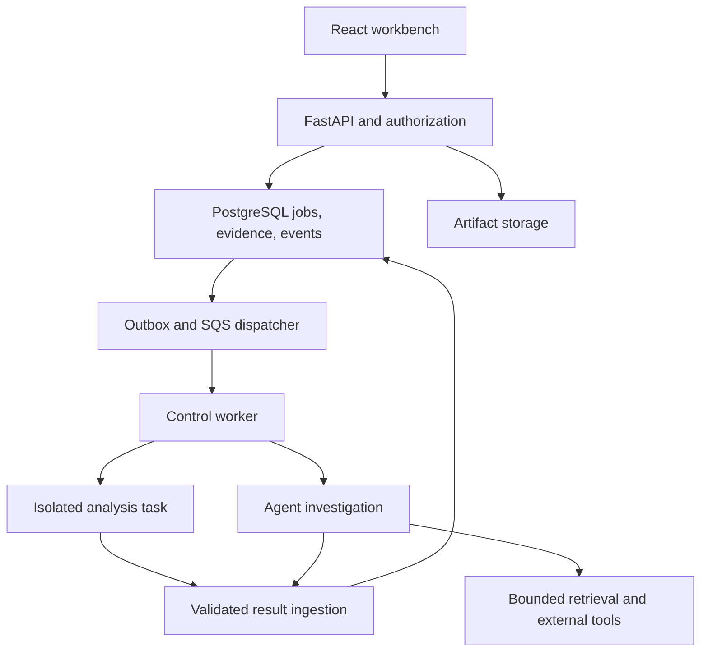

# CodeSPY: Technical Execution Blueprint

**Version:** 2.0 - planning baseline, 17 October 2026
**Product:** Open-source repository intelligence and agentic reverse-engineering platform, with an AWS-hosted SaaS edition.
**Implementation status:** This is a proposed architecture and component-level execution roadmap, not a claim of implemented or tested product capabilities. Each phase will receive a separate executable specification against the then-current code.

## 1. Product brief and starting evidence

### 1.1 Outcome

A developer connects a GitHub repository or uploads a source archive. CodeSPY inventories the admitted code, explains architecture and selected behavior, detects actionable problems, investigates follow-up questions with bounded tools, and returns recommendations with inspectable evidence. It distinguishes observed syntax, inferred relationships, runtime observations, unresolved questions, and unsupported coverage.

Primary users are individual maintainers and small engineering teams understanding unfamiliar repositories, auditing changes, and prioritizing improvements. First-class local operation is important for GitHub adoption and private-code evaluation. Hosted teams use the same analysis contracts with additional identity, tenancy, quotas, retention, and operational controls.

The first release is source-first, Python and JavaScript/TypeScript first, with explicit framework support for FastAPI, Express, and selected React patterns. Electron support is a focused extension. Other languages can appear in file inventories without implying semantic analysis. Native binaries and Android are later adapters, not prerequisites for the source product.

Success means useful explanations, actionable findings, defensible evidence, understandable limits, reliable completion, and repeat usage. Neither stars nor a large graph establishes analysis quality.

### 1.2 Inspected repository state

| Input                  | Inspected reference                                    | What is established                                                                                                                                           |
| ---------------------- | ------------------------------------------------------ | ------------------------------------------------------------------------------------------------------------------------------------------------------------- |
| CodeSPY                | `04de7aa4fbb5807de9e409bf82229d86b888e3b4`             | Default branch contains Phase 0 scaffolding, dependency/configuration files, setup checks, and documentation; application directories are placeholders        |
| CodeSPY branch listing | Remote branches visible during this review             | Main and dependency-update branches; no visible Phase 1 implementation branch was identified                                                                  |
| REA                    | `3ad1032b11edea2dcb054e78f951cc43159ae83d`             | Selected source modules and documentation inspected; package.json identifies 6.5.0, but this is a source commit, not a verification of published npm contents |
| Supplied PDF           | `codeopsy_agentic_reverse_engineering_master_plan.pdf` | Prior proposed architecture, eight-phase roadmap, and secondary-source claims; not implementation evidence                                                    |

The owner reports Phase 1 complete. Preserve that report as **owner-reported, remote implementation unverified**. Phase 1R below reconciles the actual completed code before any migration or replacement is proposed. A local/unpushed implementation may explain the discrepancy. Do not recreate it from an old plan merely because it is absent from main.

This review inspected architecture-relevant REA modules; it is not an exhaustive correctness/security audit, a reproduced benchmark, or a test run. No application tests, cloud deployment, credentials, or external workspace creation were performed for this plan.

### 1.3 Corrections to the supplied blueprint

- REA currently includes semantic graph projections, source/bundle comparisons, and runtime reconciliation. Describing it simply as a shallow literal matcher is inaccurate at the inspected commit.
- Its evidence contracts use explicit authority, coverage, limitations, and observed/derived/inferred distinctions. Do not flatten them into unsupported numerical certainty.
- The reconstruction ledger evaluates authority, fixtures, cases, bindings, dependencies, and contradictions. A linked evidence row alone is not equivalent.
- Retire unreproduced comparison charts, claims that CodeSPY already solves REA's measured failures, and impossible recall statements above 100%. Counts with incompatible denominators are not recall.
- `ts_rank_cd` is PostgreSQL cover-density ranking, not BM25. Call the initial branch PostgreSQL lexical search.
- A directory scan that reads every file remains proportional to bytes read even if later hash-tree comparison can prune unchanged subtrees.
- Parsing syntax does not produce a sound interprocedural dataflow engine. Graph reachability does not establish taint flow or feasible execution.
- Fargate and self-operated Firecracker are separate execution choices. Do not promise custom seccomp/privileged/microVM controls that the selected managed runtime does not expose.
- Backups, replication, and rollback reduce risk; they do not guarantee zero loss or instantaneous restoration.
- Context limits, model identifiers, prices, and provider availability belong in a versioned capability registry, not permanent architectural assumptions.

## 2. REA source audit and adaptation decisions

### 2.1 What to adapt

| Inspected REA source                                                                                    | Observed mechanism                                                                                                                | CodeSPY adaptation                                                                                                | Verification needed                                                                              |
| ------------------------------------------------------------------------------------------------------- | --------------------------------------------------------------------------------------------------------------------------------- | ----------------------------------------------------------------------------------------------------------------- | ------------------------------------------------------------------------------------------------ |
| `src/domain/evidence.ts`                                                                                | Strict evidence schema; subject digests; provider identity; normalized/raw result; linked records; semantic identifier validation | Versioned EvidenceRecord with immutable artifact identity, provider provenance, explicit derivation and redaction | Round-trip schema, digest tampering, mismatched provider, and lineage tests                      |
| `src/domain/relationshipCoverage.ts`                                                                    | Complete/partial/unknown caller/callee coverage, including missing-coverage limitations                                           | Operation-scoped coverage attached to every analyzer result; file and feature coverage shown separately           | Truncation and unsupported directions never render as full coverage                              |
| `src/application/AnalysisProvider.ts`                                                                   | Provider-neutral operations, cancellation/progress, readiness, close/cleanup ownership                                            | Python Protocol ports and bounded ToolRunner; worker-owned lifecycle with structured outcomes                     | Timeout, late completion, crash, and cleanup tests                                               |
| `src/application/javascript/JavaScriptSemanticGraphEvidence.ts`                                         | Exact syntax distinguished from inferred static relationships; explicit unresolved dynamic syntax                                 | Separate observed syntax edges and candidate semantic links; expose resolution basis                              | Ambiguous/dynamic fixtures preserve unknowns                                                     |
| `src/application/javascript/ElectronBoundaryGraphIpc.ts`                                                | IPC source/channel/handler nodes, literal versus dynamic channels, inferred pairings                                              | Scoped Electron adapter for renderer/preload/main boundaries, with ambiguous pairing visible                      | Aliases, wrappers, dynamic channels, multiple windows, and reply fixtures                        |
| `src/application/javascript/JavaScriptApplicationWorkflowService.ts`                                    | Validated evidence-fed feature tracing and application/source-bundle comparisons                                                  | EvidenceSlice and SnapshotComparison services; derive reports only from scoped validated inputs                   | Foreign snapshot references and altered evidence rejected                                        |
| `src/application/ReconstructionObligationLedgerEvaluation.ts` and `ReconstructionObligationPolicies.ts` | Required case kinds, authority checks, bindings, dependency/ownership diagnostics, residual unknowns                              | Claim-specific verification policy engine, plus an optional reconstruction ledger for future parity work          | Irrelevant evidence cannot satisfy verification; contradictions and missing cases remain visible |
| `src/process/ExecFileBoundedOutput.ts`                                                                  | Stream draining with bounded retained head/tail output and truncation signal                                                      | Asynchronous subprocess runner with bounded output, timeout, ownership, and structured error taxonomy             | Flooding stdout/stderr does not exhaust memory or hide truncation                                |
| `SECURITY.md`                                                                                           | Local user permissions remain a security boundary; provider isolation is not a sandbox                                            | Treat imported analyzers as untrusted-input processors; add separate SaaS worker isolation                        | Hosted worker threat model, not reliance on local CLI assurances                                 |

Keep the conceptual loop: **map the target -> trace a bounded question -> verify the intended claim**. For a source-analysis product, recreation is optional. Build evidence navigation and behavior explanations before automated code generation.

### 2.2 Reuse approach

Three approaches were considered:

1. **Rewrite every analyzer in Python:** uniform runtime but high semantic and maintenance burden; loses tested upstream behavior.
2. **Wrap REA wholesale as the product core:** fast breadth but tightly couples SaaS authority, lifecycle, and outputs to a local-tool project.
3. **Recommended: Python control plane with replaceable analyzer adapters.** Own tenancy, artifacts, jobs, evidence, retrieval, and UX. Use focused native Python analysis and a pinned REA sidecar where its tested capabilities are useful.

The REA adapter runs a pinned packaged build in an isolated worker, invokes only allowlisted CLI/MCP operations with explicit arguments, parses versioned JSON, records upstream version/commit/image digest, and converts results without discarding upstream limitations. Contract fixtures detect upstream schema drift. No `npx ...@latest` downloads in a live job. No arbitrary user-selected MCP endpoints.

REA-authored code is MIT at the inspected reference; preserve applicable copyright and permission notices for copied/substantial reused portions. Record each vendored file and change in `THIRD_PARTY_NOTICES.md`. Independently inventory licenses and distribution/hosting terms for tools, rules, datasets, and commercial providers. REA's license does not grant rights to every tool it invokes. This plan does not assert that every external rule pack is suitable for a competing hosted service.

## 3. Architecture decisions

### 3.1 Selected stack

| Concern            | Decision                                                                                    | Boundary/rationale                                                                                               |
| ------------------ | ------------------------------------------------------------------------------------------- | ---------------------------------------------------------------------------------------------------------------- |
| Backend            | Python 3.12 initially; FastAPI; Pydantic v2; SQLAlchemy async; Alembic                      | Retain the verified toolchain; upgrade in a dedicated compatibility change, not incidentally during feature work |
| Code organization  | Modular monolith plus isolated workers                                                      | Clear ports/adapters without premature network microservices                                                     |
| Database           | PostgreSQL 16 initially; pgvector server extension version verified separately              | Relational authority, bounded graph tables, lexical search, optional embeddings                                  |
| Artifact storage   | ObjectStore port: local filesystem and S3 implementations                                   | Original uploads and large outputs are not database BLOBs                                                        |
| Job transport      | SQS + DLQ; LocalStack SQS for local parity; DB job leases and outbox                        | One queue system; no simultaneous Celery/Arq/Redis Streams scheduler                                             |
| Agent workflow     | LangGraph with PostgreSQL checkpoints; direct Anthropic and Google SDK adapters             | Durable investigation state; not responsible for scheduling scanner processes                                    |
| Models             | Configurable Claude and Gemini roles behind ModelPort                                       | Exact allowed model IDs and capabilities validated when each phase starts                                        |
| Search             | Exact/path lookup + PostgreSQL lexical + pgvector + bounded graph expansion; RRF            | Start measurable and simple; Pinecone/OpenSearch only after a measured need                                      |
| Frontend           | React 19, TypeScript strict, Vite, Tailwind CSS, TanStack Query, React Router               | Keep existing package locks; no separate Next.js application server without need                                 |
| UI components      | Accessible primitives, e.g. Radix; Monaco lazy-loaded; Cytoscape.js for graph exploration   | Graph is optional; tables and text traces provide accessible equivalents                                         |
| Interface contract | Pydantic DTO -> OpenAPI 3.1 -> generated TypeScript using openapi-typescript; openapi-fetch | JSON is the wire format; generate types rather than manually duplicating them                                    |
| Streaming          | REST command + GET SSE event log + REST cancellation                                        | Durable ordered application events, not raw model thought streams                                                |
| Identity           | GitHub OAuth login using Authlib; opaque server-side sessions                               | GitHub App installations independently authorize repository access                                               |
| Infrastructure     | Terraform, preserving current repository direction                                          | Do not maintain CDK and Terraform for the same resources                                                         |
| AWS runtime        | ECS Fargate for API/control workers; per-job isolated analysis tasks                        | Runtime-execution profile designed separately; no Docker socket mounted into API                                 |
| Observability      | OpenTelemetry and structured logs; CloudWatch; optional redacted Langfuse                   | Raw source/prompts excluded by default from telemetry                                                            |
| Quality            | pytest, Hypothesis, Vitest/RTL, MSW, Playwright, axe-core, Ruff, mypy, ESLint               | Behavioral checks and real PostgreSQL integration, not implementation-mirroring tests                            |

Exact package versions come from current lockfiles and compatibility checks in each phase. Pin container images and rule packs by digest. Upgrade intentionally. Newest is not automatically compatible or necessary.

### 3.2 Control plane, analysis plane, and agent plane

The API authenticates users, checks repository permissions, creates jobs, serves bounded stored results, and streams progress. It never parses large codebases or executes submitted code in the request process.

The control worker claims a DB job, stages an immutable artifact, dispatches the appropriate isolated analyzer task, validates bounded results, and commits evidence. The analyzer receives only its admitted artifact and scoped output channel; it has no database credentials, LLM keys, or general cloud role. Staging and collection stay outside submitted-code execution authority.

The agent worker can call typed read-only services and approved verification operations. It consumes normalized evidence, not an unrestricted shell. Its LLM credentials never enter analyzer environments. Browser/external-search egress uses a separate restricted service.



### 3.3 Future module map

Paths are intended responsibilities; reconcile with Phase 1 before adding or renaming modules.

```text
backend/app/
  api/v1/                 REST routes and authorization dependencies
  contracts/              Versioned request, response, job and event DTOs
  domain/                 Artifact, finding, evidence and verification types
  services/               Ingestion, analyses, investigations and comparisons
  ports/                  ObjectStore, Queue, Analyzer, Model, Search, Runner
  adapters/               S3/local, SQS, GitHub, REA, scanners and model SDKs
  analyzers/              Language and framework extraction
  core/dsa/               Pure graph algorithms and bounded traversals
  db/ models/ repositories/ Existing Phase 1 persistence, adapted incrementally
  retrieval/              Chunking, indexing, fusion and context assembly
  agents/                 LangGraph state, nodes, policies and checkpoints
  workers/                Lease handling, dispatch, heartbeat and cleanup
  security/               Sessions, CSRF, policy and redaction
  observability/          Trace, metric and logging conventions
frontend/src/
  api/generated/          Generated types; never manually edited
  features/               Repositories, analyses, findings, evidence, investigations
  components/             Accessible shared controls
  routes/                 Route-level screens, loaders and error states
contracts/                Exported OpenAPI and event JSON Schemas
tests/fixtures/           Small labeled targets with manifests
evals/                    Retrieval, analysis and agent benchmark runners
infra/terraform/          Environment modules, separated state and account policy
docs/adr/                 Architecture decisions and capability declarations
```

## 4. Shared contracts and invariants

### 4.1 Identity and persistence

- Every hosted data access is scoped by organization and checked repository access. A guessed UUID is never authority.
- Snapshots are immutable: repository ID + source revision/archive digest + admission/configuration hash. A report also identifies analysis run and tool/rule/prompt versions.
- Node IDs are snapshot-scoped, e.g. `(snapshot_id, local_node_id)` composite keys. `local_node_id` derives from normalized path, kind, and source range, with collision checks. A separate symbol key is for cross-version matching, not primary-key reuse.
- Graph edge endpoints reference the same snapshot via composite foreign keys. Include operation/provider identity where multiple evidence-supported relationships between the same endpoints are meaningful.
- Source ranges use original artifact bytes. Store byte offsets and explicitly documented line/column conventions; test Unicode and CRLF mapping.
- Evidence is append-only. Redaction, supersession, and retention actions retain metadata needed to explain a missing payload. Deleting retained support invalidates dependent verification state.
- Findings, observations, and recommendations are separate entities. A recommendation is not a discovered vulnerability. Severity, confidence, verification state, and coverage are independent fields.
- Evidence digests detect altered content; they do not prove the producer was trustworthy or the claim is true.

### 4.2 Core wire objects

| Object             | Required information                                                                                                                                                       |
| ------------------ | -------------------------------------------------------------------------------------------------------------------------------------------------------------------------- |
| ArtifactManifest   | schema_version, organization/repository/snapshot IDs, artifact digest, normalized files and sizes, exclusions, limits, source revision                                     |
| AnalyzerResult     | schema_version, run_id, analyzer identity/version/config/image, admitted inputs, observations, candidate edges, diagnostics, scoped coverage, output references            |
| EvidenceRecord     | id/digest, snapshot, provider, operation, observation mode, exact locations, normalized payload or object reference, parent evidence, limitations, redaction, capture time |
| Finding            | rule/family, title, severity and basis, affected locations, support IDs, verification status/method, remediation, fingerprint and state                                    |
| InvestigationState | run/snapshot/principal, question, plan, evidence IDs, hypotheses, unresolved questions, budgets, tool-result references, current node, resume state                        |
| ReportClaim        | statement, category, supporting evidence IDs, verification disposition, counterevidence, qualifications                                                                    |
| JobEnvelope        | schema_version, job_id, organization/snapshot IDs, operation, configuration hash, deadline; no credentials or source in queue payload                                      |
| ProgressEvent      | schema_version, run_id, sequence, event_type, timestamp, public payload; monotonically ordered within run                                                                  |

Use enums/discriminated unions for structured states; free text describes a diagnostic, never defines executable action. Validate tool outputs as strictly as user inputs. Schema migrations and event compatibility require tests.

### 4.3 Lifecycle rules

`queued -> running -> completed | partial | failed | cancelled`; a running job may enter `cancelling`. Retries are attempts within a job, not silent resets of user history. A cancelled or timed-out worker can still write late output: fencing tokens must reject stale finalization.

Coverage records total admitted files, processed files, parse failures, ignored files, unsupported language/features, truncation, and runtime scenarios exercised. Local operation-complete does not mean repository-complete or behavior-complete.

Use snapshot status `ready` for valid available analysis data, not for an absence-of-bugs guarantee. Reports say: "No qualifying issues were detected within the completed checks," with the checks and omissions visible.

## 5. Phase map and dependencies

Preserve existing Phase 0/1 history. Phase 1R is an additive reconciliation gate. The numbering below replaces future numbering from the supplied PDF; do not keep two competing future roadmaps.

| Phase | Deliverable                                           | Hard prerequisites           | Release outcome                           |
| ----- | ----------------------------------------------------- | ---------------------------- | ----------------------------------------- |
| 0     | Existing setup                                        | Existing                     | Preserve                                  |
| 1     | Owner-reported database implementation                | Existing                     | Inspect actual implementation             |
| 1R    | Foundation reconciliation and shared contracts        | Actual Phase 1 reference     | Accepted persistence baseline             |
| 2     | Safe ingestion, identity, jobs and artifact lifecycle | 1R                           | Local upload-to-inventory vertical slice  |
| 3     | Source structure and scoped graph engine              | 2                            | Useful architecture report without an LLM |
| 4     | Deterministic findings and verification ledger        | 3                            | Cited issue report with coverage          |
| 5     | Hybrid retrieval and context assembly                 | 3, evidence contracts from 4 | Evaluated repository navigation           |
| 6     | Durable multi-step agents and model routing           | 4, 5                         | Cited repository investigations           |
| 7     | Accessible workbench, CLI/MCP and source alpha        | 6; UI shell begins in 2      | Public local source-first alpha           |
| 8     | Optional controlled runtime/browser verification      | 7; sandbox gate              | Selected verified scenarios               |
| 9     | Optional Electron/binary adapters                     | 7; per-provider readiness    | Separately labeled target support         |
| 10    | AWS hosted beta and operations                        | 7 plus isolation/cloud gates | Hosted source analysis beta               |
| 11    | Team SaaS and continuous GitHub intelligence          | 10                           | Commercial product readiness              |
| 12    | Advanced semantics, scale and optional training       | Usage/evaluation evidence    | Capability expansion by measured need     |

Phases 8 and 9 are optional capability tracks: they do not block a source-only Phase 10 launch. Their capabilities remain off in SaaS until their own isolation and quality gates pass. Security, fixtures, metrics, documentation, and observability start in 1R/2, not at launch.

## 6. Phase 1R - reconcile the foundation

### 1R.1 Inspect the completed implementation

**Paths:** actual migrations, models, repositories, configuration, CI, and Phase 1 tests.
**Steps:** obtain the commit/branch or local checkout; read repository instructions; inventory existing tables, keys, enums, indexes, and dependencies; compare them to section 4; execute the existing documented local checks when development is authorized. Record facts and gaps in an acceptance matrix.

**Output:** `docs/adr/0002-phase1-reconciliation.md` and a schema/contract diagram. Preserve existing migrations; changes use new revisions. Do not use `create_all()` from evolving runtime metadata as historical migration logic.

**Gate:** verified commit and test outputs identify accepted behavior. If the reference is unavailable, keep Phase 1 status unverified and complete only independent planning work.

### 1R.2 Repair identity and integrity through explicit migrations

**Logic:** snapshot-scoped nodes and composite edge foreign keys; organization membership; immutable snapshot references; unique run attempt/fingerprint constraints; bounds for ranges and scores; separate claim status from evidence existence. Add indexes only for concrete query shapes. Batch ingestion writes staging data and publishes readiness atomically; readers cannot observe half-built graphs.

**Failure handling:** migration fails safely on incompatible historical data; supply backfill/validation and an expand-contract rollout. Never drop user data just to fit the plan.

**Tests:** two repositories with identical paths; two snapshots with unchanged symbols; cross-snapshot edge rejection; concurrent inserts; rollback after partial batch failure; replay old migration chain against an empty real PostgreSQL database.

### 1R.3 Define domain ports and generated contracts

**Paths:** `domain/`, `ports/`, `contracts/`, `contracts/openapi.json`.
**Logic:** dataclasses/Protocols for pure algorithms and infrastructure boundaries; Pydantic for external validation; ORM classes stay inside persistence. Establish nullable fields, pagination, error codes, and version rules before frontend codegen.

**Gate:** artifact/analyzer/evidence/job/event contract fixtures validate; generated TypeScript compiles; intentional schema changes produce a visible diff.

### 1R.4 Establish quality and architectural fitness checks

**Logic:** PR CI runs locked dependency install, changed-domain tests, lint, type checks, secret scan, and database integration. Pure DSA imports cannot depend on FastAPI, SQLAlchemy, or SDK clients. Dependency audit exceptions require an owner and expiry. Avoid a blanket coverage percentage as proof of correctness.

**Gate:** required checks execute real application assertions, not only directory/package existence. Build source-distribution/container smoke checks when those artifacts first exist.

## 7. Phase 2 - safe admission, identity and job execution

### 2.1 Minimal API and identity boundary

**Paths:** `api/v1/{sessions,repositories,uploads,analyses}.py`, `security/{sessions,authorization,csrf}.py`.
**Logic:** GitHub OAuth authorization-code login with state and provider checks; opaque random session token stored hashed in DB; rotate after login/privilege changes; revoke on logout. Cookies are HttpOnly, Secure in hosted HTTPS, host-scoped, and SameSite appropriate to deployment. State-changing browser requests require CSRF protection. Local development has an explicit loopback-only owner mode, unavailable in hosted configuration.

GitHub login and GitHub App installation are independent. The API checks user organization/repository access on every resource, artifact download, graph lookup, job, SSE connection, and export. Repository installation grants do not automatically give every signed-in user access.

**Gate:** session fixation, expired state, role change, cross-tenant lookup, revoked membership, and CSRF tests pass. A minimal UI shell can authenticate, create an upload, and display job status.

### 2.2 Upload and GitHub acquisition

**Paths:** `services/ingestion.py`, `adapters/github/`, `adapters/object_store/`, `security/archive_admission.py`.
**Logic:** reserve an upload record and byte quota; use a generated object key; upload to quarantined storage; verify actual size/type/digest before admission. Initial admission defaults: 100 MiB compressed source archive, 1 GiB expanded data, 50,000 entries, 2 MiB per parsed source file, nesting depth 32. These are product guardrails, configurable and subject to representative-corpus validation. Report exclusions; never silently claim full analysis.

Reject absolute/traversal paths, symlinks/hardlinks, device entries, duplicate normalized paths, unsafe Unicode/path collisions, archive expansion bombs and nested archive recursion. Parse archive headers before allocating large output. Use a private work directory, never a user-controlled destination.

For GitHub: app installation token with minimal permissions; snapshot an exact commit; obtain archives or a controlled clone without hooks/submodules/LFS/network fetches unless explicitly supported. Use GitHub API-defined download redirects with bounded origin policies, not arbitrary supplied URLs. Validate webhook signatures and deduplicate delivery IDs. Handle token expiry and installation removal. Do not persist tokens in repository URLs, logs, or worker artifacts.

**Gate:** malicious archive fixtures and admission-limit tests; private-repository authorization fixtures; webhook duplicate/revocation tests; upload-to-inventory flow succeeds through the API.

### 2.3 Job scheduler, lease and outbox

**Paths:** `workers/`, `services/jobs.py`, `adapters/queue/sqs.py`.
**Logic:** transactionally create job + outbox; dispatcher publishes SQS message; consumer claims with compare-and-swap lease and fencing token; heartbeat extends DB lease and SQS visibility; commit results before acknowledging. Duplicate deliveries observe existing terminal state. Recovery sweep republishes stranded work. A stage idempotency key combines snapshot, operation, analyzer version and configuration hash.

Use bounded attempts with jitter for transient errors; deterministic parse/admission errors are not endlessly retried. Exhausted jobs enter DLQ with a redacted diagnostic. Cancellation sets durable intent, interrupts owned processes/tasks, and rejects late stale commits.

**Gate:** duplicate delivery, crash before/after commit, queue outage, expired lease, double consumer, cancellation and SIGTERM scenarios. No exactly-once claim; effects are idempotent over at-least-once transport.

### 2.4 Artifact and provider execution boundary

**Paths:** `ports/runner.py`, `adapters/runners/`, `services/artifacts.py`.
**Logic:** executable names/images come from an allowlist; arguments are arrays; no shell interpolation or repository-selected executable plugins. Minimal environment, bounded CPU/memory/disk/output/deadline, explicit termination and cleanup. Store truncated raw output separately with a truncation marker. Validate normalized output before persistence.

Local process execution is for trusted development fixtures; it is not equivalent to hosted isolation. Untrusted parser tasks run in dedicated restricted containers/tasks. Never share mutable work directories between tenants. Source processors have no LLM/service credentials.

**Gate:** malicious filename, stdout flood, malformed JSON, parser crash, timeout, process-tree cleanup, partial-output and stale-output rejection tests.

### 2.5 Inventory and durable progress

**Logic:** emit admission and indexing events into an append-only `run_events` log with `(run_id, sequence)` uniqueness. Polling reads a canonical job representation; SSE will consume the same event log. Publish a manifest with content digests, detected language, admitted/excluded reason, and parser readiness.

**Demo:** upload a small repository; inspect the manifest and job events without an LLM or cloud account.

## 8. Phase 3 - structural source analysis and DSA

### 3.1 Parser registry and syntax extraction

**Paths:** `analyzers/languages/{python,typescript}.py`, `analyzers/registry.py`.
**Logic:** pin compatible Tree-sitter runtime/grammars; extract modules, classes, functions, exports/imports, calls, and locations. Keep parse ERROR/missing nodes and oversized files in diagnostics. Normalize language output into typed records, not a giant arbitrary JSON graph. Python built-in AST can supplement semantic extraction where appropriate.

**Tests:** comments/docstrings, nested definitions, decorators, async code, Unicode, CRLF, TSX, destructuring, parse errors and partial files. Grammar-supported is distinct from analyzed-language-supported.

### 3.2 Scope and symbol resolution

**Paths:** `analyzers/symbols/`, optional bounded TypeScript compiler sidecar.
**Logic:** scope stack and lexical bindings first; explicit imports/exports and relative module resolution second; framework/dependency context third. Resolve Python packages and selected tsconfig path aliases from parsed configuration. Never execute config modules. Ambiguous calls produce candidate targets and reasons, not a closest-directory winner presented as fact.

Record call-site nodes separately from enclosing functions; edges identify actual sites. Dynamic imports, monkey patching, reflection, DI and computed members remain unresolved unless an adapter supports them. Semantic checker use must have its own resource budget and safe configuration policy.

**Gate:** shadowing, aliases, same-name methods, re-exports and dynamic dispatch fixtures with exact expected resolved/ambiguous/unresolved states.

### 3.3 Graph storage and algorithms

**Paths:** `core/dsa/{graph,traversal,scc,condensation}.py`, graph repository.
**Logic:** directed labeled multigraph with stable adjacency indexes and provenance-bearing edges. Bounded iterative BFS/DFS returns nodes, edges and truncation. Tarjan/Kosaraju SCC runs over a selected relation family; import cycles and call recursion are separate analyses. Condense SCCs and topologically order module summaries.

Enforce node/edge/frontier limits; never enumerate all paths on a large graph. Start with adjacency maps and PostgreSQL bounded queries. Add CSR compilation after measured memory/traversal evidence. SCC size or PageRank is a structural metric, not a demonstrated defect.

**Gate:** compare graph algorithms to NetworkX on generated small graphs; deterministic output ordering; large/deep/cyclic fixture termination. SQL query plans measured on representative graphs, without requiring one exact planner node on tiny test data.

### 3.4 Framework boundary mapping

**Paths:** `analyzers/frameworks/{fastapi,express,react_http,electron}.py`.
**Logic:** extract FastAPI router mounting/prefixes and dependencies; Express routers/middleware registrations; frontend fetch/axios method/base URL/path templates. Link only when origin/service/method/path evidence supports the relationship. Store unmatched and multiple matches. Parameterized route trie is an optimization, not proof of service identity.

Electron tracks renderer/preload/main, contextBridge APIs, literal/resolved channels, listeners and reply directions. Prefer the REA adapter for tested JS/Electron patterns where practical. Keep Node/browser/service graphs distinguished by runtime context.

**Gate:** tests for router prefixes, multiple services exposing the same path, aliases, callback wrappers, dynamic URLs/channels and reply-back flows. No 100% worldwide pairing claim.

### 3.5 Architecture report and initial full rebuild

**Logic:** derive entry points, modules, dependencies, framework boundaries, cycles and unresolved areas from stored records. Use deterministic templates first. Publish snapshot + analysis run only after staged outputs validate. Full rebuild is the initial truth baseline; maintain content hashes for future reuse.

**Demo:** a React/FastAPI fixture yields an architecture overview, candidate request trace and source links. No vulnerability or runtime-flow claim is inferred merely from connected nodes.

## 9. Phase 4 - deterministic findings and verification

### 4.1 Scanner adapters

**Paths:** `adapters/scanners/{semgrep,gitleaks,osv}.py`.
**Logic:** run pinned Semgrep CE with reviewed local rules; Gitleaks with secret-value redaction; OSV-compatible package/version matching from lockfiles. Store tool/rule/database versions, input scope, exit semantics, raw output digest and normalized findings. Fetch vulnerability metadata through the restricted external service, or use a versioned offline cache.

Do not install target dependencies or run package hooks to discover versions. Distinguish manifest ranges, lockfile resolutions, dev/runtime dependencies and unsupported ecosystems. An affected version is not proof of exploitability. CE is not a free replacement for proprietary cross-file analysis; rules and engine have separate terms.

**Gate:** pinned fixtures yield expected findings and expected non-findings; malformed/timeout outputs are partial/failed, never empty success. Secret material does not appear in reports, logs, embeddings or LLM inputs by default.

### 4.2 Normalization, deduplication and triage

**Paths:** `services/findings.py`, `domain/finding.py`.
**Logic:** fingerprint by rule family, normalized location/symbol and relevant semantic context. Preserve per-tool observations and merge only demonstrably equivalent findings. Severity has a source/basis; do not average arbitrary scores. Triage states: open, acknowledged, dismissed-with-reason, fixed-in-snapshot and stale/unassessed.

**Gate:** concurrent scan deduplication, overlapping rules, moved code and different vulnerable sinks do not silently collapse into one record.

### 4.3 Claim-specific verification policies

**Paths:** `services/verification.py`, `domain/policies/`.
**Logic:** map claim category to required evidence: syntax observation -> exact parser span; version exposure -> lockfile plus advisory; candidate dataflow -> supported dataflow engine/path or explicit hypothesis; runtime scenario -> test input, environment, capture and result. Store who/what verified, method version, snapshot and counterevidence.

Lifecycle: proposed -> supported-static | verified-scenario | contradicted | unresolved; allow stale when support changes. Database invariants check links/identity; policy service checks admissibility. A second model agreeing does not turn a claim into verified evidence.

Reconstruction parity obligations remain an optional extension with positive, negative, malformed, cancellation and teardown cases as applicable. Do not create an obligation for every function unless there is a defined reconstruction task.

**Gate:** irrelevant/missing evidence, different-snapshot support, deleted support, failed verifier, contradiction and empty obligation set cannot yield verification/closure.

### 4.4 Issue report and evaluation corpus

**Logic:** report prioritized findings with affected paths, evidence, remediation, uncertainty and coverage. Recommendations have expected benefit, trade-off, estimated effort category and goal alignment; label speculative advice. Select an initial bounded fixture corpus with at least 20 positive and 20 negative cases per advertised detector category, adding diversity before making general claims. Freeze held-out targets by repository lineage to reduce near-duplicate leakage.

**Gate:** publish per-category precision/recall with raw TP/FP/FN counts and scope, not a single global score. Any quality threshold is a release decision, not a retrospective description of achieved quality.

## 10. Phase 5 - retrieval, context and memory

### 5.1 Chunk and index lifecycle

**Paths:** `retrieval/{chunking,indexing,embedding_registry}.py`.
**Logic:** symbol-aware chunks with bounded token size; split large symbols while retaining parent, signature, exact source span and content digest. Store embedding provider/model/revision, dimensions, normalization and chunker version. Choose one embedding profile using a code-retrieval benchmark; do not hard-code 1536 merely because the old schema did.

Use separate compatible indexes/tables for incompatible embedding profiles and an explicit reindex job. Graph changes can invalidate contextual headers even when file content is unchanged. Keep raw code and derived summaries distinct.

**Gate:** range correctness, large function splitting, model change/reindex, retry idempotency, deleted-file cleanup and no cross-tenant cache reuse.

### 5.2 Hybrid search and bounded expansion

**Logic:** exact symbol/path lookup, identifier-aware lexical search (`simple` FTS plus trigram where measured), dense search, then RRF over ranked candidate lists. Generate deterministic tie-breakers. Expand 1-2 hops along explicitly chosen edge types within a node/token budget, recheck access, and rerank. State truncation.

Benchmark lexical-only before embeddings. PostgreSQL lexical ranking is not BM25. pgvector HNSW filters and iterative scans have recall/latency trade-offs; compare approximate retrieval against exact retrieval on held-out scoped queries. Half precision reduces vector storage, not automatically total index memory by exactly 50% or recall loss to zero.

**Gate:** fixture-based relevant chunk labels, Recall@k/MRR/nDCG and latency measurements; per-query class reporting; tenant/snapshot authorization applied to all branches before content is returned.

### 5.3 Context assembler

**Logic:** reserve output/tool budget; retrieve only the necessary code and evidence; deduplicate overlapping ranges; add call-site and definition context; include unknowns and contradictions; replace large tool results with references and bounded excerpts. Untrusted content is data and cannot alter tool authority. Provider-specific token accounting is advisory plus server limits, not one tokenizer assumed correct for every model.

**Gate:** overlong input, adversarial comments/docs, duplicate chunks, missing evidence and overflow produce controlled outcomes; evidence IDs survive summarization.

### 5.4 Memory with explicit scope

**Logic:** working memory = current graph state/checkpoint; episodic memory = scoped investigation history; semantic memory = versioned repository facts/summaries; procedural memory = reviewed versioned tool policies. Cache entries are not evidence and expire on policy/snapshot/profile change. Persistent memory requires organization/repository/snapshot scope and deletion rules.

Implement working + repository semantic memory first. Add episodic reuse only after evaluation shows benefit. Procedural memory is maintainer-reviewed configuration, never agent-written system instructions. No private cross-customer learning by default.

**Demo:** retrieve the request handler, caller and relevant configuration for a cross-file question, showing why each excerpt was selected and which area remains unresolved.

## 11. Phase 6 - agent investigations and smart routing

### 6.1 Durable investigation state machine

**Paths:** `agents/{state,graph,nodes,policies}.py`.
**Logic:** LangGraph nodes implement classify-question -> plan -> retrieve/map -> inspect -> evaluate support -> answer or bounded follow-up. This is a cyclic bounded state machine, not a strictly acyclic workflow pretending to support arbitrary loops. Use PostgreSQL checkpoints, immutable snapshot identity, typed state and recorded tool-call IDs.

A single investigator with a verification stage is the baseline. Add specialist parallel branches only for independent, bounded subquestions with measured benefit. Queue workers own process scheduling; LangGraph owns reasoning state. Checkpoints do not make external effects exactly once: tool calls have idempotency and fencing.

**Gate:** crash/resume, checkpoint schema version, repeated node execution, changed permissions, stale snapshot and step-budget exhaustion; no duplicate side effects.

### 6.2 Model gateway and routing policy

**Paths:** `adapters/models/{anthropic,gemini}.py`, `agents/router.py`.
**Logic:** shared request/result contracts normalize text, structured output, tool requests, finish reasons, usage and errors while preserving provider-specific metadata. Maintain configured model roles: economical extraction/summarization, standard investigation, escalation for difficult synthesis. Capability registry records context/output limits, supported tool/schema features, data policy, timeout and price-version reference.

Route by task requirements, measured quality, admitted data policy and remaining budget, not "largest repository -> dump all files into largest context". Rate-limit by organization and provider; exponential backoff for retryable failures; circuit breakers; bounded fallback. A fallback cannot silently send private code to an unapproved provider. Retain evidence/schema contracts across model switches.

**Gate:** mocked provider contract tests plus small owner-key live qualification when authorized; 429/5xx/timeout, invalid schema, unknown model, token overflow, incompatible tool response, cost ceiling and privacy-policy fallback tests.

### 6.3 Tool registry, search and browser boundaries

**Logic:** read_file_range, search_symbols, graph_neighbors, inspect_finding, retrieve_docs and inspect_artifact are narrow typed tools. A signed-in user's authority is fixed server-side; repository/web text cannot expand it. Tool names, path scopes, URL policies, deadlines and maximum output are enforced outside the model.

External lookup order: official docs/advisories -> relevant upstream source -> broader search. SearXNG is optional self-hosted discovery, not a guaranteed free availability/SLA. HTTP reads use DNS/IP/redirect checks and block internal/link-local/metadata addresses, including IPv6 and redirect rebinding. Credentials and private identifiers are removed from public search queries. Returned pages are untrusted and cited with URL/time/content digest.

Playwright/CDP runtime interaction belongs to Phase 8. Basic public-page extraction is a bounded HTTP service; no agent-controlled browser session with owner credentials. Composio is optional integration infrastructure, not an unrestricted agent tool catalog.

**Gate:** prompt injection through README/comments/web snippets, SSRF, tool escalation, oversized result, forbidden cross-repository access and accidental secret-query leakage tests.

### 6.4 Answer assembly and verification

**Logic:** structured ReportClaims refer to evidence IDs; deterministic citation/range checks run first; verifier checks whether evidence supports the intended assertion. Unsupported claims are removed, qualified, or returned as open questions. Model self-critique is a heuristic, not proof. No raw chain-of-thought is stored or displayed; users see concise plan/status, tool actions, evidence and conclusions.

**Gate:** wrong-citation fixtures, plausible unsupported claims, contradictory code and runtime records, and insufficient evidence require abstention/qualification. Record answer relevance, citation correctness, claim support, failure rate, cost and latency across multiple runs.

### 6.5 Agent evaluation and demo

Use a versioned question set covering architecture, feature trace, bug explanation, security triage and future improvement suggestions. Compare: lexical/template baseline, one-shot model with retrieval, and multi-step investigator. Keep train/dev/test target lineages separated. Human review of a stratified sample remains necessary; LLM judges supplement it.

**Demo:** investigate "How does uploaded input reach this API operation?" and "Which evidence supports the suspected issue?" with source links and a visible unresolved branch. Release only if added steps improve utility enough to justify cost/latency.

## 12. Phase 7 - workbench and public source alpha

### 7.1 API product contract and resumable SSE

**Routes:** `/api/v1/repositories`, `/uploads`, `/snapshots`, `/analyses`, `/findings`, `/evidence`, `/investigations`, `/runs/{id}/events`; object-specific subroutes as needed. Commands create work and return `202` + resource reference; reads are bounded/cursor-paginated; cancellation is a command, not dropping an SSE connection.

**Logic:** generate types from actual FastAPI schema; check compatibility in CI. SSE supports Last-Event-ID, heartbeat, replay after reconnect, and an explicit expired-cursor response requiring a state refresh. Persist events before notification. Redis pub/sub can notify live consumers later but is not the replay source. Native same-origin EventSource can use session cookies; don't put bearer tokens into query strings.

**Gate:** unauthorized stream, revoked access during long streams, reconnect, duplicate/out-of-order events, expired replay retention, proxy idle timeout, slow consumer and server restart tests.

### 7.2 User journeys and responsive UI

**Screens:** repository connection/upload; snapshot overview; architecture/file explorer; prioritized findings; evidence/code detail; investigation; run history; retention/provider settings. Build loading, empty, partial, failed, cancelled and permission-denied states for each flow.

**Logic:** TanStack Query owns server state; URL owns shareable filters/selected IDs; local component state owns transient UI. React renders escaped content. Markdown is sanitized with raw HTML off; links and downloaded artifacts have controlled handling. CSP and server content-type/download headers supplement frontend protection.

Use semantic HTML, keyboard navigation, visible focus, announced status updates, reduced motion and accessible table/text alternatives to graph views. Desktop can use a three-pane layout; mobile uses tabs/stacked views. Lazy-load Monaco and graph rendering; never render an entire large repository graph at once.

**Gate:** RTL/MSW interaction/error-state tests, Playwright upload-to-answer journeys, keyboard/manual screen-reader checks and automated axe checks. Zero automated violations alone is not a full WCAG conformance claim.

### 7.3 Design and prototype handoff

Figma can hold the reviewed screen layouts and component states; Miro can hold the architecture/dependency map. Lovable may accelerate a frontend prototype against fixtures and the generated API contract. The canonical implementation remains the CodeSPY repository. Do not introduce a second Supabase backend or cloud authority through a prototype tool.

If code is generated through Lovable, review the diff, integrate into the existing frontend, run its checks and remove placeholder auth/data logic before calling it complete. Design acceptance includes all error/partial/coverage states, not only a polished dashboard. Tool availability is not a requirement to create new external projects during planning.

### 7.4 CLI, MCP and local distribution

**Logic:** thin `codespy analyze`, `codespy investigate` and `codespy doctor` commands call the same services; optional MCP read tools expose the same authorization/limits. Initial local MCP uses stdio and explicit configured workspaces; hosted remote MCP is separately scoped and authenticated. JSON outputs are versioned. Compose profiles start required services; scanners are pinned images with notices.

**Gate:** clean Linux install from tagged release, fixture analysis, JSON contract, missing-provider diagnostics and uninstall/cleanup documentation. Define macOS/Windows support only after testing those paths. Local static mode works without LLM keys; investigations clearly state when a configured provider is required.

### 7.5 Public alpha release

Publish a sample repository, recorded reproducible walkthrough, architecture docs, supported-capability matrix, fixture results, cost methodology, contribution guide, code of conduct, security-report path and changelog. Mark optional runtime/binary capabilities experimental/off by default. An alpha user should independently connect/upload, obtain a useful result, inspect evidence and understand limitations.

**Exit:** source-only local alpha is usable by external testers. Hosted private-code ingestion is not enabled until Phase 10 controls pass.

## 13. Phase 8 - optional controlled runtime verification

### 8.1 Scenario contract and sandbox profile

**Paths:** `domain/runtime_scenario.py`, `adapters/runners/runtime/`.
**Logic:** owner-approved scenario defines artifact, image, argv, allowed environment, fixture data, network destinations, resources, deadline and expected observations. Building dependencies is code execution: installation/build/test steps run only inside this profile. Package-manager hooks are never run on API/control hosts. Generated tests are untrusted executable artifacts too.

Separate broker stages inputs and collects outputs. Target process receives no LLM keys, cloud credentials, DB access or owner browser state. Task role is absent for the untrusted execution task where feasible; tightly scoped transfer channels are controlled by the broker. No same-task credential-bearing sidecar whose privileges the target can reach. Run one job per task; destroy work directories after collection. Metadata, internal APIs and uncontrolled internet are blocked/tested.

Fargate capability constraints must be checked explicitly. If required syscall/network controls cannot be enforced there, use a separately designed EC2 microVM runner with dedicated threat model, images, host hardening and cleanup; do not claim Firecracker is a Fargate configuration toggle.

**Gate:** attempted credential access, egress, resource exhaustion, fork/output flood, timeout, cancellation and leftover-resource tests. Until passed, runtime capability stays disabled for untrusted hosted targets.

### 8.2 Browser observation

**Logic:** Playwright launches a fresh context against the admitted target in the runtime environment; collect bounded HAR/network events, console, DOM/accessibility snapshots and optional screenshots. Correlate actions and requests by scenario/event IDs. Never reuse owner's signed-in browser. Redact headers, cookies, form data and sensitive payloads before persistence/model access.

**Gate:** browser context teardown, redirect restrictions, scenario timeout, flaky capture and private-data redaction fixtures. A recorded successful scenario establishes only that scenario's observation.

### 8.3 Static/runtime reconciliation

**Logic:** compare candidate routes/calls with observations using artifact identity and scenario metadata. Distinguish observed, not exercised, contradicted and unresolved. A path absent from one trace is not unreachable. Preserve raw capture reference and derivation.

**Demo:** confirm one feature path, show an unexercised alternative, and demonstrate a contradiction remaining visible in the report.

## 14. Phase 9 - optional Electron, bundle and binary adapters

### 9.1 Packaged JavaScript and Electron

**Logic:** pinned REA adapter admits ASAR/extracted bundles, inventory/source maps and Electron boundaries; normalize evidence and preserve original byte/location provenance through source-map recovery. Enforce expanded-size/path/decompression limits and distinguish bundle inference from exact source attribution.

**Gate:** source versus bundle fixtures, malformed ASAR/source maps, missing sources, ambiguous channels and image/provider-version changes. No blanket parity or recovered-original-source claim.

### 9.2 WASM and Android

**Logic:** WABT validates and inventories imports/exports/functions; JADX adapter inventories manifest/classes/methods and decompiled locations. Keep decompiled pseudocode separate from source and original instructions. Missing tools return unavailable, not empty success. No code execution merely to inventory.

**Gate:** known producer-built fixtures, malformed artifacts, timeout/heap/output limits, return-code checking, original digest and cleanup. Provider-specific memory requirements are measured; they do not inherit source-parser defaults.

### 9.3 Native binary analysis

**Logic:** headless Ghidra first for free-tool baseline; optional REA-supported adapters later. Cap import/analysis time, use ephemeral projects, store original binary digest, address space and architecture, and normalize symbols/xrefs/pseudocode with provider limitations. Native call relationships must not be confused with exact recovered source behavior.

**Gate:** small compiled fixtures with source-grounded expected exports/calls, stripped/optimized variants, startup failure, crash, cancellation, temporary-project cleanup and tool-license inventory. Commercial tools are owner-supplied optional integrations, not automatically provisioned SaaS dependencies.

### 9.4 Adapter compatibility matrix

Publish target/format, provider version, tested host, analysis scope, unavailable operations, isolation profile, output schema and quality fixtures. Add one adapter at a time. Every adapter passes the common AnalyzerPort contract suite plus its format-specific tests.

## 15. Phase 10 - AWS hosted beta and operational readiness

### 10.1 Infrastructure topology

**Paths:** `infra/terraform/modules/{network,storage,database,queue,ecs,observability,edge}/`, `environments/{staging,prod}/`.
**Logic:** separate environment state and credentials; encrypted/versioned remote Terraform state; ECR image digests; Route 53 + ACM + CloudFront; private S3 frontend origin; `/api/*` to ALB/FastAPI with caching disabled and SSE-compatible forwarding/timeouts. RDS PostgreSQL in private subnets, S3 quarantine/result buckets, SQS queues/DLQs, Secrets Manager, KMS, CloudWatch and CloudTrail. Add WAF rules and rate limiting appropriate to observed traffic.

Use ECS Fargate API/control/agent services with separate IAM roles; analyzer tasks isolated by job. `awsvpc`, supported CPU/memory pairs and separate execution/task roles are explicit. NAT/endpoint/LLM egress costs and permissions must be designed; don't claim private subnets provide all networking automatically. A separate constrained external-fetch service handles internet reads.

Do not provision "all AWS services." ElastiCache, RDS Proxy, OpenSearch and multi-region databases require measured justification. S3/SQS/RDS/ECS are sufficient for the initial topology. Owner still manages AWS account access and service keys; this plan authorizes architecture preparation, not account access.

### 10.2 Builds, migrations and deployment

**Logic:** GitHub Actions PR gates -> build/scan/sign images and SBOM -> staging -> integration/E2E -> release approval -> controlled production rollout. GitHub OIDC uses narrowly scoped deploy roles rather than static cloud keys. Validate no workflow executes untrusted PR code with production secrets.

Run migrations once in a dedicated task; API tasks do not race to migrate at startup. Use expand-contract changes compatible with old/new application versions. Health/readiness checks, graceful shutdown, connection-pool limits, deployment circuit breakers and rollback to prior image digest. Roll back application independently from irreversible data changes.

**Gate:** failed image, failed migration, partial rollout, stale worker version, draining SSE connections and rollback rehearsal in staging.

### 10.3 Observability and incident response

**Logic:** propagate trace_id/run_id/attempt/tool_call_id across API, queue and worker; track queue lag, stage latency, failure/cancellation, parser exclusions, model usage/cost, DB saturation, SSE reconnect and cleanup backlog. Keep source, secrets and full prompts out of default logs/traces. Optional Langfuse records redacted metadata with tenant-controlled retention.

Define proposed beta SLOs: 99.5% API availability, 95% of admitted benchmark-sized source scans complete within 10 minutes under declared load, and documented recovery objectives. These are targets pending measurement. Watch false positives and abstention alongside uptime.

**Gate:** injected provider outage, queue delay, DB failure and disk/memory pressure produce useful alerts/runbooks without leaking code.

### 10.4 Backup, restoration and deletion

**Logic:** automated RDS backups/PITR, S3 versioning/lifecycle, separately protected Terraform state and configuration. Beta targets: RPO <=15 minutes and RTO <=4 hours, verified by drills; change these if costs/requirements demand it. Replication is not a substitute for backup. Rebuild disposable indexes from authoritative artifacts where possible.

Deletion revokes access immediately and queues removal of raw code, results, chunks, embeddings, checkpoints, exports, caches and optional traces. Backup expiry and restored-backup deletion replay are documented. Track tombstones so a restore does not re-expose deleted repositories.

**Gate:** timed restore into a clean environment, integrity sample checks and deletion replay. No zero-loss guarantee.

### 10.5 Hosted launch gate

Threat model reviewed; cross-tenant authorization and credential/egress tests pass; private-code provider policy and retention are explicit; workers have bounded spend/concurrency; benchmark target classes and file limits are published; restore/rollback tested; support and incident owner identified. Start invitation beta and scale admission gradually.

## 16. Phase 11 - team SaaS and continuous GitHub workflow

### 11.1 Organization access and audit

**Logic:** owner/admin/member/viewer policies, invitations with verified intended account, repository grants, session revocation and auditable role/install/retention changes. Check access when consuming old events, downloads, checkpoints and queued work, not only on job creation. Add service tokens with explicit scopes/expiry only when needed. SSO/SCIM is an enterprise extension, not an MVP dependency.

**Gate:** member removal during a job, organization transfer, installation suspension and shared-link tests do not leak data.

### 11.2 Quotas, metering and billing

**Logic:** reserve estimated spend before scheduling; enforce per-organization parallelism, uploaded bytes, analyzed bytes, LLM/tool budget and retention. Record usage in an append-only metering ledger with idempotent settlement/release. Monetary ceilings are server-enforced, not model instructions. Paid billing uses a BillingPort and a selected provider after business/region requirements are known; simulated billing is enough for beta.

**Gate:** duplicate billing webhooks, retries, aborted jobs, provider overage, plan downgrade, failed payment and concurrent budget reservation. Never bill repeatedly for a duplicate queue delivery.

### 11.3 Pull-request and baseline intelligence

**Logic:** signed GitHub webhooks create exact base/head analyses; compare normalized findings, distinguish introduced/existing/fixed/unassessed; surface architecture and change-impact summaries. Checks API integration reports status and links. PR comments are opt-in and deduplicated. Fork PR analysis never obtains base-repository secrets or runs privileged workflows.

Add durable schedules and push coalescing; prioritize interactive work over bulk scans. Recheck installation permission before reading code or writing checks.

**Gate:** force-push, rebased branch, duplicate event, removed permission, missing baseline and fork fixtures; no "fixed" claim when the relevant detector failed in the head scan.

### 11.4 Correct incremental indexing

**Logic:** preserve complete snapshot membership; reuse immutable file analysis by `(content hash, language/parser/analyzer/config version)` while assigning new snapshot-scoped graph identity. Track reverse imports, call summaries, router/config and generated-header dependencies; invalidate transitive affected regions or conservatively full rebuild. Deleted files remove membership and stale relationships. Source bytes may be shared internally only with tenant-safe authorization; do not expose cross-tenant hash existence.

Git changes help select candidates, but integrity checks and parser/config/version changes trigger broader rebuild. Hashing the entire working tree is measured separately from comparing stored trees. Use a full rebuild as oracle.

**Gate:** full-versus-incremental equivalence for unchanged scans, edits, renames, deletes, moved symbols, import/config changes, framework mounts, analyzer upgrades and graph-dependent chunk headers. Compare normalized semantic outputs, excluding expected run IDs/timestamps.

### 11.5 Open-source and international product readiness

**Logic:** stable public interfaces, semantic releases, maintainership policy, reproducible issue reports, safe fixture contributions and plugin documentation. Local static analysis remains useful without SaaS sign-in. Public demos use consented fixture repositories. Track successful activation, actionable-finding rate, repeat analysis and support load, not stars alone.

International readiness includes UTC storage/localized display, Unicode paths, keyboard/assistive access and translatable UI strings. Data residency, payment/tax and compliance promises require explicit product/legal review before advertising them. Add regions when demand and tested replication/recovery design justify them.

## 17. Phase 12 - advanced semantics, scale and optional training

### 12.1 Language-specific CFG/dataflow

**Logic:** choose one supported language/problem family; implement or integrate a real CFG with branches, loops, exits and exception semantics. Reaching definitions/SSA, alias assumptions, calls/returns and sanitizers are explicit. Dominators run on an appropriate per-function CFG, not a mixed graph interpreted as proof of authorization. A dominating condition still requires reasoning about what it checks.

Context-sensitive slicing/IFDS is a separate research/engineering deliverable with finite fact domain, transfer functions, summaries and termination bounds. Do not rename BFS to IFDS. Mature engines such as Joern are candidates only after supported-language/semantics/license and performance qualification.

**Gate:** golden control/dataflow fixtures, negative sanitization cases, alias/callback/exception cases and independent expected results; publish unsoundness/incompleteness assumptions.

### 12.2 Performance and graph scale

Profile CPU, heap, query plans, queue lag and retrieval quality first. Add CSR, symbol tries, bounded graph caches, storage partitioning or dedicated search stores only for measured bottlenecks. Caches key by tenant/snapshot/config and cannot hide staleness. Use library implementations unless a custom structure has demonstrated benefit. Union-find provides connectivity, not a principled microservice-boundary recommendation.

**Gate:** representative small/medium/large corpus profiles, regression budgets, worst-case high-degree/deep/cyclic graphs, and cost per completed useful analysis.

### 12.3 Fine-tuning only after an error analysis

**Logic:** identify repeated failures not solved by tools/retrieval/prompts; choose a narrow target such as tool selection or query planning. Use consented/open training traces with provenance and licenses; split by repository lineage. Compare prompted baseline, retrieval baseline and trained candidate at matched cost. PyTorch + Transformers + PEFT/LoRA is an optional local/open-model training path, not a way to QLoRA-tune closed Claude/Gemini API weights.

Keep private customer code out of training by default. Training artifacts/datasets require deletion and access policies. Provision GPUs only for an approved experiment with budget and stop conditions. Fine-tuning does not add missing evidence or make the analyzer sound.

**Gate:** held-out improvement, citation/abstention preservation, privacy checks, cost benefit and rollback to untrained baseline. No training phase is required to launch.

### 12.4 Expansion governance

Each new language, adapter, provider or region gets an independent capability declaration, threats, fixtures, resource envelope, migration/rollback and product documentation. Retire low-value dependencies. Avoid accumulating frameworks that duplicate queue, workflow, storage or auth authority.

## 18. Evaluation and release governance

| Layer          | Evaluation                                                                  | What it cannot establish alone                 |
| -------------- | --------------------------------------------------------------------------- | ---------------------------------------------- |
| Admission      | Malicious archives, limits, identity checks                                 | Whole-platform security                        |
| Syntax/symbols | Exact spans; resolved/ambiguous/unresolved labels                           | Runtime behavior                               |
| Graph          | Edge precision/recall by kind; bounded traversal tests                      | Feasible paths or taint flow without semantics |
| Detectors      | TP/FP/FN by category and target type                                        | Absence of vulnerabilities                     |
| Retrieval      | Recall@k, MRR/nDCG, exact-vs-ANN comparison                                 | Answer correctness                             |
| Agents         | Claim support, citation correctness, task utility, abstention, cost/latency | Proof from model agreement                     |
| Runtime        | Recorded scenario inputs/environment/output                                 | All possible executions                        |
| SaaS           | Isolation, load, recovery, deletion and billing tests                       | Worldwide readiness without tested scope       |

Proposed initial release targets, to be ratified in phase specs: high-severity auto-promoted finding precision >=90% on the declared held-out set; zero dangling evidence references in fixture reports; >=95% citation-location correctness in reviewed evaluation samples; retrieval Recall@10 >=0.85 on the labeled cross-file query set. Report denominators, misses and review method. Samples are limited evidence, not universal guarantees. Do not tune a threshold after looking at the held-out set and still call it held out.

Deterministic code must be reproducible under fixed inputs/tool versions. LLM outputs may vary; record repeated-run variation and never promise byte-identical answers. Unit/property tests, fixture integration and a small end-to-end suite serve different purposes.

Definition of done for every work package: implemented behavior; typed/versioned boundary; relevant positive/negative/failure tests; bounded resources and cancellation; authorization and redaction; useful diagnostics; migration/rollback if applicable; updated docs and capability limits; evidence of commands actually run. A file existing or CI passing without relevant assertions is insufficient.

## 19. Each future phase .md must be executable

Every requested `PHASE_<N>_<NAME>_EXECUTION_PLAN.md` will contain:

1. Exact starting commit and inspected existing files; completed versus assumed status.
2. Purpose, supported target classes, exclusions and dependencies.
3. Component contracts, schemas, state transitions and invariants.
4. Numbered work packages with exact intended paths and implementation order.
5. Logic/pseudocode for nontrivial algorithms, bounded complexity and failure taxonomy.
6. Migration/backfill, configuration/env names and compatibility handling.
7. Test fixtures with expected observations and expected non-findings.
8. Specific local/CI validation commands matched to actual repo tooling.
9. Security, privacy, budgets, observability and cleanup requirements.
10. Acceptance matrix, demo, known limitations, rollout/rollback and handoff.

Do not paste thousands of unexecuted implementation lines and label them complete. Use small reviewed changes whose tests demonstrate the intended behavior. The master plan specifies the architecture; phase documents resolve code-level details against the real implementation and current package APIs.

## 20. Immediate execution sequence

1. Reconcile the completed Phase 1 reference and existing owner instructions.
2. Freeze EvidenceRecord, AnalyzerResult, JobEnvelope and snapshot/node identity contracts.
3. Deliver Phase 2 upload -> admitted manifest -> durable job -> stored inventory, with the minimal UI shell.
4. Add Python/TypeScript symbols and bounded framework mapping in Phase 3.
5. Add deterministic findings, evidence navigation and a useful report in Phase 4.
6. Evaluate retrieval, then add multi-step agents and the complete workbench.
7. Release the source-first local alpha; qualify AWS hosted isolation and operations.
8. Expand runtime, binary support, team SaaS and advanced analysis through separate gates.

Estimate actual calendar time only after Phase 1 reconciliation and first parser/runner integration. This is a substantial multi-release project; an arbitrary short deadline would not be an engineering estimate. A credible prototype needs one supported journey, while broad SaaS support requires sustained maintenance and operational work.

## 21. Tool and workspace roles

| Tool/service | Intended role                                        | Authority boundary                                                                          |
| ------------ | ---------------------------------------------------- | ------------------------------------------------------------------------------------------- |
| GitHub       | Canonical source, PR review, issues, releases and CI | Analysis is read-only unless an explicit write workflow is enabled                          |
| Figma        | UX specifications and component states               | Design source; no database or security authority                                            |
| Miro         | Architecture/dependency maps and team planning       | Supporting visual artifact, not competing executable spec                                   |
| Lovable      | Optional frontend exploration/prototype              | Generated output reviewed and integrated into canonical repo; no mandatory parallel backend |
| Composio     | Optional scoped future external integrations         | Per-tool grants, audit and policy; not unrestricted agent action authority                  |

This planning deliverable does not require new Figma/Miro/Lovable projects, account access or production resources. Prior repository restrictions reserve these integrations for later. Future implementation uses them when a concrete deliverable benefits from them and the task authorizes it.

## 22. Source register

### Inspected primary repository sources

- CodeSPY tree: https://github.com/aman-bhaskar-codes/CodeSPY/tree/04de7aa4fbb5807de9e409bf82229d86b888e3b4
- CodeSPY README: https://github.com/aman-bhaskar-codes/CodeSPY/blob/04de7aa4fbb5807de9e409bf82229d86b888e3b4/README.md
- CodeSPY Phase 0 handoff: https://github.com/aman-bhaskar-codes/CodeSPY/blob/04de7aa4fbb5807de9e409bf82229d86b888e3b4/PHASE_0_CODESPY_SETUP_AUDIT.md
- REA source: https://github.com/morluto/rea/tree/3ad1032b11edea2dcb054e78f951cc43159ae83d
- REA evidence: https://github.com/morluto/rea/blob/3ad1032b11edea2dcb054e78f951cc43159ae83d/src/domain/evidence.ts
- REA coverage: https://github.com/morluto/rea/blob/3ad1032b11edea2dcb054e78f951cc43159ae83d/src/domain/relationshipCoverage.ts
- REA provider port: https://github.com/morluto/rea/blob/3ad1032b11edea2dcb054e78f951cc43159ae83d/src/application/AnalysisProvider.ts
- REA semantic evidence: https://github.com/morluto/rea/blob/3ad1032b11edea2dcb054e78f951cc43159ae83d/src/application/javascript/JavaScriptSemanticGraphEvidence.ts
- REA IPC graph: https://github.com/morluto/rea/blob/3ad1032b11edea2dcb054e78f951cc43159ae83d/src/application/javascript/ElectronBoundaryGraphIpc.ts
- REA feature/comparison workflow: https://github.com/morluto/rea/blob/3ad1032b11edea2dcb054e78f951cc43159ae83d/src/application/javascript/JavaScriptApplicationWorkflowService.ts
- REA ledger evaluation: https://github.com/morluto/rea/blob/3ad1032b11edea2dcb054e78f951cc43159ae83d/src/application/ReconstructionObligationLedgerEvaluation.ts
- REA ledger policies: https://github.com/morluto/rea/blob/3ad1032b11edea2dcb054e78f951cc43159ae83d/src/application/ReconstructionObligationPolicies.ts
- REA bounded output: https://github.com/morluto/rea/blob/3ad1032b11edea2dcb054e78f951cc43159ae83d/src/process/ExecFileBoundedOutput.ts
- REA security: https://github.com/morluto/rea/blob/3ad1032b11edea2dcb054e78f951cc43159ae83d/SECURITY.md
- REA license: https://github.com/morluto/rea/blob/3ad1032b11edea2dcb054e78f951cc43159ae83d/LICENSE

### Official documentation checked for architectural constraints

- LangGraph persistence: https://docs.langchain.com/oss/python/langgraph/persistence
- Claude model capabilities: https://platform.claude.com/docs/en/models/overview
- Gemini model capabilities: https://ai.google.dev/gemini-api/docs/models
- Gemini embeddings: https://ai.google.dev/gemini-api/docs/embeddings
- Semgrep CE versus cross-file analysis: https://docs.semgrep.dev/semgrep-code/semgrep-pro-engine-intro
- GitHub App installation authentication: https://docs.github.com/en/apps/creating-github-apps/authenticating-with-a-github-app/authenticating-as-a-github-app-installation
- SQS at-least-once delivery: https://docs.aws.amazon.com/AWSSimpleQueueService/latest/SQSDeveloperGuide/standard-queues-at-least-once-delivery.html
- Fargate isolation: https://docs.aws.amazon.com/AmazonECS/latest/developerguide/security-fargate-ec2.html
- Fargate task parameters: https://docs.aws.amazon.com/AmazonECS/latest/developerguide/task_definition_parameters.html
- PostgreSQL text ranking: https://www.postgresql.org/docs/current/functions-textsearch.html
- pgvector index/precision/filtering behavior: https://github.com/pgvector/pgvector
- Tree-sitter syntax parsing: https://tree-sitter.github.io/tree-sitter/

The architecture choices, release targets, admission defaults and phase ordering above are recommendations derived from the audited constraints and product goals; they are not requirements stated by these sources. Recheck changing provider APIs, model access, service limits and third-party terms at implementation time.
