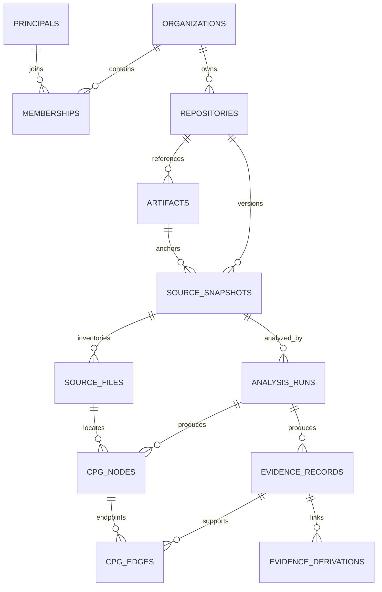

# Phase 1 - Database Foundation, Async Persistence, Evidence Contracts, and Migration Discipline: Implementation Plan

> **For agentic workers:** Implement only after the owner authorizes execution. Use `superpowers:executing-plans` task by task; use subagent-driven development only if the owner selects it. Steps use checkboxes for tracking. This document authorizes no execution by itself.

**Goal:** Establish a tested local PostgreSQL persistence foundation for scoped source snapshots, analysis results, graph structure, and evidence, without activating ingestion, analyzers, agents, authentication flows, or cloud services.
**Architecture:** Domain/DTO contracts remain independent of ORM objects. SQLAlchemy async repositories share a service-owned transaction; explicit Alembic revisions define the database history. Composite scope constraints and atomic publication prevent accidental tenant/snapshot/run mixing and incomplete public results.
**Tech stack:** Existing Python 3.12 workspace, PostgreSQL 16, SQLAlchemy 2.0, asyncpg application connections, psycopg 3 synchronous migration connections, Alembic, Pydantic v2/settings, pytest/Hypothesis/pytest-asyncio.
**Spec:** Supplied Phase 1 planning prompt; supplied `PHASE_0_CODESPY_PROFESSIONAL_SETUP.md`; current `CodeSPY_Technical_Execution_Blueprint.md` v2.0.
**Plan date:** 18 October 2026, Asia/Calcutta.
**Inspected branch/commit:** `main` at `04de7aa4fbb5807de9e409bf82229d86b888e3b4`.
**Execution status:** Planning only. Commands below are proposed, not observed passing results.

## Global constraints

- Retain Python `>=3.12,<3.13`, the root workspace `uv.lock`, and the existing locked package versions unless a separately reviewed compatibility change is necessary.
- Do not configure, retrieve, or validate LLM/service keys; do not access the owner's AWS account. No paid resources or browser automation are required.
- Do not modify the repository or start its stopped services during this planning task. Future execution requires a separate instruction.
- Preserve existing ignored `.env`, named volumes, accepted migrations, and unrelated work. Never use volume deletion as an upgrade strategy.
- No parser/scanner execution, archive acquisition, production auth, frontend implementation, queue transport, runtime/binary analysis, or live model calls in Phase 1.
- Real PostgreSQL integration establishes PostgreSQL behavior; SQLite and mocked sessions do not substitute for it.
- Every tenant-owned reference carries organization scope; graph/evidence references additionally carry snapshot and analysis-run scope.
- Stored evidence does not automatically imply verified claims. No retrieval-quality or security-completeness claim follows from persistence success.

## Review focus

1. An identical file path in two snapshots or analysis runs must never collide or overwrite earlier results: WP05/WP07 tests.
2. A cancellation or terminal publication racing a writer must reject the stale write rather than reopen the run: WP06/WP07 two-connection tests.
3. A test command accidentally receiving the developer database URL must stop before schema/data mutation: WP02 safeguard tests.
4. A password containing `%`, `@`, `:` or Unicode must not break URL construction, Alembic configuration, or redacted logs: WP01/WP03 tests.
5. An unchanged named CHECK constraint or trigger body can evade autogeneration drift checks; catalog/behavior tests must detect the actual semantics: WP06/WP08 tests.

---

## 1. Outcome, scope, and non-goals

### 1.1 Exit outcome

A developer can create a dedicated local database, provision required extensions, apply a deterministic migration chain, and use typed persistence services to create an organization, a principal/membership, a repository, an immutable source snapshot/file manifest, an analysis run, and scoped graph/evidence records. A published-result query returns only completed or explicitly partial runs. Invalid references, duplicate/conflicting writes, transaction failures, and stale lifecycle transitions are demonstrably rejected.

This is one persistence subsystem. The fixture/demo constructs representative data; it is not an ingestion or analysis feature.

### 1.2 Scope allocation

| Area                                              | Phase 1 disposition                                                      | Immediate consumer or invariant                                      |
| ------------------------------------------------- | ------------------------------------------------------------------------ | -------------------------------------------------------------------- |
| Organizations, principals, memberships            | Implement minimal records and scoped context checks                      | Persistence/demo isolation; future services can share the same scope |
| Repositories, artifact metadata, snapshots, files | Implement                                                                | Stable source identity and exact file attribution                    |
| Analysis runs and optimistic version              | Implement                                                                | Distinguish results/configuration/lifecycle; guard stale writes      |
| Nodes, edges, evidence, derivation links          | Implement bounded structural storage                                     | Demonstration of snapshot/run/evidence integrity                     |
| Findings and finding-evidence links               | Typed contract only; Phase 4 migration                                   | No scanner or findings consumer exists yet                           |
| Analysis attempts, leases, jobs/outbox/events     | Contract and invariants only; Phase 2 implementation                     | Queue-free Phase 1 must not pretend to deliver worker semantics      |
| Embedding profiles/chunks/vectors                 | Contract only; Phase 5 migration                                         | No chosen model, dimension, chunker, or retrieval workload           |
| Session tokens/OAuth/authorization API            | Contract boundary only; Phase 2                                          | No production identity flow in this phase                            |
| Verification/reconstruction ledger                | Defer policy engine/tables to Phase 4                                    | Evidence attachment is distinct from claim adjudication              |
| pgvector                                          | Verify extension; temporary scalar-distance smoke operation              | Preserve Phase 0 readiness without speculative permanent tables      |
| HNSW, broad GIN, graph caches                     | Defer                                                                    | No demonstrated query or scale requirement                           |
| Actual object uploads/deletions                   | Defer                                                                    | Artifact rows are references, not proof of object availability       |
| RLS                                               | Defer; explicitly block hosted exposure without later authorization gate | Local persistence is not a complete multi-tenant SaaS boundary       |

### 1.3 Simplification decisions

Do not build a generic CRUD repository framework, a dependency-injection container, a custom retry framework, or a class-based Unit of Work. A small async transaction context and concrete repositories suffice. No new runtime dependency is required. Keep installed Arq/Redis/model packages dormant rather than uninstalling them as unrelated cleanup.

## 2. Inspected baseline and implementation status

### 2.1 Evidence register

| Evidence                                  | Observed fact                                                                                                       | Classification                                                              |
| ----------------------------------------- | ------------------------------------------------------------------------------------------------------------------- | --------------------------------------------------------------------------- |
| GitHub recursive tree at inspected commit | Backend app/model/repository/test/Alembic version directories are placeholders; no implemented ORM/migrations found | Verified repository content, not runtime behavior                           |
| `AGENTS.md`, `.codex/USER_PREFERENCES.md` | Owner manages keys/cloud; services off; design services reserved for later                                          | Applicable execution boundaries                                             |
| `docs/SETUP_STATUS.md`                    | Reports 101 local setup checks passed before shutdown                                                               | Recorded historical verification; not rerun here                            |
| Root `pyproject.toml`                     | Workspace member `backend`, root env/lock, Python 3.12, `package=false`                                             | Verified configuration                                                      |
| `backend/pyproject.toml`                  | Async DB/migration/test packages present; strict mypy/Ruff; pytest asyncio auto mode                                | Verified configuration, not imports/test success                            |
| `uv.lock`                                 | Exact resolutions listed below                                                                                      | Verified locked metadata; installed runtime not inspected                   |
| `compose.yaml`                            | PostgreSQL image pinned by digest; loopback binding; named persisted volume                                         | Verified configuration; running server version/extension version unresolved |
| Extension SQL                             | `uuid-ossp`, `citext`, `pg_trgm`, `vector` declared                                                                 | Initialization intent; not evidence for an existing volume                  |
| `docs/PHASE_1_DATABASE.md`                | Broad future table/index list, explicitly setup-only                                                                | Documented intent, superseded by bounded plan                               |
| `.github/workflows/setup.yml`             | Manual-only setup jobs; no Phase 1 behavioral checks                                                                | Verified workflow content                                                   |
| Blueprint v2.0                            | Contains an earlier owner-reported Phase 1-completion assumption                                                    | Historical assumption; current request says only Phase 0 complete           |

The current planning request establishes a new Phase 1 planning baseline. Do not carry the blueprint's older completion assumption forward as a fact. Before implementation, inspect the actual checkout and any unpushed Phase 1 work. If it exists, turn these work packages into additive reconciliation tasks; preserve accepted revisions and test evidence.

### 2.2 Locked compatibility baseline

| Package                      | Root lock version inspected |
| ---------------------------- | --------------------------- |
| SQLAlchemy                   | 2.0.54                      |
| Alembic                      | 1.20.0                      |
| asyncpg                      | 0.32.0                      |
| psycopg                      | 3.3.6                       |
| pgvector Python client       | 0.5.1                       |
| Pydantic / pydantic-settings | 2.14.1 / 2.16.0             |
| pytest / pytest-asyncio      | 9.1.1 / 1.4.0               |
| greenlet                     | 3.5.6                       |
| mypy / Ruff                  | 2.4.0 / 0.17.1              |

`backend/uv.lock` is a symlink to the root lock. The exact PostgreSQL minor/server extension versions require a live query during execution. Client version `pgvector==0.5.1` does not identify the installed PostgreSQL `vector` extension version.

### 2.3 Inspection boundaries

Read: supplied prompt/runbook and complete current blueprint; repository tree, instructions, root/backend metadata, root lock, environment template, Compose, extension script, bootstrap script, Makefile, setup workflow, setup status, ADR 0001, Phase 1 stub, environment selector and relevant setup-verifier code.

Not performed: dependency sync, application import, tests, SQL connections, container start, migration, schema modification, GitHub write, external project creation, credential validation, or AWS calls. Figma/Lovable/Composio/GitBook do not provide a necessary capability for this local database plan and remain unused.

## 3. Phase 0/blueprint reconciliation

| Topic           | Phase 0 position                    | Blueprint position                 | Repository evidence                                                                   | Phase 1 decision                                                                                                   | Reason                                                  | Migration impact                                          |
| --------------- | ----------------------------------- | ---------------------------------- | ------------------------------------------------------------------------------------- | ------------------------------------------------------------------------------------------------------------------ | ------------------------------------------------------- | --------------------------------------------------------- |
| Queue           | Arq installed; Redis available      | SQS + DB lease/outbox              | ADR 0001 and packages retain Arq; LocalStack configured                               | Leave dependencies/services intact; define job contracts, defer implementation to Phase 2                          | No queue consumer in this phase                         | Later jobs/attempt/outbox migrations; no queue tables now |
| Identity        | JWT-oriented template               | Opaque sessions                    | JWT and SESSION_SECRET fields, no auth code                                           | Principal/membership records only; no token/session tables                                                         | Do not implement unused production auth                 | Phase 2 adds sessions and identity-provider mapping       |
| Phase numbering | Old 0-7 roadmap                     | Expanded roadmap and Phase 1R      | Future phase docs are stubs                                                           | This Phase 1 incorporates 1R checks then implements the absent foundation; later phases follow blueprint numbering | Avoid competing roadmaps                                | Documentation only; no history rewrite                    |
| CPG             | Broad AST/CFG/PDG plan              | Scoped structural support          | No analyzer implementation                                                            | Store structural records with explicit relation kinds and provenance; no semantic guarantee                        | Storage must not invent analysis capability             | New relation kinds require reviewed enum/CHECK revision   |
| Embeddings      | Earlier fixed examples              | Versioned model/dimension profiles | Client installed, no vector table                                                     | Contract only; no 1536-column assumption                                                                           | No selected retrieval workload                          | Phase 5 creates compatible profile/index schema           |
| HNSW/GIN        | Immediate broad indexes             | Measured adoption                  | Phase 1 stub promises indexes, none implemented                                       | Query-specific B-trees only; extension smoke without permanent ANN index                                           | Avoid speculative write/storage cost                    | Add indexes later after benchmark                         |
| DB lifecycle    | Docker initialization               | Explicit migrations                | Named volume + init script                                                            | Provision extensions administratively; Alembic owns application schema                                             | Init scripts do not upgrade existing volumes            | Four explicit initial application revisions               |
| Driver          | Both installed                      | Async ORM                          | asyncpg/psycopg locked                                                                | asyncpg runtime, psycopg sync Alembic                                                                              | Clear lifecycle; no nested asyncio migration runner     | URL conversion only, same schema                          |
| Infrastructure  | Detailed runbook suggests AWS steps | Terraform selected broadly         | ADR selects OpenTofu with Terraform-compatible HCL; assistant cloud access prohibited | Preserve ADR/OpenTofu; no IaC changes                                                                              | Concrete repo decision controls                         | None                                                      |
| UUID/citext     | Extensions preinstalled             | No necessary UUID policy           | Both extensions declared                                                              | Python uuid4, text identity keys; preserve unused extensions                                                       | No need for extension-generated UUID or email semantics | No DROP EXTENSION                                         |
| Frontend SDK    | hey-api installed                   | openapi-typescript proposed        | No API implementation                                                                 | DTO JSON Schema only in Phase 1; defer generator selection                                                         | Avoid incidental frontend dependency churn              | No frontend changes                                       |
| Cloud database  | Runbook mentions RDS Phase 1        | Hosted beta later                  | No application deployment                                                             | Local DB only                                                                                                      | No cost/account dependency                              | Future role/extension compatibility qualification         |

## 4. Research findings and decision register

Access date for references: **18 October 2026 (Asia/Calcutta)**. Version-specific documentation is preferred. `/latest` documentation may differ from locked patch versions; each consequential API is qualified against the lock during implementation. These are design choices supported by sources, not claims that sources prescribe CodeSPY's schema.

| ID  | Decision and supported conclusion                                                                                         | Primary evidence                     | Alternative and trade-off                                                                    |
| --- | ------------------------------------------------------------------------------------------------------------------------- | ------------------------------------ | -------------------------------------------------------------------------------------------- |
| D01 | One AsyncSession per task/transaction; explicit eager reads and `expire_on_commit=False`; dispose engine at lifecycle end | [R1] SQLAlchemy 2.0 asyncio          | Sharing a session across concurrent tasks is rejected                                        |
| D02 | Service owns transaction; repositories execute/flush only                                                                 | [R2] Session transactions            | Concrete context manager is sufficient; class-based UoW deferred                             |
| D03 | psycopg synchronous Alembic engine with NullPool; runtime remains asyncpg                                                 | [R3], [R4], [R5]                     | Alembic async engine/run_sync is valid, but adds an unnecessary event-loop bridge here       |
| D04 | Composite foreign keys enforce scope, and referenced scopes have explicit PK/UQ support                                   | [R6] PostgreSQL 16 constraints       | Global UUID alone is convenient but does not enforce tenant/snapshot association             |
| D05 | Extension provisioning uses a separate administrative operation; migrations validate availability                         | [R7] CREATE EXTENSION                | Runtime role cannot be assumed privileged; no hidden CREATE EXTENSION on connection          |
| D06 | Pgvector extension/readiness only; future profiles record dimension/metric/type                                           | [R8], [R9]                           | No HNSW before retrieval corpus/profile; storage and ANN-index dimension limits differ       |
| D07 | Function-scoped test engines/loops; separate databases for concurrency/migrations                                         | [R10] pytest-asyncio 1.4             | Shared pooled engine across different loops is avoided                                       |
| D08 | Frozen root workspace sync; no unnecessary lock update                                                                    | [R11], [R12] uv                      | Installed package presence is separately verified at execution                               |
| D09 | Pydantic validates wire data; environment parsing is separate and tolerates unrelated dotenv keys                         | [R13], [R14]                         | Blanket strict mode on environment strings or wire UUID strings is inappropriate             |
| D10 | READ COMMITTED + row lock/version check for publication                                                                   | [R15], [R16] PostgreSQL 16           | Serializable not used universally; retries must restart a whole safe transaction             |
| D11 | RLS deferred; no hosted exposure; repository methods require trusted context                                              | [R17] PostgreSQL 16 RLS              | Table-owner/superuser bypass and pooled context must be solved before claiming RLS isolation |
| D12 | Index plan checks use real data and budgets, not forced planner choices                                                   | [R18] PostgreSQL 16 index-only scans | Covering indexes do not guarantee zero heap reads or one exact plan                          |
| D13 | Explicit revisions and separate checks for trigger/CHECK semantics                                                        | [R19] Alembic autogenerate           | Autogeneration is a reviewed draft, not authoritative schema correctness                     |
| D14 | Timeouts and transaction context are set/reset explicitly                                                                 | [R20], [R21]                         | No unknown PostgreSQL-17+ configuration setting applied to PostgreSQL 16                     |

Pgvector future constraints: upstream documentation currently lists HNSW `vector` indexing up to 2,000 dimensions and `halfvec` up to 4,000; these are index/type-specific limits, not a universal storage limit. Iterative ANN scans require an appropriate extension version and still have scan limits. Verify actual extension version before adopting either. Phase 1 does not depend on these features or claim retrieval recall.

## 5. Persistence architecture and transaction boundaries

### 5.1 Dependency direction and intended files

| Layer                           | Proposed paths                                                                          | Rules                                                                                    |
| ------------------------------- | --------------------------------------------------------------------------------------- | ---------------------------------------------------------------------------------------- |
| Domain                          | `backend/app/domain/{scope,errors,lifecycle,source_ranges}.py`                          | Dataclasses/enums; no ORM/SDK/FastAPI imports                                            |
| Contracts                       | `backend/app/contracts/{persistence,evidence,future_work}.py`                           | Pydantic request/record DTOs, `extra=forbid`, explicit serialization; no lazy ORM access |
| Settings                        | `backend/app/core/database_config.py`                                                   | Parse/validate DB-only settings; no engine construction or secret lookup at import       |
| Engine/transaction              | `backend/app/db/{base,session,transaction,health}.py`                                   | Engine factory, sessionmaker, service transaction context, capability health             |
| ORM                             | `backend/app/models/{identity,repository,analysis,graph,evidence}.py` and `__init__.py` | SQLAlchemy typed mappings; every model imported for metadata discovery                   |
| Repositories                    | `backend/app/repositories/{identity,repository,analysis,graph,evidence}_repository.py`  | Session supplied; explicit scoped queries; no commits; bounded result sets               |
| Application services            | `backend/app/services/persistence.py`                                                   | Owns transaction, idempotency and publication, returns DTOs                              |
| Migration                       | `backend/alembic.ini`, `backend/alembic/{env.py,script.py.mako,versions/}`              | Fresh engine; explicit historical DDL                                                    |
| Administrative/local test tools | `scripts/{phase1_db.py,phase1_demo.py}`                                                 | Local-only allowlist; no cloud or target-code execution                                  |

### 5.2 Session and transaction policy

`build_engine(settings: DatabaseSettings) -> AsyncEngine` and `build_session_factory(engine) -> async_sessionmaker[AsyncSession]` are explicit constructors. Create once per future API/worker process, not globally when a module imports. `await engine.dispose()` runs at process/test teardown.

`transaction(factory) -> AsyncIterator[AsyncSession]` creates a new session, enters `session.begin()`, yields, commits on clean exit, rolls back on exceptions/cancellation, and closes. Repositories may `flush()` or use `RETURNING`; they do not `begin/commit/rollback` secretly. Do not nest service entry points that each open a transaction; factor shared internal functions accepting the existing session.

No one holds a transaction while parsing, waiting for a model, reading an archive, or performing external I/O. Prepare and validate DTOs before DB work. For future batches, compute outside the transaction and stage/publish through explicit services.

Session settings: `expire_on_commit=False`, `autoflush=False`; explicitly flush required dependent inserts. Relationship lazy loading defaults to `raise` if relationships are defined. Prefer explicit projections over a web of bidirectional ORM relationships. Convert to immutable record DTOs before session closure. Future requests and workers each create their own session; SSE must never retain a DB session for the duration of a stream.

### 5.3 Local configuration defaults and bounds

| Setting                            | Proposed local default | Rationale                                                       |
| ---------------------------------- | ---------------------- | --------------------------------------------------------------- |
| `DB_POOL_SIZE` / `DB_MAX_OVERFLOW` | 5 / 0                  | Predictable <=5 connections per process; start small            |
| `DB_POOL_TIMEOUT_SECONDS`          | 5                      | Fail boundedly on saturation                                    |
| `DB_CONNECT_TIMEOUT_SECONDS`       | 5                      | Bound initial network wait                                      |
| `DB_STATEMENT_TIMEOUT_MS`          | 10,000                 | Local OLTP bound; bulk operations need explicit later profile   |
| `DB_LOCK_TIMEOUT_MS`               | 2,000                  | Fail lock contention before statement timeout                   |
| `DB_IDLE_TRANSACTION_TIMEOUT_MS`   | 15,000                 | Catch abandoned transactions                                    |
| Pool pre-ping                      | true                   | Identify stale connections on checkout, not replay transactions |
| SQL logging                        | false                  | Avoid source/parameter/credential leakage                       |
| Isolation / timezone               | READ COMMITTED / UTC   | Explicit baseline                                               |
| Migration lock / statement timeout | 5,000 / 60,000 ms      | Separate DDL budget, not application engine settings            |

Validate integer positivity and `lock_timeout < statement_timeout < idle_transaction_timeout` for this profile; max pool size 20, overflow 0-10 if explicitly increased. Runtime and test role privileges are separate from pooling. Budget later total connections as process count times pool maximum plus migrations/maintenance headroom; don't multiply workers without revisiting it.

`DATABASE_URL` is optional only when all local `POSTGRES_*` connection fields are supplied. Blank URL in the existing template means absent. Build via SQLAlchemy `URL.create`, not string interpolation; explicit URL wins, and no partially combined DSN is produced. Parse DB settings from root `.env` only when caller explicitly supplies that file; environment values override it. Ignore unrelated existing dotenv keys, but forbid unknown fields on request DTOs. Never read model/AWS settings to construct a DB engine.

`DATABASE_MIGRATION_URL` is optional; if absent derive a URL with driver changed to `postgresql+psycopg` from the same parsed connection values. Do not insert unescaped URLs into ConfigParser `set_main_option`; construct migration engines from a URL object in env.py. Log redacted driver/host/database only. Cloud TLS verification is a future required profile, not disabled by local defaults.

Use `TIMESTAMPTZ`, return aware UTC datetimes, reject naive datetimes in contracts, and document microsecond precision. IDs use Python uuid4 and native PostgreSQL UUID; no extension UUID default is required.

For the runtime engine, pass asyncpg server_settings string values for timezone, statement_timeout, lock_timeout, idle_in_transaction_session_timeout and application_name; its timeout argument bounds connection wait. For synchronous psycopg migrations, use connection options for DDL timezone/timeouts so env.py does not accidentally autobegin a transaction by issuing SET before Alembic's transaction. No pgvector codec registration occurs in ordinary runtime connections before extension availability; the scalar readiness test does not need to return a vector object.

CoverageV1 with status complete requires omitted_count=0 and truncated=false, in addition to processed_count=admitted_count. This remains completeness of the declared fixture operation, not all repository behavior.

### 5.4 Retry/error contract

Map known SQLSTATE/constraint names to `ScopeViolation`, `DuplicateConflict`, `InvalidTransition`, `StaleWrite`, `NotPublished`, or bounded `DatabaseUnavailable`; retain internal SQLSTATE without exposing SQL/parameters. `23505/23503/23514` are correctness failures, not automatic retries. After integrity errors the transaction must rollback (or the error must be contained in an explicit savepoint).

No automatic write retries in Phase 1. A future caller may retry the entire explicitly idempotent transaction for serialization/deadlock (`40001`, `40P01`), with bounded attempts. A lost commit response is ambiguous; query by idempotency key/result digest before replaying. Pool pre-ping does not solve in-flight failure.

## 6. Schema specification and ER diagram

### 6.1 Conventions and notation

All tables are in `public` initially. `org_id` is `UUID NOT NULL`. Every reference below is a physical foreign key, not merely a repository filter. IDs are immutable; `ON UPDATE NO ACTION`, `ON DELETE RESTRICT` unless explicitly stated. No automatic cascade or generic purge is needed for Phase 1; dedicated disposable databases provide safe test cleanup. A later reviewed retention migration/service owns production deletion.

`id` means `UUID NOT NULL` supplied by Python, with no server default. `created_at` means `TIMESTAMPTZ NOT NULL DEFAULT CURRENT_TIMESTAMP`. `hash64` means `TEXT NOT NULL CHECK(value ~ '^[0-9a-f]{64}$')`. `obj` means `JSONB NOT NULL DEFAULT '{}'::jsonb CHECK(jsonb_typeof(value)='object')`. `arr` means JSONB array with analogous default/check. These are macros for the table descriptions, not new PostgreSQL types.

All omitted defaults are **none**; nullable columns explicitly say nullable and default NULL. Text enums are TEXT + named CHECK constraints, not native PostgreSQL ENUM, so additions are explicit ordinary migrations. Name constraints deterministically and keep within PostgreSQL identifier limits. Use table-prefixed explicit short constraint names where composite automatic names would be ambiguous/truncated.

### 6.2 Implemented tables (12)

#### T01 `organizations` - owner: identity repository

Columns: `id`, `slug TEXT NOT NULL`, `display_name TEXT NOT NULL`, `created_at`.

Keys/checks: PK `(id)`; UQ `(slug)`; slug lower-case ASCII pattern `^[a-z0-9][a-z0-9-]{0,62}$`; display name 1-200 characters. No implicit email/domain ownership.

Indexes/queries: PK and unique slug support get/create; no additional index. Create fixture tenant; lookup by immutable ID or normalized slug. Deletion restricted by all children. Tests: duplicate slug, invalid name, two independent tenants. Migration: 0001.

#### T02 `principals` - owner: identity repository

Columns: `id`, `subject_key TEXT NOT NULL`, `display_name TEXT NOT NULL`, `created_at`.

Keys/checks: PK `(id)`; UQ `(subject_key)`; subject_key 1-255 bytes; display_name 1-200 characters. Fixture keys use `local:<uuid>`. Do not store email/password/provider tokens or infer identity from display name. Later OAuth adds a separate issuer/subject mapping.

Queries/indexes: unique subject key for idempotent fixture creation; no other index. Global principal can join multiple organizations only through membership. Delete restricted by memberships. Tests: duplicate identity key, no cross-org membership inference. Migration: 0001.

#### T03 `memberships` - owner: identity repository

Columns: `org_id`, `principal_id UUID NOT NULL`, `role TEXT NOT NULL`, `created_at`.

Keys/checks: PK `(org_id,principal_id)`; FK org -> T01, principal -> T02; role in owner/admin/member/viewer. No default role. Index `(principal_id,org_id)` supports listing organizations and principal FK lookup. Update role is explicit; last-owner enforcement is deferred to the identity service and cannot be claimed here.

Representative operations: construct a trusted local `TenantContext` after membership check; fail missing membership. Deletes are explicit membership removal, not parent cascade. Tests: role/check/FK failures and scoped context resolution. Migration: 0001.

#### T04 `repositories` - owner: repository repository

Columns: `org_id`, `id`, `repository_key TEXT NOT NULL`, `display_name TEXT NOT NULL`, `source_kind TEXT NOT NULL`, `created_at`.

Keys/checks: PK `(org_id,id)`; FK org -> T01; UQ `(org_id,repository_key)`; repository_key 1-255 bytes; source_kind in local_fixture/github/archive; display name 1-200 chars. `repository_key` is canonical provider identity, e.g. future `github:<numeric-repo-id>`; a mutable GitHub owner/name is not authoritative identity. No user-provided URL fetching.

Queries: list org repositories by key; fetch `(org,id)`; idempotent create compares source kind and canonical key. Unique index covers these initial reads. Delete restrict. Tests: same key allowed across tenants, incorrect org denied. Migration: 0001.

#### T05 `artifacts` - owner: repository repository

Columns: `org_id`, `id`, `repository_id UUID NOT NULL`, `sha256 hash64`, `size_bytes BIGINT NOT NULL`, `storage_key TEXT NOT NULL`, `created_at`.

Keys/checks: PK `(org_id,id)`; FK `(org_id,repository_id)` -> T04; UQ `(org_id,repository_id,id)` for snapshot binding; size>=0; storage_key 1-1024 bytes, opaque generated key without credentials/query strings. Phase 1 fixture uses a declared fixture key; metadata alone does not verify object presence. No global digest deduplication/cross-tenant existence endpoint. No unique hash assumption.

Index `(org_id,repository_id,created_at,id)` for repository inventory/FK reads. Metadata immutable after insert; updates/deletes rejected by ordinary application privileges/guard, retaining future purge to a separate maintenance path. Tests: negative size, foreign tenant repository, malformed hash. Migration: 0002.

#### T06 `source_snapshots` - owner: repository repository

Columns: `org_id`, `id`, `repository_id UUID NOT NULL`, `artifact_id UUID NOT NULL`, `source_revision TEXT NULL`, `admission_config_hash hash64`, `identity_hash hash64`, `manifest_hash TEXT NULL`, `state TEXT NOT NULL DEFAULT 'building'`, `created_at`, `sealed_at TIMESTAMPTZ NULL`.

Keys/FKs: PK `(org_id,id)`; UQ `(org_id,repository_id,id)`; UQ `(org_id,repository_id,identity_hash)`; FK repo -> T04; FK `(org_id,repository_id,artifact_id)` -> T05's scoped candidate key. Thus an artifact from another repository cannot silently become a snapshot's source.

Checks: state building/sealed; sealed iff manifest_hash+sealed_at both nonnull, and manifest_hash matches hash64 when present; source_revision if present 1-255 bytes. Identity hash canonically includes repository identity, artifact digest, optional revision and admission-config hash; it excludes analyzer settings. Files contribute to manifest_hash at seal. Content identity and analysis identity remain distinct.

Index `(org_id,repository_id,created_at,id)` for history. `seal_snapshot` locks snapshot row, validates files, sets manifest_hash and sealed_at once. No run against a building snapshot. No edits after sealing. Deletion restrict. Test duplicate fingerprint resolves to same immutable snapshot only after content-equivalence check; conflicting fields fail. Migration: 0002 plus 0004 guards.

#### T07 `source_files` - owner: repository repository

Columns: `org_id`, `snapshot_id UUID NOT NULL`, `id`, `path TEXT NOT NULL`, `sha256 hash64`, `size_bytes BIGINT NOT NULL`, `language TEXT NULL`, `created_at`.

Keys/FKs: PK `(org_id,snapshot_id,id)`; FK `(org_id,snapshot_id)` -> T06; UQ `(org_id,snapshot_id,path)`. File IDs are snapshot-specific, not a globally reused hash. size>=0; path 1-1024 UTF-8 bytes. Reject NUL, backslash, absolute paths, empty components, `.`/`..` components; preserve exact Unicode/case, do not normalize distinct source bytes into one name. Use deterministic C collation for canonical path ordering. No source content stored in this table.

PK/UQ support file and manifest reads; no hash or language index without consumer. Inserts only while snapshot is building, with parent lock; updates prohibited. Files cannot be added after seal. Scope/range checks use size_bytes. Delete restrict. Tests: duplicate path, Unicode distinctness, invalid components, sealed-file insert rejection. Migration: 0002/0004.

#### T08 `analysis_runs` - owner: analysis repository

Columns: `org_id`, `snapshot_id UUID NOT NULL`, `id`, `request_key TEXT NOT NULL`, `analyzer_name TEXT NOT NULL`, `analyzer_version TEXT NOT NULL`, `config_hash hash64`, `config obj`, `status TEXT NOT NULL DEFAULT 'queued'`, `write_version BIGINT NOT NULL DEFAULT 0`, `coverage obj`, `limitations arr`, `result_hash TEXT NULL`, `failure_code TEXT NULL`, `created_at`, `started_at TIMESTAMPTZ NULL`, `finished_at TIMESTAMPTZ NULL`.

Keys/FKs: PK `(org_id,snapshot_id,id)`; FK snapshot -> T06; UQ `(org_id,request_key)`. request_key 1-128 bytes; analyzer name/version 1-128 bytes; write_version>=0; status queued/running/completed/partial/failed/cancelled. config stores sanitized nonsecret settings, not keys/URLs; limits: contract canonical encoding <=64KiB. Terminal status iff finished_at nonnull; started_at nonnull for running/completed/partial; result_hash required only for completed/partial and matches hash64; failure_code required for failed and <=128 bytes. Completed requires coverage.status=complete, partial requires partial/unknown/unavailable; coverage denominator is explicitly scoped operation coverage, not all possible behavior.

Index `(org_id,snapshot_id,created_at,id)` for history; UQ handles request replay. Same snapshot/analyzer config can have many independent runs with different request keys. Same request_key with changed snapshot/analyzer/config raises DuplicateConflict. No automatic upsert of historical results.

Runs require sealed snapshot. Trigger/service enforces state machine in section 7. Terminal records immutable; public result readers filter status completed/partial. write_version is optimistic lifecycle control, not a worker lease. Delete restrict. Tests include stale version, valid transitions, idempotent replay, configuration isolation. Migration: 0003/0004.

#### T09 `cpg_nodes` - owner: graph repository

Columns: `org_id`, `snapshot_id UUID NOT NULL`, `run_id UUID NOT NULL`, `local_id UUID NOT NULL`, `file_id UUID NOT NULL`, `node_kind TEXT NOT NULL`, `symbol_name TEXT NOT NULL`, `qualified_name TEXT NOT NULL`, `start_byte BIGINT NOT NULL`, `end_byte BIGINT NOT NULL`, `start_line INTEGER NOT NULL`, `end_line INTEGER NOT NULL`, `start_col INTEGER NOT NULL`, `end_col INTEGER NOT NULL`, `attributes obj`, `created_at`.

Keys/FKs: PK `(org_id,snapshot_id,run_id,local_id)`; FK `(org_id,snapshot_id,run_id)` -> T08; FK `(org_id,snapshot_id,file_id)` -> T07. Node local_id is deterministic within an analyzer result, derived from path/kind/range; compare payload on a collision rather than silently ignore it. Run scope preserves changed parser/config results for the same source snapshot.

Checks: node_kind module/class/function/method/call/import; symbol/qualified name <=2048 UTF-8 bytes (empty symbol allowed for a module/anonymous construct); ranges section 7; attributes contract <=64KiB and no source blob. Byte upper bound checked by file lookup trigger. Every node inserted only while its run is running. Append-only thereafter.

Index `(org_id,snapshot_id,run_id,file_id,start_byte,local_id)` for file outline; no speculative trigram/GIN/PageRank index. Queries by explicit RunRef and local ID. Delete restrict. Tests: identical local ID in different runs allowed; wrong file snapshot rejected. Migration: 0003/0004.

#### T10 `evidence_records` - owner: evidence repository

Columns: `org_id`, `snapshot_id UUID NOT NULL`, `run_id UUID NOT NULL`, `id`, `file_id UUID NULL`, `digest hash64`, `schema_version INTEGER NOT NULL DEFAULT 1`, `provider_name TEXT NOT NULL`, `provider_version TEXT NOT NULL`, `operation TEXT NOT NULL`, `observation_mode TEXT NOT NULL`, `basis TEXT NOT NULL`, `coverage_status TEXT NOT NULL`, `payload obj`, `limitations arr`, six nullable range fields `start_byte,end_byte BIGINT` and `start_line,end_line,start_col,end_col INTEGER`, `captured_at TIMESTAMPTZ NOT NULL`, `created_at`.

Keys/FKs: PK `(org_id,snapshot_id,run_id,id)`; FK run -> T08; optional FK `(org_id,snapshot_id,file_id)` -> T07; UQ `(org_id,snapshot_id,run_id,digest)`. Nullable file_id cannot circumvent mandatory run FK; file-scope FK uses ordinary nullable semantics intentionally. File-level evidence may omit a range; ranged evidence must include file_id and all six range fields. No half-specified ranges.

Checks: schema_version=1; mode static/runtime/external, basis observed/derived/inferred, coverage complete/partial/unknown/unavailable; nonempty provider/version/operation <=128 bytes each. payload canonical size<=64KiB; limitations array of bounded strings via DTO. Store sanitized data only; no raw source, credentials or unbounded tool output. A later schema adds large raw-result object references and redaction/supersession metadata rather than mutating evidence.

Digest uses the versioned canonical EvidenceEnvelopeV1, including scope/run/provider/operation/location/payload/coverage/limitations/captured_at; excludes surrogate id, digest and inserted created_at. Application recomputes before insert. Digest equality is tamper/replay identity, not truth. No claim_verified column or trigger exists.

PK/UQ provide reads/idempotence; index `(org_id,snapshot_id,run_id,file_id)` for evidence-by-file and FK checks. Inserts only while run running; updates/deletes prohibited to application role. Tests: changed payload with same digest, wrong run/file context, range completeness, duplicate digest. Migration: 0003/0004.

#### T11 `cpg_edges` - owner: graph repository

Columns: `org_id`, `snapshot_id UUID NOT NULL`, `run_id UUID NOT NULL`, `id`, `source_local_id UUID NOT NULL`, `target_local_id UUID NOT NULL`, `edge_kind TEXT NOT NULL`, `support_evidence_id UUID NOT NULL`, `properties obj`, `created_at`.

Keys/FKs: PK `(org_id,snapshot_id,run_id,id)`; composite FKs source and target to T09; support FK `(org_id,snapshot_id,run_id,support_evidence_id)` -> T10; UQ `(org_id,snapshot_id,run_id,source_local_id,target_local_id,edge_kind,support_evidence_id)`. Thus separate observations may support parallel edges. Properties must match on idempotent replay.

edge_kind AST_CHILD/IMPORTS/CALLS_CANDIDATE; no CFG/PDG/TAINT_FLOW storage promise before supported extraction. Properties include resolution basis; existence of an edge does not assert feasible runtime execution.

Indexes: forward `(org_id,snapshot_id,run_id,source_local_id,edge_kind) INCLUDE(target_local_id,support_evidence_id)`; reverse same with target/source exchanged; support index `(org_id,snapshot_id,run_id,support_evidence_id)`. The unique index may overlap forward prefix; review measured redundancy in WP08 before retaining both. Forward/reverse queries are concrete demo reads; avoid including properties JSONB in covering indexes.

Inserts only during running state; no mutation/deletion via application role. Test both endpoint scope violations, foreign-run support, parallel support, retry collision and bounded neighbors. Migration: 0003/0004.

#### T12 `evidence_derivations` - owner: evidence repository

Columns: `org_id`, `snapshot_id UUID NOT NULL`, `run_id UUID NOT NULL`, `child_id UUID NOT NULL`, `parent_id UUID NOT NULL`, `created_at`.

Keys/FKs: PK `(org_id,snapshot_id,run_id,child_id,parent_id)`; both child/parent scoped FKs to T10; CHECK child_id<>parent_id; reverse index `(org_id,snapshot_id,run_id,parent_id,child_id)` supports lineage. No JSON array hides constrained references.

Append-only while running. Batch service validates the proposed derivation DAG with iterative cycle detection before insertion; only same-run lineage in v1. A database CHECK cannot prove acyclicity across rows; direct SQL is not an authorized application write path. Cross-run/cross-snapshot lineage is a future explicitly typed relation, not silently permitted now.

Tests: missing/foreign parents, self-link, cycle and deterministic lineage order. Deletion restrict. Migration: 0003/0004.

### 6.3 Compact ER diagram



The diagram abbreviates physical composite keys. Section 6.2 defines the actual tenant/snapshot/run FKs and both endpoints.

### 6.4 Why this identity model

Global UUID PKs plus separate tenant filters are smaller in some indexes but make scope an application-only convention unless composite candidate keys/FKs are added. Pure natural keys complicate renames and cross-version matching. This plan uses simple org/principal IDs, then explicit scoped composite keys for owned records. Wide indexes cost space; that cost buys enforceable association and is measured before scale optimization. Do not replace scope integrity with an assumption that UUID collisions are unlikely.

### 6.5 Contract-only future objects

Define Pydantic models/JSON Schema, not tables or services:

- `FindingDraftV1`: RunRef, rule/family/title/severity+basis, locations, support EvidenceRefs, verification disposition, remediation; evidence attachment never defaults to verified.
- `JobEnvelopeV1`: schema_version, org/job/snapshot/run IDs, operation, config_hash, deadline; no credentials/source. Phase 2 must validate dispatcher authority and attempt fencing.
- `AttemptLeaseV1`: job_id, attempt_id, monotonically increasing fence, owner, expiry, heartbeat. No promise that this contract alone rejects a worker.
- `ProgressEventV1`: run_id, sequence, event_type, timestamp, public payload. Sequence allocation/replay implementation deferred.
- `EmbeddingProfileV1`: provider, model_id/revision, dimensions>0, distance cosine/l2/inner_product, normalization, element_type, chunker_version, profile_hash. Profiles do not establish an embedding's retrieval usefulness.
- `ChunkRefV1`: snapshot/run/file/range/content hash and profile reference. Actual chunks and embedding storage arrive with retrieval evaluation.

### 6.6 Phase 1 service DTO field ledger

All classes live in `contracts/persistence.py` except the evidence envelope and range types. DTOs are frozen after validation; Python caller validation uses native UUID/aware datetime values, while JSON input uses the documented JSON Schema forms. Cross-field validators implement the bounds above.

| DTO                                               | Exact field set / composition                                                                                                                                                                                                                                                              |
| ------------------------------------------------- | ------------------------------------------------------------------------------------------------------------------------------------------------------------------------------------------------------------------------------------------------------------------------------------------ |
| `RepositoryCreate`                                | repository_key, display_name, source_kind; org/principal come only from trusted context                                                                                                                                                                                                    |
| `ArtifactCreate`                                  | sha256, size_bytes, storage_key                                                                                                                                                                                                                                                            |
| `SourceFileCreate`                                | id, path, sha256, size_bytes, language optional                                                                                                                                                                                                                                            |
| `SnapshotCreate`                                  | repository_id, artifact:ArtifactCreate, source_revision optional, admission_config_hash; service computes identity/manifest hashes                                                                                                                                                         |
| `RunCreate`                                       | snapshot_id, request_key, analyzer_name, analyzer_version, config; service computes config_hash; IDs/status/times/version are service-owned                                                                                                                                                |
| `NodeCreateV1`                                    | local_id, file_id, node_kind, symbol_name, qualified_name, range:SourceRangeV1, attributes                                                                                                                                                                                                 |
| `EvidenceEnvelopeV1`                              | schema_version=1, scope:RunRef, id, file_id optional, range optional, provider_name, provider_version, operation, observation_mode, basis, coverage_status, payload, limitations, captured_at; service excludes id from semantic digest                                                    |
| `EdgeCreateV1`                                    | id, source_local_id, target_local_id, edge_kind, support_evidence_id, properties                                                                                                                                                                                                           |
| `DerivationCreateV1`                              | child_id, parent_id; scope supplied by enclosing run                                                                                                                                                                                                                                       |
| `ResultBatchV1`                                   | schema_version=1, scope:RunRef, nodes:list[NodeCreateV1], evidence:list[EvidenceEnvelopeV1], edges:list[EdgeCreateV1], derivations:list[DerivationCreateV1], disposition:completed\|partial, coverage:CoverageV1, limitations:list[str]                                                    |
| `CoverageV1`                                      | status:complete\|partial\|unknown\|unavailable, scope_description:str, admitted_count:int>=0, processed_count:int>=0, omitted_count:int>=0, truncated:bool; processed+omitted=admitted for a countable fixture scope; unknown denominators represented by a separate future schema version |
| `RepositoryRecord`, `SnapshotRecord`, `RunRecord` | Explicit immutable scalar DTOs matching their table columns; no relationship fields or ORM serialization; SnapshotRecord also returns file_count computed within transaction                                                                                                               |
| `EvidenceRef`                                     | scope:RunRef, evidence_id:UUID                                                                                                                                                                                                                                                             |
| `EvidenceRecord`                                  | EnvelopeV1 plus digest and created_at                                                                                                                                                                                                                                                      |
| `InsertSummary`                                   | inserted_nodes, existing_nodes, inserted_edges, existing_edges: nonnegative integers                                                                                                                                                                                                       |
| `NeighborPage`                                    | scope, edges:list[EdgeCreateV1], next_cursor optional, truncated:bool                                                                                                                                                                                                                      |
| `GraphPage`                                       | scope, nodes:list[NodeCreateV1], edges:list[EdgeCreateV1], next_cursor optional, truncated:bool; include endpoint nodes for returned edges or return their explicit references, never pretend a page is a complete graph                                                                   |

Canonical result_hash excludes service-generated inserted_at/created_at and is calculated after sorting node/evidence/edge records by their stable IDs and derivations by child,parent. It includes the evidence digests, graph contents, derivations, disposition, coverage and limitations. Callers must reuse stable fixture IDs/captured_at for an identical replay. Any change in semantic data is a different result, even if the graph shape is unchanged.

`create_snapshot` computes identity before inserting a new artifact row. If a sealed equivalent snapshot exists, compare canonical source metadata and return it without creating an orphan artifact. Otherwise insert artifact, snapshot and files and seal in one transaction. A concurrent unique-identity conflict triggers a whole-transaction rollback followed by a fresh scoped read/compare; no blind successful reuse of an incompatible snapshot.

## 7. Integrity, authorization boundaries, and lifecycle rules

### 7.1 Snapshot and run publication

Snapshots: building -> sealed only. `seal_snapshot` holds `FOR UPDATE`, hashes a deterministic ordered file manifest and changes state atomically. File inserts take the same parent lock. No analyzer/run references building snapshots. Sealed source identities cannot be edited. Large ingestion/staged manifests are future work; Phase 1 uses bounded fixture manifests.

Runs: queued -> running -> completed | partial | failed | cancelled; queued -> cancelled is allowed. No terminal reopening or completed->failed rewrite. Any retry requiring new computation uses a new request key/run; worker attempt reuse is deferred. Every state change increments write_version exactly once. `started_at`, `finished_at`, coverage and result hash must agree with the target state.

The run INSERT guard requires queued/version0, null started_at/finished_at/result_hash/failure_code. The run UPDATE guard admits only the transition-specific mutable fields plus the exact version increment; all source/analyzer/config/request identity remains fixed. A failed transition requires a nonempty sanitized failure_code; nonfailed transitions retain it NULL. SQL trigger rejection uses documented constraint/error categories, not a generic success return.

Child insert guard: lock its run row `FOR UPDATE`, require status running, validate ranges/FKs, then insert. All graph/evidence/node identity and payload updates are rejected. Publication and cancellation lock the same row, preventing a late child writer from racing a terminal transition. Trigger functions are SECURITY INVOKER with schema-qualified references, not ad hoc SECURITY DEFINER privilege escalation.

`persist_result` validates the whole bounded batch before opening the transaction, locks/compares version, inserts evidence/nodes/derivations/edges, stores a canonical result hash, and changes status last in the **same transaction**. A concurrent reader sees previous state or a complete published state. Public reads join the run and require completed/partial; direct administrative inspection of base tables is explicitly not a public reader.

If a caller receives an ambiguous commit result, replay with same run/result hash returns its published record; a different hash is a conflict. Returning success by blindly `ON CONFLICT DO NOTHING` is forbidden. A publication failure rolls the entire transaction back, leaving the prior running state; a separate failure transition may then record the sanitized error.

### 7.2 Range and canonicalization rules

- Original-file UTF-8 byte positions: start inclusive, end exclusive, `0 <= start_byte <= end_byte <= file.size_bytes`.
- Lines are 1-based; columns are 0-based **UTF-8 byte offsets**, not UTF-16 editor offsets or Unicode codepoints. End coordinates refer to the exclusive end position. Same-line end_col>=start_col; lines positive, columns nonnegative.
- Newline interpretation: LF terminates a line; CRLF is preserved in bytes, with the LF ending that line. Empty file range is `[0,0)`, line1/col0 -> line1/col0.
- DTO/SQL checks establish shape and bounds; exact byte-to-line consistency requires actual source bytes in a later analyzer. The fixture/demo verifies its own known bytes; DB metadata alone does not prove content correspondence.
- `codespy-json-v1` canonical encoding: reject non-finite numbers/non-JSON types and duplicate object keys at ingestion; UTC aware timestamps rendered ISO8601 with fixed microseconds and `Z`; UUIDs lower-case canonical strings; sorted object keys, compact separators, UTF-8 `ensure_ascii=False`, `allow_nan=False`. Keep finite-float behavior pinned by tests; this is a versioned Python canonicalization policy, not an RFC 8785 interoperability claim.

### 7.3 Authorization boundary and RLS choice

`TenantContext(org_id, principal_id, role)` is constructed by a trusted local fixture/membership resolver. It is not accepted verbatim from an HTTP body. Every repository method requires it and includes scope in SQL. Member/viewer policies for reads are separate from FK enforcement; writing requires owner/admin/member in the local policy. No internet API is exposed.

RLS is deferred, not rejected forever. If later adopted: non-owner/NOBYPASSRLS app role, FORCE ROW LEVEL SECURITY where appropriate, trusted transaction-local org context, tested reset on pool reuse, and denied missing-context behavior are prerequisites. RLS does not replace server authorization and a user-settable org variable alone cannot protect against an app-role SQL compromise.

Phase 1 tests scoped repository behavior but do not claim DB-enforced read isolation. Local runtime role can select base tables across tenants; only trusted services may hold it. Hosted launch remains blocked on authorization review (and an explicit RLS decision).

### 7.4 Privileges and immutability

Provision separately: an extension administrator; a migration owner; an application role with no superuser/CREATEDB/CREATEROLE/BYPASSRLS, no schema CREATE, no TRUNCATE and no ability to disable triggers. Phase 0 Compose's configured database user may be administrative; do not use that as a hosted application identity.

Grant app SELECT/INSERT on source/result tables, UPDATE only where the documented state transition needs it, and explicit membership/repository metadata operations as designed. Guards still validate immutable fields/status. No app DELETE on artifacts/snapshots/files/runs/graph/evidence. Test actual role behavior in the disposable cluster. A later retention service/maintenance role can implement logged deletion with dependency invalidation; table owner can bypass controls and is outside app authority.

### 7.5 Required invariants and enforcement

| Invariant                         | Enforcement now                                            | Later boundary                                   |
| --------------------------------- | ---------------------------------------------------------- | ------------------------------------------------ |
| Cross-tenant association          | Composite FK and scoped repository tests                   | Hosted read authorization/RLS decision           |
| Same snapshot/run graph endpoints | Composite endpoint FKs                                     | No silent cross-run edge reuse                   |
| Same path/symbol remains distinct | Snapshot/run keys                                          | Cross-version mapping is a separate relation     |
| Source vs analysis identity       | Sealed snapshot vs independently versioned run             | Analyzer changes create new runs                 |
| Evidence correct context          | Run/file/support composite FKs                             | Cross-run evidence requires typed policy         |
| Evidence != verification          | No automatic verified state                                | Claim policy engine in Phase 4                   |
| Outcomes distinct                 | CHECKs + lifecycle guards                                  | Worker job outcomes mirror these explicitly      |
| Duplicate durable effects         | Request/result idempotency and compare-on-conflict         | Actual SQS duplicate-delivery tests Phase 2      |
| Stale write rejection             | Row locks + expected write_version                         | Lease/fence enforcement mandatory before workers |
| No partial publication            | Atomic result transaction + scoped read gate               | Multi-batch staging must preserve gate           |
| Ranges explicit                   | DTO/SQL/file-size guard                                    | Byte/line semantic validation with real source   |
| Untrusted data bounded            | <=64KiB canonical payload/attributes/config contract limit | Raw results use scoped object references         |

## 8. Migration and compatibility strategy

### 8.1 Initial chain

| Revision        | Contents                                                  | Down-revision |
| --------------- | --------------------------------------------------------- | ------------- |
| `0001_identity` | T01-T04 and named constraints                             | None          |
| `0002_source`   | T05-T07, indexes, source constraints                      | 0001_identity |
| `0003_results`  | T08-T12, scoped graph/evidence constraints/indexes        | 0002_source   |
| `0004_guards`   | Lifecycle/immutability/range guard functions and triggers | 0003_results  |

Revisions use explicit `op.create_table/create_index/execute` DDL and reverse dependencies on downgrade. No revision imports current ORM models or calls `Base.metadata.create_all/drop_all`. env.py may import current metadata solely for autogeneration/drift comparison. Test databases are created from migrations, never metadata.

There is no inspected existing application revision. Therefore fresh install is the verified plan path. If the actual execution checkout contains revisions/data, stop the fresh-init branch, inventory its current head, map existing records and create an additive migration/backfill plan. Never stamp head over unknown tables or downgrade/delete them to fit this plan.

### 8.2 Extension and schema ownership

Preserve `docker/postgres/init-extensions.sql`. It applies when the image initializes an empty data directory; updating it does not change existing volumes. `scripts/phase1_db.py provision-extensions` is an explicit local administrative command that idempotently creates the four historical extensions and records extname/extversion, server_version_num and image digest. It never drops them.

Migration preflight requires PostgreSQL 16 (`160000 <= server_version_num < 170000`) and the Phase 0 extension inventory. Query actual version; do not require an invented exact vector version. No halfvec/iterative-scan behavior is used, so do not force an upgrade for it. Missing extension is a clear preflight failure with provisioning guidance, not an auto-admin connection. Application health reports capabilities without mutating them.

env.py uses sync psycopg `create_engine(..., poolclass=NullPool)`, configured transaction timeouts and `context.begin_transaction`. A one-off Alembic process is not run inside an active asyncio loop. Future async tests can run migration CLI in a subprocess. No startup auto-migrate; future deployment executes migrations once under controlled ownership.

### 8.3 Naming, discovery and drift

`db/base.py` defines one MetaData naming convention for pk/uq/fk/ck/ix. Named CHECKs refer to stable short identifiers. `models/__init__.py` imports every mapped table; unit test asserts the 12 expected tables exist in metadata.

env.py enables compare_type and reviewed compare_server_default. Autogenerate is a candidate diff requiring manual review; don't rely on optional named-CHECK detection to compare expressions. `alembic check` is supplemented by catalog assertions/behavior for CHECK definitions, FK actions, trigger existence and permissions. Store explicit expected guard version/digest in migration tests; future intentional changes update migration and fixture together.

One head is required. `upgrade --sql` is a DDL preview, not migration success. Downgrade is tested only on a disposable populated fixture database; initial table drops are destructive and never the default application rollback.

### 8.4 Future compatibility and backfills

Add nullable column/new table -> deploy compatible code -> bounded resumable backfill -> validate -> enforce constraints -> remove old path in a separate release. `NOT VALID` foreign/check constraints then VALIDATE may help large existing tables; unique constraints need a separately reviewed index strategy. CREATE INDEX CONCURRENTLY cannot run in the ordinary transaction block; no concurrent index build is needed on empty Phase 1 tables.

Use lock timeout and inspect blockers instead of indefinite DDL waits. Long backfills are separate resumable jobs, not one opaque migration transaction. Document irreversible steps with restore/forward-fix guidance. Application image rollback must remain compatible with the current schema; do not promise that downgrade can undo lost data.

## 9. Numbered implementation work packages

Each package is independently reviewable, with relative complexity and named interfaces. Execute tests before/after implementation, then commit only the package's intended paths. No changes are authorized by this planning delivery.

### WP00 - execution baseline and acceptance record (small, low uncertainty)

**Prerequisite:** owner authorizes Phase 1 implementation. **Inspect/retain:** AGENTS, owner preferences, root/backend metadata/locks, ADR 0001, Compose/init SQL, existing uncommitted work and any Phase 1 branch.

**Proposed paths:** create `docs/adr/0002-phase1-persistence.md`; update `docs/PHASE_1_DATABASE.md`; keep setup handoff unchanged as history. Record plan version, actual starting commit/branch, actual code/migrations and current local server state. Do not edit AGENTS to manufacture authorization.

- [ ] Read repository instructions and `git status --short`; classify changes without discarding them.
- [ ] Compare actual implementation with this schema; if any accepted Phase 1 exists, write an additive reconciliation before new revisions.
- [ ] Record implement/contract-only/deferred matrix and dormant dependencies in ADR 0002.
- [ ] Run nonmutating `uv lock --check` and inspect `uv tree --locked --package codespy-backend`; no unrestricted dependency upgrade.
- [ ] Review/commit the ADR and phase stub update.

**Failure/recovery:** unavailable local tools or missing source reference remains a recorded blocker to execution, not invented completion. **Acceptance:** exact input commit and schema branch decision. **Migration impact:** none. **Handoff:** WP01 uses this fixed baseline.

### WP01 - configuration, domain and evidence contracts (medium, low uncertainty)

**Create:** package `__init__.py` files as needed; `core/database_config.py`; `domain/{scope,errors,lifecycle,source_ranges}.py`; `contracts/{persistence,evidence,future_work}.py`; `domain/canonical_json.py`; `backend/tests/unit/{test_database_config,test_contracts,test_canonical_json}.py`. **Modify:** `.env.example` add only documented DB settings; retain owner-managed blanks. Backend pytest config adds `pythonpath=["."]`, registered markers, `asyncio_default_fixture_loop_scope="function"` and `asyncio_default_test_loop_scope="function"`; preserve existing `asyncio_mode="auto"`.

**Interfaces:** `DatabaseSettings`; `TenantContext(org_id:UUID, principal_id:UUID, role:OrgRole)`; `RunRef(org_id:UUID,snapshot_id:UUID,run_id:UUID)`; `SourceRangeV1`; `EvidenceEnvelopeV1`; `ResultBatchV1`; `canonical_bytes(value:JsonValue)->bytes`; `semantic_digest(value)->str`. Contracts define fields matching section 6 and specific future objects in 6.5.

- [ ] Write failing tests: blank DATABASE_URL falls back only with complete local fields; special-character password round-trips; invalid pool/timeouts reject; settings repr never reveals secret; unrelated dotenv keys tolerated.
- [ ] Add range tests with `[0,0)` empty file, CRLF/Unicode bytes, partial range rejection, naive timestamp rejection; strict Python UUID vs JSON-string validation is tested separately.
- [ ] Add canonicalization tests: ordering stable, finite float fixture stable, NaN rejected, changed payload changes digest, duplicate JSON keys rejected by the raw-input loader, id/time exclusion explicit.
- [ ] Run `uv run --frozen --all-packages --all-groups pytest -c backend/pyproject.toml backend/tests/unit -q` and verify relevant failures before implementing.
- [ ] Implement exact fields, bounds and error types; keep framework/ORM imports out of domain modules.
- [ ] Run the same tests and strict mypy/Ruff on these paths; review the diff, then commit `feat(db): define settings and scoped persistence contracts`.

**Failure:** validation errors omit sensitive input values. **Acceptance:** no keys/cloud calls and deterministic contract serialization. **Migration:** none. **Handoff:** WP02/03 use settings; WP04-07 use scope/DTOs.

### WP02 - isolated PostgreSQL test harness (medium, high safety importance)

**Create:** `compose.phase1-tests.yaml`, `scripts/phase1_db.py`, `backend/tests/{conftest.py,support/db_guard.py}`, `backend/tests/unit/test_db_guard.py`. **Modify:** `.gitignore` for generated test env/ownership manifests. **Retain:** developer Compose/volumes unchanged.

**Harness contract:** `phase1_db.py prepare --env-out <ignored-file>` emits no passwords to stdout, creates only a dedicated test cluster/database/roles, and records a random ownership marker; `cleanup --env-file ...` destroys only resources with matching marker/project. Test settings use `CODESPY_TEST_*`, never DATABASE_URL or developer `.env` fallback. Use explicit disposable passwords in generated ignored env, never real service keys.

- [ ] Write safeguard tests rejecting non-loopback host, db names `codespy/postgres/template0/template1`, unapproved port, missing marker, developer DATABASE_URL-only input, wrong project/container labels and malformed identifiers.
- [ ] Implement standalone Compose project `codespy-phase1-tests`, same pinned PostgreSQL image, `127.0.0.1:55432:5432`, tmpfs data, no developer named volumes or init mounts. Test-only admin account is independent of Phase 0 credentials.
- [ ] Provision template0-derived test DB names `codespy_p1_test_<random>` and a marker table in schema `codespy_test_guard`; identifier composition uses psycopg.sql.Identifier, not string interpolation.
- [ ] Create distinct test migration/app roles and extension setup with the admin. App role is non-owner/non-superuser; schema CREATE/TRUNCATE/trigger disabling are denied.
- [ ] Implement migration/concurrency/performance suites with dedicated databases; ordinary integration tests use a fixture DB and explicit rollback/owned records. Every DB creation/drop is guarded and in admin autocommit.
- [ ] Run unit safeguards before any real start; after authorization run the prepare command, verify marker/roles/extensions, and clean up only its test project without `-v` on developer Compose.
- [ ] Review/commit `test(db): add guarded PostgreSQL integration environment`.

**Acceptance:** developer database cannot be targeted by destructive harness commands even if environment is misconfigured. **Recovery:** retain an ownership manifest on partial failure and clean only matching resources. **Migration:** harness metadata separate from application public schema; exclude guard schema from drift comparisons. **Handoff:** all later DB tests use this harness.

### WP03 - engine, transaction context and Alembic skeleton (medium)

**Create:** `db/{base,session,transaction,health}.py`, `backend/alembic.ini`, `backend/alembic/env.py`, `backend/alembic/script.py.mako`; `backend/tests/integration/{test_transactions,test_db_health}.py`; `backend/tests/migrations/test_migration_bootstrap.py`.

**Interfaces:** `build_engine(settings)->AsyncEngine`; `build_session_factory(engine)->async_sessionmaker[AsyncSession]`; `transaction(factory)->AsyncIterator[AsyncSession]`; `inspect_database(engine)->DatabaseCapabilities`. Capabilities include exact server/extension versions, not private DSN.

- [ ] Write transaction tests using temporary owned fixture tables: successful shared transaction, rollback after second insert fails, two tasks use different sessions, engine disposal, statement/lock timeout behavior.
- [ ] Test module import creates no connection; health performs reads only and reports missing extensions as unavailable.
- [ ] Implement settings/timeouts/lifecycle from section 5; set server UTC and use transaction-local timeouts as needed. No global default session or scoped_session.
- [ ] Configure sync psycopg Alembic env with URL object/NullPool, `script_location=%(here)s/alembic`, `prepend_sys_path=%(here)s`, and only explicit metadata discovery.
- [ ] Verify empty version directory is not called migrated; preview CLI help/history and bootstrap tests on guarded DB. First real revision arrives WP04.
- [ ] Run transaction/health tests and commit `feat(db): add async transaction lifecycle and migration runner`.

**Failure:** cancelled context rolls back/closes; DDL permissions fail explicitly. **Migration:** skeleton only, no table history yet. **Handoff:** repositories receive sessions; migrations get independently created sync engine.

### WP04 - identity and source metadata schema (medium)

**Create:** `models/{identity,repository}.py`, `models/__init__.py`, `alembic/versions/{0001_identity,0002_source}.py`; `repositories/{identity,repository}_repository.py`; `backend/tests/integration/{test_identity_scope,test_snapshot_integrity}.py`.

**Interfaces:** `IdentityRepository(session)` with `resolve_context(org_id,principal_id)->TenantContext`; `RepositoryRepository(session)` with `create/get/list` requiring context; internal `insert_snapshot_with_files(ctx,spec,files)` and `seal_snapshot(ctx,snapshot_id)->SnapshotRecord` (service owns transaction). Use DTO results, not detached ORM objects.

- [ ] Write tests for T01-T07 keys, checks, same-name tenants, foreign-tenant/repository artifact rejection and snapshot path uniqueness. Assert specific SQLSTATE/constraint category.
- [ ] Implement ORM+explicit revisions with columns/actions from section 6; ensure all metadata is imported.
- [ ] Implement short-lived scoped repository reads; no unbounded list or secret values in DTOs. `list` limit default50/max200 and deterministic key cursor.
- [ ] Implement manifest hash from sorted path/hash/size/language records; guard functions temporarily arrive WP06, so full sealed-immutability acceptance is not claimed yet.
- [ ] Test fresh upgrade to `0002_source` in the dedicated migration DB; perform populated downgrade/re-upgrade there only.
- [ ] Run tests; commit `feat(db): add tenant and immutable source metadata schema` with note that lifecycle guards complete in WP06.

**Failure/recovery:** uniqueness replay compares canonical fields; conflict raises instead of silently reusing incompatible row. **Migration:** explicit two-revision chain. **Handoff:** WP05 binds runs/results to these exact keys.

### WP05 - runs, graph and evidence schema (large; split into two reviewable commits)

**Create:** `models/{analysis,graph,evidence}.py`; `alembic/versions/0003_results.py`; `repositories/{analysis,graph,evidence}_repository.py`; `backend/tests/integration/{test_result_scope,test_evidence_integrity}.py`.

**Interfaces:** `AnalysisRepository(session).create_run(ctx,request)->RunRecord`; `EvidenceRepository(session).insert_batch(ctx,run_ref,records)->list[EvidenceRef]`; `GraphRepository(session).insert_batch(ctx,run_ref,nodes,edges)->InsertSummary`; `neighbors(ctx,run_ref,local_id,direction,edge_kind,limit)->NeighborPage`; `read_evidence(ctx,ref)->EvidenceRecord` with publication gate for public mode.

- [ ] Write failing scope tests for nodes/edges/evidence using two orgs, two snapshots and two runs of the same snapshot. Include same local_id everywhere to prove keys do real work.
- [ ] Implement T08-T12 ORM and migration; evidence/site relations stay explicit FKs; basic graph enum supports only structural candidates.
- [ ] Add tests for bad source/target/support run, half-null ranges, range upper bound acceptance deferred to WP06 guard, duplicate digest, identical request key with changed config, derivation self-link/cycle service rejection.
- [ ] Implement insert-then-compare idempotency using `RETURNING`/follow-up scoped read; return actual inserted/existing counts, not input length. Limit batches to 1,000 nodes, 2,000 edges, 1,000 evidence and 2,000 derivations in this phase, with DTO byte limits.
- [ ] Verify immutable context/ID fields, no lazy reads, bounded ordered neighbor queries and DTO conversion while session open.
- [ ] Run tests and migration to 0003; commit schema first, concrete repositories second after review.

**Failure:** invalid row rolls back whole batch; no partial ignore. **Migration:** earlier revisions independent of new model imports. **Handoff:** WP06 supplies SQL guards; WP07 supplies transaction/publication orchestrator.

### WP06 - lifecycle, range and immutability guards (large, highest correctness risk)

**Create:** `alembic/versions/0004_guards.py`; `backend/tests/integration/{test_lifecycle_guards,test_publication_races,test_roles}.py`; `backend/tests/migrations/test_guard_catalog.py`.

**Produces:** migration-defined SQL trigger functions for snapshot sealing/file insertion, run transitions/immutable identity, child result insertion and file-size range validation. Keep function DDL in the revision, not loaded from a mutable runtime SQL file.

- [ ] Write raw-SQL tests as app role: mutate sealed file/snapshot, edit evidence, insert after terminal run, alter immutable identity/config, skip valid transitions and insert out-of-file range; all reject.
- [ ] Implement guards with schema-qualified tables and SECURITY INVOKER; acquire snapshot/run row locks before parent-state checks; all writers follow snapshot-before-run ordering where both needed.
- [ ] Implement allowed state transitions and exact write_version increment; reject terminal updates even if a caller repeats them with new fields.
- [ ] Coordinate two DB connections with explicit barriers (no timing-only sleeps): writer vs cancellation, child insert vs finalization, file insert vs sealing. Assert either valid serialized outcome and no published result mutation.
- [ ] Test app cannot TRUNCATE/ALTER/DISABLE triggers or edit guard functions; catalog tests assert trigger/version/FK definitions and CHECK behavior.
- [ ] Run guards/race tests; review SQL locking/deadlock paths; commit `feat(db): enforce scoped immutable publication boundaries`.

**Failure/recovery:** lock timeout returns a bounded conflict; caller rolls back. **Migration:** downgrade drops guards before earlier tables; no shared extension removal. **Handoff:** WP07 can publish using guaranteed locks/constraints.

### WP07 - persistence services and atomic result publication (medium-large)

**Create:** `services/persistence.py`; `backend/tests/integration/{test_persistence_service,test_idempotency,test_public_reads}.py`.

**Interfaces (all async):**

```python
class PersistenceService:
    def __init__(self, factory: async_sessionmaker[AsyncSession]) -> None: ...
    async def create_repository(
        self, ctx: TenantContext, data: RepositoryCreate
    ) -> RepositoryRecord: ...
    async def create_snapshot(
        self, ctx: TenantContext, data: SnapshotCreate, files: list[SourceFileCreate]
    ) -> SnapshotRecord: ...
    async def create_run(self, ctx: TenantContext, data: RunCreate) -> RunRecord: ...
    async def start_run(
        self, ctx: TenantContext, ref: RunRef, expected_version: int
    ) -> RunRecord: ...
    async def persist_result(
        self,
        ctx: TenantContext,
        ref: RunRef,
        batch: ResultBatchV1,
        expected_version: int,
    ) -> RunRecord: ...
    async def cancel_run(
        self, ctx: TenantContext, ref: RunRef, expected_version: int
    ) -> RunRecord: ...
    async def read_published_graph(
        self, ctx: TenantContext, ref: RunRef, limit: int = 200
    ) -> GraphPage: ...
```

Validation/locking algorithm:

```text
validate batch/context/reference and compute result hash outside transaction
open fresh session + transaction
lock scoped run FOR UPDATE
if already published with same result hash and same disposition: return existing record
require run running and write_version == expected_version
insert/compare evidence -> nodes -> derivations -> edges
validate coverage/disposition and update status, result_hash, finished_at, version
materialize record DTO
commit transaction; return DTO only after successful commit
```

- [ ] Write tests for two independent runs preserving different config, cancellation stale-version failure, duplicate publication same hash success and different hash failure.
- [ ] Test exception after evidence/nodes but before final edge rolls back all newly inserted rows; run retains prior running state.
- [ ] Test public read returns NotPublished during work; successful commit returns all expected rows; partial includes limitations.
- [ ] Implement read/write role policies and preserve context checks; no API or worker implemented. Shared helpers accept session rather than opening nested transactions.
- [ ] Implement paged reads keyed by run/local_id/edge ID; reject max limits. Export requires explicit org+run reference.
- [ ] Run service/idempotency/race tests; commit `feat(db): publish graph evidence atomically through scoped services`.

**Acceptance:** transaction boundaries and retry behavior are independently observable; no session escapes into public record. **Migration:** none beyond guard chain. **Handoff:** WP08 evaluates actual queries; WP09 demonstrates the complete path.

### WP08 - migration discipline, vector readiness and query plans (medium)

**Create:** `backend/tests/migrations/{test_fresh_chain,test_roundtrip,test_schema_drift}.py`; `backend/tests/integration/test_vector_readiness.py`; `backend/tests/performance/test_query_plans.py`; `backend/tests/support/seed_graph.py`.

- [ ] Test base->head yields exactly 12 application tables plus Alembic metadata, one head and no unexpected drift; guard schema excluded deliberately.
- [ ] Test upgrade 0002->head preserving source rows; test populated downgrade->0002->head only on disposable DB and explicitly expect result data loss from dropping its tables.
- [ ] Assert past revisions contain explicit DDL and no runtime-model imports/create_all; query catalog and execute negative checks to validate guard semantics.
- [ ] Verify actual vector extension version and scalar cosine-distance query of two temporary three-element vectors; expected orthogonal distance approx1.0. These are arbitrary test dimensions, not production dimensions. Do not create a permanent code_chunks table or HNSW index.
- [ ] Seed a deterministic realistic fixture, initially 10 runs x 10,000 nodes with 30,000 edges/run, then ANALYZE. Benchmark selective forward/reverse neighbor lookup, scoped file outline and evidence lookup with `EXPLAIN (ANALYZE,BUFFERS,FORMAT JSON)`.
- [ ] Seed this performance corpus through controlled fixture-level repository/SQL batches, not the public ResultBatchV1 path capped at 1,000 nodes. Keep constraints and guards active, finalize valid fixture runs explicitly, and use a dedicated test-only seed transaction timeout. Do not enlarge normal application limits merely to seed a benchmark.
- [ ] Check result count bounded, tenant/run filters present, and selective lookup does not scan all unrelated runs. Accept index/bitmap/index-only variants; no forced `enable_seqscan=off` in acceptance. Record plans/timings/dataset/hardware; absolute latency is a measured local result, not a universal SLA.
- [ ] Review duplicate forward/UQ indexes and remove redundant candidates only with the exact tested query/uniqueness behavior preserved; update metadata+revision consistently before initial publication.
- [ ] Commit `test(db): verify migrations vector capability and scoped query plans`.

**Failure:** missing extension/slow query is a specific failing gate, not auto upgrade/tuning. **Migration:** initial index definitions fixed before merge; after merge new revision required. **Handoff:** final evidence includes measured plans, no retrieval-quality claim.

### WP09 - local demonstration and Phase 1 CI/handoff (medium)

**Create:** `scripts/phase1_demo.py`, `.github/workflows/phase1-database.yml`, `docs/PHASE_1_ACCEPTANCE.md`. **Modify:** Makefile with additive `phase1-unit`, `phase1-test`, `phase1-demo` targets and backend lint/type/test commands; README/phase stub update only for implemented capability. Do not enable the old all-service setup workflow or schedules as a side effect.

- [ ] Write a demo smoke test verifying the service-level transcript in section 11: correct counts, rollback, invalid reference rejection and safe cleanup ownership.
- [ ] Implement demo against an explicitly generated disposable environment; never seed/truncate the developer DB.
- [ ] Add PR/manual Phase 1 CI on relevant backend/scripts/migration paths with read-only contents permission, frozen uv install and only the disposable PostgreSQL service. No AWS/OAuth/model key configuration.
- [ ] Run lint/format/mypy, unit/integration/migration/concurrency suites and demo. Run performance suite in a separate job/manual profile to avoid unstable CI timing gates.
- [ ] Record actual commands, commit, versions, migration heads, test counts, plans and unresolved limitations; never copy Phase 0's historical count as Phase 1 evidence.
- [ ] Review final diff, check no source/secrets/test env artifacts entered Git, then commit `docs(db): add local demo CI and Phase 1 acceptance evidence`.

**Acceptance:** clean checkout can follow documented commands without later features. **Rollback:** revert code on branch before release; do not run destructive downgrade on developer data. **Handoff:** Phase 2 takes the contracts and adds jobs/leases/admission/auth through new migrations.

## 10. Test matrix and validation commands

### 10.1 Test matrix

| Test category / path     | Behavior established                                    | Expected result                                                     |
| ------------------------ | ------------------------------------------------------- | ------------------------------------------------------------------- |
| unit/config              | URL parsing, bounds, secret redaction, unrelated dotenv | Deterministic accepted/rejected configurations; no network          |
| unit/contracts           | Wire types, ranges, canonical hash, duplicate keys      | Bad shapes reject before SQL; stable canonical fixture bytes        |
| unit/db_guard            | Developer/prod DSN or missing ownership marker          | Stop before DB CREATE/DROP/TRUNCATE                                 |
| migrations/fresh         | Actual revision chain on empty DB                       | One head, 12 tables, required constraints/guards                    |
| migrations/upgrade       | Known 0002 source rows survive head upgrade             | Same IDs/data, new result tables available                          |
| migrations/roundtrip     | Disposable populated downgrade/re-upgrade               | Expected destructive scope explicit, no extension removal           |
| migrations/drift         | Metadata vs DB plus guard catalog                       | No unexpected diff; semantic checks independent of autogen          |
| integration/identity     | Scoped membership and repository access                 | Foreign/missing scope denied; FK invalid references fail            |
| integration/snapshot     | Artifact association, paths, sealing                    | Cross-repo artifact and post-seal writes fail                       |
| integration/result_scope | Same local IDs across contexts, scoped edges            | Independent results retained; foreign context rejected              |
| integration/evidence     | Digest, range, links, cycles                            | Invalid lineage/payload/hash rejects; evidence not verified claim   |
| integration/transactions | Shared transaction failure and separate tasks           | No partial commit; sessions/connections isolated                    |
| integration/lifecycle    | Status shapes, versions, terminal immutability          | Valid transitions pass; stale/reopen reject                         |
| concurrency/barrier      | Duplicate insert/publication/cancel races               | One consistent outcome; no duplicate durable effect                 |
| integration/roles        | Non-owner app permissions                               | No DDL/TRUNCATE/guard bypass or prohibited evidence mutation        |
| integration/vector       | Extension inventory + scalar distance                   | Correct operation on installed extension; no retrieval assertion    |
| performance/plans        | Scoped selective reads over realistic graph             | Bounded output and explained efficient access, no fixed-plan fetish |
| smoke/demo               | Whole phase service flow                                | Data present, rollback and invalid-reference scenarios demonstrated |

Use Hypothesis for normalized path/range bounds and small derivation DAG cycle cases; don't generate huge DB scenarios that merely repeat CHECK expressions. Fixed regression examples cover Unicode/CRLF and concurrency explicitly.

### 10.2 Async fixture lifecycle

Function-scoped asyncio loop and engine/session fixtures; all session/connection resources close before engine dispose and loop teardown. Use `pytest_asyncio.fixture` explicitly for DB fixtures even with the existing auto mode. No session-scoped pooled engine reused under function loops. For fast tests with service commits, use owned unique fixture data or dedicated per-test DB as appropriate; do not incorrectly assume outer rollback undoes a service that opened a different connection.

Concurrency tests use independent connections/sessions and committed setup, not a shared rollback transaction. Migration tests use independent databases; never run downgrade against integration fixtures in use. Initial suite is serial; pytest-xdist is not installed or required. If later parallelized, allocate per-worker databases/ports/markers and never share a migration database.

### 10.3 Commands: existing versus proposed

All commands run from the repository root in future implementation. They were **not executed during planning**. Use `source scripts/env.sh` to select the project's existing tools, but do not restart all services merely to test persistence.

Existing metadata checks:

```bash
source scripts/env.sh
uv lock --check
uv sync --all-packages --all-groups --frozen
uv pip check
```

Proposed after WP01 test configuration exists:

```bash
uv run --frozen --all-packages --all-groups pytest -c backend/pyproject.toml backend/tests/unit -q
uv run --frozen --all-packages --all-groups ruff check backend/app backend/tests scripts/phase1_db.py scripts/phase1_demo.py
uv run --frozen --all-packages --all-groups ruff format --check backend/app backend/tests scripts/phase1_db.py scripts/phase1_demo.py
uv run --frozen --all-packages --all-groups mypy --config-file backend/pyproject.toml backend/app
```

Proposed guarded integration harness (WP02 defines these commands):

```bash
uv run --frozen --all-packages --all-groups python scripts/phase1_db.py prepare --env-out .phase1-test.env
uv run --frozen --all-packages --all-groups python scripts/phase1_db.py test --env-file .phase1-test.env --suite integration
uv run --frozen --all-packages --all-groups python scripts/phase1_db.py test --env-file .phase1-test.env --suite migrations
uv run --frozen --all-packages --all-groups python scripts/phase1_db.py test --env-file .phase1-test.env --suite concurrency
uv run --frozen --all-packages --all-groups python scripts/phase1_db.py test --env-file .phase1-test.env --suite performance
uv run --frozen --all-packages --all-groups python scripts/phase1_db.py cleanup --env-file .phase1-test.env
```

`test` validates ownership, selects a fresh suite DB, provisions/extensions/migrates as required, sets test-only DSNs and invokes pytest with `-c backend/pyproject.toml` and absolute package path in PYTHONPATH. It accepts only enumerated suite names/paths, not arbitrary commands. Add `.phase1-test*.env` and manifests to `.gitignore`; ensure credentials are not printed.

Proposed direct Alembic inspection, with an explicitly configured local `DATABASE_MIGRATION_URL` and development-only preflight:

```bash
uv run --frozen --all-packages --all-groups alembic -c backend/alembic.ini heads
uv run --frozen --all-packages --all-groups alembic -c backend/alembic.ini history
uv run --frozen --all-packages --all-groups alembic -c backend/alembic.ini upgrade head
uv run --frozen --all-packages --all-groups alembic -c backend/alembic.ini check
```

The harness is the default route for tests/demo; direct migration commands are deliberate local-development actions after inspecting destination. env.py rejects nonlocal targets in this phase unless a future reviewed deployment profile explicitly changes that boundary. Do not print DATABASE_URL or source `.env` with shell tracing.

## 11. Complete local demonstration

`scripts/phase1_demo.py` has CLI `--env-file <generated-file>` and uses the guarded disposable cluster, never normal application DSN fallback. It inserts synthetic code metadata only; no parser, model, archive or downloaded repository is executed.

1. **Start PostgreSQL:** run WP02 `prepare`; assert loopback port 55432, project labels, marker, PostgreSQL16 and extensions. No other Phase 0 service is started.
2. **Apply migrations:** create `codespy_p1_test_demo_<random>` from template0; provision extensions with admin; run Alembic head with migration role; apply app grants; inspect one head.
3. **Create identity/source fixture:** organization `demo-<random>`, local principal, owner membership and repository; hash known UTF-8 bytes for two toy source files, including one Unicode identifier/CRLF case. Create fixture artifact metadata, building snapshot and file rows, then seal its manifest through the persistence layer.
4. **Start a run:** `create_run` with explicit analyzer `fixture-builder`, version1 and sanitized config; queued version0 -> `start_run(...expected_version=0)` returns running version1. This is not analyzer execution.
5. **Store results:** prepare two nodes, an observed syntax evidence record, a derived candidate-relationship record linked to the observation, and an edge supported by that derived record. Publish completed with declared fixture-operation coverage and expected_version1. Commit -> version2.
6. **Query:** read published graph and evidence through scoped service; assert two nodes, one edge, two evidence records and one derivation; show original paths/ranges/provider/mode/limitations. No verified-bug claim.
7. **Replay:** publish identical canonical batch; returns same record/counts with no duplicate rows. Change payload/result hash; expect DuplicateConflict.
8. **Rollback:** create a second running fixture run; attempt a batch that inserts valid evidence and nodes then an edge to an absent node; expect failure and no inserted child rows after rollback. Demonstrate original published run remains unchanged.
9. **Invalid context:** create a separate organization/snapshot and attempt to use its node/file/evidence with the first run; expect FK/scope rejection. Same path/local symbol in its own scope remains valid.
10. **Stale lifecycle:** cancel a new running run with expected_version1; a subsequent publish with version1 rejects and status remains cancelled. Explain that this tests optimistic versioning, not a worker lease.
11. **Clean up safely:** close all sessions/engines, drop only the ownership-marked demo database with admin, verify its absence; optional harness cleanup removes only the disposable test project/tmpfs. No developer volumes, schemas or data are touched.

Output prints a redacted assertion transcript and count summary, returning nonzero if any expected rejection does not occur. Demo tests its semantic assertions rather than matching fragile console wording. Retain only sanitized acceptance evidence, not passwords/source-sensitive logs.

## 12. Acceptance checklist and completion evidence

- [ ] Actual starting commit, branch, owner instructions and any existing Phase 1 work reconciled.
- [ ] Locked packages install/import under Python3.12; no unreviewed upgrade or key/cloud dependency.
- [ ] Database-only settings validate, handle special-character credentials and redact errors.
- [ ] 12-table schema and all composite FKs/checks/indexes match this specification or an explicitly reviewed amendment.
- [ ] Atomic snapshot sealing/run publication, immutable results and cancellation/version races tested.
- [ ] Idempotent replay compares content; no silent incompatible conflict ignore.
- [ ] Scope-aware reads/roles documented; no claim of hosted authorization/RLS completeness.
- [ ] Explicit Alembic chain fresh/known-upgrade/drift/guard tests; no evolving-model create_all in revisions.
- [ ] Extension administrator and app/migration roles separated; exact live versions recorded.
- [ ] Vector smoke succeeds without production embedding dimensions/indexes.
- [ ] Test harness demonstrably refuses developer/nonlocal DB destinations.
- [ ] Query plans and fixture sizes recorded; no unsupported latency/recall guarantee.
- [ ] Local demo completes rollback/rejection/replay/cleanup assertions.
- [ ] PR CI checks real Phase 1 behavior without production secrets or all-service startup.
- [ ] No dormant future systems claimed implemented; handoff lists required next migrations.

Completion evidence goes in `docs/PHASE_1_ACCEPTANCE.md`: final commit; OS/Python/Postgres/extension/package versions; sanitized command log; migration current/heads; test counts and skipped reasons; query-plan artifacts; role checks; demo outcome; known limits. This planning document contains no fabricated passing count.

## 13. Risks, unresolved decisions, and deferred work

| Item                                 | Status and practical impact                                                                 | Resolution point                                                   |
| ------------------------------------ | ------------------------------------------------------------------------------------------- | ------------------------------------------------------------------ |
| Unpushed Phase 1 work                | Not visible remotely; fresh schema path may need additive reconciliation                    | WP00 before revisions                                              |
| Installed runtime/extension versions | Lock/image intent inspected, not live server                                                | WP02/03 inventory                                                  |
| Wide scope keys                      | More index bytes/joins; deliberate correctness trade-off                                    | WP08 measurement, later scale work                                 |
| Guard locking                        | Can serialize writers per snapshot/run; bounded fixture scope is acceptable                 | WP06 race tests; large ingest staging in Phase2/3                  |
| Same-run lineage only                | Cross-run comparisons cannot forge a parent link                                            | Later explicit provenance relation migration                       |
| JSON digest interoperability         | Python v1 serialization is not RFC8785; cross-language producers need adapter normalization | WP01 golden fixtures; future schema version                        |
| Byte/line semantics                  | DB checks metadata/bounds, not actual code contents                                         | Source analyzers Phase3                                            |
| RLS/read authority                   | Direct runtime-role SQL is not tenant-isolated                                              | Hosted security gate before Phase10                                |
| Membership last owner                | Not fully enforced by foundation                                                            | Identity flow Phase2                                               |
| Retention/deletion                   | Restrict + immutable app access; no user-facing deletion promise yet                        | Admission/retention design Phase2, hosted gate                     |
| Jobs/attempt fencing                 | DTO only; no queue/lease enforcement claimed                                                | Phase2 before any worker                                           |
| Large batched results                | Phase1 bounded transaction only; no arbitrary-size staging guarantee                        | Phase3 ingestion/performance design                                |
| Model/vector profile                 | No model selected; HNSW dimensions not assumed                                              | Phase5 evaluated profile migration                                 |
| Latest docs vs lock                  | Official docs can advance                                                                   | Qualify locked APIs during execution; separate upgrade if required |
| Migration rollback                   | Destructive downgrade only tested in disposable environment                                 | Expand-contract and restore planning for live data                 |

Deferred entirely: Pinecone, BM25 extension, auth sessions/OAuth code, live SQS/Redis transport, external scanner/provider adapters, RAG agent memory, runtime sandbox, AWS RDS provisioning, hosted billing, fine-tuning and broad language semantics. None is necessary to verify this foundation.

### Final design review disposition

Resolved during planning: global node-ID collisions -> scoped run keys; evidence-row-as-proof -> no verification state; implicit commits -> service-owned transaction; HNSW speculation -> extension-only readiness; trigger/autogen blind spots -> catalog plus behavior tests; old phase assumption -> actual remote baseline; unsafe DB cleanup -> separate guarded test cluster; queue duplication -> future contract boundary; competing IaC direction -> preserve ADR OpenTofu.

Remaining risks above are bounded scope limits or execution-time facts, not hidden requirements delegated to an implementer. No material schema/transaction decision is left to an unspecified "modern framework."

## 14. Handoff to the next phase

Phase 2 consumes `TenantContext`, Repository/Snapshot/RunRef DTOs, EvidenceEnvelopeV1, ResultBatchV1, persistence services and explicit migration history. It adds safe repository/archive admission, real object storage, identity/session flows, jobs/attempts/leases/outbox/progress events, and an execution boundary.

Before workers: implement monotonically fenced attempts, lease renewal/expiry, idempotent SQS effects, stale-finalization rejection, cancellation and crash recovery with independent DB/queue tests. Before public endpoints: enforce authenticated repository authorization on every read/write/export/stream. Before large multi-batch outputs: add explicit staging/publish semantics preserving immutable run identity. Before retrieval: choose/version chunk/embedding profiles and test exact/approximate search.

Update the Phase1 acceptance record and future phase stubs to refer to one roadmap: this Phase1 absorbs the blueprint's 1R prerequisite checks; it does not rename or reimplement later capabilities. The next requested plan should be `PHASE_2_SAFE_INGESTION_AND_JOB_EXECUTION_PLAN.md`, grounded in the final Phase1 commit.

## 15. Primary-source references

All documentation accessed 18 October 2026, Asia/Calcutta. Repository references are pinned. Version notes state the inspected applicability; they do not imply live runtime validation.

| Ref | Primary source and applicable version                                                                              | Supported use in this plan                                                   |
| --- | ------------------------------------------------------------------------------------------------------------------ | ---------------------------------------------------------------------------- |
| R1  | [SQLAlchemy 2.0 asyncio](https://docs.sqlalchemy.org/en/20/orm/extensions/asyncio.html), 2.0 series; lock2.0.54    | Concurrent session safety, explicit loading, engine disposal                 |
| R2  | [SQLAlchemy 2.0 transactions](https://docs.sqlalchemy.org/en/20/orm/session_transaction.html)                      | Explicit transaction context ownership                                       |
| R3  | [Alembic cookbook](https://alembic.sqlalchemy.org/en/latest/cookbook.html), page identifies1.20.0                  | Sync migration interface and optional async bridge comparison                |
| R4  | [psycopg3 concurrency/async](https://www.psycopg.org/psycopg3/docs/advanced/async.html), rolling docs; lock3.3.6   | Distinguish connection/transaction ownership and migration connection choice |
| R5  | [asyncpg API](https://magicstack.github.io/asyncpg/current/api/index.html), includes0.32 changes                   | Connect timeout/server settings, driver-specific configuration               |
| R6  | [PostgreSQL16 constraints](https://www.postgresql.org/docs/16/ddl-constraints.html)                                | Composite scope FKs, null semantics, referential actions                     |
| R7  | [PostgreSQL16 CREATE EXTENSION](https://www.postgresql.org/docs/16/sql-createextension.html)                       | Separate privileged provisioning                                             |
| R8  | [pgvector server](https://github.com/pgvector/pgvector), rolling upstream                                          | Type/index limits and extension-version-specific features                    |
| R9  | [pgvector Python](https://github.com/pgvector/pgvector-python), rolling upstream; lock0.5.1                        | Client/server distinction and later codec/type integration                   |
| R10 | [pytest-asyncio concepts](https://pytest-asyncio.readthedocs.io/en/stable/concepts.html), page1.4.0                | Loop/fixture scope qualification                                             |
| R11 | [uv workspaces](https://docs.astral.sh/uv/concepts/projects/workspaces/)                                           | Shared root lock/workspace commands                                          |
| R12 | [uv locking/sync](https://docs.astral.sh/uv/concepts/projects/sync/)                                               | Frozen sync and explicit lock consistency                                    |
| R13 | [Pydantic settings](https://docs.pydantic.dev/latest/concepts/pydantic_settings/), rolling v2; lock2.16.0 settings | Environment/dotenv precedence and parsing                                    |
| R14 | [Pydantic strict mode](https://docs.pydantic.dev/latest/concepts/strict_mode/), rolling v2; lock2.14.1             | Distinguish Python versus JSON validation semantics                          |
| R15 | [PostgreSQL16 transaction isolation](https://www.postgresql.org/docs/16/transaction-iso.html)                      | Publication visibility and whole-transaction retry boundaries                |
| R16 | [PostgreSQL16 explicit locking](https://www.postgresql.org/docs/16/explicit-locking.html)                          | Parent-row serialization and race tests                                      |
| R17 | [PostgreSQL16 row security](https://www.postgresql.org/docs/16/ddl-rowsecurity.html)                               | Owner/bypass limitations and future RLS prerequisites                        |
| R18 | [PostgreSQL16 index-only scans](https://www.postgresql.org/docs/16/indexes-index-only-scans.html)                  | Covering index/visibility caveats                                            |
| R19 | [Alembic autogenerate](https://alembic.sqlalchemy.org/en/latest/autogenerate.html), page1.20.0                     | Manual revision review and CHECK/trigger drift limits                        |
| R20 | [PostgreSQL16 client defaults](https://www.postgresql.org/docs/16/runtime-config-client.html)                      | Session/statement/lock timeout settings                                      |
| R21 | [SQLAlchemy2.0 pooling](https://docs.sqlalchemy.org/en/20/core/pooling.html)                                       | Async pool sizing, NullPool and lifecycle behavior                           |
| R22 | [PostgreSQL16 CREATE DATABASE](https://www.postgresql.org/docs/16/sql-createdatabase.html)                         | Privileges and template0 test-database creation                              |
| R23 | [SQLAlchemy2.0 PostgreSQL dialect](https://docs.sqlalchemy.org/en/20/dialects/postgresql.html)                     | Driver URLs/types and explicit dialect behavior                              |

Repository evidence: [pinned CodeSPY tree](https://github.com/aman-bhaskar-codes/CodeSPY/tree/04de7aa4fbb5807de9e409bf82229d86b888e3b4); [backend metadata](https://github.com/aman-bhaskar-codes/CodeSPY/blob/04de7aa4fbb5807de9e409bf82229d86b888e3b4/backend/pyproject.toml); [root lock](https://github.com/aman-bhaskar-codes/CodeSPY/blob/04de7aa4fbb5807de9e409bf82229d86b888e3b4/uv.lock); [Compose](https://github.com/aman-bhaskar-codes/CodeSPY/blob/04de7aa4fbb5807de9e409bf82229d86b888e3b4/compose.yaml); [ADR0001](https://github.com/aman-bhaskar-codes/CodeSPY/blob/04de7aa4fbb5807de9e409bf82229d86b888e3b4/docs/adr/0001-setup-boundaries.md); [setup handoff](https://github.com/aman-bhaskar-codes/CodeSPY/blob/04de7aa4fbb5807de9e409bf82229d86b888e3b4/docs/SETUP_STATUS.md); [owner instructions](https://github.com/aman-bhaskar-codes/CodeSPY/blob/04de7aa4fbb5807de9e409bf82229d86b888e3b4/.codex/USER_PREFERENCES.md).

The supplied runbook and blueprint are design inputs, not primary evidence of executed database behavior. Numerical limits, batch sizes, schema choices and phase boundaries above are explicit CodeSPY design recommendations to validate in this phase.
