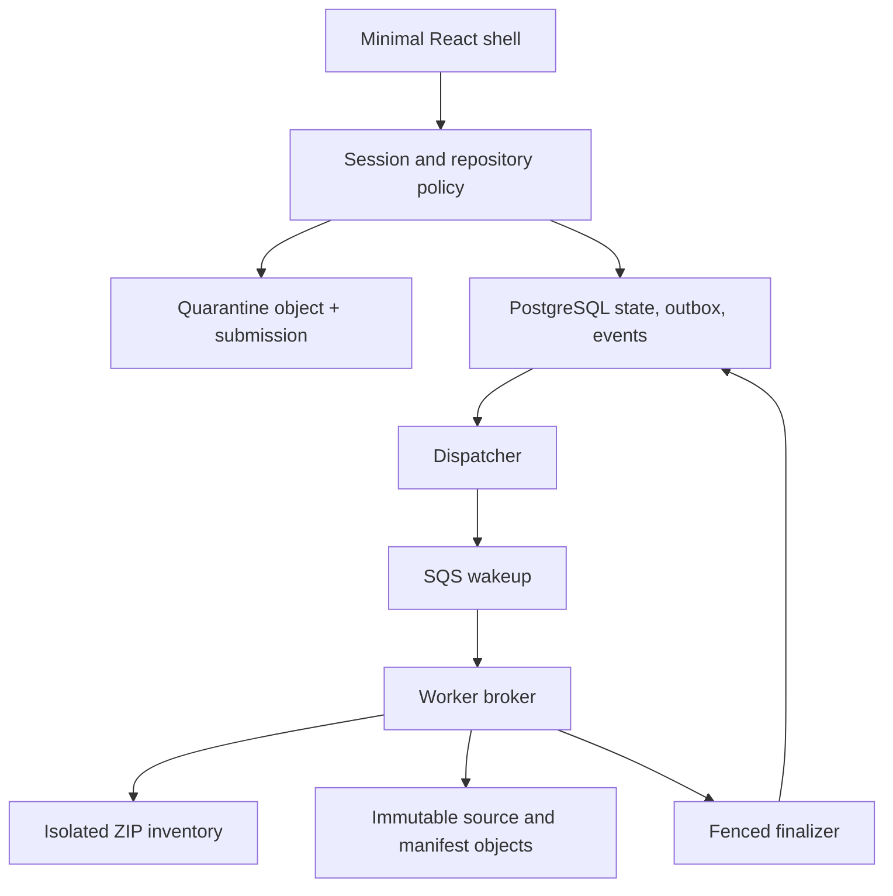
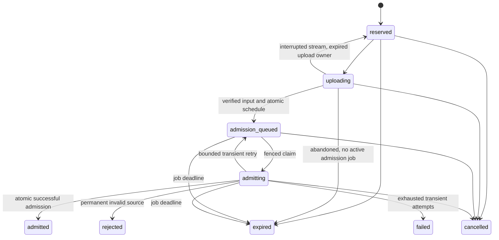
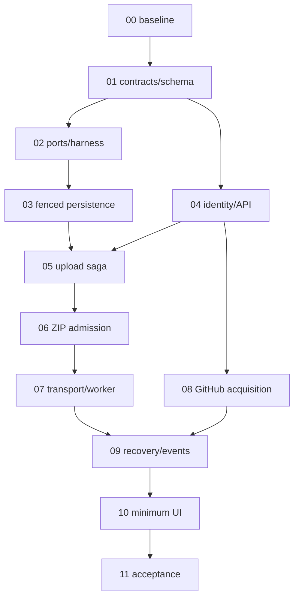

# Phase 2 - Safe Source Ingestion, Identity, Durable Jobs, and Artifact Lifecycle: Execution Plan

> **For the implementing agent:** Planning is complete only after review; this file is not execution authorization. On an explicit implementation instruction, use Superpowers executing-plans task by task and GodPrompt for scoped verification. Do not require subagents; use independent review only when separately authorized and available.

**Goal:** Turn an authenticated, authorized source submission into an immutable byte-grounded snapshot and a durable inventory result, with observable progress, recoverable jobs, cancellation, and owned-resource cleanup.
**Starting branch/commit inspected:** `main`, `fc39852b04909c04fbeb4c38a8b4c668a224f4d1`.
**Prompt reference:** Same commit; no material difference at the time of inspection. Re-resolve immediately before implementation.
**Revision:** 2.1, targeted planning corrections, 18 October 2026 (Asia/Calcutta).
**Date:** 18 October 2026, Asia/Calcutta.
**Repository destination:** `docs/phases/PHASE_2_SAFE_INGESTION_IDENTITY_JOBS_EXECUTION_PLAN.md`.
**Status:** Revised implementation specification. The complete supplied plan and local tracked source at the exact reference above were read. Documentation and installed dependency source were inspected read-only. No behavioral test, database connection, service startup, credential access, infrastructure action, or deployment was performed for this revision. The owner subsequently authorized implementation after revision; that later activity must have a separate execution ledger and acceptance evidence.

## 1. Outcome and scope

### 1.1 Required vertical slice

Reserve a source upload -> stream bounded ZIP bytes to quarantine -> admit and hash safe entries -> resolve/create a sealed snapshot -> schedule an inventory job -> publish an inventory summary and manifest references -> inspect status, exclusions and events -> cancel/retry safely -> clean owned temporary objects.

The second entry path takes an authorized GitHub repository and exact commit, obtains a bounded ZIP, and enters the same admission path. Local qualification mocks GitHub authentication/API responses. Real GitHub behavior remains a separate owner-configured qualification; never fabricate tokens or weaken authorization to make a demo pass.

Required: minimal identity/session handling, repository grants, API, raw upload streaming, local filesystem/S3 adapters, ZIP admission, durable PostgreSQL jobs/attempts/outbox/events, SQS/DLQ adapters, worker/recovery/cleanup loops, additive migrations, tests, and a small React shell. This is one coherent capability delivered in reviewable increments, not a request to build all future subsystems.

Prerequisite adaptations: transaction-sharing hooks in Phase 1 services; worker-only fenced write authority; storage reference replay stability; application authorization beyond organization membership. Optional: owner-configured live GitHub qualification. Deferred: TAR, resumable/multipart client uploads, presigned browser uploads, SSE, graph workbench, parsers, scanners, dependency installation, target execution, embeddings, agents, runtime/binary analysis and production deployment.

### 1.2 Success language

Admission success means the archive passed the declared format/path/resource policy. Inventory completion means byte-grounded paths, sizes and digests are available. Neither means the code was analyzed, safe, executable, or free of problems. A deliberately excluded file is not a corrupt upload; a corrupt archive is not a partial success.

## 2. Inspected baseline and Phase 1 handoff

### 2.1 Evidence and authority

| Category                     | Evidence / conclusion                                                                                                                                                                                                                                                                                                      |
| ---------------------------- | -------------------------------------------------------------------------------------------------------------------------------------------------------------------------------------------------------------------------------------------------------------------------------------------------------------------------- |
| Source inspected             | Current recursive tree; instructions; README; ADR0001/0002; acceptance/database guide; blueprint/Phase 1 plan; contracts; persistence service; repositories; guards; table metadata; settings; canonical JSON; harness; frontend package/config; CI; root lock                                                             |
| Recorded checks              | Acceptance reports 31 unit, 21 PostgreSQL integration, 3 migration and 1 performance test, strict typing/lint, plus a standalone demo. These are repository-recorded checks, not planning-time reruns                                                                                                                      |
| Delivered foundation         | Twelve mapped tables, revisions `0001_identity` through `0004_guards`, scoped SQLAlchemy repositories, immutable DTOs, atomic snapshot/result publication, guarded disposable PostgreSQL                                                                                                                                   |
| Not delivered                | HTTP API, sessions, admission, actual object storage, jobs/leases/outbox/events, workers and frontend screens                                                                                                                                                                                                              |
| Contract-only proposals      | `JobEnvelopeV1`, `AttemptLeaseV1`, `ProgressEventV1`, findings, embeddings/chunks in `contracts/future_work.py` and JSON Schemas                                                                                                                                                                                           |
| Prohibitions retained        | No owner AWS account, service-key setup, owner browser/Chrome automation, external workspaces, developer-service restart, deployment or automatic jobs during planning                                                                                                                                                     |
| Execution authority boundary | The owner explicitly selected revise-then-implement in the current conversation. Disposable PostgreSQL+LocalStack, fixture processes, local API/UI tests and PR/manual CI are implementation scope. No real credential setup, owner browser or AWS account access is authorized; browser E2E remains separately restricted |

`AGENTS.md` and `.codex/USER_PREFERENCES.md` were inspected. Their Phase 1 authorization alone did not authorize Phase 2; the current explicit revise-then-implement instruction supplies that additional scope without overriding cloud/key/browser restrictions. GitBook/Figma/Lovable/Composio are not needed to write this plan. Later UI work can use design tools for a concrete authorized deliverable; no external project is created just because a connector is installed.

### 2.2 Exact existing symbols to preserve/reuse

| Existing path / symbol                                                  | Reuse                                                                                                  | Necessary extension                                                                                                                                      |
| ----------------------------------------------------------------------- | ------------------------------------------------------------------------------------------------------ | -------------------------------------------------------------------------------------------------------------------------------------------------------- |
| `domain/scope.py`: Contract, TenantContext, RunRef                      | Frozen strict validated domain scope                                                                   | Construct context from sessions/membership; never trust request role/org as authority                                                                    |
| `domain/canonical_json.py`: canonical_bytes, semantic_digest, load_json | `codespy-json-v1`, timestamps/UUID normalization, duplicate JSON key rejection                         | Keep bytes/hashes stable; don't replace with a different canonicalizer                                                                                   |
| `db/transaction.py`: transaction(factory)                               | One session/transaction per service operation                                                          | Repositories still do not commit; avoid nested public services in atomic finalizers                                                                      |
| `IdentityRepository.resolve_context`, `authorize`                       | Re-check DB membership and role                                                                        | Organization membership alone is not per-repository access                                                                                               |
| `RepositoryRepository.create/get/list`                                  | Canonical scoped repository identity                                                                   | Add API grant policy and GitHub numeric-ID binding                                                                                                       |
| `PersistenceService.create_snapshot`                                    | Atomic file manifest + sealed snapshot; identity includes original archive SHA/config                  | Extract transaction-sharing helper; stable canonical storage_key; add finalizer fence plus persisted-file lookup in the same transaction (section 9.5.1) |
| `PersistenceService.create_run/start_run/fail_run/cancel_run`           | Preserve terminal state machine                                                                        | Fresh run per inventory attempt; no running->queued/reset                                                                                                |
| `PersistenceService.persist_result`                                     | Revalidates batch; compares entire stored result identity set and semantic hash; terminal replay check | Split internal in-transaction publishing from legacy local wrapper; job-bound writes must pass current fence                                             |
| `ResultBatchV1`, EvidenceEnvelopeV1, CoverageV1                         | Bounded result and evidence contracts                                                                  | Inventory summary uses zero graph nodes/edges and a bounded manifest-reference evidence record                                                           |
| `models/tables.py`                                                      | Existing centralized Core tables plus mappings                                                         | Keep convention; add `models/phase2_tables.py`, explicitly import metadata; no unrelated restructure                                                     |
| `0004_guards.py`                                                        | Immutable source/result and parent-lock guarantees                                                     | New revisions alter/add worker-bound guards; never edit historical revision                                                                              |
| `scripts/phase1_db.py` and test guard                                   | Ownership marker, generated test env, separate DB per suite                                            | Preserve port 55432/project ownership; add separately owned Phase 2 harness                                                                              |

**Source observations at `fc39852b04909c04fbeb4c38a8b4c668a224f4d1`:** `_create_snapshot_in_session` does not exist yet; it is a proposed extraction. Lines 67–81 of `create_snapshot` exclude candidate file IDs from the sorted manifest; the replay branch returns `SnapshotRecord` without inserting proposed IDs. Phase 2 must use stored IDs, not candidates.

Important implementation facts: `create_snapshot` compares artifact `storage_key` on replay, not just digest. `persist_result` rejects a batch omitting any previously staged records. Analysis runs cannot be reopened. Existing DB `write_version` rejects lifecycle races but is not a worker fence. App role has cross-tenant base-table SELECT; no hosted DB read isolation is claimed.

### 2.3 Locked toolchain

Retain root `uv.lock`, Python 3.12 and frontend lock. Relevant resolutions: FastAPI 0.143.3, Starlette 1.8.0, HTTPX 0.28.1, Authlib 1.9.1, boto3/botocore 1.40.61, aioboto3 15.5.0 / aiobotocore2.25.1, cryptography 50.0.2, SQLAlchemy 2.0.54, Pydantic 2.14.1. Frontend already has React 19, Vite, Tailwind, TanStack Query, RTL/MSW/Vitest/Playwright and hey-api code generation. Use those installed contracts rather than migrating SDK tooling without need.

No installed dependency implies active functionality. Arq/Redis/model/scanner packages remain dormant. No new runtime dependency is initially necessary. Any package change gets its own compatibility justification and root-lock diff.

## 3. Roadmap reconciliation

| Conflict                                          | Decision                                                                                                          |
| ------------------------------------------------- | ----------------------------------------------------------------------------------------------------------------- |
| Request contains a stray "phase1 planning" phrase | Attached prompt and primary request govern: Phase 2 planning after completed Phase 1                              |
| Old `PHASE_2_DSA_CPG_ENGINE.md`                   | Superseded numbering; structural extraction is Phase 3. Update stub to redirect when implementation is authorized |
| Blueprint's old Phase 1-unverified statement      | Current code/acceptance supersede it; don't reconstruct Phase 1                                                   |
| Blueprint Terraform wording vs accepted ADR       | Retain OpenTofu and Terraform-compatible HCL; no IaC provisioning in Phase 2                                      |
| Arq installed vs SQS architecture                 | SQS standard queue+DLQ, DB authoritative jobs/leases and outbox; no second scheduler                              |
| Queue V1 requires snapshot/run before admission   | Keep V1 historical schema; add JobEnvelopeV2 with only job references and dispatch generation                     |
| Full SSE workbench vs minimum UX                  | Persist replay-compatible events; polling only now; small upload/status/inventory shell                           |
| Broad archive/binary support                      | ZIP32 stored/deflate source archives first; unsupported formats reject clearly                                    |
| JWT-oriented env                                  | Opaque local sessions; GitHub App JWT is provider server authentication only, not browser auth                    |
| Worker fencing vs Phase 1 version                 | Both needed: job attempt fence at final write boundary, existing run version within result publication            |

## 4. Research and decision register

Official sources checked for this targeted revision on 18 October 2026; inherited source-register entries retain their original qualification status. Source register gives precise URLs. Technical source statements are separated from product defaults and proposed algorithms. Rolling docs are not proof that the locked SDK/emulator implements every option.

| Question                   | Alternatives                                                                   | Evidence                                                   | Decision                                                                              | Trade-off                                                                      | Verification                                                          |
| -------------------------- | ------------------------------------------------------------------------------ | ---------------------------------------------------------- | ------------------------------------------------------------------------------------- | ------------------------------------------------------------------------------ | --------------------------------------------------------------------- |
| Initial archive format     | ZIP; TAR; both                                                                 | Python 3.12 ZIP/TAR docs [R1-R2]                           | ZIP32 stored/deflate only; no extractall                                              | Narrow compatibility; simpler hostile-input policy                             | Producer fixture corpus, malformed ZIPs; explicit TAR/ZIP64 rejection |
| Upload path                | Raw stream; multipart; presigned client PUT                                    | FastAPI Request/lifespan [R3-R4]                           | Authenticated raw `application/zip` stream                                            | API relays <=100MiB; no multipart spool ambiguity                              | Chunked transfer, disconnect, body/time limits                        |
| Queue guarantees           | Standard; FIFO; DB-only                                                        | SQS duplicate/visibility/quotas [R5-R7]                    | Standard SQS wakeups; DB owns state                                                   | Duplicate handling required                                                    | Real PostgreSQL + LocalStack + deterministic fault injection          |
| Publication authority      | Run version; job fence; both                                                   | PG16 row locks [R8-R9], existing guard                     | Fence checked inside same authoritative write transaction                             | Refactor needed                                                                | Stale worker blocked after replacement/cancel                         |
| S3 immutable writes        | Overwrite; conditional create; versioned objects                               | S3 conditional write/consistency [R10-R11]                 | Conditional create, independent SHA256 verification, version ID when available        | Emulator/SDK qualification required                                            | Two writers,412/409, ambiguous PUT and checksum mismatch              |
| GitHub authority           | Installation alone; broad OAuth repo scope; App user+installation intersection | GitHub App docs [R12-R15]                                  | App user OAuth login plus independent installed-repository authority and local grants | Owner must configure App; existing OAuthApp credentials aren't interchangeable | Mock permission matrix; optional live qualification                   |
| OAuth implementation       | Starlette signed session state; explicit transient store                       | Authlib docs retrieval incomplete; GitHub OAuth/PKCE [R14] | Locked Authlib HTTPX OAuth2 client; server-side flow/state store                      | Small API spike required                                                       | Verify exact client methods against1.9.1 source; fail closed          |
| Initial progress transport | Polling; SSE                                                                   | Existing ProgressEventV1 and scope                         | Job events with monotonic sequence; HTTP polling                                      | Not live token streaming                                                       | Order, authorization, expiry and pagination tests                     |
| Local AWS fidelity         | Existing dev stack; separate emulator                                          | LocalStack service docs [R16-R17]                          | Dedicated pinned LocalStack 3.8.1 profile                                             | No proof of AWS IAM/timing parity                                              | API probes; hosted qualification deferred                             |
| Identity membership        | Org-wide repository access; explicit grants                                    | Current authorize only checks membership                   | New repository_grants, owner/admin policy                                             | Additional rows/checks                                                         | Cross-repo/tenant/revoked access cases                                |

Implementation spikes (P2-00, disposable only): (a) Authlib 1.9.1 authorize/token client method signatures with HTTPX mock transport and S256; no live keys; (b) botocore 1.40.61 supports selected IfNoneMatch/checksum parameters, LocalStack 3.8.1 honors concurrent conditional writes/VersionId; (c) raw streaming with locked Starlette does not spool whole body; (d) admission sandbox enforces the selected Linux limits; (e) 10,000-file snapshot persistence fits an explicitly bounded finalizer budget. If a required capability fails, stop that adapter at an explicit unavailable result; do not replace conditional writes with an unsafe read-then-overwrite fallback or silently upgrade everything.

Authlib public documentation endpoints failed retrieval in this planning session. Its exact integration is an execution spike, not represented as source-verified. GitHub OAuth/PKCE requirements were read from official documentation independently.

## 5. Architecture and trust boundaries

### 5.1 Modules and authority

| Component / proposed paths                                    | Responsibility                                                           | Forbidden authority                                                    |
| ------------------------------------------------------------- | ------------------------------------------------------------------------ | ---------------------------------------------------------------------- |
| `app/api/{application,dependencies,errors}.py`, `api/v1/`     | Lifespan resources, session/CSRF/repo authorization, bounded DTO routes  | Parsing archives, running target code, arbitrary URL/object-key access |
| `security/{sessions,oauth,authorization,archive_paths}.py`    | Identity and policy checks; safe path rules                              | Trusting browser-supplied TenantContext or repository text             |
| `services/{submissions,admission,jobs,events,cleanup}.py`     | Short state transitions and orchestration                                | Holding DB transactions during network/filesystem work                 |
| `ports/{object_store,queue,github,clock}.py`                  | Typed replaceable infrastructure interfaces                              | Adapters deciding user permissions                                     |
| `adapters/storage/{local,s3}.py`                              | Immutable bounded streams, exact-version metadata/deletion               | Serving arbitrary caller-chosen paths or keys                          |
| `admission/{zip_inventory,manifest,process}.py`               | Byte inventory and resource enforcement in isolated subprocess/container | Credentials, DB access, GitHub access, package/build execution         |
| `adapters/github/{auth,client,downloads}.py`                  | Fixed-origin scoped GitHub operations                                    | Arbitrary git URLs, hooks, tokens in logs/subprocesses                 |
| `workers/{dispatcher,consumer,heartbeat,recovery,cleanup}.py` | Leases, wakeup delivery, retries and cleanup                             | Bypassing the finalization fence                                       |
| `services/job_finalization.py`                                | Only job-bound authoritative snapshot/result write service               | Opening nested persistence transactions or external I/O                |
| `frontend/src/features/ingestion/`                            | Submit, poll, cancel, inventory/exclusions, errors                       | Claiming code analysis or exposing credentials                         |



API, broker and archive process have different privileges. Broker stages a descriptor/private input, launches an allowlisted inventory executable/module, and receives bounded normalized output. Archive process has no secrets/network/DB and never imports submitted code. Pure-Python ZIP handling is still an untrusted-input processing surface; process timeout alone is not a hostile multi-tenant sandbox. Local fixtures are qualified; public untrusted hosting stays blocked until hosted isolation is qualified in the hosted-operation phase.

Use FastAPI lifespan to own engine/session factory, HTTPX clients, AWS async client contexts and shutdown. Never create clients per archive entry or call blocking SDK/filesystem loops on the API event loop. Bounded async streams and dedicated worker/subprocess I/O handle long work. No Docker socket in the API; local test harness controls disposable containers.

### 5.2 Jobs, source identity and runs are different

Two required operations:

1. `admit_source`: references a source_submission, initially no snapshot or run. For GitHub, broker first obtains an exact-revision ZIP under checked authority. Archive processing produces stable source/manifest objects, then a fenced transaction seals the snapshot and schedules one child inventory job.
2. `inventory_snapshot`: references the sealed snapshot and published inventory manifest. Every worker attempt gets a **fresh** analysis run (`analyzer_name=source-inventory`, version1), so expired attempts never share mutable result rows. The job's successful attempt points to the published run.

The inventory job reads the admitted manifest, not source syntax. Its ResultBatchV1 has empty nodes/edges/derivations and one evidence record pointing to the manifest digest/object ID, entry/eligibility counts, exclusions and policy version. Never create fake file/function nodes to simulate Phase 3. Retryable attempt failures close their own run as failed; replacement creates a new queued->running run without rewriting prior results.

## 6. Contracts, schemas, and lifecycle diagrams

### 6.1 Common wire rules

Reuse strict frozen Contract and `codespy-json-v1`. UUID/time parsing uses Pydantic JSON-validation semantics at HTTP/queue boundaries; direct Python callers use UUID/aware datetime. Extra fields reject. No `model_construct` or unchecked `model_copy` bypass at service writes. Canonical request digests omit incidental timestamps but include org/repository, requested source/ref, digest/length if specified, policy hash and operation.

All user requests carry a selected org/repository identifier, but the server constructs TenantContext from the authenticated principal plus DB memberships/grants. Queue/config objects carry identifiers, not authority. References are resolved against DB state. Secrets, raw source, authorization headers and storage URLs do not enter queue/event payloads.

| Contract                     | Fields and bounds                                                                                                                                                                                                                                                                                                                                        | Owner / compatibility                                                                                                                          |
| ---------------------------- | -------------------------------------------------------------------------------------------------------------------------------------------------------------------------------------------------------------------------------------------------------------------------------------------------------------------------------------------------------- | ---------------------------------------------------------------------------------------------------------------------------------------------- |
| UploadReservationV1 request  | schema_version1; repository_id UUID; filename display-only <=255 UTF8 bytes; declared_size 1..100MiB; declared_sha256 optional hash64; idempotency key header1..128 bytes                                                                                                                                                                                | API; org/context derived; <=4KiB JSON; same key+different request409                                                                           |
| UploadReservationV1 response | submission_id, state reserved, upload_path relative, expiry, max_bytes, policy_hash                                                                                                                                                                                                                                                                      | No presigned/object key or token; same-origin upload                                                                                           |
| GitHubAcquisitionV1          | repository_id, installation_id positive int, github_repository_id positive int, requested_ref1..255 bytes; full SHA only after resolution                                                                                                                                                                                                                | API binds canonical numeric identity; <=4KiB; arbitrary URL forbidden                                                                          |
| AdmissionResultV1            | submission_id, policy_hash, archive_sha256, bytes_received, manifest_sha256/size, total_entries, regular_file_count, eligible/excluded counts, snapshot_id optional, disposition admitted/rejected, error_code optional                                                                                                                                  | Internal output <=16KiB excluding manifest object; atomic availability separate                                                                |
| ArtifactManifestV1           | schema_version1; policy_version and policy_hash; original archive digest/size; normalized_files_sha256 (the Phase 1 source-file manifest digest, section 7.5.1); source metadata: numeric GitHub repository ID and resolved commit, or null for uploaded archives when GitHub; ordered entry records with path,size,sha256,language_hint,eligible,reason | <=64MiB object, <=10k entries; source_files includes all safe regular entries; IDs attached by finalizer                                       |
| InventoryResultV1            | scope RunRef; manifest object reference+digest; counts, bounded exclusion summary by reason, no source contents; generated ResultBatchV1                                                                                                                                                                                                                 | <=32KiB summary; individual entries through paginated reads                                                                                    |
| JobEnvelopeV2                | schema_version2; org_id/job_id UUID; operation admit_source/inventory_snapshot; dispatch_generation positive int; config_hash hash64; deadline aware timestamp                                                                                                                                                                                           | <=4KiB canonical UTF8. No required snapshot/run before admission. Reject V1 at Phase 2 consumer with diagnostic; historical V1 schema remains  |
| AttemptLeaseV2               | schema_version2; org_id,job_id,attempt_id; fence>0; owner<=128bytes; lease_expires_at,heartbeat_at; run_ref optional for admission, required for inventory                                                                                                                                                                                               | Server-issued; not a public bearer token; internal <=2KiB                                                                                      |
| JobEventV2                   | schema_version2; org_id,job_id,sequence>=1; run_ref optional; type closed enum; timestamp; public_payload object<=4KiB                                                                                                                                                                                                                                   | Pre-snapshot events cannot use run-only ProgressEventV1. Preserve V1 unchanged                                                                 |
| CancelRequestV1              | schema_version1; optional reason enum user_requested/access_revoked; idempotency header                                                                                                                                                                                                                                                                  | No caller-supplied fence, state or role; <=1KiB                                                                                                |
| ErrorV1                      | code closed enum; safe message<=256chars; request_id; retryable bool; optional field path; no raw exception                                                                                                                                                                                                                                              | <=2KiB;401 unauthenticated,403 CSRF,404 unavailable scope,409 state/input conflict,413 size,415 format,422 validation,429 quota,503 dependency |
| PageV1                       | items, next_cursor optional, snapshot/job scope, data_version; limit1..200 default50                                                                                                                                                                                                                                                                     | Cursor binds filters/org/job or snapshot; immutable snapshot inventory keyset path. <=256KiB response; may return fewer than limit by byte cap |

Representative valid queue: `{schema_version:2,org_id:<UUID>,job_id:<UUID>,operation:admit_source,dispatch_generation:1,config_hash:<hash64>,deadline:<UTC time>}` encoded as real JSON with quoted keys. Invalid: V1 with fabricated all-zero snapshot, unknown operation, embedded access_token, message>4KiB, or generation mismatching DB. HTTP valid reservation describes1000 bytes ZIP; invalid declared_size0 or storage_key supplied by client. Contract tests include fully serialized literal JSON fixtures, not these explanatory placeholders.

### 6.1.1 Shared types and closed enums

- `schema_version` is an integer literal (1 for new HTTP/domain contracts, 2 for new queue/lease/event contracts). Only schema version, optional fields, empty lists, and page size have defaults. UUIDs, hashes, required counts, and timestamps have no fabricated defaults.
- Hashes are exactly 64 lowercase hex characters. Counts and byte sizes are nonnegative signed-64-bit values with the narrower policy caps applied. Strings are validated by UTF8 byte length where a byte bound is specified. Return validation errors through the central error mapper.
- Optional fields default to null. Job dispatch generation starts at 1; fence, event sequence, attempts, and send counts start at 0. Time comes from the server/database; callers cannot choose lifecycle timestamps.
- `source_kind` is `upload_zip` or `github_archive` on submissions. This does not rename the historical repository `source_kind`; use the existing repository source_kind `archive` for uploads and `github` for provider acquisition; keep `local_fixture` for historical fixture repositories.
- Attempt states: `active`, `succeeded`, `failed`, `expired`, `cancelled`. Outbox states: `pending`, `claimed`, `sent`. Cleanup states: `pending`, `claimed`, `done`, `exhausted`. Job/submission/object states are the closed sets in sections 6–9. Submission states are the exact closed set and transitions in section 6.3; job-owned terminalization always updates its submission through that table.
- Public event types: `submitted`, `upload_verified`, `queued`, `commit_pinned`, `attempt_started`, `progress`, `retry_scheduled`, `cancel_requested`, `cancelled`, `admitted`, `inventory_completed`, `inventory_partial`, `failed`. A payload has a type-specific strict schema; it is not arbitrary user JSON. Only counts, safe stage/error codes, commit SHA where authorized, and opaque references are allowed. No source path appears in events.
- Error codes initially include `unauthenticated`, `csrf_invalid`, `resource_unavailable`, `validation_error`, `idempotency_conflict`, `invalid_state`, `already_terminal`, `quota_exceeded`, `upload_length_mismatch`, `upload_hash_mismatch`, `upload_timeout`, `unsupported_format`, `unsupported_name_encoding`, `unsafe_archive_path`, `archive_collision`, `archive_corrupt`, `archive_limit_exceeded`, `admission_timeout`, `admission_process_failed`, `storage_integrity_error`, `storage_unavailable`, `queue_unavailable`, `provider_unconfigured`, `provider_unavailable`, `provider_capacity_unsupported`, `access_revoked`, `stale_attempt`, `deadline_exceeded`, `attempts_exhausted`, `cursor_expired`, and `invariant_failed`, `finalization_timeout`, `finalization_outcome_unknown`, `source_unavailable_for_retry`, and `retry_not_supported`. Retry classification follows section 9, not an exception-name guess. `stale_attempt` is an internal control result, not a public retry permission.
- Cancellation reason defaults to `user_requested`. Only the trusted revocation handler can issue `access_revoked`; reject that reason from an ordinary client rather than trusting its label.

### 6.1.2 Literal contract examples

The following are syntactically valid illustrative JSON. Repeated hexadecimal digests are schema examples, not claimed fixture-content hashes. P2-01 replaces them with computed hashes for behavioral tests. Use these UUIDs consistently across related fixture objects:

```json
{
  "org_id": "11111111-1111-4111-8111-111111111111",
  "repository_id": "22222222-2222-4222-8222-222222222222",
  "submission_id": "33333333-3333-4333-8333-333333333333",
  "job_id": "44444444-4444-4444-8444-444444444444",
  "attempt_id": "55555555-5555-4555-8555-555555555555",
  "snapshot_id": "66666666-6666-4666-8666-666666666666",
  "run_id": "77777777-7777-4777-8777-777777777777"
}
```

| Contract                   | Valid fixture case                                                                                                              | Invalid mutation and outcome                                                                                                      |
| -------------------------- | ------------------------------------------------------------------------------------------------------------------------------- | --------------------------------------------------------------------------------------------------------------------------------- |
| UploadReservation request  | Version 1, repository UUID, `filename="demo.zip"`, `declared_size=120`, optional SHA null; header key `upload-demo-1`           | Zero/over-limit size, filename >255 UTF8 bytes, or extra storage key -> 422; changed request under same key -> 409                |
| UploadReservation response | Reserved submission, relative `/api/v1/uploads/<id>/content`, UTC expiry, max bytes 104857600, policy hash                      | Absolute third-party upload URL or token/storage key -> schema rejection                                                          |
| GitHubAcquisition          | Version 1, repository UUID, positive installation/repository numbers, `requested_ref="main"`                                    | URL instead of ref, invalid numeric identity, or unbound installation -> validation/unavailable scope                             |
| AdmissionResult            | Admitted result with actual archive size/hash, manifest size/hash, complete counts, snapshot null until finalizer               | Rejected result with available snapshot or fabricated manifest -> invalid tagged union                                            |
| ArtifactManifest           | Version 1, policy/hash, archive digest/size, source metadata, ordered entries; `README.md`, size 5, computed SHA, eligible text | Duplicate/colliding path, invalid digest, wrong sorting/counts, or unsafe path -> reject, no snapshot                             |
| InventoryResult            | Exact RunRef, manifest object ID/hash, counts and exclusion summary, byte inventory complete                                    | Foreign snapshot/run, counts disagreeing with manifest, raw source payload -> reject before publication                           |
| JobEnvelopeV2              | Full literal example below                                                                                                      | V1 fabricated run, unknown operation, secret field, >4 KiB, stale generation -> reject/diagnose or acknowledge stale without work |
| AttemptLeaseV2             | Admission lease with null run; inventory lease with matching RunRef                                                             | Zero fence, expired lease, wrong owner/run -> contract rejection or StaleAttempt at the database boundary                         |
| JobEventV2                 | Version 2, scoped job, sequence 1, queued type, UTC timestamp, `{"stage":"queued"}`, null run                                   | Sequence 0, unknown type, source content, >4 KiB -> reject; foreign event read -> 404                                             |
| CancelRequest              | `{"schema_version":1,"reason":"user_requested"}`                                                                                | Fence/role/state injection or client `access_revoked` -> 422                                                                      |
| ErrorV1                    | Full example below                                                                                                              | Raw traceback, source path, cookie, unknown code, or oversized message -> mapper/schema test failure                              |
| PageV1                     | Authorized scope, immutable data version, up to 200 items, null cursor on final page                                            | Foreign/filter-mismatched cursor -> 422; unauthorized scope -> 404; expired event cursor -> 410                                   |

```json
{
  "schema_version": 2,
  "org_id": "11111111-1111-4111-8111-111111111111",
  "job_id": "44444444-4444-4444-8444-444444444444",
  "operation": "admit_source",
  "dispatch_generation": 1,
  "config_hash": "aaaaaaaaaaaaaaaaaaaaaaaaaaaaaaaaaaaaaaaaaaaaaaaaaaaaaaaaaaaaaaaa",
  "deadline": "2026-10-18T12:15:00.000000Z"
}
```

```json
{
  "schema_version": 2,
  "org_id": "11111111-1111-4111-8111-111111111111",
  "job_id": "44444444-4444-4444-8444-444444444444",
  "attempt_id": "55555555-5555-4555-8555-555555555555",
  "fence": 1,
  "owner": "fixture-worker-1",
  "heartbeat_at": "2026-10-18T12:00:00.000000Z",
  "lease_expires_at": "2026-10-18T12:01:30.000000Z",
  "run_ref": null
}
```

```json
{
  "schema_version": 1,
  "code": "upload_length_mismatch",
  "message": "Uploaded byte count does not match the reservation.",
  "request_id": "fixture-request-1",
  "retryable": false,
  "field_path": "declared_size"
}
```

Pydantic structural validity does not confer authorization or a live lease. Tests must separately show that a structurally valid foreign/stale object fails service/database authority checks. Public response DTOs never expose the internal lease example.

### 6.2 New physical schema (additive, 17 tables)

Implementation refinement: `api_commands` is the seventeenth table (revision `0009_api_commands`). Its scoped `(org_id, principal_id, request_key)` key stores operation, request hash and bounded public response in the same transaction as repository creation or GitHub binding. Identical replay returns the original result; changed input conflicts. A revoked binding requires a fresh command and fresh authorization. This closes ambiguous-response duplication without changing Phase 1 identities.

Notation: all owned tables have `org_id UUID NOT NULL`; all IDs UUID generated server-side; created/updated/expiry columns TIMESTAMPTZ UTC; hashes TEXT lower-case64hex CHECK; states TEXT+named CHECK; no hidden references in JSON. Use explicit composite FK scopes matching existing candidate keys. Core identity-principal tables below are global only where explicitly stated. Bound JSON encodings in DTOs and named SQL shape checks. Every table specifies the concrete consumer/index. No generic CRUD framework.

| Table / exact essential columns                                                                                                                                                                                                                                                                                                                                                                                                                                                                                                                                          | Keys, constraints and query indexes                                                                                                                                                                                                                                                                                                                                                                | Consumer / deletion                                                                                                                                        |
| ------------------------------------------------------------------------------------------------------------------------------------------------------------------------------------------------------------------------------------------------------------------------------------------------------------------------------------------------------------------------------------------------------------------------------------------------------------------------------------------------------------------------------------------------------------------------ | -------------------------------------------------------------------------------------------------------------------------------------------------------------------------------------------------------------------------------------------------------------------------------------------------------------------------------------------------------------------------------------------------- | ---------------------------------------------------------------------------------------------------------------------------------------------------------- |
| `external_identities(provider TEXT, subject TEXT, principal_id UUID, created_at)`                                                                                                                                                                                                                                                                                                                                                                                                                                                                                        | PK(provider,subject); FK principal; UQ(provider,principal_id); numeric GitHub user ID string, never mutable login/email                                                                                                                                                                                                                                                                            | OAuth identity mapping; index principal; no automatic account linking                                                                                      |
| `oauth_flows(id UUID, state_hash, browser_hash, verifier_cipher BYTEA, key_id TEXT, return_path TEXT, expires_at, consumed_at nullable, created_at)`                                                                                                                                                                                                                                                                                                                                                                                                                     | PK id; UQ state_hash; expiry index; browser hash required; return path allowlisted                                                                                                                                                                                                                                                                                                                 | One-time login, global transient security record; expiry cleanup                                                                                           |
| `sessions(id UUID, principal_id UUID, token_hash, csrf_hash, issued_at,last_seen_at,idle_expires_at,absolute_expires_at,revoked_at nullable)`                                                                                                                                                                                                                                                                                                                                                                                                                            | PKid; UQtoken_hash; FKprincipal; principal/revoked and expiry indexes                                                                                                                                                                                                                                                                                                                              | Opaque sessions; no token plaintext; revoke/TTL; housekeeping DELETE permitted                                                                             |
| `github_user_grants(principal_id UUID, token_cipher BYTEA,key_id TEXT,expires_at,revoked_at nullable,version BIGINT,last_verified_at)`                                                                                                                                                                                                                                                                                                                                                                                                                                   | PK/FKprincipal; version>=0; no token without key_id; no refresh token stored in Phase 2                                                                                                                                                                                                                                                                                                            | User-to-App OAuth access; expires -> reauthorize. App is separate installation authority                                                                   |
| `repository_grants(org_id,repository_id,principal_id,permission TEXT,revoked_at nullable,created_at)`                                                                                                                                                                                                                                                                                                                                                                                                                                                                    | PK(org,repo,principal); FK(org,repo) repositories, FK(org,principal) memberships; permission read/write; reverse(org,principal,repo)                                                                                                                                                                                                                                                               | Explicit private repository policy; no implied grant from installation                                                                                     |
| `github_repository_bindings(org_id,repository_id,github_repository_id BIGINT,installation_id BIGINT,account_id BIGINT,state,version,last_checked_at)`                                                                                                                                                                                                                                                                                                                                                                                                                    | PK(org,repo); UQ(org,github_repository_id); IDs>0; state active/suspended/revoked; installation index                                                                                                                                                                                                                                                                                              | Canonical App association; role checks at bind/acquire/read; mapping updates version                                                                       |
| `org_work_limits(org_id,max_active_jobs INT,max_pending_jobs INT,max_reserved_bytes BIGINT,reserved_bytes BIGINT,created_at)`                                                                                                                                                                                                                                                                                                                                                                                                                                            | PK/FKorg; positive limits; reserved>=0 <=max; row lock for reservation/claim                                                                                                                                                                                                                                                                                                                       | Default quotas:active2,pending20,reserved1GiB; durable counters calculated/repaired against submissions                                                    |
| `source_submissions(org_id,id,repository_id,principal_id,source_kind,state,request_key,request_hash,retry_of_submission_id UUID NULL,reserved_bytes BIGINT NOT NULL,reservation_released_at TIMESTAMPTZ NULL,finished_at TIMESTAMPTZ NULL,declared_size nullable,declared_sha nullable,actual_size nullable,actual_sha nullable,input_object_id nullable,snapshot_id nullable,requested_ref nullable,resolved_commit nullable,policy_hash,error_code nullable,upload_owner nullable,upload_expires_at nullable,expires_at,created_at)`                                   | PK(org,id); UQ(org,request_key); FKrepo,membership; UQ(org,repo,id), scoped same-repo retry_of FK; reserved_bytes>=0; terminal submission iff finished_at nonnull; released timestamp immutable once set; terminal state/reference shape from section 6.3; named source/state/nullability checks; FKscoped objects/snapshot added after dependencies; repo/created and expiry indexes              | Upload/admission lifecycle, numeric GitHub info via binding; identity fields immutable; no plaintext URLs/tokens                                           |
| `object_records(org_id,id,repository_id,key TEXT,kind,state,sha256 nullable,size_bytes nullable,version_id nullable,owner_job_id nullable,owner_fence nullable,expires_at nullable,created_at)`                                                                                                                                                                                                                                                                                                                                                                          | PK(org,id); UQ(org,repo,key); scoped repo FK; kind input/stage/source/manifest; state reserved/writing/quarantined/verified/available/deleting/deleted; hash+size required at verified/available; owner fields paired; state/expiry index                                                                                                                                                          | Object-state ledger is separate from immutable Phase 1 artifacts; availability gates every download/read                                                   |
| `inventory_entries(org_id,snapshot_id,file_id,eligible BOOLEAN,exclusion_reason TEXT nullable,policy_hash,created_at)`                                                                                                                                                                                                                                                                                                                                                                                                                                                   | PK(org,snapshot,file); FKexisting source_files; eligible iff reason NULL; reason enum oversized/unsupported_language/binary/nested_archive/sensitive_path/generated_dependency; index(org,snapshot,eligible,file)                                                                                                                                                                                  | Cheap paginated inventory/exclusion reads; every safe file remains byte-hashed in source_files                                                             |
| `jobs(org_id,id,repository_id,principal_id,submission_id nullable,snapshot_id nullable,parent_job_id nullable,retry_of_job_id nullable,operation,state,request_key,request_hash,config_hash,dispatch_generation BIGINT,fence BIGINT,current_attempt_id nullable,result_run_id nullable,result_object_id nullable,cancel_requested_at nullable,attempt_count INT,max_attempts INT,not_before,deadline,event_sequence BIGINT,events_min_sequence BIGINT NOT NULL DEFAULT 1,publication_checked_at TIMESTAMPTZ NULL,failure_code nullable,created_at,finished_at nullable)` | PK(org,id); UQ(org,request_key); scoped repo/membership/submission/snapshot/parent/retry_of FKs; UQ(org,repo,id); retry_of is distinct from parent admission-child relation; publication_checked_at required only for succeeded/partial; operation/state shape; current attempt FK added after attempts; ready(not_before,org,id) partial queued/retry_wait; active(org,state); expiry/state index | Authoritative scheduling; no run required admission. result_run scoped to inventory snapshot. Immutable request; new retry-after-terminal job uses new key |
| `job_attempts(org_id,job_id,id,fence BIGINT,owner TEXT,state,run_snapshot_id nullable,run_id nullable,lease_expires_at,heartbeat_at,started_at,finished_at nullable,error_code nullable)`                                                                                                                                                                                                                                                                                                                                                                                | PK(org,job,id); UQ(org,job,fence); job FK, scoped run FK; partialUQ(org,job) WHERE state=active; run pair both NULL or both nonnull                                                                                                                                                                                                                                                                | Attempts/leases; previous run never reopened; expired attempt->terminal before replacement                                                                 |
| `outbox(org_id,id,job_id,kind TEXT,generation BIGINT,payload JSONB,state,claim_token nullable,claim_expires_at nullable,send_attempts INT,next_send_at,sent_at nullable,created_at)`                                                                                                                                                                                                                                                                                                                                                                                     | PK(org,id); UQ(org,job,kind,generation); scopedjobFK; kind wakeup/dead_letter; <=4KiB payload; pending/due index; claim expiry index                                                                                                                                                                                                                                                               | Short dispatcher claims; no DB transaction around SendMessage; duplicates tolerated                                                                        |
| `job_events(org_id,job_id,sequence BIGINT,event_type TEXT,run_snapshot_id nullable,run_id nullable,public_payload JSONB,created_at)`                                                                                                                                                                                                                                                                                                                                                                                                                                     | PK(org,job,sequence); job/run FKs; payload<=4KiB; type enum; created index for TTL                                                                                                                                                                                                                                                                                                                 | Job lock allocates sequence; polling now, SSE later; no raw source/token/path diagnostics                                                                  |
| `webhook_receipts(delivery_id TEXT,event_type TEXT,body_sha256,state,normalized_action JSONB,received_at,processed_at nullable)`                                                                                                                                                                                                                                                                                                                                                                                                                                         | PKdelivery; bounded ID/type; hash; state received/processed; received index                                                                                                                                                                                                                                                                                                                        | Signature validated before insertion; same ID/different body rejects;7-dayTTL; store normalized action only, no raw secret body                            |
| `cleanup_tasks(org_id,id,object_id,reason,state,claim_token nullable,claim_expires_at nullable,attempt_count INT,next_attempt_at,last_error_code nullable,created_at)`                                                                                                                                                                                                                                                                                                                                                                                                   | PK(org,id); UQ(org,object,reason); objectFK; pending/due and claimexpiry indexes                                                                                                                                                                                                                                                                                                                   | Exactly scoped object deletion/abandoned staging; no general recursive prefix removal                                                                      |

Required additional columns/indexes on existing tables: `analysis_runs.worker_job_id UUID NULL`, `worker_attempt_id UUID NULL`, `worker_fence BIGINT NULL` all-null or all-present; scoped FK to matching attempt identity/fence; unique(org,snapshot,id,worker_job_id,worker_attempt_id,worker_fence) only if a referenced key requires it. Add conditional trigger that job-bound inserts/publication require current live job/attempt/fence and run mapping. Preserve run write_version/history. `artifacts` and `source_files` retain existing immutable schema; object availability is joined by org/repo/storage_key through object_records. Do not weaken old immutable triggers.

Use migration-time explicit column lists, lengths and full defaults: random IDs/tokens service-generated; timestamps DB clock; state initial per lifecycle; counters0 except generation1; nullable fields only where identified above. All FK deletes RESTRICT except transient session/flow housekeeping. No API physical deletion of accepted snapshots/results. Runtime grants: no DDL/TRUNCATE/trigger changes; result-writer broker role alone writes job-bound source/results, API cannot. Upgrade scripts define role grants separately with explicit role parameters, preserving Phase 1 test role behavior.

### 6.3 Authoritative submission/job transition table

This is the single transition authority for admission and its child inventory work. Terminal submissions are `admitted`, `rejected`, `failed`, `expired`, `cancelled`; other states are `reserved`, `uploading`, `uploaded`, `admission_queued`, `admitting`. Terminal submission identity, snapshot binding and outcome never reopen. An admitted submission remains admitted even when its inventory child fails or access is later revoked. Job states remain `queued`, `running`, `retry_wait`, `cancelling`, `succeeded`, `partial`, `failed`, `cancelled`; a deadline uses failed/deadline_exceeded, not a new job-state spelling.

Every job terminalization takes the locks in section 9.1 and writes the corresponding submission/event/object/accounting changes in that same transaction. An inventory operation does not rewrite an admitted submission. `R` below means the exact accounting CAS in section 6.3.1, not an informal decrement. Object cleanup is ledger-scheduled outside the transaction after reference checks (section 7.5).

| Current submission/job state                                                                              | Trigger                                                                                | Authorized actor                                                                   | Atomic changes                                                                                                                                                                                             | Resulting states                                                                                         | Reservation accounting                                                  | Object retention/cleanup                                                                                                                             | Retry eligibility                                                                                                         |
| --------------------------------------------------------------------------------------------------------- | -------------------------------------------------------------------------------------- | ---------------------------------------------------------------------------------- | ---------------------------------------------------------------------------------------------------------------------------------------------------------------------------------------------------------- | -------------------------------------------------------------------------------------------------------- | ----------------------------------------------------------------------- | ---------------------------------------------------------------------------------------------------------------------------------------------------- | ------------------------------------------------------------------------------------------------------------------------- |
| reserved or abandoned uploading / no job                                                                  | Upload TTL expires; no live upload owner                                               | Submission recovery sweep                                                          | Invalidate upload token; record expiry/error, finished_at, event, cleanup intents                                                                                                                          | expired / none                                                                                           | R                                                                       | Exact incomplete/unreferenced stage cleanup; no reusable verified input promised                                                                     | New upload/acquisition request, not job retry                                                                             |
| uploading / none                                                                                          | Complete byte-count/digest verification                                                | Current upload owner under CAS                                                     | Bind byte-verified input (verified does not mean archive-safe), actual hash/size; create admission job/outbox/event                                                                                        | admission_queued / queued (uploaded is recoverable scheduling intermediate only)                         | Hold until admission outcome                                            | Keep selected verified input pinned by submission/job                                                                                                | Same command key replays identical completion only                                                                        |
| admitting / running admit_source                                                                          | Invalid/corrupt archive, unsafe paths, unsupported format, hash/invariant mismatch     | Current fenced attempt via typed permanent-failure finalizer                       | Fail attempt/job with exact error; set submission rejected and finished_at; no snapshot/child; event and cleanup intents                                                                                   | rejected / failed                                                                                        | R                                                                       | Unreferenced inputs/stages queued for deletion; no accepted-source reference                                                                         | Permanent rejection never manual-retries; a corrected source/policy requires a new submission                             |
| admitting / running admit_source                                                                          | Transient fault or lease loss, retries remain, deadline allows retry                   | Current fenced failure callback or DB reaper after authority recheck               | Close only that attempt; increment dispatch generation; bounded backoff/outbox/event; keep selected acquisition immutable                                                                                  | admission_queued / retry_wait, then queued when due                                                      | Hold; no release/re-reserve per attempt                                 | Retain verified input; clean only lost-attempt stages                                                                                                | Automatic retry uses same submission and selected input; at most max_attempts                                             |
| admitting or admission_queued / running or retry_wait admit_source                                        | Transient attempts exhausted                                                           | Current fenced callback or recovery sweep                                          | Close active attempt if present; failed/attempts_exhausted and finished_at on job/submission; one diagnostic outbox/event                                                                                  | failed / failed                                                                                          | R                                                                       | Verified input retained for at most 24h from terminalization when allowed; exact stages cleaned                                                      | New submission via section 9.4.1 if error class and retained verified input allow                                         |
| admission_queued / queued or retry_wait admit_source                                                      | Absolute job deadline reached while not claimed                                        | DB recovery sweep, independent of dispatcher/SQS                                   | Fence/invalidate any stale mapping; fail job/deadline_exceeded and expire submission; obsolete wakeups ignored; event                                                                                      | expired / failed                                                                                         | R                                                                       | Keep byte-verified input up to terminal-input TTL for explicit retry; clean stages                                                                   | New submission only; no new wakeup extends old deadline                                                                   |
| admitting / running admit_source                                                                          | Deadline reached, including finalization rejection                                     | Recovery sweep after acquiring locks; current callback can request same transition | Invalidate fence, close attempt failed/deadline_exceeded, expire submission, terminal job/event                                                                                                            | expired / failed                                                                                         | R                                                                       | Same bounded verified-input retention; no snapshot becomes visible                                                                                   | New submission with retained input only; never reopen this job                                                            |
| reserved/uploading/uploaded/admission_queued/admitting / none, queued, retry_wait or running admit_source | User cancellation                                                                      | Repository-write session; no caller fence/role                                     | Invalidate upload owner; increment job fence if job exists; cancel attempt and bound run if any; terminal submission and event                                                                             | cancelled / none or cancelled; running job may use cancelling until cleanup acknowledgement/grace reaper | R in the cancellation transaction, not again on acknowledgement         | POST cancel retains verified input up to 24h for explicit retry; DELETE submission immediately schedules unreferenced input deletion; stages cleaned | New submission if retained input still verified and source/error policy permits; otherwise source_unavailable_for_retry   |
| any nonterminal submission/admission job; admitted/inventory child separately                             | Membership/grant/provider revocation                                                   | Trusted revocation handler plus bounded recovery fan-out                           | Persist revocation marker first; cancel affected current attempts/fences/jobs; terminalize non-admitted submission; deny reads/publication immediately under local policy                                  | cancelled / cancelled or cancelling for admission; admitted stays admitted if child is cancelled         | R only if admission reservation remains; no duplicate release for child | Clean unreferenced inputs/stages; accepted snapshot/source retained and access denied                                                                | Requires restored authority and independently retained verified input; no fail-open retry                                 |
| admitting / running admit_source                                                                          | Successful admission; terminal publication predicates pass                             | Current fenced JobFinalizer                                                        | Resolve snapshot plus persisted IDs; verify/create complete inventory associations; attach source/manifest; set submission admitted and job succeeded; create exactly one child inventory job/outbox/event | admitted / admission succeeded; child queued                                                             | R once in same transaction                                              | Canonical accepted source/manifest retained; unreferenced quarantine/stages cleanup                                                                  | Same admission redelivery returns durable outcome; a distinct request can resolve identical snapshot through replay rules |
| admitted / running inventory_snapshot                                                                     | Transient child fault with attempts remaining                                          | Current callback or DB recovery                                                    | Close that attempt's run failed; retry child with fresh run on next claim                                                                                                                                  | admitted / child retry_wait then queued                                                                  | No reservation change                                                   | Keep accepted objects; clean only child stages                                                                                                       | Automatic child retry, bounded by its own deadline/attempt count                                                          |
| admitted / queued, retry_wait or running inventory_snapshot                                               | Child permanent failure, exhausted attempts or deadline expiry                         | Current fenced callback or DB recovery sweep                                       | Fail child/active run with exact error and event/diagnostic; preserve admitted snapshot                                                                                                                    | admitted / child failed                                                                                  | No reservation change                                                   | Accepted source retained                                                                                                                             | New inventory job if authorized snapshot/objects remain; no re-admission required                                         |
| admitted / queued, retry_wait or running inventory_snapshot                                               | User cancel or access revocation                                                       | Authorized session/revocation handler                                              | Fence child; cancel attempt/run; event and stage cleanup                                                                                                                                                   | admitted / child cancelled or cancelling                                                                 | No reservation change                                                   | Retain admitted source and immutable history                                                                                                         | New inventory job only after authority and availability checks                                                            |
| admitted / running inventory_snapshot                                                                     | Complete byte inventory; eligibility counts remain separate                            | Current fenced finalizer                                                           | Publish attempt run and job/result pointer/event atomically                                                                                                                                                | admitted / child succeeded or partial                                                                    | No reservation change                                                   | Accepted objects retained                                                                                                                            | Terminal replay only; new independent inventory job uses new key                                                          |
| failed/cancelled/expired submission with failed/cancelled admission job                                   | Manual admission retry; eligible error, retained verified input, current authorization | Repository-write session via retry API                                             | Create NEW submission+NEW admission job/outbox/event under a NEW request key; set retry_of references; preserve original terminal rows; reserve anew                                                       | original unchanged; new admission_queued / queued                                                        | New reservation once, old released CAS unchanged                        | Transactionally pin same retained verified descriptor before cleanup can claim it; no implicit re-download                                           | Only explicit recoverable error classes; reject rejected/unsupported/missing/deleting input with409                       |
| admitted / failed or cancelled inventory job                                                              | Manual inventory retry                                                                 | Repository-write session                                                           | Create NEW inventory job with retry_of_job_id; bind existing admitted submission/snapshot, new child request key; next claim makes a fresh run                                                             | admitted unchanged / new queued                                                                          | No admission byte reservation                                           | Retain and verify accepted descriptors                                                                                                               | Reject changed policy/snapshot, unavailable objects, or missing authority                                                 |



`uploaded` is an explicit recoverable scheduling intermediate only; the reconciler moves it idempotently to admission_queued. Terminal diagrams do not authorize terminal-to-queued mutation. The job graph is queued -> running -> succeeded/partial/failed/cancelling, running -> retry_wait -> queued, queued/retry_wait -> failed on deadline or cancelled on cancellation, cancelling -> cancelled by worker acknowledgement or grace reaper. Successful publication wins only by the section 9.1 serialization and terminal predicates; a later cancel returns409 already_terminal. Repeated cancellation reads the existing cancelled result.

### 6.3.1 Reservation and reference accounting

Persist immutable `reserved_bytes` and nullable `reservation_released_at` on each submission. Upload reservation equals declared_size; GitHub acquisition reserves the policy's maximum compressed size. Under org-limit then submission/job locks, release only by `UPDATE ... WHERE reservation_released_at IS NULL RETURNING reserved_bytes`, followed in the same transaction by one counter decrement. Zero updated rows means already released: subtract nothing. No transfer to inventory jobs; admission success releases in its publication transaction. Automatic admission attempts hold the same reservation; manual admission retry creates a new independently quota-checked reservation. Every table row above must test the complete state/reference/accounting tuple, including duplicate recovery/release and rollback. Reconciliation recomputes outstanding reservations from unreleased rows under the same lock and repairs a discrepancy explicitly, never blindly subtracting.

### 6.4 Inventory versus eligibility semantics

Every accepted regular file is fully streamed and hashed. A hard byte/resource/corruption failure rejects admission and publishes no partial snapshot. Admission job succeeds when safe admission is complete, even if some files are ineligible for later analysis.

The implemented inventory operation reports complete **byte-inventory** coverage: admitted and processed counts equal all regular manifest files, omitted count is zero, and truncated is false. Its scope explicitly excludes parsing and semantic analysis. Eligible/excluded counts remain separate observed evidence payload fields; exclusions do not turn a complete byte inventory into a partial semantic claim. Empty archives complete with all counts zero and `empty_repository=true`.

This documentation correction is recorded in [ADR 0003](../adr/0003-structural-analysis.md). It preserves existing immutable runs, hashes and API behavior. Phase 3 structural analysis has separate operation-specific coverage and must disclose exclusions, unsupported syntax, omissions and budget cutoffs. Never label byte inventory “code is safe.” Failed inventory has no published result, and failed publication rolls back its complete transaction. An eligibility exclusion alone does not emit `inventory_partial`.

## 7. Admission and artifact algorithms

### 7.1 Limits and policy

Initial policy `source-zip-v1` includes every numeric limit and normalization/exclusion rule in policy_hash. Proposed defaults: compressed<=100MiB, actual total expanded<=1GiB, <=10,000 entries including directories, depth<=32, path<=1024 UTF8 bytes; central directory<=16MiB; per-entry actual data<=100MiB; global expansion ratio<=100 relative to actual archive length. Per-file eligibility<=2MiB is a **future analysis-readiness limit**, not a reason to leave inventory byte hashes fabricated. Hard safety violations reject the whole archive; readable but ineligible files are hashed and listed with exclusion reason.

Reject encrypted, multi-disk, ZIP64 and non-stored/non-deflate entries; reject TAR/gzip/binary bundles with415 unsupported_format. Validate signatures and parse structures, not just extension or Content-Type. Nested archives are opaque files marked nested_archive; do not recurse. Empty safe ZIP yields a legitimate empty manifest with an explicit empty_repository result.

Do not accept header-declared sizes as proof of actual sizes. Count bytes during upload and decompression; CRC/actualsize mismatch or malformed directory is a rejection. Limit checks occur before and during expensive work.

### 7.2 Path preflight and collisions

Before constructing a large ZipFile inventory, perform bounded EOCD/central-directory preflight in the isolated process: reject excessive count/central-directory bytes, unsupported features, raw NUL and malformed flags/names. ASCII names or explicitly flagged valid UTF8 are admitted; other legacy encodings reject unsupported_name_encoding. This prevents zipfile's name handling from hiding an original NUL/truncated path.

Paths must be relative POSIX names. Reject `/`, backslash/UNC, drive-prefix/colon components, NUL/control characters, `.`/`..`, empty internal components, trailing dot/space and Windows reserved-device component names. Directory terminal slash is metadata only, removed for collision checks. Decode once; percent-encoded text is literal and is never URL-decoded into a filesystem path.

Reject both exact duplicate normalized paths and portability collisions under Unicode NFC+casefold, including file-vs-directory ancestor conflicts. Preserve the accepted original Unicode string in the manifest; collision keys are only checks, not silent renaming. GitHub ZIPs have one provider-generated root: validate a single safe common root and strip it under an explicit GitHub-only policy included in the hash; uploaded ZIPs retain their submitted relative root.

Inspect external attributes: only regular files/directories allowed; symlinks, hardlink-like/special entries and ambiguous Unix types reject. GitHub symlink archives therefore reject honestly until separately supported. Do not follow symlinks or materialize target paths.

### 7.3 Byte inventory algorithm

```text
broker verifies quarantined object hash/length against submission
launch inventory process with read-only ZIP descriptor and private output descriptor
preflight ZIP format and raw path metadata under caps
for each accepted central-directory record in deterministic order:
  validate type, path, uniqueness, depth and prefix policy
  stream regular-file bytes in <=64KiB blocks, count actual bytes, update SHA256
  enforce per-entry/total/ratio/CPU/deadline caps; verify CRC and expected size
  classify eligibility from path, extension, byte prefix and size only (no code import)
  append bounded manifest entry; directories count toward archive cap but not source_files
serialize canonical manifest; compute digest; return summary and output digest
broker verifies output schema/size/hash and promotes immutable objects
fenced finalizer creates snapshot + file rows + inventory_entries atomically
```

For eligible text, validate UTF8 incrementally; binary/invalid-text content is excluded from later analysis but remains byte-inventoried. Classifier is deterministic/versioned; language_hint is an extension hint, not grammar support. `.git`, node_modules/vendor/build outputs, likely credential files and nested archives are excluded for later analysis by the documented policy; filenames may still be sensitive and are authorized inventory data, not public event content.

No archive entry path is used for extraction. Later range reads stream the exact stored archive entry through the same path/size validation; this phase's UI shows metadata only, no arbitrary source preview. This avoids zip-slip write paths; private spool/stage files still use generated names, O_EXCL, restrictive permissions and owned directory descriptors. Destination root cannot be user-writable/shared; cleanup never follows symlinks.

### 7.4 Resource envelope

Local qualification reduced the initial advertised entry cap from 50,000 to 10,000. The 50,000-file fixture exceeded both the locked driver command budget and, after bounded insert batching, the 60s aggregate budget. The 10,000-file fixture completed Linux inventory in 1.67s and authoritative finalization in 6.28s on the owned local environment. These are observed local measurements, not a hosted performance guarantee. Preserve the 60s/90s timing contract; raising the cap requires new capacity qualification and a changed policy hash.

Admission process: Linux-qualified memory 512 MiB, CPU 60 s, wall 120 s, no network/keys/DB, input<=100MiB, output manifest<=64MiB, stdout/stderr<=64KiB. Broker workspace<=256MiB per attempt (compressed input+manifest+overhead), worker total concurrency2, temporary root quota1GiB. Expanded bytes are streamed, not all extracted. Tests measure these assumptions; macOS resource controls are not claimed equivalent to Linux. Oversized output/timeout/crash becomes a typed admission rejection/failure, never an empty inventory.

Admission SQL finalization uses section 9.1: a 60s aggregate monotonic deadline including checkout/locks/COMMIT; statement20s, each lock2s and idle90s are independent controls, with separately bounded 5s cancellation cleanup. Benchmark10k file rows against that total, not just individual statements. If it cannot meet the budget, reduce advertised max-files with policy revision or design staging in a reviewed change; do not remove immutable guards or pretend half a snapshot is ready. API command transactions retain Phase 1 short defaults.

**Linux admission isolation:** use a dedicated unprivileged container/namespace profile with no network, read-only input, private writable output, no inherited credentials, no capability escalation, and memory/CPU/process/output limits. The harness owns any container creation. Do not claim `resource.setrlimit` alone removes network access. Capability qualification verifies enforcement; unsupported hosts can run trusted fixture tests but cannot advertise hostile-upload isolation. Broker resource limits and the later hosted security gate still apply.

### 7.5 Storage lifecycle and saga

Object keys are generated, never supplied: `q/<org>/<submission>/<upload-token>`, `stage/<org>/<job>/<fence>/<kind>`, and canonical `source/<org>/<repo>/<sha>/source.zip` / `manifest/<org>/<repo>/<sha>.json`. No URI schemes/query strings, consistent with ArtifactCreate. Canonical source key is stable across same-byte replays so Phase 1 artifact comparison succeeds.

`ObjectStore` supports `put_stage`, `stat`, `open_verified`, `put_if_absent`, `delete_exact`; descriptors carry key, digest,size and optional exact version_id. Local adapter uses an owned private root, atomic no-replace create/link and fsync under qualified filesystem assumptions. S3 adapter streams staging upload, completes it, then conditionally creates final immutable object. With <=100MiB source and64MiB manifest, single conditional PUT is adequate; multipart client APIs are deferred. Hash actual bytes independently; ETag is not treated as SHA256.

**Object intent before external writes:** persist a scoped object intent and generated key before uploading/promoting. This is how a reconciler discovers a write whose response or DB completion was lost. Do not rely on process memory or a broad bucket listing to recover orphans.

If a conditional canonical PUT reports existing, compare actual known SHA/size/version; mismatch is storage_integrity_error. Lost PUT response is resolved by stat/read verification. No unconditional overwrite fallback. Failure after external write but before DB commit leaves an orphan candidate recorded for cleanup; recovery checks active DB references before deleting. No DB transaction spans S3 I/O.

After verified canonical source+manifest exist, finalizer makes object_records available and source snapshot visible in one DB transaction. Workers may leave stale attempt stage objects; their fencing token never lets them publish a snapshot/result or change available pointers. Their exact owned stage objects are later removed. A stale canonical same-content create is harmless only after digest verification and still grants no publication authority.

**Storage cleanup versus publication:** finalization and cleanup lock the same object-ledger rows in sorted ID order. Cleanup can change an object to `deleting` only while reference checks and ownership/lease checks hold in that transaction. A finalizer requires verified/available descriptors and refuses deleting/deleted objects. No new reference may attach to a deleting object. Delete outside the transaction using the exact descriptor/version; a later recreation needs a new verified intent. This prevents a reference check followed by a concurrent snapshot attachment and deletion.

Cleanup claims rows with expiring tokens, marks deleting only when no live submission/job/snapshot reference needs the object, performs exact deletion outside transaction, then marks deleted. Missing object is idempotent success; wrong version/owner rejects. Initial automatic cleanup targets abandoned uploads/stage/orphan objects. Accepted snapshot source is retained; full user-data erasure/purge across evidence/backups is a later hosted requirement, not claimed here. Pre-admission DELETE submission cancels work and schedules its unreferenced inputs. Do not DELETE immutable Phase 1 history to free a ZIP.

### 7.5.1 Commit, acquisition and snapshot identities

Keep four different identities; none substitutes for another:

| Identity                   | Definition                                                                                                                                              | Consequence                                                                                                                                      |
| -------------------------- | ------------------------------------------------------------------------------------------------------------------------------------------------------- | ------------------------------------------------------------------------------------------------------------------------------------------------ |
| GitHub revision            | Numeric GitHub repository ID plus pinned full commit SHA; local org/repository binding checked independently                                            | Fixes requested source revision, not compressed ZIP bytes or permanent provider-root spelling                                                    |
| Acquired artifact A        | SHA256 of exact received ZIP bytes and actual byte size, selected verified object descriptor                                                            | Phase 1 artifacts and stable canonical source key remain byte-backed                                                                             |
| Normalized file manifest F | Existing Phase 1 `semantic_digest` over byte-path-sorted `{path,sha256,size_bytes,language}` rows, excluding candidate IDs and archive wrapper metadata | Equals source_snapshots.manifest_hash; same extracted admitted files can share F even when A differs; does not authorize deduplication by itself |
| CodeSPY snapshot S         | Unchanged Phase 1 identity hash over org_id, repository_id, artifact_sha256 A, source_revision, admission_config_hash                                   | Different A means a different S, even for the same commit and F; do not add a commit-only or F-only uniqueness constraint                        |

The full ArtifactManifestV1 object digest M is separate: it includes A, policy, provider metadata and eligibility entries, so archive variation can change M while F is unchanged. Add `normalized_files_sha256=F` to that contract. GitHub-only root stripping is policy-defined; retain numeric provider identity and observed root/provenance. A repository rename can alter provider root names without changing admitted files. Never overwrite the canonical source key for a different A.

A submission selects an acquisition atomically: `(input_object_id,actual_sha,actual_size,resolved_commit)` is either not yet selected or a consistent verified descriptor. Resume/retry an already selected acquisition by re-verifying and reading those retained bytes. A transient inability to read it causes bounded storage retry; corruption/mismatch is storage_integrity_error. Missing/deleting retained input cannot silently be replaced within that submission.

If no verified acquisition was selected before a crash, the next automatic attempt may download the already pinned commit again into a fresh tracked stage, independently verify it, and win the descriptor CAS. Bytes may legitimately differ from an unselected earlier download. A losing candidate becomes an owned orphan. If a selected input is permanently unavailable, fail with source_unavailable_for_retry; a fresh acquisition request with a new submission/key and explicit pinned SHA is needed, rather than mutating the old terminal record.

A distinct new acquisition at the same commit may have different compression and A but the same F. Accept it if format/policy/integrity checks pass: create its own artifact-backed snapshot S and corresponding stored file IDs, then its own idempotent inventory child. Do not infer cross-acquisition work reuse or deduplication absent a schema contract. A byte mismatch against a frozen selected descriptor or explicitly declared digest is an integrity failure; a different newly acquired ZIP with unchanged admitted contents and no frozen-byte expectation is legitimate provider variation. If equal A/policy/revision produces conflicting F/eligibility, reject as inconsistent admission; do not append to a sealed result.

Required fixture G03 constructs identical accepted files/commit using ZIP_STORED and ZIP_DEFLATED with bounded safe flags: A1 != A2, F1 == F2, M1 != M2, S1 != S2. Both independent submissions can publish inventory; replay of each selected acquisition reuses its own S/IDs. No snapshot merge by commit is expected.

## 8. Identity and GitHub authorization

### 8.1 Session and CSRF flow

Use GitHub App web OAuth user authentication as the default GitHub identity flow, plus opaque CodeSPY sessions. This uses OAuth protocol but is **not** a broad `repo`-scope OAuth App workaround. Existing registered OAuthApp credentials are not silently reused as App credentials. The provider adapter is mocked in the primary demo.

Authlib's locked AsyncOAuth2Client performs authorization/code exchange after the P2-00 signature test. Persist random state hash, browser-nonce hash, encrypted PKCE verifier, expiry 10 min and allowlisted return path; raw state/nonce are high-entropy random values. Browser nonce is HttpOnly, SameSite=Lax and Secure under HTTPS. Store no verifier in a signed-but-readable browser session. Callback atomically consumes the one-time flow and matches state+browser binding; on exchange failure the user restarts login. Use S256, fixed configured callback, POST token exchange, and no arbitrary return URL. Tokens/codes/querystrings are redacted from logs.

Map numeric GitHub user ID to external_identities; never link accounts by email/login. Provision a personal org and owner membership transactionally on first login, with deterministic unique identity binding and race tests. For an existing organization, login does not create membership. GitHub grants are encrypted with AES-GCM via cryptography, key ID and authenticated principal/provider context; key is owner-configured when live mode is explicitly enabled. No live key is generated/retrieved in this phase's tests. Mock mode uses synthetic ephemeral test key under the isolated harness only. Do not store refresh tokens now: expiry requires reauthorization; set the App's expiring-token behavior during owner qualification.

Issue a new 256-bit opaque session secret, store SHA256 digest and random session ID; rotate on login/privilege elevation; revoke old session. Session idle 30 min, absolute 24 h, touch at most once/minute; logout revokes server row and clears cookie. CSRF token is independently random, digest stored with session, delivered through same-origin session response and required as X-CSRF-Token on mutations; validate Origin/Referer against exact configured origin. Cookies HttpOnly, SameSite=Lax, Path=/, no Domain, Secure on HTTPS. Prefix `__Host-` only for Secure deployment; loopback dev uses a distinct nonsecure cookie name.

Development fallback is an explicit `local_fixture` auth backend, built/injected only by test/local entrypoint. It binds 127.0.0.1, validates Host/Origin, forbids forwarded-header bypass, and refuses startup if environment is hosted/production or any listener is nonloopback. No public create-admin or trust-user-header endpoint. API tests prove this backend cannot be enabled by a request or environment mismatch.

### 8.2 Repository permissions

Each API action resolves membership afresh, then repo grant (read for status/inventory/events; write for reserve/acquire/cancel/retry). Org owner/admin can manage/bind repos; ordinary membership does not grant all GitHub repositories. Upload creator receives an explicit write grant. Installation ID by itself is not authorization. Foreign/missing resource returns404 without existence leakage.

Worker authority is the original principal's still-valid membership/repo grant and active provider binding, not a browser cookie or client-supplied role. Logout alone does not cancel already-authorized jobs; membership/repo grant revocation does. Before authoritative finalization, resolve current role and versioned binding again. Rows used for this decision are locked against concurrent local revocation through the finalization transaction. Raw DB roles are not exposed externally; RLS remains an explicit hosted design gate.

### 8.3 GitHub acquisition

1. User-to-App OAuth grant identifies the GitHub user. Query accessible installations/repositories on behalf of that user; bind verified numeric repo ID to local repository and installation only after local owner/admin action. Request read-only Contents and Metadata permissions; no checks/issues/write permissions.
2. At acquisition, verify local grant, active installation binding, user grant expiry and current user+App repository visibility. Repository must appear in the checked installation's accessible-repository set; bound pagination, max 5000 repo entries/50 pages; otherwise fail a specific unsupported-capacity error, not silently authorize.
3. The acquisition endpoint queues the requested ref. The worker resolves it through the fixed GitHub API, verifies numeric repository identity, and compare-and-swaps the full SHA into the submission before download. Emit commit_pinned only after commit. Retries reuse this stored SHA and never resolve the mutable ref again; acquisition-byte selection/reuse/redownload follows section 7.5.1, and pinned SHA never asserts identical compressed bytes; an unresolved job cannot publish a snapshot.
4. Broker obtains installation token restricted to that repository and read-only permissions. Expiration is read from response; tokens remain broker memory, never queue/archive/argv. Reacquire on expiry only while authorization remains valid.
5. Obtain ZIP through GitHub archive endpoint. HTTPX automatic redirects off. Allow initial `api.github.com` to documented `codeload.github.com` only, HTTPS port 443, max 2 redirects, no userinfo/customport/IP literal. Never forward Authorization to the cross-origin download; treat signed URL as secret. If actual qualified flow requires another origin, stop and review the allowlist. Reject internal/link-local/metadata/private IPv4/IPv6 DNS destinations and rebinding; use a qualified fixed-origin transport/proxy, not a check-then-unrestricted fetch.
6. Bound connection/read/total download times and actual bytes; no clone, hooks/submodules/LFS/dependencies. Recheck provider authority before final commit outside DB transaction, then compare binding version inside it. External revocation is detected as of checks/webhooks, not promised instantaneously across GitHub and local DB.

Webhooks included only for installation/repository removal/suspension and `github_app_authorization` revocation. Verify HMAC-SHA256 over capped raw body<=1MiB before JSON parsing; compare constant-time; delivery ID duplicate same digest is acknowledged, different digest rejected. Store normalized actions+digest, not raw payload. On local revoke, mark binding/grant revoked, cancel affected jobs and deny new reads/acquisition as policy requires. **Webhook durability:** add a bounded normalized-action JSON field to `webhook_receipts` (not the raw payload). HMAC verification precedes insertion. Store the receipt and apply local revocation/cancellation atomically for bounded affected jobs. When fan-out exceeds a transaction budget, persist a revocation marker first so access/publication immediately fails closed; a bounded reconciler cancels remaining jobs. A crash cannot leave a processed receipt with its revocation unapplied.

No push-triggered scans in Phase 2. Out-of-order events cannot reactivate a binding; reactivation requires a fresh live verification.

Live qualification requires owner-configured App/client/private key/webhook secret, explicit network authorization, and a consenting test repository. Primary tests use mocked provider calls; neither this planner nor CI retrieves real credentials.

## 9. Durable scheduling and recovery

### 9.1 Authorities, time and lock order

DB job state and PostgreSQL `clock_timestamp()` determine live lease/deadline authority. Application wall clocks never supply those comparisons. `AppClock.wall_now()` and `AppClock.monotonic()` support scheduling/backoff and pure tests only; section 13.1 defines actual database-time fixtures. Generation is a dispatch epoch; fence is a claim epoch; neither is run.write_version.

**Global lock order:** claims take the shared claim-capacity advisory lock first; where needed, `org_work_limits` follows, then membership/grant/binding authority rows, repository, snapshot, job, attempt, run, object records, result children/events/outbox. The org-limit row is required for transactions changing quota or active-work counts. Heartbeats that change no quota may lock only job/attempt. Reapers first read candidate scope without authority, acquire the prescribed locks, and revalidate before mutation. Batch handlers order organizations and IDs consistently. Never lock a job first and then seek an organization/repository lock.

#### 9.1.1 Total finalization budget and timeout controls

CodeSPY chooses total budget B=60s, cancellation/recovery allowance C=5s, and lease/deadline safety margin M=5s (M>=C). Lease length stays90s; heartbeat stays20s. External object verification, manifest parsing and bounded DTO/hash preparation finish before finalization entry. At the first line of the transaction-execution routine, before any pool checkout, begin, lock request or SQL, record `t0=loop.time()` and monotonic deadline `t0+B`. Pool checkout, ALL lock waits, all statements, result materialization and awaited COMMIT acknowledgement share that one deadline. No step restarts B.

PostgreSQL16 has no configured whole-transaction timer in this design. `statement_timeout=20s` bounds an individual statement, `lock_timeout=2s` each lock wait, and `idle_in_transaction_session_timeout=90s` only idle transaction sessions. asyncpg `command_timeout=20s` also bounds an individual driver operation, including protocol waits; it is not B. All values are separately named and logged as safe durations. Where a remaining budget is shorter, use that remaining budget as the application await limit; no statement gets a new aggregate budget.

Implement the total limit with Python3.12 `asyncio.timeout_at(t0+B)` around an explicitly managed SQLAlchemy AsyncSession: create session, `await session.begin()`, run the session-taking helpers, and `await session.commit()` INSIDE the same timeout. Do not use `async_sessionmaker.begin()` for this path: its locked SQLAlchemy context exit can shield transaction completion in another task. Do not shield COMMIT, swallow CancelledError, start a background commit, or add nested service transactions. Session lifetime belongs to one task. The old Phase1 transaction wrapper remains compatible for legacy fixture services; it is not proof of the new total-time contract.

At timeout/cancellation, stop sending publication statements. Outside the expired timeout context, run and await rollback/close through a separately tracked cancellation-safe cleanup task with at most C=5s; shielding is permitted only for that bounded cleanup, not for forward work. If rollback/driver synchronization cannot be confirmed, invalidate the held SQLAlchemy session/connection so it cannot return to the pool; use the qualified asyncpg transport-termination fallback if graceful invalidation fails. No detached cleanup/commit task may survive resource ownership unnoticed. Driver cancellation, rollback, invalidate/termination and next-checkout usability must be qualified against installed SQLAlchemy2.0.54/asyncpg0.32.0 in P2-00/P2-03. Store no live DSN/backend identifier in public errors.

Cancellation is cooperative, and PostgreSQL16 cannot guarantee a hard backend termination instant during a network/server failure. B is the enforced application forward-work deadline; C is a separately measured cleanup allowance, not a fake transaction timeout. Per-operation server/driver limits and idle fallback bound normal recovery; unresolved disconnection marks finalization_outcome_unknown, stops that connection's reuse, and leaves recovery to durable-state reconciliation. Do not claim all locks must disappear exactly at B or start replacement writes on an assumed rollback.

#### 9.1.2 Lease/deadline predicates and serialization

After taking the ordered authority/repository/snapshot/job/attempt/run/object locks, query a fresh DB `clock_timestamp()` in that transaction. Let R be the remaining application budget `max(0,t0+B-loop.time())`. Require current running attempt/fence/owner, valid local authority/binding, no cancellation, and BOTH remaining DB lease and job deadline >= R+M. With no spent budget this is65s; lock/checkout time is already charged and reduces R. Renew a live lease through the ordinary heartbeat BEFORE starting finalization if needed; never renew inside a finalizer holding the job lock. An insufficient absolute deadline cannot be renewed: reject finalization and let the deadline owner terminalize it under section 6.3.

Deadline validity is checked again at **terminal publication**, not only entry. In the final job-state transition, after source/result/child writes but before returning, a DB guard samples `clock_timestamp()` and rejects an expired lease or job deadline, changed fence/attempt/run/owner, cancellation or missing authority. Store that instant in `jobs.publication_checked_at`; the check and terminal state change are one locked SQL operation. Earlier worker-bound child-write guards still check current live authority. Failure rolls back the entire finalization, including snapshot/entries/result/object pointers/child job/outbox/events/accounting.

The terminal transition is the declared logical publication authority point; physical WAL commit/acknowledgement may finish later and can be ambiguous. No claim is made that the commit timestamp precedes the deadline. A visible durable terminal row wins only after COMMIT; locks serialize competing mutations until then. A heartbeat waiting on finalization rechecks terminal/current state after lock release and cannot resurrect it. Cancellation, replacement claim and reaper wait under their own bounded lock budget, then re-evaluate; they never steal an in-flight job lock or extend its lease speculatively. Once they acquire it, a committed terminal result wins; after confirmed rollback they can apply cancellation/expiry/replacement. Local revocation locks the same authority rows; an already recorded revocation must make entry/publication fail, while a revocation transaction still waiting behind those locks has not yet won serialization.

#### 9.1.3 Ambiguous COMMIT recovery

If timeout/disconnect occurs during or after issuing COMMIT, never assert rollback solely from the exception. On a fresh, separate bounded connection, read the scoped durable submission/job/attempt/result hash, selected objects and child-job keys. A matching terminal outcome is success without republishing or re-releasing quota; a terminal cancellation/failure or different hash is a typed conflict/stale result. An old running state is not yet proof that an in-flight server transaction aborted: use the ordinary ordered row-lock/recheck to establish its resolution. If that cannot complete within short query/lock limits, return finalization_outcome_unknown and retry observation via DB recovery. Never reset a terminal run, force a status, delete potentially referenced canonical objects, or acknowledge the transport as completed until the durable result is known.

### 9.2 API/job creation and outbox

**Idempotency namespaces:** existing submission keys are scoped by `(org_id, request_key)` as declared. Keep a bounded normalized request hash and operation in the comparison; using the same key across repositories or operations conflicts, rather than revealing another repository's existing response. Return a replay only after authorizing that existing resource. Worker-generated child and attempt keys use deterministic namespaced keys, never a client-controlled prefix. Retain idempotency records with their durable jobs/submissions.

Reservation locks org_work_limits, checks scope/idempotency/quota, inserts submission/object intent and reserves bytes. Upload completion performs external object write first, then short compare-and-swap on upload_owner/state/actual digest; create admission job+outbox+event atomically. If a completion response is lost, the same reservation resolves its existing result. Different content for the same key409.

Job creation owns request_key/hash; new request creates queued generation1,fence0. Outbox claims up to 20 due rows with FOR UPDATE SKIP LOCKED, claim_token random and expiry30s, commits, sends outside transaction, then marks sent only if claim_token still matches. Failure -> bounded next_send_at; abandoned claim expires. Crash after send/before mark causes duplicate same-generation wakeup, which is safe.

### 9.3 Consumer claim and run mapping

Long poll 20 s, receive at most current capacity; SDK timeout exceeds poll duration. Parse max 4 KiB V2, then reload scoped job. Ignore/ack messages for terminal or superseded dispatch generation. If same job is actively leased, do not claim twice; acknowledge only the duplicate receipt or release with short visibility while preserving DB recovery ownership.

Claim transaction checks not_before/deadline/quota/current state, closes expired attempt if any under the prescribed order, increments fence and attempt_count, sets running, creates active attempt+90s lease, allocates event, commits. For inventory claim create a fresh run in the **same transaction** using extracted Phase 1 helper, request_key `job:<id>:attempt:<n>` and worker-bound columns; start it once. Admission attempts have no fake RunRef.

If active-per-org limit2 or global capacity2 is reached, leave job queued, extend this receipt briefly and rely on the same pending dispatch/recovery; don't consume attempt count. Counters are derived under the org row lock, not unsynchronized in-process integers. To enforce the global active limit across broker processes, claims first take one documented, namespaced PostgreSQL transaction advisory lock, count all active durable attempts, then take the org-limit lock and revalidate. All claimers use that same advisory key. Other lifecycle operations never acquire this advisory lock after an org/job lock; delayed releases can reduce throughput temporarily but cannot exceed the cap.

### 9.4 Heartbeat, expiry and retry

Every 20 s, CAS `(org,job,attempt,fence,owner,state=running)` and unexpired lease; update heartbeat/lease and then extend receipt visibility to 120 s. Failure to renew DB lease stops work; visibility failure does not grant write authority and is logged/retried while DB lease valid. Do not use SQS receipt handles as leases or expose them to clients.

Lease expiry or finalization_timeout, and transient storage/queue/network faults -> reaper closes attempt expired/failed, closes its run failed without publishing, sets retry_wait, increments dispatch generation, schedules outbox with deterministic exponential backoff base5s/cap60s plus injected jitter, respecting deadline. Max3 worker attempts per job. Invalid archive/path/hash mismatch/unsupported format are permanent and do not burn endless retries. Permission loss cancels/denies, not generic transient retry. Unexpected invariant failure becomes failed with a safe code and review evidence.

Deadline 15 min from job creation, including queue time. The DB recovery sweep is independently runnable without SQS/dispatcher connectivity. Every15s it first terminalizes up to100 overdue queued/retry_wait/running jobs using the complete section6.3 transition, then handles other due work. Queued deadline expiry must not depend on message delivery, claim, outbox send, or a live worker. It also scans bounded batches to: expire live leases, complete cancellation cleanup after grace 30 s, enqueue due retries, and republish stranded queued jobs with no viable unsent/sent wakeup after180s. Republishing advances generation under lock; old messages then cannot create competing claims. Never rely on a process sleeping until a job's next retry. No next_send_at/not_before beyond deadline can keep admission pending; the sweep releases its reservation once and cancels obsolete outbox intent. It uses fresh DB time, not injected application time, for live expiry.

### 9.4.1 Manual retries preserve history

`POST /jobs/{id}/retry` returns a tagged result `{retry_job_id, submission_id, retry_of_job_id, retry_of_submission_id|null}`. A new Idempotency-Key is required; request hash binds source job, operation, scope and policy. Repeated identical retry requests return the same new resources after authorization. Admission retry never changes a terminal submission to queued: create a NEW submission referencing retained byte-verified input and the fixed commit/policy, plus a NEW admission job. Record same-repository scoped retry_of links on both tables. Reserve new bytes under current quotas; the original reservation and history remain released/unchanged. No implicit network reacquisition is part of this API.

Eligible admission origins are failed/cancelled jobs with submissions failed/cancelled/expired and recoverable codes (storage_unavailable, queue/provider unavailable, admission_process_failed, finalization_timeout, attempts_exhausted with a recoverable cause, deadline_exceeded, or user_requested cancellation). Recheck current source/object verification, policy compatibility, expiry, authority and cleanup state under ordered locks; re-read bytes outside the transaction before attaching a new reference, then CAS descriptor/version inside. Deleted/deleting/unverified/missing input yields409 source_unavailable_for_retry; rejected permanent input, unsupported operation or changed policy yields409 retry_not_supported. Restored permission alone does not reconstruct deleted input. A new normal upload/acquisition request is how corrected input, policy changes, or fresh provider acquisition enter.

An inventory retry creates only a NEW child inventory job against the existing admitted submission/snapshot and verified manifest; it gets a new run on claim. `parent_job_id` retains admission lineage; `retry_of_job_id` records the earlier inventory job. No original job/run/submission is reopened, no snapshot is edited, and no new admission byte reservation is charged. Terminal success/partial is not a retry target; a future independent re-analysis operation is separate scope.

### 9.5 Fenced authoritative finalization

Required service refactor preserves wrappers and tests:

```text
PersistenceService.create_snapshot -> validate + transaction + _create_snapshot_in_session
PersistenceService.create_run/start_run -> existing wrapper + internal session helper
PersistenceService.persist_result -> validate/hash + transaction + _persist_result_in_session

JobFinalizer.finish_admission(lease, admitted_result):
  immutable objects verified outside transaction
  execute all steps under section 9.1 total deadline; lock in global order
  check live fence, deadline, cancellation, binding versions and object descriptors
  snapshot = _create_snapshot_in_session(...) without nested transaction
  bindings = _resolve_snapshot_files_in_session(...expected_files...)
  create/verify inventory_entries with bindings.persisted_file_id (never candidate IDs)
  write object availability
  recheck terminal DB time/fence; complete attempt/job and bind submission->snapshot
  release reservation exactly once through section 6.3.1
  create child inventory job + outbox + progress in SAME transaction

JobFinalizer.finish_inventory(lease, ResultBatchV1):
  lock authority/repository/snapshot/job/attempt/run
  require current fence + exact attempt->run binding
  call _persist_result_in_session with current run.write_version
  recheck terminal DB time/fence; atomically complete attempt/job,
  select result_run_id and publication_checked_at, append terminal event
  commit, then acknowledge current SQS receipt
```

Raw result inserts/updates for worker-bound runs also invoke a new job-aware DB guard; storing a fence only in jobs is insufficient. Use a constrained broker writer role plus transaction-local worker-job/attempt/fence context set by trusted finalizer, validated against DB rows; API role cannot write source/result tables. These session values are a consistency guard, not protection against compromised broker credentials. All direct job-bound write paths must call the guard. Pre-snapshot sealing occurs through the same constrained finalizer; API cannot directly call unrestricted legacy snapshot creation. Preserve legacy local fixture wrappers for Phase 1 tests; no API route exposes them.

Stale `finish_*`, heartbeat or failure callback returns StaleAttempt and cannot mutate current job/run/object availability. Do not let an old worker fail a replacement's run. Terminal redelivery reads current terminal state and acknowledges without publishing again.

### 9.5.1 Persisted path-to-file identity on snapshot replay

Preserve public Phase1 `PersistenceService.create_snapshot(ctx, data, files) -> SnapshotRecord`. Extract `_create_snapshot_in_session(session, ctx, data, candidate_files) -> SnapshotRecord` with its existing replay comparisons and hash policy. Add internal `_resolve_snapshot_files_in_session(session, ctx, snapshot_id, expected_files) -> tuple[PersistedFileBindingV1,...]`; each binding contains exact path, persisted_file_id, sha256,size_bytes,language. Query the complete scoped source_files set in C/UTF8 byte-path order in the SAME transaction while repository and snapshot locks are held. Verify exact path set, digest, size and language against the admitted manifest, recompute F, and verify snapshot/artifact identity and stable storage_key. Candidate IDs are deliberately irrelevant on replay.

`JobFinalizer.finish_admission` is the new binding consumer; the legacy public wrapper continues to return only SnapshotRecord. The inventory-association writer accepts persisted bindings plus expected eligibility/reason/policy, never candidate SourceFileCreate.id. A newly created snapshot uses the just-inserted stored IDs; a replay uses the previously committed IDs. Existing complete inventory_entries must match exact file-ID set and eligibility/reason/policy. Any partial/conflicting association set rejects rather than appending or repairing a sealed accepted inventory.

The first Phase2 attachment to a previously sealed snapshot may initialize a complete association set only when no entries AND no prior admitted Phase2 submission reference exist; insert the full set and that first admitted reference atomically. An empty source has an empty complete set, distinguished by its admitted Phase2 reference, not by an invented file. Legacy artifacts with incompatible storage metadata/availability require explicit import qualification, not a weakened replay comparison.

Concurrent equal admissions serialize on the repository, then the resolved snapshot before job/attempt locks; each validates its own fence and current permissions. Discover an existing identity under the repository lock and acquire its snapshot lock before later-ranked locks; if creating a new snapshot, no other transaction can observe it before commit. Both equal submissions resolve the same S and persisted mapping. Each distinct admission job has its own namespaced child key; duplicate finalization of one admission job returns its already committed child. Inventory jobs read persisted entries, not candidate-ID arrays kept by a previous worker. A missing/mismatched stored row, eligible-set mismatch under the same policy, or artifact conflict is an atomic conflict with no new association, pointer or quota mutation.

Required compatibility callers/tests: old create_snapshot callers in `scripts/phase1_fixture.py` and Phase1 integration tests retain their return type/hash expectations; new finalizer is the only new session-helper caller. Test sequential identical ZIP requests with different request keys and completely fresh candidate UUIDs, simultaneous identical finalizers, conflicting file metadata, and changed eligibility under the same identity/policy. Assert exactly one snapshot/artifact-compatible identity and stored file mapping survives equal replay; conflicts publish nothing. Different-A acquisitions follow section7.5.1 and are NOT equal-snapshot replays.

### 9.6 DLQ and failure matrix

Every failure below uses the authoritative terminal submission/accounting mapping in section6.3; this table identifies crash owners, not a second lifecycle definition.

DB owns max-attempt decisions. Exhausted job transitions failed and transactionally creates one dead_letter outbox row, published to an application diagnostic DLQ with job/fence/error references only; consumer of that queue is read-only/manual triage. Standard queue redrive maxReceiveCount10 is a separate transport-poison safety net, not the application retry counter. A guarded DLQ reconciler maps valid known messages to DB state, preserves retry/deadline policy, and never creates unbounded retries. Invalid/unparseable messages get a diagnostic digest, no authority. Source queue retention4days/DLQ14days; recovery is bounded by the15min job deadline regardless of queue retention. No exactly-once delivery claim.

| Failure point                                               | Durable state                                                                               | Retry owner                   | Idempotency protection                  | Recovery                                                                  | Visible result                                            |
| ----------------------------------------------------------- | ------------------------------------------------------------------------------------------- | ----------------------------- | --------------------------------------- | ------------------------------------------------------------------------- | --------------------------------------------------------- |
| After reservation, before upload                            | reserved, byte quota                                                                        | expiry sweep                  | reservation key+owner                   | expire24h/release quota                                                   | upload required/expired                                   |
| Mid-stream/disconnect                                       | uploading, stage intent                                                                     | upload lease sweep            | unique upload_owner+stage key           | delete incomplete stage; fresh stream                                     | retry upload                                              |
| Object complete, DB not updated                             | stage object, old DB                                                                        | submission reconciler         | digest/owner CAS                        | verify then schedule or cleanup                                           | pending completion                                        |
| DB job committed, no send                                   | queued+outbox                                                                               | dispatcher                    | UQjob/kind/gen                          | send due row                                                              | queued                                                    |
| Send succeeded, mark lost                                   | queued+claimed outbox                                                                       | dispatcher lease              | same generation+job                     | duplicate wakeup                                                          | queued/running once                                       |
| Claim committed, process crashes                            | active lease/run                                                                            | DB reaper                     | active UQ+fence                         | expire, close attempt/run, retry                                          | retry_wait                                                |
| Stale worker writes after replacement                       | old attempt/fence                                                                           | none for old worker           | finalizer+DB guard                      | reject, clean old stage                                                   | current job unaffected                                    |
| Admission object promoted, seal txn fails                   | orphan immutable object                                                                     | samejob/reconciler            | digest+canonical key                    | retry fenced seal                                                         | retry_wait                                                |
| Snapshot sealed but child enqueue crash                     | impossible split if finalizer correct                                                       | dispatcher                    | same transaction snapshot+childoutbox   | child wakeup replay                                                       | admitted/inventory queued                                 |
| Result commit before queue ack crash                        | terminal job/run/event                                                                      | redelivery                    | terminal+result hash                    | ack without mutation                                                      | completed/partial                                         |
| Cancel races complete                                       | serialized job lock                                                                         | winner committed              | fence/status guard                      | cancel wins rejects publish; completion wins and cancellation returns 409 | unambiguous terminal                                      |
| Permission revoked during processing                        | binding/grantversion change                                                                 | revocation handler            | authority/fence check                   | cancel+cleanup                                                            | access denied/cancelled                                   |
| Delete succeeded, DB mark lost                              | deleting task                                                                               | cleanup lease                 | exact object/version                    | missing is success; mark deleted                                          | cleanup pending then complete                             |
| Several individually short finalization statements exceed B | no terminal publication before COMMIT; transaction rollback/invalidation or unknown outcome | DB recovery                   | full durable result/hash/child key read | section9.1.3 resolution before retry/cleanup                              | retry_wait, terminal success, or outcome_unknown honestly |
| Overdue queued admission while SQS/dispatcher unavailable   | old queued job/submission+held reservation                                                  | independent DB recovery sweep | terminal status plus reservation CAS    | job failed/deadline_exceeded; submission expired; release once            | expired, not indefinitely queued                          |
| DLQ send failed                                             | failedjob+pending diagnostic outbox                                                         | dispatcher                    | UQdiagnostic                            | retry boundedly, alert backlog                                            | failed still truthful                                     |

## 10. API and minimum UI scope

API prefix `/api/v1`; JSON errors use ErrorV1, generic unavailable404 for foreign resources. Cookie sessions and CSRF as above. POST commands require Idempotency-Key (except OAuth flow initiation and logout, which have their own nonce/session semantics). Validate duplicate keys/requests against request_hash; default retry UI reuses same key only for identical command.

| Endpoint                                                | Authorization                                      | Result / semantics                                                                                                                                                                                                         |
| ------------------------------------------------------- | -------------------------------------------------- | -------------------------------------------------------------------------------------------------------------------------------------------------------------------------------------------------------------------------- |
| GET `/session`                                          | optional session                                   | 200anonymous or principal, allowed orgs/repos and CSRF token; no provider token                                                                                                                                            |
| GET `/auth/github/start`, GET `/auth/github/callback`   | state/browser binding                              | fixed redirect flow; unavailable503 if live provider not configured; localmock flow injected in tests only                                                                                                                 |
| POST `/session/logout`                                  | session+CSRF                                       | 204revoked; idempotent                                                                                                                                                                                                     |
| GET `/repositories`                                     | session+membership                                 | bounded keyset list of authorized repos                                                                                                                                                                                    |
| POST `/repositories`                                    | orgmember write policy+CSRF                        | 201upload repository + creator grant; no arbitrary ownership context                                                                                                                                                       |
| POST `/repositories/{id}/github-binding`                | orgowner/admin+CSRF+verified provider intersection | 201/200binding numeric IDs;409 mismatch                                                                                                                                                                                    |
| POST `/repositories/{id}/uploads`                       | write+CSRF                                         | 201reservation;429quota                                                                                                                                                                                                    |
| PUT `/uploads/{id}/content`                             | write+CSRF+reservation-owner CAS                   | raw stream;202admission queued;409state/hash,413size,415unsupported                                                                                                                                                        |
| GET `/uploads/{id}`                                     | read                                               | state, counts, job references, exclusions summary; no key                                                                                                                                                                  |
| DELETE `/uploads/{id}`                                  | write+CSRF                                         | 202cancel/cleanup pre-admission;409accepted_snapshot_retained                                                                                                                                                              |
| POST `/repositories/{id}/github-acquisitions`           | write+provider intersection+CSRF                   | 202 submission/admission job; resolved SHA may be pending until commit_pinned;503unconfigured,404noaccess                                                                                                                  |
| GET `/jobs/{id}`                                        | repo read                                          | status, attempt summary, deadline, result refs, safe failures; no owner credential/receipt                                                                                                                                 |
| POST `/jobs/{id}/cancel`                                | repo write+CSRF                                    | 202cancelling or200alreadycancelled;409alreadyterminal                                                                                                                                                                     |
| POST `/jobs/{id}/retry`                                 | repo write+CSRF                                    | 202tagged new resources under section9.4.1: admission creates new submission+job from retained verified input; inventory creates new job only;409retry_not_supported or source_unavailable_for_retry; never reopen history |
| GET `/jobs/{id}/events?after=n&limit=50`                | repo read                                          | ordered eventpage;410cursor_expired with current state; after0 starts retained log                                                                                                                                         |
| GET `/snapshots/{id}/inventory?eligible=...&cursor=...` | repo read+available source binding                 | <=200records/256KiB; selected snapshot, no code execution                                                                                                                                                                  |
| GET `/snapshots/{id}/archive`                           | repo read+objectavailable                          | optional explicit authenticated download, Content-Disposition attachment, nosniff, no HTML render; stream bounds, recheck access at start                                                                                  |
| POST `/webhooks/github`                                 | valid capped raw HMAC                              | 202normalized revocation; duplicate200; invalidsignature401/403; no user cookie CSRF needed                                                                                                                                |
| GET `/health/live`, `/health/ready`                     | minimal public local metadata                      | live process; ready requires DB/storagequeue capability with no secrets, no auto migrations                                                                                                                                |

Event append allocates sequence by `UPDATE jobs SET event_sequence=event_sequence+1 RETURNING` under the same job lock/transaction as state change. Unique(org,job,seq) prevents duplicates. Heartbeats do not flood events; state/progress is bounded to once/5s. Add `events_min_sequence BIGINT NOT NULL DEFAULT 1` to jobs in revision 0007. A retained-log cursor older than `events_min_sequence-1` returns 410 with current state; `after=0` explicitly starts the currently retained log. Cap progress events before the 2,000-event ceiling, reserving room for terminal changes. Retaining start and terminal events may produce sequence gaps after expiry; return monotonic actual sequences, not renumbered history.

UI: login/local-fixture session indicator, repository selection, ZIP chooser, upload progress (stream progress if supported; otherwise indeterminate), job polling every2s active /5s queued, cancel/retry, final file inventory and exclusions, admission policy help. Cover empty, forbidden, expired, invalidZIP, oversized, partial eligibility, dependency unavailable and cancelled states. Use TanStack Query with bounded backoff and cancellation; URL holds selected submission/job/snapshot; don't duplicate server state in a global store.

Reuse React/Vite/Tailwind and existing hey-api generator (`frontend/package.json` script), qualify0.99.0 CLI/client options before use. Export actual FastAPI schema to `backend/openapi.json`; generated TS in `frontend/src/api/generated`; never hand-edit generated DTOs. Vite dev proxy `/api` ->127.0.0.1:8000 for same-origin cookies; exact CORS allowlist only if needed. No `*` with credentials, trusted-host checks, raw HTML rendering, arbitrary links, graph/Monaco or agent screens. Keyboard/focus/status announcements and accessible table pagination required.

Browser automation remains prohibited for this task. Future Playwright acceptance requires explicit disposable-test-browser authorization; API/RTL tests can proceed independently but E2E coverage is not claimed until actually run.

## 11. Migrations and configuration

### 11.1 Revision sequence

| Revision                  | Changes                                                                            | Compatibility / rollback                                                                                                                                               |
| ------------------------- | ---------------------------------------------------------------------------------- | ---------------------------------------------------------------------------------------------------------------------------------------------------------------------- |
| `0005_identity_access`    | External identities, sessions/OAuth grants/flows, repo grants/bindings, orglimits  | Additive; backfill **local_fixture only** creator/owner access where deterministic. No blanket private GitHub grants                                                   |
| `0006_submission_objects` | Submissions, objectrecords, inventory_entries, cleanup_tasks                       | Stage tables with cyclic optional references added via explicit ALTER after parents; existing Phase 1 artifacts remain legacy-unavailable until explicit object import |
| `0007_jobs_events`        | Jobs, attempts, outbox, events, webhook receipts and scoped references             | All initial rows empty; claims/leases uniqueness and indexes; no transport startup in migration                                                                        |
| `0009_api_commands`       | Scoped immutable API command results for repository and binding replay             | New table only; no Phase 1 mutation                                                                                                                                    |
| `0008_worker_fencing`     | Nullable worker-binding columns, candidate keys/FKs, job-aware write guards/grants | Old runs all-null retain old behavior; new worker-bound rows require fence. API role loses direct result/source write authority                                        |

Parent declaration order: create jobs/attempts without circular current_attempt FK, then add named scoped candidate/FKs; object.owner_job references added after jobs. New revisions are immutable once accepted. models phase2 imports included in metadata discovery. Migrations never call evolving create_all or change0001-0004. Update exact table/candidate-key catalog assertions through an explicit phase-aware expectation; do not disable Phase 1 regression checks just because schema grew. Test Phase 1 application at head and source-preserving0004->0009 upgrade.

Downgrade drops new FK/triggers before tables; destructive local-only tests. Old application can operate legacy data during expand stage; do not roll it back while active Phase 2 jobs exist without stopping/draining/fencing them. No production downgrade or data-reset recommendation.

Revisions 0005–0007 mainly create empty tables; defer circular FKs until parents/candidate keys exist. Adding run columns/constraints/triggers in 0008 takes locks on existing relations: measure against populated Phase 1 fixtures and use bounded `lock_timeout`. Do not retry DDL forever or terminate developer sessions. New-table indexes can be built normally in the disposable environment; an eventual production upgrade needs its own reviewed online-index/constraint-validation procedure. No hosted migration safety is inferred from an empty database pass.

Downgrade tests run only on owned disposable data. They remove dependent triggers/FKs before tables and restore prior grants/guard behavior. Downgrading after real Phase 2 data would discard that data; the normal application rollback keeps expanded schema, drains/fences workers, and preserves accepted history.

### 11.2 Configuration and resource ceilings

Settings are explicitly scoped by process. API never reads model keys; archive subprocess gets no config secrets. Local AWS adapters always require explicit loopback endpoint, test-owned bucket/queue prefix and dummy credentials; set metadata credential probing off and disable inherited profile resolution in the harness. Refuse missing endpoint rather than falling through to AWS_PROFILE=codespy.

| Setting                         | Initial value / rule                                                                                                                                                                                     |
| ------------------------------- | -------------------------------------------------------------------------------------------------------------------------------------------------------------------------------------------------------- |
| Auth backend/environment/listen | local_fixture or github_app; hosted+local_fixture invalid; local listener127.0.0.1                                                                                                                       |
| OAuth/App config                | separate App ID, client ID, client secret, private-key reference, callback origin, encryption key ID/material, webhook secret; owner-provided only; no required values in fixture tests                  |
| ObjectStore backend             | filesystem default local; s3 under explicit test endpoint; root owned0700; buckets random/test-prefixed                                                                                                  |
| Queue backend                   | SQS+DLQ only; explicit local endpoint; regionap-south-1 fixture; queue wakeup<=4KiB                                                                                                                      |
| Upload lease / reservation TTL  | 15min /24h; read idle10s; total upload120s; min-body progress checked                                                                                                                                    |
| Jobs                            | deadline15min; attempts3; active2/org; pending20/org; globalworker2; reservation1GiB/org                                                                                                                 |
| Finalization                    | total60s from pre-checkout entry through awaited COMMIT; statement20s; lock2s/attempt; asyncpg command20s; idle90s; cleanup5s; safety5s; initial required remaining65s, reduced by spent budget under9.1 |
| Terminal-input retention        | verified failed/cancelled/expired input<=24h unless explicit delete/revocation schedules earlier cleanup; references and cleanup serialized                                                              |
| Lease/visibility/poll           | 90s DBlease; heartbeat20s; visibility120s; longpoll20s; HTTPreadtimeout>=30s                                                                                                                             |
| Dispatcher                      | claimbatch20, claimTTL30s, tick1s; sendbackoffbase1s/cap60s; max10consecutive before alert, durable pending until deadline/manual recovery                                                               |
| Recovery/cleanup                | every 15 s recovery100rows; cleanup10rows/15s, max5attempts then alert; stageTTL1h, quarantineTTL24h                                                                                                     |
| API/page/event                  | JSON<=64KiB except special bodies; manifest64MiBobject; event4KiB; page256KiB; limit200; concurrentupload1/org initially                                                                                 |
| Pool budget                     | Phase 1 enginepool5/overflow0; independent processes count toward PostgreSQL max; shortheartbeat sessions; do not hold transactions over poll/network                                                    |
| Retention                       | events7days, webhookdigests7days, flows10min, sessionabsolute 24 h; accepted sources retained until later explicit policy                                                                                |

Structured logs: request_id, opaque org/job/attempt IDs, fence, generation, stage, error_code, timings/counts. No paths/repo names/URLs/source/token/cookie/PKCE/verifier/rawwebhook by default. Metrics: queue/outbox lag, lease loss, stale-write rejects, admission reject categories, retry/DLQ rate, reserved bytes, cleanup backlog, event polling, worker resource use and status latency. No model observability integration needed.

## 12. Ordered implementation work packages

All paths below are proposed relative to repository root. Recheck instructions, the starting commit, and existing symbols before editing. Preserve the centralized Phase 1 patterns. Each package delivers a coherent behavior; split large packages into reviewable commits. Security, concurrency, and regression work starts with a relevant failing test. Estimates describe complexity, not calendar promises.

### P2-00 — Baseline and qualification spikes (medium)

**Reuse:** README, accepted ADRs, Phase 1 acceptance, root lock, future contracts, persistence service, and test harness. **Create:** `docs/adr/0003-phase2-ingestion-jobs.md`, `backend/tests/unit/test_phase2_adapter_capabilities.py`. Update the obsolete Phase 2 stub to redirect to this scope.

1. Record the current commit and changes since the inspected baseline; check nested instructions and local uncommitted work.
2. Enumerate public service signatures, guards, current schema, and deferred features.
3. Write credential-free probes for the locked Authlib API, S3 conditional-write parameters, and raw request streaming. Run emulator and resource-limit probes only under the authorized disposable harness.
4. Record the five qualification decisions in section 4. A failed required capability blocks that adapter until resolved; independent work can continue. This includes cancellation/COMMIT/invalidation qualification for the finalization protocol in section 9.1.

**Validate:** C1. **Accept:** reproducible baseline and explicit compatibility decisions. **Failure:** no silent dependency upgrade or cloud fallback. **Migration:** none. **Handoff:** agreed contracts for P2-01. Suggested commit: `docs: define Phase 2 admission and job boundaries`.

### P2-01 — Versioned contracts and additive schema (large)

**Reuse:** `Contract`, canonical JSON, shared metadata, Alembic environment and existing guards. **Create:** `backend/app/contracts/{ingestion,jobs,identity,events,errors}.py`, `backend/app/domain/{admission_policy,job_lifecycle}.py`, `backend/app/models/phase2_tables.py`, revisions 0005–0009, exported schemas under `docs/contracts/`, and `backend/tests/{unit/test_phase2_contracts.py,migrations/test_phase2_chain.py}`.

**Interfaces:** DTOs in section 6; `AdmissionPolicyV1.digest() -> str`; `JobEnvelopeV2.model_validate_json(...)`. Historical V1 contracts remain unchanged.

1. Add valid and invalid literal JSON fixtures, including an admission job without a snapshot and an inventory job with a run.
2. Implement revisions 0005–0007 with named composite scope keys, checks, bounded strings, and query indexes. Implement revision 0008 with P2-03 before enabling job writes.
3. Check circular references explicitly: create parents first; add `objects.owner_job` after jobs exist; add `jobs.current_attempt` after attempts exist. Cleanup tasks reference objects, not a nonexistent jobs table in revision 0006.
4. Test source-preserving upgrade from 0004, one Alembic head, role boundaries, unchanged hashes, and metadata alignment.
5. Export schemas deterministically. Update catalog expectations by schema version without weakening historical behavioral tests.

**Validate:** C1 and C2 migration suite. **Accept:** every state/null/scope combination is specified and tested. **Recovery:** rollback only the isolated migration database. **Handoff:** exact tables and DTOs. Commit contracts and each migration family separately.

### P2-02 — Ports and disposable local environment (medium)

**Create:** `backend/app/ports/{object_store,queue,github,clock}.py`, `backend/app/adapters/storage/local.py`, `scripts/phase2_env.py`, `compose.phase2-tests.yaml`, `backend/tests/support/phase2_env.py`, and ignored environment manifests.

**Interfaces:** `ObjectStore.put_stage(key, chunks, max_bytes) -> ObjectDescriptor`; `put_if_absent(key, source_descriptor) -> ObjectDescriptor`; `open_verified(descriptor) -> AsyncIterator[bytes]`; `delete_exact(descriptor) -> None`. Queue operations are `send`, `receive`, `extend`, and `ack`; delivery objects contain receipt handles internally, never in public DTOs. Inject application wall/monotonic clocks for pure scheduling tests only; real PostgreSQL authority uses the separate section13.1 fixture profile.

1. Write port tests for interrupted streams, duplicate writes, content conflicts, path escape, and exact-version deletion.
2. Implement owned filesystem paths, no-follow checks, atomic no-replace creation, independent SHA256, and byte counts.
3. Build project `codespy-phase2-tests`: PostgreSQL on loopback port 55433 and LocalStack on 4567. Preserve the Phase 1 harness on 55432 and the developer stack.
4. Create ownership metadata before side effects. Use random labels, marker checks, tmpfs/owned scratch, and a mode-0600 ignored manifest. Cleanup must work even when preparation fails before the database marker exists.
5. Remove inherited AWS credentials/profiles, disable metadata probing, set dummy credentials and explicit loopback endpoints. Every administrative action checks the endpoint and owned resource prefix.
6. Prepare distinct migration/API/broker roles and verify their grants.

**Validate:** C1 and C2 port suite. **Accept:** tests cannot accidentally target developer databases or owner AWS resources. **Recovery:** delete exact owned resources only. **Migration:** role setup is separate from schema migration. Suggested commit: `test: add isolated Phase 2 services and storage contracts`.

### P2-03 — Fenced jobs and atomic persistence (highest risk)

**Create:** `backend/app/repositories/{job,attempt,event,outbox}_repository.py`, `backend/app/services/{jobs,job_finalization}.py`, integration tests `test_job_fencing.py` and `test_phase1_worker_compatibility.py`, and concurrency tests `test_finalization_races.py`. **Extend:** `services/persistence.py` through internal transaction-sharing helpers and revision `0008_worker_fencing`.

**Interfaces:** `JobService.enqueue(ctx, request)`, `claim(org_id, job_id, generation, owner) -> AttemptLeaseV2 | ClaimDisposition`, `heartbeat(lease)`, `cancel(ctx, job_id)`, `finish_admission(lease, result)`, `finish_inventory(lease, batch)`, and `fail_attempt(lease, error)`.

1. Write a failing stale-worker test at the actual snapshot/result publication boundary. Keep legacy local persistence behavior tested separately.
2. Extract session-taking internal Phase 1 helpers without changing public wrapper signatures, canonical hashes, complete-set comparisons, or terminal replay semantics.
3. Implement the aggregate timeout/cancellation/connection-recovery protocol and entry/terminal predicates in9.1, plus locked checks for job, attempt, fence, owner, cancellation, authority and run binding. Use explicit await commit, not a shielded factory.begin context. API roles cannot write source/results directly. The trusted finalizer alone invokes internal helpers; no HTTP or queue field can bypass it.
4. Admission completion resolves the persisted path-to-ID map through9.5.1 and atomically publishes the snapshot, complete inventory associations, object references, child job, outbox, events and one reservation release. Preserve public Phase1 return types.
5. Inventory claim creates a fresh run for that attempt. Result publication and terminal job transition share one transaction. Failed attempts close their own run; later attempts never reopen it.
6. Use explicit barriers for replacement versus stale finalization, cancellation versus completion, two claims, and permission revocation versus publication. Test job-bound DB guards with raw SQL as well as services.
7. Test cumulative individually-short statements exceeding the total budget, cancellation/rollback/pool recovery and ambiguous COMMIT. Cover fresh candidate IDs on replay, concurrent identical admissions and eligibility conflicts. Resolve durable state/hash/child keys under9.1.3 before retrying; no force reset.

**Validate:** C1, C2 database/concurrency suites, and CPhase 1. **Accept:** an old attempt cannot seal a snapshot or publish results after losing authority. Merely storing a fence is insufficient. **Migration:** nullable legacy bindings preserve existing rows. **Handoff:** transport can safely deliver duplicates. Commit the persistence extraction before the job-aware behavior.

### P2-04 — Sessions, grants, and API lifecycle (large)

**Create:** `backend/app/security/{sessions,oauth,authorization,csrf}.py`, `repositories/{identity_access,session}_repository.py`, `api/{application,dependencies,errors}.py`, `api/v1/{sessions,repositories}.py`, and API tests `test_sessions.py` / `test_repository_authorization.py`.

**Interfaces:** `create_app(settings, ports) -> FastAPI`; session `issue/resolve/revoke`; `require_repository(request, repository_id, write) -> TenantContext`; OAuth `begin/consume_callback`. Mock and live providers implement the same narrow port.

1. Test forged scope/role headers, cross-repository access, expired sessions, state replay, browser-binding mismatch, unsafe return paths, PKCE mismatch, rotation, logout, and CSRF failures.
2. Implement server-side OAuth flows and encrypted provider grants. Keep browser sessions independent from provider tokens. Provision first-login identity/personal organization atomically; never link by email.
3. Add application factory/lifespan, typed errors, exact origins/trusted hosts, and cookie rules.
4. Enforce repository grants on every API-owned operation while retaining Phase 1 services as trusted internal persistence.
5. Inject fixture identity only through the local/test entrypoint. Hosted startup must reject fixture mode; no public administrator bootstrap endpoint exists.

**Validate:** C1, C2 API suite, and CPhase 1. **Accept:** installation ID or request organization cannot grant access. **Failure:** provider unavailable produces a typed 503, never anonymous write access. **Migration:** 0005. Suggested commit: `feat: add opaque sessions and repository access checks`.

### P2-05 — Streamed uploads and object ledger (medium–large)

**Create:** `backend/app/services/submissions.py`, `repositories/{submission,object}_repository.py`, `api/v1/uploads.py`, and tests `api/test_upload_streaming.py` / `integration/test_object_saga.py`.

**Interfaces:** `reserve(ctx, UploadReservationV1, key) -> SubmissionRecord`; `write_content(ctx, id, stream, headers) -> SubmissionRecord`; upload-owner CAS and `schedule_admission` within one database transaction.

1. Test dishonest sizes/headers, chunked bodies, disconnection, hash mismatch, concurrent PUT, stale upload owners, and quota races.
2. Reserve declared bytes under the organization-limit lock. Enforce actual bytes never exceed declared size or policy; at successful completion actual size must equal declared size. Otherwise return `upload_length_mismatch` and schedule owned cleanup.
3. Stream directly to owned staging storage with idle/total deadlines and SHA256. Validate magic and descriptor before changing durable state; full archive policy belongs to the isolated worker.
4. Atomically bind byte-verified input, enqueue admission and append events; hold its reservation until the section6.3 admission outcome. Do not release on upload completion or transfer an admission reservation to its child. Reconcile crashes between object completion and scheduling.
5. Expose authorized status and pre-admission deletion/cancellation without exposing storage keys. Replay identical commands; conflicting content returns 409.

**Validate:** C1 and C2 API/storage suites. **Accept:** no full-body memory read, uncontrolled multipart spool, or live cloud dependency. **Failure:** partial objects remain tracked; failed verification never returns a successful 202. **Migration:** 0006–0007. Suggested commit: `feat: accept bounded source uploads into quarantine`.

### P2-06 — Hostile ZIP admission and deterministic inventory (large)

**Create:** `backend/app/admission/{zip_inventory,manifest,process}.py`, `security/archive_paths.py`, `workers/operations/admit_source.py`, and generated archive fixtures with `unit/test_archive_paths.py` / `admission/test_zip_policy.py`.

**Interfaces:** `inspect_zip(input_descriptor, policy, output_descriptor) -> AdmissionResultV1`; `ManifestBuilder.append/finish`. The process runner accepts generated descriptors and cancellation, never a caller-supplied shell command.

1. Generate the malicious and legitimate fixtures in section 13. Commit small producers instead of enormous bomb binaries.
2. Implement bounded raw central-directory preflight, codec/type checks, path collisions, streaming hashes, CRC checks, and actual-byte counters. Never extract entry paths.
3. Enforce subprocess memory/CPU/wall/output limits and secret/network isolation. Broker validates output schema, manifest size, and digests independently.
4. Classify eligibility using bytes/path only; hash every safe regular file, including opaque or excluded files. Do not import source modules or run grammars/scanners.
5. Promote canonical source/manifest objects, then invoke the fenced finalizer. Test empty archives, the file-count boundary, and finalizer resource budget.
6. Review rejection taxonomy and process cleanup before connecting the processor to scheduling.

**Validate:** C1 and C2 admission/database suites. **Accept:** hard hazards reject the entire archive; eligibility exclusions remain visible with authentic hashes. **Failure:** invalid process output creates no snapshot. **Handoff:** admission can atomically schedule inventory. Split policy/processor and worker integration into separate commits.

### P2-07 — S3/SQS adapters and inventory worker (large)

**Create:** `backend/app/adapters/storage/s3.py`, `adapters/queue/sqs.py`, `workers/{dispatcher,consumer,heartbeat}.py`, `workers/operations/inventory_snapshot.py`, and tests `ports/test_s3_contract.py`, `ports/test_sqs_contract.py`, `integration/test_queue_delivery.py`.

1. Qualify locked SDK and LocalStack parameters. Run common storage contracts against filesystem and S3 adapters.
2. Implement client lifecycles, explicit local endpoints, streaming hashes, version descriptors, and conditional creation. Test 409/412, concurrent writers, and lost responses; never overwrite after a failed condition.
3. Dispatcher claims outbox rows, commits, sends outside the transaction, then conditionally marks sent. Consumer parses V2, reloads the job, checks generation, and claims database authority.
4. Maintain DB leases before queue visibility. Stop work after ownership loss or cancellation. Graceful shutdown stops new claims and leaves unfinished attempts recoverable.
5. Inventory reads a verified manifest, produces bounded summary evidence with zero graph elements, finalizes atomically, and acknowledges only after commit.
6. Inject duplicate/late deliveries, queue outage, lease loss, crash after send, and crash after result commit before acknowledgement.

**Validate:** C1, C2 port/job suites, and CPhase 1. **Accept:** duplicate delivery has one durable effect; do not claim exactly-once transport. **Failure:** malformed messages enter diagnostics/DLQ policy; storage failures are typed. **Migration:** none beyond prior packages. Commit adapters before worker integration.

### P2-08 — GitHub acquisition and revocation (large)

**Create:** `backend/app/adapters/github/{auth,client,downloads}.py`, `services/github_acquisition.py`, `api/v1/{github,webhooks}.py`, and tests `github/test_authority.py`, `github/test_archive_download.py`, `api/test_webhooks.py`.

**Interfaces:** `GitHubPort.get_user`, `list_user_installation_repositories`, `resolve_commit`, `get_repo_installation`, `create_scoped_installation_token`, and `download_archive`. There is no arbitrary HTTP URL/method escape hatch.

1. Mock user/App/local-grant intersections, numeric repository identity, renamed repositories, expired/revoked grants, installation mismatch, branch movement, and pagination limits.
2. Create the admission job with a requested ref. The worker resolves it once and durably compare-and-swaps `resolved_commit` before download. A retry reads the saved SHA; it never resolves the mutable ref again. Emit `commit_pinned` after durable resolution.
3. Implement bounded fixed-origin downloading and redirect credential stripping. Credentials remain in broker memory.
4. Feed the ZIP through the same admission policy; test provider root removal, rejected symlinks and the G03 same-commit/different-compression fixture. Preserve selected acquisition bytes within a submission and allow distinct artifact-backed snapshots across new acquisitions under7.5.1.
5. Verify raw-body webhook HMAC before parsing. Dedupe deliveries, prevent stale events from reactivating access, and cancel affected jobs on revocation. Do not add push-triggered scans.
6. Document optional owner-configured live qualification separately. Mock success never implies a real App has been configured or tested.

**Validate:** C1 and C2 GitHub suite. **Accept:** mocked authority/origin behavior is complete; live status is explicitly unverified unless observed. **Failure:** bounded transient retries; no fail-open permission cache. **Migration:** grants, bindings, and receipts from prior packages. Suggested commit: `feat: acquire authorized GitHub snapshots at fixed revisions`.

### P2-09 — Recovery, events, retries, and cleanup (large)

**Create:** `backend/app/workers/{recovery,cleanup}.py`, `services/events.py`, `api/v1/{jobs,inventory}.py`, and tests `concurrency/test_recovery.py`, `integration/test_cleanup.py`, `api/test_event_pagination.py`.

1. Implement independent bounded DB-time reapers: terminalize overdue queued/retry_wait/running jobs even when SQS/dispatcher is unavailable, apply every section6.3 submission transition/accounting CAS, expire attempts, close only their runs, schedule due retries and finish cancellation. Inject application time only for pure scheduling/backoff; live expiry fixtures follow13.1.
2. Keep application attempt exhaustion separate from SQS delivery count. Add diagnostic dead-letter outbox and optional transport-DLQ reconciliation.
3. Allocate event sequences under the job lock; implement bounded polling, retention cursors, redaction, and authorization on every page.
4. Clean staging/quarantine/orphans through ledger-owned tasks and exact versions. Check references before deletion; retain accepted canonical sources.
5. Exercise every crash row in9.6 and every transition row in6.3, asserting the entire submission/job/run/object/reservation tuple. Add explicit new-submission admission retry, retained/deleted input, permanent-rejection refusal, inventory-only retry and duplicate-release cases.

**Validate:** C1 and C2 job/concurrency/cleanup suites. **Accept:** every stranded state has a recovery owner and bounded outcome. **Failure:** exhausted cleanup alerts; it never broad-deletes prefixes or reopens runs. Commit recovery separately from events/cleanup.

### P2-10 — OpenAPI and accessible minimum UI (medium–large)

**Create:** `scripts/export_openapi.py`, `backend/openapi.json`, `frontend/src/{main.tsx,App.tsx,api/client.ts,api/generated/}`, `frontend/src/features/ingestion/`, frontend test setup, and relevant API/RTL/MSW/Playwright fixtures. **Extend:** existing frontend entrypoint/configuration rather than introducing another backend or generator.

1. Test endpoint contracts, statuses, idempotency, and errors. Export OpenAPI without connecting to services during import.
2. Qualify existing hey-api CLI/client options, generate TypeScript, and check schema drift/type compilation.
3. Build session indicator, repository selection, upload, job status, cancel/retry, inventory, and error states. Use TanStack Query and same-origin cookies/CSRF.
4. Test keyboard use, focus, status announcements, empty results, exclusions, partial coverage, expiration, and dependency failure with RTL/MSW.
5. Run Playwright/axe only when the disposable test browser/server workflow is explicitly authorized. Until then, record E2E as unexecuted; never automate the owner's browser.

**Validate:** C1, C2 API suite, CFrontend, and CE2E when authorized. **Accept:** the fixture journey is understandable and screens consistently say inventory rather than semantic analysis. **Migration:** none. Commit API contracts before the UI flow.

### P2-11 — Integrated acceptance and delivery (medium)

**Create:** `scripts/{phase2_demo,phase2_fault_demo}.py`, `.github/workflows/phase2-ingestion.yml`, additive Makefile targets, and `docs/PHASE_2_ACCEPTANCE.md`. Update README capability claims and the obsolete stub.

1. Run section 14 demonstrations on owned PostgreSQL/LocalStack with fake GitHub. Dispose engines/clients and clean owned resources afterward.
2. Run Phase 1 regressions, Phase 2 migration/security/contract/port/admission/job/UI checks, and actual lint/type/build checks. Record failures, skips, and emulator limits.
3. Add only authorized PR/manual CI. Preserve existing required check names and paused schedules. Never run untrusted PR code with secrets through `pull_request_target`.
4. Review the requirements matrix, schema diff, lock order, and failure owners. Resolve material findings with relevant regression tests rather than weaker assertions.
5. Prepare factual commits and a PR description: problem, resulting behavior, validation actually observed, migration impact, limitations, and demo evidence.

**Validate:** all applicable command groups below. **Accept:** completed ledger and evidence, no source/key leaks, and a clean Phase 3 handoff. **Rollback:** stop/drain/fence workers before application rollback; never reset a developer database. No implementation package authorizes merge or production deployment by itself.

### Dependency graph



### Validation command groups

These are proposed commands, not planner-observed test results. Run from repository root after implementation and applicable execution authorization. The new harness must implement the interface below; adjust commands in the ADR if the actual locked CLI requires a reviewed change. Cleanup belongs in a `finally`/trap path even when a suite fails.

**C1 — Static and unit checks**

```bash
uv sync --all-packages --all-groups --frozen
uv run --frozen --all-packages --all-groups pytest -c backend/pyproject.toml backend/tests/unit
uv run --frozen --all-packages --all-groups ruff check backend scripts
uv run --frozen --all-packages --all-groups mypy backend/app
```

**C2 — Owned integration environment**

```bash
uv run --frozen --all-packages --all-groups python scripts/phase2_env.py prepare --env-file .phase2-test.env
uv run --frozen --all-packages --all-groups python scripts/phase2_env.py test --env-file .phase2-test.env --suite migration
uv run --frozen --all-packages --all-groups python scripts/phase2_env.py test --env-file .phase2-test.env --suite all
uv run --frozen --all-packages --all-groups python scripts/phase2_env.py cleanup --env-file .phase2-test.env
```

The harness also accepts focused suites `ports`, `database`, `api`, `storage`, `admission`, `jobs`, `github`, `concurrency`, and `cleanup`. It supplies owned environment configuration internally, not through inherited developer credentials.

**CPhase 1:** retain the existing `make phase1-unit`, `make phase1-test`, and `make phase1-demo` paths with their original ownership guard. Run performance checks when affected. Historical catalog assertions run at revision 0004; current-head catalog expectations explicitly include the reviewed additions.

**CFrontend:** run `npm --prefix frontend ci --ignore-scripts`, then existing or qualified scripts `codegen:api`, `typecheck`, `lint`, `test`, and `build` through `npm --prefix frontend run <script>`. The generator spike must correct an incompatible existing script before this gate can pass. Do not assume an installed script already works.

**CE2E:** `npm --prefix frontend run test:e2e`, under authorized harness-managed test servers/browser fixtures. No owner browser or developer-service restart.

## 13. Test matrix and fault injection

| ID  | Fixture and observable assertion                                                                                                                                                                  | Package    |
| --- | ------------------------------------------------------------------------------------------------------------------------------------------------------------------------------------------------- | ---------- |
| A01 | Valid ASCII/UTF8, LF/CRLF, empty archive, exact limits, known byte hashes                                                                                                                         | 06         |
| A02 | Traversal, absolute/UNC/drive paths, backslash, raw NUL, reserved devices, trailing dots, file/directory conflicts, NFC/case collisions reject the archive                                        | 06         |
| A03 | Links/special files, ZIP64, encryption, multidisk, TAR, unsupported codec, corrupt CRC, and lying metadata produce typed rejection                                                                | 06         |
| A04 | Actual expansion, count, depth, memory, CPU, wall, stdout, and manifest bounds terminate without a snapshot                                                                                       | 06         |
| A05 | Large analysis files, unknown languages, binaries, secret paths, and nested archives retain hashes and exclusion reasons; nothing executes                                                        | 06         |
| S01 | Interrupted stream, stale upload owner, length/hash mismatch, ambiguous PUT, concurrent create, and version mismatch                                                                              | 02, 05, 07 |
| S02 | Promotion followed by DB failure recovers an orphan; canonical reuse preserves Phase 1 storage-key replay                                                                                         | 03, 05, 09 |
| I01 | State/browser/PKCE/replay, session expiry/fixation/logout, CSRF, Host checks, hosted fixture-mode rejection                                                                                       | 04         |
| I02 | Foreign organization/repository, revoked membership/grant, viewer write, installation without user authority                                                                                      | 04, 08     |
| G01 | Branch movement after SHA pinning, numeric identity, expiry/revocation, 403/404/429, blocked redirects, no forwarded token                                                                        | 08         |
| G02 | Invalid HMAC, oversized body, delivery ID with changed digest, duplicate and out-of-order revocation                                                                                              | 08         |
| J01 | Duplicate delivery before claim/during lease/after commit, stale generation: one durable effect                                                                                                   | 03, 07     |
| J02 | Old workers cannot seal snapshots or publish results after replacement/cancellation; raw SQL verifies bound guards                                                                                | 03         |
| J03 | Every crash boundary in section 9 has an observed recovery owner/outcome                                                                                                                          | 07, 09     |
| J04 | Three-attempt exhaustion, separate DB/SQS counters, diagnostic-send failure, absolute deadline                                                                                                    | 09         |
| J05 | Concurrent event sequence, rollback, scope checks, cursor expiry, byte cap, preserved terminal event                                                                                              | 09         |
| J06 | Barrier-controlled cancel/revoke/completion races have one valid outcome; old callbacks cannot fail a newer attempt                                                                               | 03, 09     |
| M01 | 0004-to-head preserves hashes; one head; scoped keys; old guards retained; minimum roles                                                                                                          | 01, 03     |
| U01 | Upload/status/cancel/retry/inventory, empty/partial/errors/expiry, keyboard/focus/announcements                                                                                                   | 10         |
| C01 | Partial preparation, ownership mismatch, absent DB marker, cleanup crash, orphan deletion, referenced-source protection                                                                           | 02, 09     |
| T01 | Individually sub-statement-limit SQL operations cumulatively exceed total B; known pre-COMMIT rollback leaves no source/result/child/outcome/accounting writes, connection recovered or discarded | 00,03      |
| T02 | Timeout/disconnect during COMMIT resolves by durable state/hash; delayed observation stays outcome_unknown without duplicate publication/release                                                  | 03,09      |
| T03 | Clock injection alone does not expire DB lease; actual DB-time short-profile expiry rejects stale service/raw-SQL publication after a coordinator barrier                                         | 03,09      |
| L01 | Every row of6.3, including exhausted admission, queued deadline with SQS down, child failure and manual cancelled retry, has consistent states/references and release<=once                       | 03,09      |
| F01 | Same ZIP/different keys/fresh candidate IDs and concurrent finalizers reuse stored S/file IDs; metadata/eligibility conflicts reject atomically                                                   | 03,06      |
| G03 | Same pinned commit+files, different ZIP compression: A differs/F equal/M differs/S differs; independent publication and per-acquisition replay                                                    | 06,08      |
| R01 | Phase 1 replay, complete-set hash, NULL coverage, disconnected graph cursor, role and transaction regressions retained                                                                            | 03, 11     |

Use real disposable PostgreSQL with coordinated two-connection tests. Advance an injected application clock only for pure scheduling/backoff tests; never interpret it as PostgreSQL time. Live lease/finalization tests use section13.1. Inject named boundaries: `after_outbox_commit`, `after_send`, `after_claim`, `after_promote`, `before_publish`, `after_publish_before_ack`, and `after_delete`. Restart actual worker processes in a small integration subset; mocked acknowledgements alone do not demonstrate restart recovery.

Use property tests for path normalization, conflicting prefixes, and small job-state sequences. Include valid fixtures that must remain accepted. Assert external effects and persisted state, not merely the implementation helper's return value.

Selected S3/SQS tests make actual requests to dedicated LocalStack; filesystem contracts run separately. Emulator success does not qualify AWS IAM, network isolation, throttling, redrive timing, regional behavior, or availability. Those remain hosted-phase checks. No paid credentials or target-code execution is needed for principal acceptance.

### 13.1 Two clock domains and owned expiry fixtures

Pure `AppClock` fakes drive not_before calculation, jitter, scheduled tick selection and unit state-machine inputs. Production lease validity, due-job terminalization, heartbeat CAS and terminal publication always compare against live PostgreSQL clock_timestamp(), not a parameter supplied by AppClock, now()/transaction start, or an HTTP clock override.

For live tests, the owned disposable harness selects a validated short timing profile (example: lease1s, heartbeat200ms, total-finalization150ms, per-statement100ms, per-lock20ms, cleanup50ms, safety50ms). Production entrypoint retains90s/60s/5s and refuses this fixture profile in hosted mode. The same production SQL predicates, roles, triggers and time function run unchanged. No trigger disabling, security-definer clock shim, global time mocking, public test route, or arbitrary owner database mutation is permitted.

`wait_for_database_expiry(admin_connection, org/job/attempt/fence, max_wait=3s)` first verifies ownership marker/project/allowed endpoint, reads the committed lease expiry from DB, and polls DB clock_timestamp() on a separate connection until it is >= the stored expiry. Optional<=10ms yields prevent spinning; the assertion is the observed DB predicate, not a guessed sleep interval. Timeout fails the fixture. Keep worker blocked at a named barrier OUTSIDE its finalization transaction while this happens, so no held job lock defeats the test. Release it only after observed expiry, optionally claim a replacement through the ordinary reaper/claim API, then attempt service publication and validly shaped raw worker-bound SQL with the stale lease. Both must fail at actual DB authority and leave snapshot/run/job/object/accounting unchanged for the current attempt. Renewals/replacements are coordinated through separate connections and explicit barriers.

T01 uses that profile with several separate SQL operations each about60ms (<100ms statement timeout), separated by ordinary awaited fixture barriers. Combined work exceeds150ms total. Inject before COMMIT and verify zero committed snapshot/result/child/event/accounting changes, prior job still running until a separate failure/reaper transaction applies6.3, no leaked locks, and next pooled checkout usable or a new connection acquired after invalidation. Test a distinct COMMIT-ack fault for T02; a committed terminal result may be recovered as success, so do not falsely require rollback there. Use a small production-duration qualification separately to establish the60s profile; scaled tests prove control flow, not10k-file capacity.

## 14. Demonstrations and acceptance

### 14.1 Happy path

1. Under explicit execution authorization, prepare owned Phase 2 PostgreSQL/LocalStack, apply migrations/roles, and launch fixture API/dispatcher/worker with fake GitHub and owned storage.
2. Establish a test session through harness injection. Bind a fixture organization, repository, and grant; do not add a public administrator route.
3. Upload a known ZIP containing Python/TypeScript text, Unicode/CRLF, binary data, and a nested ZIP. Verify actual size/hash. Nothing in it is imported or executed.
4. Observe admission events; assert sealed snapshot, exact file hashes, visible exclusions, available objects, and one child inventory job/outbox.
5. Inventory creates an attempt-specific run and publishes zero graph elements with bounded manifest-reference evidence. Job/run/events/counters agree. Inspect paginated inventory and exclusions through API/UI.
6. Replay identical commands and test conflicting content. Run mocked GitHub acquisition with a fixed SHA; moving the branch afterward cannot change the retry target.
7. Show viewer write denial, foreign-resource 404, and sanitized logs. Dispose clients/engines, stop owned processes, and clean test resources. Preserve developer services.

### 14.2 Failure and recovery

Crash the dispatcher after sending but before marking sent, then deliver duplicates. Crash a worker after claim, observe actual DB expiry through13.1, recover, and claim a replacement. Resume the old worker and attempt snapshot and result publication: both must reject stale authority. Crash the replacement after commit but before acknowledgement; redelivery observes the terminal result without another effect. Coordinate cancellation versus completion and show one winning transaction. Inject promotion failure and cleanup claim loss; delete exact owned orphans while retaining accepted sources.

### 14.3 Completion gate

- [ ] Starting commit, instructions, and material baseline changes recorded; no rewritten Phase 1 history.
- [ ] Contracts, examples, limits, transitions, and owners implemented; historical V1 preserved and V2 selected explicitly.
- [ ] Principal demo needs no live keys, owner cloud account, or owner browser session.
- [ ] Actual ZIP bytes, collisions, and resource controls tested; no parser/scanner/target execution.
- [ ] Sessions, CSRF, local/repository/provider authority, and hosted fixture rejection tested.
- [ ] Every authoritative publication path checks current attempt and DB deadline at terminal publication; total wall budget covers locks through COMMIT and bounded cleanup/pool recovery is qualified.
- [ ] Cumulative-statement timeout, ambiguous COMMIT and real-DB-time stale publication regressions execute with durable-outcome assertions.
- [ ] All6.3 terminal mappings and retries preserve submission/job/object/accounting consistency, including queue outage, exhausted retries, and one release.
- [ ] Same-snapshot replay uses persisted file IDs; fresh-ID/concurrent/conflicting-metadata/eligibility tests execute.
- [ ] Same-commit different-compression acquisitions preserve byte-backed identity and selected-acquisition reuse rules.
- [ ] Job/outbox/event/publication atomicity and crash/duplicate behavior demonstrated.
- [ ] Conditional immutable storage and verified hashes qualify under both selected adapters; unsupported emulator features fail closed.
- [ ] Quotas, concurrency, deadlines, retry limits, cleanup, and event ordering observed under faults.
- [ ] UI consistently identifies inventory and covers empty, excluded, failed, expired, and cancelled states.
- [ ] Phase 1 regressions and applicable Phase 2 checks actually run; unexecuted E2E/live checks explicitly reported.
- [ ] Owned test resources stopped/cleaned; no secrets or source leaks; accepted-source retention limits documented.
- [ ] Acceptance evidence and PR description report observed behavior, migration impact, risks, and qualification status.

## 15. Execution and GitHub handoff

For each package: inspect current instructions/commit/diff; read actual symbols; write relevant failing tests; implement the smallest coherent behavior; run focused checks; inspect outputs and failure paths; record evidence; commit; proceed after dependencies pass. Investigate failures rather than disabling constraints, weakening authorization, or adding unrelated scope.

Use a feature branch or small dependent PRs according to review capacity. Useful PR boundaries are contracts/migrations, fenced persistence, admission/storage, identity/GitHub/API, recovery, and UI/acceptance. Preserve required check names. Natural commits explain real behavior; do not manufacture activity, alter timestamps, invent human review, conceal failed checks, or claim tests that were not run. Follow repository contribution/disclosure rules.

A PR description should state the concrete problem and resulting behavior, relevant validation, migration compatibility, known limits, and demo evidence. Example title: `Add bounded ZIP admission with durable inventory jobs`. Replace generic wording with what the diff actually delivers.

This deliverable is one coherent Markdown plan; appendices A/B are non-normative evidence templates only. Normative rules formerly in Appendix C now live in sections6–13. Implementation may create the listed ADRs/schemas/acceptance files; it does not require duplicate external workspaces in GitBook/Figma/Lovable. The document itself does not authorize execution. The current separate owner instruction authorizes revision followed by Phase2 implementation; merge, cloud deployment and live credential setup remain separate.

## 16. Risks, deferred work, and Phase 3 interface

| Risk or limit                            | Consequence and response                                                                                                                 |
| ---------------------------------------- | ---------------------------------------------------------------------------------------------------------------------------------------- |
| Large backend subsystem                  | Deliver incrementally. Cut optional features before compromising fencing or authorization                                                |
| Locked OAuth/SDK compatibility           | Run the explicit spikes; keep live qualification separate; no broad PAT workaround                                                       |
| ZIP32 and rejected links/case collisions | Document exact compatibility. Add formats only under a new versioned policy                                                              |
| Large manifest finalization              | Measure transaction duration/memory. Reduce the advertised limit if the required budget cannot be met                                    |
| Database read isolation                  | API policy is required; raw database credentials remain internal. Hosted RLS/threat-model review remains a gate                          |
| Grant-encryption key lifecycle           | Owner-configured live key, versioned key IDs, explicit rotation. No live token persistence without valid encryption configuration        |
| Local process isolation                  | Resource limits alone do not prove a hostile multi-tenant sandbox. Public untrusted hosting requires later qualification                 |
| Provider revocation latency              | Local checks, webhooks, and revalidation fail closed; no claim of instantaneous cross-system revocation                                  |
| Object/database atomicity                | Use the tested saga and orphan reconciliation; no distributed-transaction claim                                                          |
| Privacy erasure                          | Accepted immutable history is retained. Full purge, backups, and evidence invalidation must be designed before a hosted deletion promise |
| Emulator fidelity                        | AWS IAM/network/throttle/redrive/platform checks remain deferred                                                                         |
| Semantic accuracy                        | This phase inventories bytes and eligibility. It does not find bugs or prove code safety                                                 |

Phase 3 receives revision identity, acquired archive A, normalized files F and manifest-object M separately, immutable descriptors, persisted snapshot/file identifiers (never candidate IDs), policy version, exclusions, the operation registry, fenced finalizer, scoped API/session, and typed contracts. Add `analyze_structure` as a new operation with explicit language capabilities. Preserve per-attempt runs, total finalization/rollback protocol, DB-time terminal authority, complete submission/accounting mapping, retained-input/new-submission retry rules, cancellation, fencing, source-byte positions, and Phase 1/2 regressions. Inventory or graph storage alone does not establish control-flow, program-dependence, or taint-analysis accuracy.

Planning review resolved these key conflicts: pre-snapshot V1 envelopes become V2; retries get fresh runs; atomic finalization uses shared internal transactions; stored fences become authoritative checks; stable canonical keys plus persisted-file bindings preserve byte-backed artifact replay without assuming commit-only deduplication; GitHub authority intersects user/App/local grants; hazards reject while eligibility exclusions remain visible; object/DB drift uses a saga; progress is durable; tests use separately owned resources. Remaining qualification questions are recorded, not declared complete.

## 17. Primary-source references

Accessed 18 October 2026. Numeric limits and product algorithms are proposed CodeSPY choices. Sources establish platform constraints, not CodeSPY accuracy. Repository evidence is pinned to the inspected commit. No source code from the inspiration project is proposed to be copied in this phase; later reuse requires a fresh license and capability review.

- **R1:** [Python 3.12 zipfile](https://docs.python.org/3.12/library/zipfile.html) — archive metadata and read semantics; no reliance on `extractall`.
- **R2:** [Python 3.12 tarfile](https://docs.python.org/3.12/library/tarfile.html) — comparison supporting TAR deferral.
- **R3:** [FastAPI direct Request](https://fastapi.tiangolo.com/advanced/using-request-directly/) — raw request boundary; application validation remains necessary.
- **R4:** [FastAPI lifespan](https://fastapi.tiangolo.com/advanced/events/) — client/engine lifecycle.
- **R5:** [SQS duplicate delivery](https://docs.aws.amazon.com/AWSSimpleQueueService/latest/SQSDeveloperGuide/standard-queues-at-least-once-delivery.html) — idempotent durable effects.
- **R6:** [SQS visibility](https://docs.aws.amazon.com/AWSSimpleQueueService/latest/SQSDeveloperGuide/sqs-visibility-timeout.html) — receipt visibility and extension; DB lease remains CodeSPY authority.
- **R7:** [SQS message quotas](https://docs.aws.amazon.com/AWSSimpleQueueService/latest/SQSDeveloperGuide/quotas-messages.html) — transport limits; the proposed 4 KiB payload cap is smaller.
- **R8:** [PostgreSQL 16 locking](https://www.postgresql.org/docs/16/explicit-locking.html) — transaction locks and conflicts.
- **R9:** [PostgreSQL 16 SELECT](https://www.postgresql.org/docs/16/sql-select.html) — `SKIP LOCKED` for work claiming.
- **R10:** [S3 conditional writes](https://docs.aws.amazon.com/AmazonS3/latest/userguide/conditional-writes.html) — conditional creation and failure handling.
- **R11:** [S3 consistency](https://docs.aws.amazon.com/AmazonS3/latest/userguide/Welcome.html#ConsistencyModel) — object consistency does not make S3 and PostgreSQL atomic.
- **R12:** [GitHub installation authentication](https://docs.github.com/en/apps/creating-github-apps/authenticating-with-a-github-app/authenticating-as-a-github-app-installation) — scoped installation tokens.
- **R13:** [GitHub App user authority](https://docs.github.com/en/apps/creating-github-apps/authenticating-with-a-github-app/authenticating-with-a-github-app-on-behalf-of-a-user) — user/App permission intersection.
- **R14:** [GitHub App OAuth and PKCE](https://docs.github.com/en/apps/creating-github-apps/authenticating-with-a-github-app/generating-a-user-access-token-for-a-github-app) — server flow, state, and S256; expiration configuration needs owner qualification.
- **R15:** [Installation repository access](https://docs.github.com/en/rest/apps/installations), [repository ZIP endpoint](https://docs.github.com/en/rest/repos/contents#download-a-repository-archive-zip), and [webhook validation](https://docs.github.com/en/webhooks/using-webhooks/validating-webhook-deliveries) — repository intersection, archive retrieval, and raw-body HMAC.
- **R16:** [LocalStack SQS](https://docs.localstack.cloud/aws/services/sqs/) — selected API qualification.
- **R17:** [LocalStack S3](https://docs.localstack.cloud/aws/services/s3/) — rolling documentation does not prove pinned 3.8.1 compatibility.
- **R18:** [SQS dead-letter queues](https://docs.aws.amazon.com/AWSSimpleQueueService/latest/SQSDeveloperGuide/sqs-dead-letter-queues.html) — redrive and retention considerations.
- **R19:** [SQLAlchemy 2.0 asyncio](https://docs.sqlalchemy.org/en/20/orm/extensions/asyncio.html) — transaction/session ownership; no concurrent reuse of a session.
- **R21:** [PostgreSQL16 client timeouts](https://www.postgresql.org/docs/16/runtime-config-client.html) — per-statement/per-lock/idle distinctions, checked in this revision.
- **R22:** [PostgreSQL16 date/time](https://www.postgresql.org/docs/16/functions-datetime.html) — clock_timestamp is current DB time; now() is transaction-start time.
- **R23:** [Python3.12 asyncio timeouts](https://docs.python.org/3.12/library/asyncio-task.html#asyncio.timeout_at) — absolute monotonic cancellation deadline; cancellation cleanup can take additional time.
- **R24:** [GitHub source archive stability](https://docs.github.com/en/repositories/working-with-files/using-files/downloading-source-code-archives#stability-of-source-code-archives) — content/revision and compression-byte stability are distinct.
- **R25:** [asyncpg API](https://magicstack.github.io/asyncpg/current/api/index.html), [SQLAlchemy async session invalidation](https://docs.sqlalchemy.org/en/20/orm/extensions/asyncio.html#sqlalchemy.ext.asyncio.AsyncSession.invalidate) — driver operation timeout/connection lifecycle; installed sources0.32.0/2.0.54 inspected, runtime cancellation qualification remains unexecuted.
- **R20:** [Authlib HTTPX OAuth2](https://docs.authlib.org/en/latest/client/oauth2.html) — intended official reference; retrieval failed during planning. Verify exact locked APIs in P2-00 rather than assuming documentation compatibility.

Pinned repository evidence: [tree](https://github.com/aman-bhaskar-codes/CodeSPY/tree/fc39852b04909c04fbeb4c38a8b4c668a224f4d1), [Phase 1 acceptance](https://github.com/aman-bhaskar-codes/CodeSPY/blob/fc39852b04909c04fbeb4c38a8b4c668a224f4d1/docs/PHASE_1_ACCEPTANCE.md), [persistence service](https://github.com/aman-bhaskar-codes/CodeSPY/blob/fc39852b04909c04fbeb4c38a8b4c668a224f4d1/backend/app/services/persistence.py), [future contracts](https://github.com/aman-bhaskar-codes/CodeSPY/blob/fc39852b04909c04fbeb4c38a8b4c668a224f4d1/backend/app/contracts/future_work.py), [guards](https://github.com/aman-bhaskar-codes/CodeSPY/blob/fc39852b04909c04fbeb4c38a8b4c668a224f4d1/backend/alembic/versions/0004_guards.py), [ADR 0002](https://github.com/aman-bhaskar-codes/CodeSPY/blob/fc39852b04909c04fbeb4c38a8b4c668a224f4d1/docs/adr/0002-phase1-persistence.md), and [technical blueprint](https://github.com/aman-bhaskar-codes/CodeSPY/blob/fc39852b04909c04fbeb4c38a8b4c668a224f4d1/docs/CodeSPY_Technical_Execution_Blueprint.md).

## Appendix A. Execution ledger template

| Package | Starting commit | Inspected symbols | Failing test/evidence   | Change commit | Passing checks/evidence | Migration/rollback | Review findings   | Status  |
| ------- | --------------- | ----------------- | ----------------------- | ------------- | ----------------------- | ------------------ | ----------------- | ------- |
| P2-00   | Record actual   | Record actual     | Actual or justified N/A | Record actual | Record actual           | Record actual      | Record resolution | Pending |

Copy one row per package. Link actual sanitized evidence. Distinguish unexecuted, skipped, failed, and passed. Never prefill passing counts or infer completion from file existence.

## Appendix B. Acceptance-evidence template

- Final branch/commit, base commit, plan revision, and reviewed amendments.
- OS, Python, PostgreSQL/extensions, LocalStack image, SDK, and frontend versions.
- Applied migrations/one head, role/guard checks, and Phase 1 regression results.
- Generated schema/OpenAPI differences and justified locked dependency changes.
- Actual commands, results, counts, failures, and skips by category; avoid double-counting.
- Happy-path fixture hashes/counts/exclusions and actual result/event/run references.
- Fault boundaries, recovery owner/state, stale-write rejection, and duplicate acknowledgement results.
- Measured byte/count/memory/CPU/finalizer limits; revised advertised limits if necessary.
- Mocked GitHub/auth coverage and separate live qualification status; never attach key material.
- UI keyboard/accessibility and E2E status, with no unexecuted browser claim.
- Emulator limits and deferred hosted security/retention risks.
- Owned cleanup evidence and stopped test processes; preserved developer resources.
- PR summary: problem, resulting behavior, important trade-offs, observed validation, migrations, known limits, and Phase 3 handoff.
