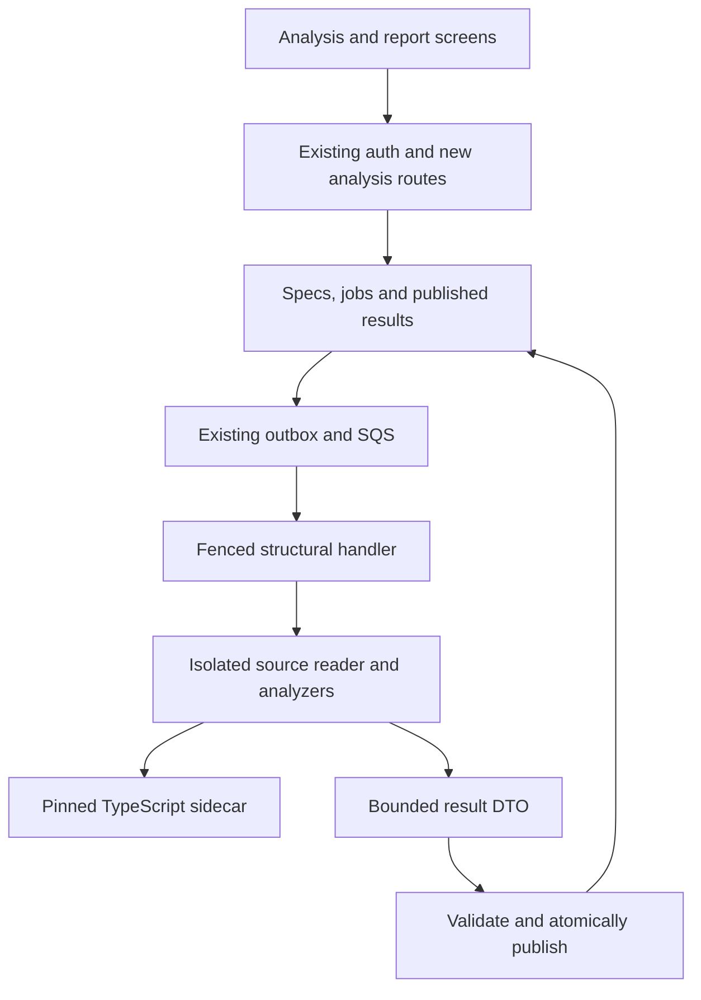
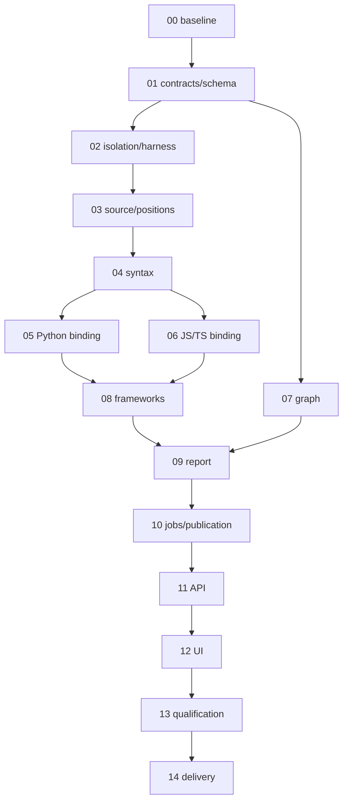

# CodeSPY Phase 3 — Structural Source Analysis Execution Plan

> **For Aman, implementing manually:** This is the complete Phase 3 execution specification, covering architecture through verification. Work through the numbered packages in order. It replaces the earlier Stage 1-only handoff as the execution reference. It is a plan, not a claim that the code below has been implemented or tested. When requesting paste-ready implementation instructions, use a package/step ID; each instructional chunk can remain at most six steps. No coding agent or subagent is required.

**Goal:** Analyze an admitted Python/JavaScript/TypeScript source snapshot and publish a deterministic architecture report, scoped graph, explicit binding outcomes and framework boundary observations, without an LLM or executing target code.
**Architecture:** Retain the Python control plane, PostgreSQL authority, immutable snapshots and SQS/outbox workers. Add an isolated structural analyzer, a narrowly pinned TypeScript compiler sidecar, bounded graph algorithms and one atomic fenced publication. Reuse existing graph/evidence contracts; put additional typed resolution/framework/report records in a bounded immutable report.
**Tech stack:** Python 3.12, Tree-sitter, Python ast/symtable, TypeScript 5.9.3/Node 22 sidecar, PostgreSQL 16, SQLAlchemy/Alembic, existing FastAPI/React/hey-api tooling, pytest/Hypothesis/NetworkX reference tests.
**Specification:** Revised `CodeSPY_Technical_Execution_Blueprint.md`, especially §8, current accepted Phase 1–2 code, and this document's decisions.
**Inspected commit:** `736a5ef831ed4a81899916153a7d09a13a51f2d1`, main. Rechecked 19 October 2026.
**Intended repository path:** `docs/phases/PHASE_3_STRUCTURAL_ANALYSIS_EXECUTION_PLAN.md`.
**Status:** Complete planning deliverable, proposed implementation. No application code, dependency installation, services, credentials, cloud access, browser automation or GitHub mutations were performed during preparation.

## Global constraints

- Preserve tenant/repository/snapshot/run scope, composite references, immutable source/results, current DB-time fences and cancellation.
- Preserve historical migrations 0001–0009, V1 persistence contracts and active Phase 2 behavior. Extend through new revisions.
- Preserve root `uv.lock` ownership and installed frontend contracts. No incidental broad upgrades.
- No target imports, scripts, dependencies, plugins, package installation, runtime execution, browser, scanner or LLM calls.
- No owner AWS, real-key work, developer-service restart, external workspace, deployment or automatic jobs during planning.
- Use original UTF8 source bytes and explicit half-open ranges. Never silently normalize newlines or source encoding.
- Initial supported release is a **bounded structural-analysis profile**, not unlimited repository coverage. Limits and omissions must be visible.
- All commands later in this document are instructions for future manual execution, not observed results.

## Review focus

1. Identical names in different scopes, snapshots or services must not create a false unique target — WP-3.05/06/08.
2. Unicode, CRLF and non-BMP characters must not produce incorrect citations — WP-3.03/04/06.
3. A worker losing its lease during native work or publication must not write a late report — WP-3.02/10/11.
4. A valid archive larger than the structural output profile must remain inventory-valid and yield honest structural omissions — WP-3.03/09.
5. A large result, unexpected sidecar output or malicious configuration must not bypass memory, byte, path or transaction limits — WP-3.02/06/10.

## 1. Which Phase 3 this implements

### 1.1 Reconcile the uploaded plans

The five uploaded files are useful context, but they do not all use the same roadmap or describe the code now on main.

| Input                                         | Finding                                                                                                              | Decision                                                                                         |
| --------------------------------------------- | -------------------------------------------------------------------------------------------------------------------- | ------------------------------------------------------------------------------------------------ |
| `CODESPY_MASTER_PROJECT_PLAN(1).md`           | Older eight-phase sequence: Phase 2 DSA/CPG, Phase 3 RAG/memory; contains broad unverified performance/recall claims | Historical vision only; do not use its numbering or claims as acceptance evidence                |
| `CodeSPY_Technical_Execution_Blueprint(1).md` | Revised v2.0 roadmap: Phase 2 ingestion, Phase 3 structural analysis, Phase 4 findings, Phase 5 retrieval            | Governs this phase, with accepted repository refinements                                         |
| Uploaded Phase 0 plan                         | Historical setup and cloud/bootstrap instructions                                                                    | Preserve accepted setup; current owner restrictions supersede cloud/key instructions             |
| Uploaded Phase 1 plan                         | Proposes Pinecone/vector/search/ledger features beyond the actual accepted foundation                                | Do not assume those tables/services exist or recreate its schema                                 |
| Uploaded old Phase 2 DSA/CPG plan             | Includes CFG/PDG, proximity resolution, taint-like traversal, CSR/caches/binaries and broad recall claims            | Adapt only justified syntax/graph ideas; reject unsupported semantics and unnecessary algorithms |
| Current repository                            | Phases 1–2 are merged; ingestion/inventory are implemented; structural analyzer directories are placeholders         | Extend the accepted implementation rather than paste old replacement modules                     |

[VERIFIED: inspected commit, `.codex/USER_PREFERENCES.md`, accepted ADRs, acceptance documents and uploaded blueprint, accessed 2026-10-19.] This plan does **not** move RAG into Phase 3. Findings remain Phase 4, retrieval/memory Phase 5, agents Phase 6, full workbench Phase 7 and hosted operation later.

### 1.2 Required outcome and exclusions

**Required journey:** upload/connect a fixture through existing ingestion → select its sealed snapshot → request structural analysis → observe a durable job → inspect architecture/modules/imports/call candidates/bindings/framework observations → navigate exact source evidence → cancel/retry safely → export a deterministic report.

Required: Python and JS/JSX/TS/TSX syntax; bounded Python lexical/import resolution and TypeScript-backed JS/TS binding; explicit resolved/ambiguous/unresolved states; graph traversal/SCC/condensation; literal/static FastAPI/Express/fetch/axios mapping; typed report, minimal API/UI, meaningful evaluation and preserved Phase 1–2 regressions.

Deferred: Electron implementation, REA runtime sidecar, CFG/PDG/SSA/dominators, taint or feasible-path claims, vulnerability detectors, model calls, embeddings, RAG/memory, change indexing, CSR, Merkle diff, route tries, custom scheduler, Redis caches, production deployment and general private-code SaaS support.

A connected structural path is not proof of execution or dataflow. A resolved lexical binding is not a proven runtime call target. An import cycle is a structural observation, not automatically a defect.

## 2. Verified starting point and prerequisite fixes

### 2.1 Evidence classification

[VERIFIED: `736a5ef`, files in the source register, accessed 2026-10-19.] Main contains twelve Phase 1 tables, seventeen Phase 2 tables and nine migrations. Phase 2 acceptance records local suites, including 92 Phase 2 checks, 70 legacy/pure checks, original integration/migrations 21/3, five frontend component tests and a 10,000-file capacity fixture. These categories may overlap; do not total them into a new test count. These are repository-recorded results, **not rerun by this planner**.

[ASSUMED] Owner OS/architecture/RAM remain unspecified. Use Python 3.12 and Node 22 development with a pinned Linux Docker analysis image as the qualification baseline. Native installation, Docker architecture and memory availability remain untested. This does not block writing the plan; WP-3.00 records the actual host before execution.

### 2.2 Preserve and extend these exact seams

Paths below are relative to `backend/app/` unless otherwise stated.

| Existing symbol/path                                        | Verified behavior                                                                               | Required extension                                                        |
| ----------------------------------------------------------- | ----------------------------------------------------------------------------------------------- | ------------------------------------------------------------------------- |
| `domain/scope.py`: Contract, TenantContext, RunRef          | Strict frozen DTOs and scoped references                                                        | Reuse everywhere; no request-supplied authority                           |
| `domain/canonical_json.py`                                  | `codespy-json-v1`; strict duplicate-key/nonfinite handling                                      | Python owns authoritative hashing; sidecar returns data only              |
| `security/authorization.py`: require_repository, lock_scope | Fresh explicit repository grants; provider binding checks; lock hierarchy                       | Every analysis/report/graph/evidence/source endpoint                      |
| `ports/object_store.py`: ObjectStore                        | Verified object streaming, exact descriptors/version deletion                                   | No per-file source reader exists; add isolated admitted-entry reading     |
| `contracts/jobs.py`                                         | V2 operation literals admit_source/inventory_snapshot only                                      | Preserve V2; introduce V3 for structural work                             |
| `services/jobs.py`: claim                                   | Current attempt/fence, capacity two, fresh run only for inventory, hardcoded inventory analyzer | Add explicit structural run/config branch, preserving old branches        |
| `workers/consumer.py`: JobConsumer.handle                   | Admission versus inventory two-way dispatch                                                     | Explicit operation handlers; maintain heartbeat and failure ownership     |
| `services/job_finalization.py`: finish_inventory            | Explicitly rejects graph nodes/edges/derivations                                                | New structural finalizer, not a misuse of inventory                       |
| `services/persistence.py`: _persist_result_in_session       | Full-set identity comparison, run lock, terminal hash replay, final status last                 | Call inside a new fenced shared transaction                               |
| `contracts/persistence.py`: ResultBatchV1                   | 1,000 nodes/evidence; 2,000 edges/derivations                                                   | Keep caps; add stricter aggregate bytes and deterministic partial profile |
| `services/finalization_budget.py`, JobFinalizer._execute    | 60 s aggregate including awaited COMMIT; ambiguity reconciliation                               | Reuse the policy via a small shared executor extraction                   |
| `GraphRepository.neighbors`, read_published_graph           | Scoped published-only pages, ≤200                                                               | Not traversal/SCC APIs; add bounded services/read contracts               |
| `domain/source_ranges.py`, migration 0004                   | UTF8 bytes; DB checks range end ≤ file size                                                     | Verify byte/line/column mapping against actual source bytes               |
| `contracts/http.py`: JobEventV2                             | Closed event types/public payload keys                                                          | Add versioned structural-compatible event/read DTOs                       |
| `scripts/phase2_db.py`, phase2 catalog test                 | Owned disposable services; catalog expects exactly 0009/29 tables                               | Preserve historical target; add current-head compatibility tests          |
| API `ApplicationPorts`, create_app; frontend App.tsx        | Real upload/status/inventory shell and generated hey-api client                                 | Add small analysis/report feature; no parallel application                |

### 2.3 Resolve documentation defects before feature claims

1. Phase 2 committed plan §6.4 describes eligibility-based partial coverage, while `inventory_batch` publishes complete **byte-inventory** coverage. Preserve existing runs/hashes. Record in ADR 0003 that inventory completeness and structural completeness are different; correct the conflicting documentation only.
2. README still contains reserved-frontend/unfinished-upload language contradicted by code. Update only affected capability statements after observing the relevant behavior.
3. The accepted archive cap is 10,000 entries, not the initial proposed 50,000. Keep admission policy unchanged.
4. Keep accepted OpenTofu direction and current hey-api generation, despite older Terraform/generator wording.
5. Existing internal repository inserts are not a staged large-result protocol: final publication still requires the complete identity set in one bounded ResultBatchV1. Do not simulate chunked publication by reopening a run.

## 3. Architecture decisions and research rationale

All decisions in this section are **[PROPOSED]**, grounded in inspected code and official sources. Qualification results remain unexecuted.

| Decision               | Options considered                                                    | Selected approach and rationale                                                                                                                      | Reversal/qualification                                                                                                                       |
| ---------------------- | --------------------------------------------------------------------- | ---------------------------------------------------------------------------------------------------------------------------------------------------- | -------------------------------------------------------------------------------------------------------------------------------------------- |
| ADR-3A parsing         | Direct grammars versus locked language pack                           | Keep tree-sitter 0.26.0; qualify Python 0.25.0, JavaScript 0.25.0, TS/TSX 0.23.2 individually. MIT upstream packages; no first-use downloads in jobs | Exact ABI/query corpus/wheels must pass. Language pack stays dormant; prebundled alternate requires explicit revision                        |
| ADR-3B Python          | Tree-sitter only, ast/symtable, Jedi, Pyright/SCIP                    | Tree-sitter observations plus 3.12 ast/symtable lexical scope supplement, local import resolver                                                      | Narrow unsupported constructs explicitly. Jedi/Pyright are optional references, not target execution shortcuts                               |
| ADR-3C JS/TS           | Own full resolver, compiler API, ts-morph, SCIP                       | Isolated TypeScript 5.9.3 classic API sidecar with virtual file host; matches existing frontend version without coupling packages                    | Standard profile requires qualification. Syntax-only fallback is a separately labelled limited profile, not a passing standard-profile claim |
| ADR-3D graph           | NetworkX runtime, custom iterative algorithms, native graph libraries | Small application-owned iterative traversal and Kosaraju SCC with explicit work budgets; NetworkX 3.7 as differential reference                      | Custom SCC justified by cooperative budget checks. rustworkx/igraph deferred until measured need                                             |
| ADR-3E publication     | Raise V1 limits, new staging subsystem, bounded atomic result         | Bounded first profile fitting unchanged V1 caps; atomic graph/evidence/report/job commit                                                             | If core fixture cannot fit, revise design before claiming release. Larger staging is later explicit work                                     |
| ADR-3F extra structure | Expand every graph enum versus typed report                           | Reuse six existing node kinds and three edge kinds. Persist typed binding/framework/coverage arrays in bounded report JSON                           | Future relational tables/new graph types require consumers and migrations; no fake external/function nodes                                   |
| ADR-3G framework links | Path equality versus contextual matching                              | Require method/path plus service/origin evidence; retain unmatched/multiple outcomes                                                                 | Unsupported expressions abstain; no runtime reachability claim                                                                               |
| ADR-3H reproducibility | Incremental cache versus full rebuild                                 | Full rebuild; normalized report digest separate from run/result identity                                                                             | Cache requires full-rebuild equivalence and invalidation specification later                                                                 |
| ADR-3I Electron        | REA copy, pinned sidecar, defer                                       | Defer implementation; adopt provenance/unknown/IPC candidate concepts only                                                                           | Optional capability needs independent source/license/schema/process review                                                                   |

**Research cautions:** the locked language pack 1.22.1 documents on-demand grammar downloads; a package install does not establish offline grammar availability. Pinned py-tree-sitter 0.26.0 type source differs from the rendered Parser timeout signature; verify actual API in a spike, use external process limits regardless. TypeScript symbol/checker results remain static bindings. SCIP occurrences/definitions are not a universal call-target oracle. GitHub stack-graphs is archived; do not introduce it as a new maintained dependency. Semgrep engine/rules and CodeQL libraries/CLI have separate licensing surfaces; neither is a mandatory Phase 3 runtime.

### 3.1 Responsibilities and import rules



The broker owns credentials/leases/storage. The analysis container gets only generated input files/config and bounded output, no DB/cloud/model credentials, network, host project directory or Docker socket. The API never parses source.

Pure structural DTOs, source-position utilities and graph algorithms do not import API, DB, ORM, ObjectStore adapters or worker modules. Language/framework analyzers may import those pure DTOs, not services. The source broker is the only infrastructure orchestration layer. Sidecar shares no Python DB API. Use a narrow AST import-boundary test for the new modules initially; introducing import-linter is optional only if that contract becomes materially harder to maintain.

## 4. Supported profile, limits and coverage

### 4.1 The first release has a specific supported scale

Profile `structural-small-v1` is designed for small fixture repositories and targeted source subsets. Admission can hold much larger inventories; that is not a structural-analysis coverage promise. Report the requested scope, skipped files and resource limits prominently.

| Resource                 | Exact initial limit / behavior                                                                                                                                  |
| ------------------------ | --------------------------------------------------------------------------------------------------------------------------------------------------------------- |
| Input archive            | Retain Phase 2 limit 100 MiB compressed; verify descriptor and digest                                                                                           |
| Selected eligible source | `.py`, `.js`, `.jsx`, `.mjs`, `.cjs`, `.ts`, `.tsx`; ≤128 files and ≤16 MiB total original source                                                               |
| File read                | ≤2 MiB per eligible source file; existing admission exclusions cannot be overridden                                                                             |
| Config data              | ≤32 eligible JSON/JSONC package/tsconfig files, ≤256 KiB each, ≤1 MiB total; no JS config execution                                                             |
| Native syntax work       | ≤200,000 visited syntax nodes/file, ≤1,000,000/run; worker process memory remains independent                                                                   |
| Resolution               | ≤2,000 sites/run, ≤16 candidates/site, import/re-export expansion depth 16, ≤4,096 module lookups/run                                                           |
| Graph/result             | Hard V1 caps 1,000 nodes, 2,000 edges, 1,000 evidence, 2,000 derivations; reserve one summary evidence slot                                                     |
| Serialized result        | ≤8 MiB canonical ResultBatchV1, ≤2 MiB report JSON; per attributes/properties/evidence payload ≤8 KiB in this producer                                          |
| Diagnostics              | ≤500 retained, message ≤256 bytes, no raw source in default logs; counts retain omitted diagnostic total                                                        |
| Framework records        | ≤256 route observations, ≤256 request observations, ≤512 candidate links; all consume report byte budget                                                        |
| Traversal request        | depth ≤16; nodes ≤500; returned edges ≤1,000; scanned edges ≤10,000; frontier ≤1,000; wall 2 s                                                                  |
| SCC/condensation         | ≤1,000 nodes / 2,000 selected stored edges; scans ≤20,000; wall 2 s each; all-or-unavailable result                                                             |
| Container                | 1 GiB memory+swap cap, ≤2 CPU, PID limit 64, read-only root, network none, no new privileges; Node old-space 256 MiB                                            |
| Scratch/output           | Owned input/output root ≤512 MiB/run, container tmpfs 64 MiB, result file ≤16 MiB; stdout/stderr each ≤64 KiB                                                   |
| Time                     | Total analysis 180 s; individual parser/checker operation 20 s; existing job deadline 15 min, heartbeat 20 s, DB lease 90 s; retain finalization 60 s aggregate |
| Concurrency              | Existing global active job cap 2; one structural process tree per attempt; no unbounded parser threads                                                          |
| HTTP reads               | pages ≤100 records/default25, response canonical bytes ≤256 KiB; source excerpt ≤64 KiB                                                                         |

These are chosen defaults requiring WP-3.00 qualification. A counter or Node heap flag does not enforce total native RSS. If the host cannot support the profile, use smaller explicitly versioned settings and requalify; do not pretend the advertised profile passed. No fixed latency or memory benchmark is promised.

### 4.2 Deterministic admission to the structural result

Normalize prefix filters once: relative POSIX directory prefixes, ≤16, ≤1,024 bytes each; reject traversal/backslash/empty internal components. Sort/dedupe them. Default `[]` means the complete snapshot scope, subject to visible limits. No arbitrary glob engine.

Inventory candidate files in UTF8 path order. Apply immutable eligibility and supported-language rules; then source count/total-byte caps. Extract bounded per-file bundles. Retain a file bundle atomically if its nodes/observations/evidence fit; otherwise omit that file with `output_capacity` and continue to smaller later files while time remains. A malformed parser output is a failure, not a bundle omission. Do not retain a definition and silently discard its required identity/evidence.

Build resolution and edges over retained bundles. Sort relation proposals by stable site/target keys. Emit only edges with retained endpoints and support evidence; when edge/evidence budget prevents an entire site's candidate set, retain an unresolved capacity diagnostic for that site rather than a misleading subset of candidates. Diagnostics and counters explain omissions. Source hashes/metadata remain the accepted inventory truth.

### 4.3 Coverage model

`StructuralCoverageV1` separates:

- Snapshot inventory totals and admission exclusions, with reasons.
- Requested supported source count after user scope, before structural caps.
- Processed complete files, processed partial files, omitted files by reason; sums must agree.
- Syntax: parse errors/missing nodes/unsupported syntax and visited-node budget.
- Resolution: total recorded sites and separate resolution-record totals, resolved/ambiguous/unresolved record counts; reasons and candidate truncation.
- Framework observations: adapter capability, attempted scope, dynamic/unmatched/multiple cases.
- Graph: retained counts, selected relation family, source-coverage limit and algorithm completion.

Existing `CoverageV1.admitted_count` equals requested supported source files. `processed_count` equals complete+partial processed files; `omitted_count` is the remainder. Overall result is partial if any requested source is omitted/partially parsed, output is truncated, or enabled supported resolution/framework work cannot complete. `truncated` denotes a resource/output cutoff, not simply a dynamic language feature. Detailed coverage records semantic limitations separately.

No requested supported files: publish an explicit empty/unsupported structural report, partial coverage with a reason, no semantic claim. Prefix selects no files: same truthful empty outcome; never invent modules. Files outside the selected prefix are out of scope and reported, not counted as a processing failure.

A complete SCC decomposition of the retained projection can coexist with partial source coverage. Label both explicitly. An algorithm interrupted halfway must not publish its partial components as a decomposition; its section is `unavailable_budget`, while already valid syntax observations may still publish as a partial overall result.

## 5. Contracts and deterministic identities

All new DTOs use the existing strict frozen `Contract`. Validate external JSON with Pydantic JSON semantics; reject extra fields, nonfinite values and duplicate keys through the established JSON loader. UUIDs are actual UUID values internally; timestamps are UTC aware. Hashes are 64 lower-case hex. All counts are nonnegative integers. Bounds in §4 apply at producers and broker validation.

### 5.1 Contract ledger

| DTO and owner                       | Required fields, defaults and invariants                                                                                                                                                                                                                                                                                                                                                                                                                    |
| ----------------------------------- | ----------------------------------------------------------------------------------------------------------------------------------------------------------------------------------------------------------------------------------------------------------------------------------------------------------------------------------------------------------------------------------------------------------------------------------------------------------- |
| `StructuralAnalysisRequestV1` — API | schema_version=1; snapshot_id UUID; include_prefixes list default[]; profile literal structural-small-v1. Body ≤4 KiB. No image, shell, owner, org role or resource override                                                                                                                                                                                                                                                                                |
| `AnalysisConfigV1` — server         | version1; normalized prefixes; enabled adapters python/js_ts/fastapi/express/http_client; resolution_profile standard or explicitly syntax_only; toolchain/profile digest; exact limits and service bindings. Immutable canonical config hash                                                                                                                                                                                                               |
| `AnalysisSpecV1` — DB               | org/repo/snapshot/spec IDs, creator, config, config_hash, toolchain digest. Server constructs scope; not queue authority                                                                                                                                                                                                                                                                                                                                    |
| `SourceInputV1` — broker/container  | selected archive+manifest descriptors, persisted file ID/path/hash/size/eligibility map, original admission policy incl. root stripping, config and attempt-scoped output identity; generated input files, no credential                                                                                                                                                                                                                                    |
| `SourceLocationV1` — pure           | file_id UUID; SourceRangeV1; file hash. Every location must match selected snapshot/file bytes                                                                                                                                                                                                                                                                                                                                                              |
| `SymbolObservationV1` — analyzer    | semantic_key hash; kind module/class/function/method/call/import; file/path/hash/location; name/qualified name; container key nullable; role declaration/call/import. Names ≤2,048 bytes                                                                                                                                                                                                                                                                    |
| `ResolutionV1` — analyzer           | site_key, resolution_kind binding/call_target/import, namespace value/type, status resolved/ambiguous/unresolved; candidate keys list≤16, reason enum, basis lexical/import_alias/compiler_symbol/static_member/unsupported. Resolved exactly one justified target; ambiguous ≥2; unresolved no asserted target. Unique record key=(site_key,resolution_kind,namespace). Unknown external definitions stored as external reference metadata, not fake nodes |
| `DiagnosticV1` — analyzer           | code enum; severity info/warning/error; optional location; safe bounded message; stage; affected count. No raw exception/source dump                                                                                                                                                                                                                                                                                                                        |
| `RouteObservationV1`                | key, framework fastapi/express, service_key, method enum incl ANY/UNKNOWN, raw/template path, registration/handler/include locations, handler symbol optional, resolution state, evidence keys, limitations                                                                                                                                                                                                                                                 |
| `HttpRequestObservationV1`          | key, origin state known/relative/unknown, method, baseURL/path/template segments, location, client fetch/axios, evidence keys, limitations                                                                                                                                                                                                                                                                                                                  |
| `BoundaryLinkV1`                    | request key, route keys≤16, state candidate/ambiguous/unmatched, reason, service/method/path evidence keys, limitations. “Candidate” never means verified transport                                                                                                                                                                                                                                                                                         |
| `StructuralCoverageV1`              | Counters and section states from §4.3; processed+omitted=requested; resolved+ambiguous+unresolved=resolution_records; distinct site counts are separate; no falsely complete cutoffs                                                                                                                                                                                                                                                                        |
| `ArchitectureReportV1`              | schema_version1, RunRef, config/toolchain identity, source snapshot/archive/policy digests, coverage, stable symbol/evidence maps, resolutions, routes/requests/links, modules/import SCCs/candidate-call SCCs, diagnostics, limits, explicit nonclaims; ≤2 MiB                                                                                                                                                                                             |
| `StructuralResultV1`                | schema_version1; scope RunRef; ResultBatchV1; ArchitectureReportV1; full report digest and normalized digest. Scope/config/source identities must agree; broker computes hashes                                                                                                                                                                                                                                                                             |
| `JobEnvelopeV3`                     | schema_version3; same reference/hash/deadline fields as V2; operation admit_source/inventory_snapshot/analyze_structure. ≤4 KiB. Historical V2 remains unchanged                                                                                                                                                                                                                                                                                            |
| `JobRecordV3` / `RetryResponseV2`   | New structural read/retry DTOs; report/run/spec references; submission nullable. Return historical V2/V1 objects for old operations to preserve wire behavior                                                                                                                                                                                                                                                                                               |
| `GraphQueryV1` / `GraphSliceV1`     | RunRef, root UUID, direction, allowed relation list, budgets/cursor; nodes/edges, scanned counts, truncation and reason. Cursor binds scope/filter/version                                                                                                                                                                                                                                                                                                  |
| `ReportPageV1`                      | section enum summary/symbols/resolutions/routes/requests/links/diagnostics/components; items, next cursor, report digest/data version; authorized published run only                                                                                                                                                                                                                                                                                        |

Avoid a single arbitrary JSON “analysis result.” Report JSON is validated against these nested DTOs on creation and reading. Its source references are application-validated; graph/evidence foreign keys remain physical composite DB references. This distinction must appear in the implementation docs.

### 5.2 Identity and normalization

Semantic source key = SHA256 of canonical `{path, file_sha256, kind, range, qualified_name, role}` under a documented algorithm version. Collision between unequal records is an integrity error. It is a matching key, not a global primary key.

Node ID = UUID5 with the current run ID as namespace and a typed semantic key as name. Evidence IDs similarly derive from run ID + operation/basis/location/payload identity. Equal symbols in different runs remain physically distinct. Calls have their own nodes and ranges; do not connect functions by name alone.

`ResultBatchV1.semantic_hash()` retains accepted behavior. Separately compute normalized report bytes by replacing physical node/evidence/file IDs with semantic keys/path+file hash and omitting run/job/org identifiers, timestamps, durations, host paths and memory measurements. Retain analyzer/config/profile/source hashes and semantic limitations. Sort all arrays by documented keys; hashes/UUIDs are not ordering proxies. Full stored-report digest includes actual scope; normalized digest is for two-run comparison. Do not change historical canonicalization to force equality.

### 5.3 Graph/evidence mapping

- `AST_CHILD`: containment between retained structural observations, not every concrete syntax node. Description explicitly says this is a structural AST projection.
- `IMPORTS`: import observation → retained local module, only when local module binding is justified.
- `CALLS_CANDIDATE`: call-site → retained definition candidate. Even a resolved binding does not become a proven runtime-call edge.
- External imports/unresolved calls stay observations/resolutions with no invented file-backed target.
- Each edge has valid same-run support evidence. Source observations have observed evidence; binding/link conclusions use derived/inferred evidence with exact supporting locations and limitations.
- Framework endpoints and HTTP candidate links live in typed report records, not fake graph kinds. All evidence/target references are validated before publication.
- Reserve one summary evidence record; keep individual producer payloads ≤8 KiB. Never pack source files into evidence payloads.

## 6. Persistence and migration design

### 6.1 New tables only where there is a consumer

Create `backend/app/models/phase3_tables.py`, explicitly imported by metadata discovery. Retain the existing centralized conventions; no unrelated ORM rewrite.

| Table / columns      | Keys/checks                                                                                                                                                                                                                                                                                                                                                                                                                                          | Consumer/index                                                                                                                                       |
| -------------------- | ---------------------------------------------------------------------------------------------------------------------------------------------------------------------------------------------------------------------------------------------------------------------------------------------------------------------------------------------------------------------------------------------------------------------------------------------------- | ---------------------------------------------------------------------------------------------------------------------------------------------------- |
| `analysis_specs`     | `org_id UUID`, `id UUID`, `repository_id UUID`, `snapshot_id UUID`, `principal_id UUID`, `config_json JSONB`, `config_hash TEXT`, `toolchain_hash TEXT`, `created_at TIMESTAMPTZ`; all NOT NULL. PK(org,id); UQ(org,repo,snapshot,id,config_hash). Scoped FK(org,repo,snapshot)→source_snapshots; FK(org,principal)→memberships; hash regex checks; config canonical bytes≤64 KiB; immutable trigger                                                 | Specs resolved by job FK/PK; index(org,repo,snapshot,created_at,id) for authorized history; no broad JSON GIN                                        |
| `structural_reports` | `org_id UUID`, `snapshot_id UUID`, `run_id UUID`, `spec_id UUID`, `repository_id UUID`, `config_hash TEXT`, `report_json JSONB`, `report_sha256 TEXT`, `normalized_sha256 TEXT`, `created_at TIMESTAMPTZ`; all NOT NULL. PK(org,snapshot,run); composite FK to analysis_runs; composite FK(org,repo,snapshot,spec,config_hash)→analysis_specs; payload≤2 MiB; hashes checked; insert requires live worker-bound structural run; immutable thereafter | One report/run; lookup by scoped run; history index(org,repo,snapshot,created_at,run). Published-read join to runs prevents visibility before commit |

UUIDs and hashes are service-generated, not DB randomness. Timestamps default to DB current time. JSONB storage-shape byte checks do not replace the canonical UTF8 payload bound; enforce both conservatively. No physical deletion of accepted report history through API.

Add nullable `jobs.analysis_spec_id UUID`. Composite FK `(org_id,repository_id,snapshot_id,analysis_spec_id,config_hash)`→analysis_specs. New check: analyze_structure requires spec+snapshot and no submission; old operations require analysis_spec_id NULL. Existing same-repository snapshot FK remains. Extend operation CHECK to three operations; do not edit 0007. Do not enlarge existing graph enums or V1 limits.

Canonical service limits are ≤64 KiB for config and ≤2 MiB for report. JSONB text serialization differs from canonical bytes: add separate conservative SQL checks of octet_length(config_json::text)≤96 KiB and octet_length(report_json::text)≤4 MiB. Both checks apply; SQL text size never substitutes for canonical service validation.

### 6.2 Revisions and privileges

1. `0010_structural_specs`: new two tables, metadata import, nullable job binding, candidate keys, scope FKs, checks and indexes. No data backfill; old jobs remain NULL. Bounded DDL lock timeout and source-preserving 0009→0010 test.
2. `0011_structural_authority`: structural report insert guard, source/config/run binding validation, immutable triggers, structural-job binding immutability and any job event CHECK expansion actually present in inspected schema. API may INSERT immutable analysis_specs only through service; broker may INSERT reports. API cannot INSERT graph/evidence/report rows or call broker authority function. No runtime role can DDL/TRUNCATE/change triggers.

Use existing Phase 2 run/result authority for graph/evidence; add report-specific guard using the same current DB-time job/attempt/fence function. It verifies operation=analyze_structure, exact run/attempt/spec/snapshot/config relationship and running state. Don't trust session variables alone. New raw-SQL cross-scope/stale/report-insert tests are required.

Current-head expected table count becomes 31 excluding alembic_version, one head `0011_structural_authority`. Preserve historical Phase 2 catalog assertions at 0009/29 and original Phase 1 at 0004/12. New tests assert current catalog and behavior; do not weaken old assertions to accept any count.

Downgrades are destructive on new data and tested only in owned databases. Normal application rollback retains expanded schema, disables analysis creation, stops/fences new workers and preserves accepted reports. Downgrading requires no structural jobs/reports/specs and explicit local-only data-discard authority; no developer database reset.

## 7. Source, parser and resolution algorithms

For structural jobs only, reject updates to org/repository/principal/snapshot/analysis_spec_id/config_hash/operation/request identity after INSERT. Worker-state/fence/lease/result updates remain governed by existing authority rules. Test this with raw SQL; do not depend on the API alone. Preserve existing operations’ behavior.

### 7.1 Authenticated source access

Broker resolves sealed snapshot, immutable archive, available canonical object and stored manifest/file-ID mapping under authorization. Close DB transaction before storage I/O. Stream archive/manifest into generated mode-0600 owned input files through ObjectStore verification; never accept caller storage keys. Include original root-stripping policy, expected hashes, size and persisted IDs.

Inside the network-disabled analysis container, bounded ZIP preflight and selected entry reads revalidate paths/CRC/size/digest. Never extract ZIP entry names into a shared source tree. Build virtual files keyed by validated relative path. Read each selected entry once, streaming limits enforced on actual bytes. File IDs in the input map must match snapshot rows and the manifest, not freshly generated IDs. Missing/corrupt source is `source_integrity_error`, not “file has no symbols.”

### 7.2 Syntax extraction

For each language/dialect choose a pinned grammar explicitly; TSX is not the plain TS grammar. Own parser/tree/query cursor per operation. Prefer iterative TreeCursor walking to unbounded recursive Python walks or collecting every query capture before counting. Retain ERROR/missing diagnostics and safe observations; no unique binding across an unsupported/error-overlapping expression.

Extract modules, classes, functions/methods, imports and calls. Model lambdas as function observations with stable generated display names derived from source range, not a global counter. Object literals/type-only declarations may be scope records without inventing a V1 persisted node kind. Include decorators, async markers and export/type-role metadata as typed attributes; do not evaluate them.

Position mapping uses exact original bytes. Python AST line/byte columns need file line-start indexing. TypeScript UTF16 positions need a tested UTF16↔UTF8 mapping including surrogate pairs; no character-count shortcut. Tree-sitter rows become 1-based lines; columns remain bytes. Verify each published range against file length and actual line/column boundaries. Missing-node zero-width ranges are diagnostics, not fabricated token observations.

### 7.3 Python lexical and local-import resolution

Parse ast/symtable only in the isolated process. Python 3.12 parse failures or newer unsupported syntax do not erase Tree-sitter observations; mark supplementary resolution unavailable for that file.

Build lexical scopes for module, class, function, lambda and comprehensions; obey global/nonlocal and assignment-created locals. Class scope is not an ordinary closure inherited by methods. Track import aliases and immutable direct aliases conservatively. Assignment/rebinding, conditional alternatives or unknown receivers prevent a false unique target. Attribute calls require documented local module alias or narrowly known receiver binding; same spelling alone is insufficient.

Resolve relative/local imports against explicit source roots (default snapshot root), `.py` and `__init__.py`, plus configured admitted roots; never consult host sys.path, import target modules, or inspect arbitrary installed packages. Bound roots≤8 and import expansion. Multiple valid local package candidates stay ambiguous. Star imports, reflection, monkey-patching and computed dynamic imports remain unresolved unless a specific static rule is proven by fixtures.

Outcome records include site, scope, namespace, candidate keys, basis and reason. A call to a parameter may resolve to the parameter binding while its callable implementation remains unresolved; do not conflate those tasks. Emit separate ResolutionV1 records with resolution_kind=binding and resolution_kind=call_target. A resolved binding record never promotes an unresolved call-target record. Cap the combined resolution-record collection at 2,000 records; report omitted record counts and their cutoff reasons separately from distinct site counts.

### 7.4 TypeScript sidecar

`tools/typescript-analyzer/` is a separate trusted package with TypeScript exactly 5.9.3, a committed package-lock, strict compilation and no target dependencies. Fixed entrypoint communicates bounded versioned JSON through stdin and a generated output file. No arbitrary sidecar command or target working directory.

Virtual CompilerHost reads only selected admitted source/config and packaged trusted standard library files. Explicitly implement readFile/fileExists/directoryExists/readDirectory/realpath/module resolution against that map. No fallback to ts.sys for target paths, host node_modules, network, plugins, automatic type acquisition, emit/build/watch or JS config require.

Parse JSON/JSONC configuration as data. Allow local bounded extends, files/include, baseUrl, paths, module/moduleResolution, JSX and project references only within the virtual map; depth≤8, references≤16. Unsupported external extends/plugins produce diagnostics. `noEmit=true`, `incremental=false`, allowJs enabled for JS, and a declared JS/TS source-version profile. Dependencies/declarations absent from admitted scope remain unavailable, not installed.

Checker supplies symbol/alias binding and declaration candidates. Retain type/value namespaces, destructuring, re-exports, overload/declaration multiplicity and ambiguity. Normalize static import/reference observations independently from call-target candidates. Type-only imports never become runtime call edges. Missing declarations, any/unknown receivers, unresolved dynamic require/import and incomplete project context abstain. Reject output referencing files absent from the admitted virtual map except explicitly tagged trusted external libraries, which do not become file-backed graph nodes.

## 8. Graph and framework logic

### 8.1 Pure graph engine

`GraphProjectionV1` is a read-only adjacency representation with explicit scoped identity, relation selection and provenance edge lists. Deduplicate edges by full declared identity/support, not just endpoint/kind if that would erase evidence. Sorting is deterministic by semantic source key.

Traversal is iterative queue/stack with visited set, node/depth/frontier/returned-edge and **scanned-edge** counters. Check cancellation/deadline while expanding each bounded group of edges. Return `truncated` and limiting reason when a budget ends. Never enumerate all paths.

SCC uses iterative Kosaraju: bounded DFS finishing-order pass; bounded reverse traversal; sort component members; build unique inter-component edges; stable Kahn topological ordering with semantic-key heap. Count work across both passes and condensation. Complexity is O(V+E) plus deterministic sorting; Python/native memory ceilings are separate. Use NetworkX's SCC partition and DAG checks as a differential reference on generated small graphs, not as the same implementation called twice.

For import SCCs project import observation ownership to module→module. For candidate call SCCs project enclosing callable→candidate target callable. Keep module-level calls separate from callable recursion. Report relation family, source coverage, omitted-edge reasons and projection counts. Recursion/cycle presence is not a security issue.

### 8.2 Framework observation and matching policy

FastAPI: identify imported FastAPI/APIRouter symbols and local aliases; observe literal decorators/add_api_route and include_router composition. Preserve each include occurrence: one router can be mounted multiple times. Nested prefix concatenation requires fully justified literal/static bindings; include/route cycles or dynamic prefixes are diagnostics. Dependencies are observed registrations, not runtime/dataflow proof.

Express: recognize imported/required express factory/router and local aliases, method registration, literal supported paths and local mounts. Preserve middleware order/array callbacks as syntax. Do not claim handler reachability through unknown middleware. Detect package major if admitted package metadata supplies it; regex/wildcard/path syntax with version-dependent semantics abstains in v1.

HTTP clients: literal fetch calls with default GET or supported static options; axios methods, request config and locally constructed axios.create instances with static baseURL. Record raw expression, method/base URL/path and template segments separately. Do not evaluate environment variables/interceptors or execute wrappers. Unknown dynamic Request/config objects remain observations with unresolved values.

Service binding comes from reviewed server-owned config mapping source roots to a service key and canonical origin, not from source text's self-asserted authority. Default has no deployment-origin assumption. A relative client request can match only an explicitly configured same-origin backend/service mapping. Method/path alone yields no asserted service link. Multiple compatible routes yield ambiguous candidate set; no nearest-file tie-break.

Match exact literal segments and declared parameter shapes conservatively. Query string is separate from path; do not percent-decode repeatedly or treat FastAPI and Express parameter grammars as identical. Enforce candidate/link caps; unavailable full candidate set gives unresolved capacity, not a falsely unique route.

## 9. Report, jobs, publication and recovery

### 9.1 Durable job integration

Add `analyze_structure` as an explicit operation, not a rename of inventory. API creates immutable spec + queued job + outbox + event in one transaction under current authorization/quota/idempotency rules. Config/toolchain hash is server-derived. No browser-triggered analysis loops: user requests a run.

Keep JobEnvelopeV2 frozen. Dispatcher emits V2 for the two old operations, V3 for structural jobs. New consumer validates both versions and routes an explicit allowlisted handler. Old workers reject/ack unfamiliar envelopes, so do not run a mixed old/new worker pool: stop/drain owned old workers before enabling new analysis submissions. No historical queue contract silently acquires new meanings.

`JobService.claim` creates a fresh worker-bound run for inventory **and** structural work, using the appropriate analyzer name/version/config. Structural run name `codespy-structure`, version `1`; config is copied from verified spec. Preserve current lock order/capacity/deadline checks. Every retry gets a new attempt/run; no terminal run reopens.

`JobRecordV3` retains existing job fields, adds schema_version=3, operation including analyze_structure, required analysis_spec_id for structural jobs, nullable submission_id and report_available boolean. Structural retry response and event versions carry new references without making old submission IDs fake. Audit `job_record`, `RetryService`, recovery/deadline handlers, public error mapping and the local runtime composition, not just enqueue/consumer branches. Manual structural retry creates a new job referencing the same immutable spec if source/authority/profile remain valid. A changed configuration is a new analysis request/spec, not retry of old history.

### 9.2 Structural finalization transaction

The container returns bounded data; the trusted broker validates schema, actual bytes/ranges, counts, scope, identities, all endpoints/evidence references and hashes. It creates IDs and authoritative digests server-side. Untrusted output never supplies TenantContext or wins authority by a UUID.

Extract the existing budget/commit/reconciliation mechanism into `services/publication.py` with old JobFinalizer methods delegating unchanged. Add `StructuralFinalizer` with a separate `finish(lease, result)` and durable resolver. Keep this extraction minimal and regression-tested.

```text
prepare result outside transaction:
  verify source descriptors and normalized output
  validate all DTOs, count/byte budgets, ranges, references and complete-set mapping
  compute batch hash, full report hash and normalized hash
renew lease immediately before acquiring publication locks
within existing 60-second aggregate budget:
  lock org limits -> authority -> repository -> snapshot -> job -> attempt -> run
  verify current DB-time lease/deadline/fence/owner, operation and immutable spec/config
  set trusted worker context; reject stale/cancelled work
  insert immutable structural_report under report-specific authority guard
  call _persist_result_in_session with current version and complete ResultBatchV1
  mark matching attempt succeeded; job succeeded/partial with result_run_id
  append terminal event in the same transaction
  await COMMIT inside the aggregate budget
acknowledge queue receipt only after durable outcome
```

Old public persistence wrappers stay available for original fixtures but are not exposed as API bypasses. Do not call public `persist_result` from inside another transaction. Report insertion and graph/result publication either all commit or all roll back. Reads join published runs and reauthorize current access.

Ambiguous COMMIT: discard/invalidate the affected transport using established policy, acquire a fresh bounded session, and compare current job/run batch hash **and** report hash/config. Matching terminal state resolves success; unresolved outcome leaves recovery ownership, not a forced failure/republication. Stale callback cannot fail a replacement's run.

### 9.3 Failure and crash matrix

| Failure point                                         | Durable state                                    | Owner/recovery                                                  | Public outcome                                                                 |
| ----------------------------------------------------- | ------------------------------------------------ | --------------------------------------------------------------- | ------------------------------------------------------------------------------ |
| Spec/job transaction before commit fails              | Neither spec/job/outbox visible                  | Same idempotency request can retry                              | Request failed, no phantom work                                                |
| Job committed, no queue send                          | Queued job + outbox                              | Existing dispatcher/recovery                                    | Queued                                                                         |
| Send succeeds, mark lost                              | Same generation may be duplicated                | Claim/fence and outbox idempotency                              | One active effect                                                              |
| Worker claim then process loss                        | Active attempt + fresh running run               | Lease reaper closes old run, retries if allowed                 | Retry_wait/failed by policy                                                    |
| Parse syntax error/unsupported feature                | No durable output yet                            | Valid diagnostic; continue bounded partial analysis             | Partial structural coverage                                                    |
| Container hard timeout/OOM/crash                      | No trusted complete result                       | Current attempt fails with typed code; no partial JSON accepted | Failed; retry policy distinguishes deterministic cap vs infrastructure failure |
| Source/config integrity mismatch                      | Selected snapshot unchanged                      | Permanent integrity error, no report                            | Failed, investigate                                                            |
| Lease/cancel/revocation during parser                 | Current authority lost                           | Cancel process group/container; DB fence blocks late writes     | Cancelled/access unavailable                                                   |
| Failure after report insert, before graph publication | Uncommitted report/rows                          | Roll back entire transaction                                    | No visible half report                                                         |
| COMMIT response lost                                  | Possibly terminal                                | Fresh durable reconciliation by hashes and fence                | Completed/partial or outcome pending                                           |
| Commit succeeds, ack lost                             | Terminal report/run/job/event                    | Redelivery reads terminal, acknowledges                         | No duplicate report                                                            |
| Output cap reached cleanly                            | Bounded valid complete result envelope           | Publish partial with deterministic omissions                    | Partial, omissions visible                                                     |
| SCC budget exhausted                                  | Other observations valid, no complete SCC result | Mark SCC unavailable; report limitation                         | Partial, no false decomposition                                                |
| Cleanup interrupted                                   | Owned marker and exact generated paths           | Retry only owned cleanup; alert bounded backlog                 | Job state unchanged                                                            |

### 9.4 Error, event and logging taxonomy

Add safe analysis codes: `analysis_unavailable`, `unsupported_profile`, `source_integrity_error`, `excluded_source`, `parse_error`, `unsupported_syntax`, `resolution_unavailable`, `config_out_of_scope`, `dependency_unavailable`, `candidate_budget`, `output_capacity`, `analysis_timeout`, `analysis_memory_limit`, `analyzer_output_invalid`, `graph_budget`, `report_integrity_error`. Infrastructure faults may retry within existing max-three/deadline; deterministic malformed source/config or unsupported profile do not retry indefinitely.

Add structural-compatible event DTO/SQL types: `analysis_started`, `syntax_completed`, `resolution_completed`, `report_completed`, `report_partial`. Keep old events/payloads valid; new public payload keys are closed stage/count/error fields, never source paths or parser text. Coalesce progress, preserve terminal events and current retention/cursor behavior. Polling remains sufficient; SSE deferred.

Default logs contain opaque request/job/attempt IDs, fence, stage, safe code, counts and durations. Authorized report diagnostics may include paths and short safe messages; default logs must not. Do not log source, AST dumps, cookie/token/PKCE, signed URLs, target config contents or raw subprocess output. CPU/memory measurements are telemetry, excluded from normalized report hash.

## 10. API, source citations and minimum UI

Every new analysis read path includes repository_id explicitly. Resolve a fresh authorized repository context and constrain the lookup by organization, repository, snapshot and run; a UUID or path parameter never grants authority. Return the same not-found response for absent and unauthorized resources.

All mutations use existing opaque sessions, CSRF/origin checks and `Idempotency-Key`. Org/principal/role come from server authority. Foreign or unavailable scoped resources return generic 404. Error DTOs contain safe codes/request IDs, not exceptions.

| Endpoint                                                                      | Request/response and authorization                                                                | Bounds / behavior                                                                                                              |
| ----------------------------------------------------------------------------- | ------------------------------------------------------------------------------------------------- | ------------------------------------------------------------------------------------------------------------------------------ |
| POST `/api/v1/repositories/{repo_id}/analyses`                                | Repository write; StructuralAnalysisRequestV1 →202 AnalysisAcceptedV1(spec_id,job_id,snapshot_id) | Snapshot must be sealed in same repo; same key+request returns same refs; changed request409; unavailable profile503; quota429 |
| GET `/api/v1/jobs/{job_id}`                                                   | Existing authorization; historical JobRecordV2 or structural JobRecordV3                          | Preserve old wire shape; new object links run/spec/report availability                                                         |
| POST `/api/v1/jobs/{job_id}/cancel`                                           | Existing write+CSRF                                                                               | Fences structural work immediately; existing terminal race behavior retained                                                   |
| POST `/api/v1/jobs/{job_id}/retry`                                            | Existing write+CSRF                                                                               | Old retry DTO for old jobs; structural RetryResponseV2 with nullable submission and immutable spec reference                   |
| GET `/api/v1/jobs/{job_id}/events`                                            | Existing read; compatible versioned page                                                          | Same durable sequence/retention; closed new event variants                                                                     |
| GET `/api/v1/repositories/{repo_id}/analyses/{run_id}/report`                 | Read authorized repository resolved from run; published only                                      | Summary and available sections≤64 KiB; include exact report/normalized digests and coverage                                    |
| GET `/api/v1/repositories/{repo_id}/analyses/{run_id}/report/{section}`       | Scoped published report, filters bound into cursor                                                | Page≤100, ≤256 KiB; section allowlist only; bad/foreign-filter cursor422; absent resource404                                   |
| GET `/api/v1/repositories/{repo_id}/analyses/{run_id}/graph`                  | Published run read                                                                                | Reuse edge/node paging semantics, existing V1 node/edge DTOs; ≤100 records and byte cap                                        |
| POST `/api/v1/repositories/{repo_id}/analyses/{run_id}/traversal`             | Read authority, CSRF for cookie POST                                                              | Validated GraphQueryV1; no SQL/query language; budgeted result; does not create runtime claims                                 |
| GET `/api/v1/repositories/{repo_id}/analyses/{run_id}/evidence/{evidence_id}` | Same run/snapshot/repo read                                                                       | Evidence DTO, source location and optional already-stored bounded excerpt; no arbitrary archive path                           |
| GET `/api/v1/repositories/{repo_id}/analyses/{run_id}/export?format=json      | markdown`                                                                                         | Same authorization                                                                                                             | Attachment with nosniff, ≤8 MiB; deterministic template; no raw HTML |

`AnalysisAcceptedV1` is a version-1 DTO with spec/job/snapshot UUIDs and relative status URL; it is not an invented completed run. A run exists after claim. Every read resolves run scope server-side; a client cannot combine another snapshot with an authorized run.

Source navigation in this phase uses exact location/hash, optional **bounded stored excerpts**, and optional validated GitHub commit permalinks for provider-backed sources. It does not add arbitrary ZIP parsing in an API request. `EvidenceExcerptV1` holds file_id, excerpt_range, UTF8 text≤2 KiB and digest of exact excerpt bytes; total excerpt bytes≤64 KiB/report, counted in report budget. Produce excerpts inside isolation from verified bytes, truncate at valid UTF8 boundaries and retain the actual excerpt range. They are authorized source data, never default logs. For uploaded code, display file/range plus excerpt or allow the owner to locate the original local file; do not invent a GitHub URL.

UI feature `frontend/src/features/analysis/`: select snapshot; “Analyze structure”; durable job progress/cancel/retry; report coverage; module/import/cycle tables; binding state filters; request/route candidates and limitations; source citation/excerpt panel; JSON/Markdown export. Reuse current App shell, URL selection, TanStack Query and hey-api types. No graph canvas/Monaco/agent timeline required. Render source/comments as escaped text; no raw HTML or automatic external resource loading. Preserve upload/inventory navigation.

Visible labels: “Structural analysis,” “Static candidate,” “Unresolved,” “Partial coverage,” “Inventoried, not analyzed.” Never show “all green/code is safe.” Keyboard controls, focus recovery, clear errors, live status announcements and responsive tables are required. API/RTL/MSW tests are mandatory. Browser automation remains an unexecuted separate authorization gate; owner manual verification can be recorded honestly.

## 11. Exact module map and interfaces

All listed new paths are proposed, relative to repo root. Existing files are edited at the named symbols rather than replaced wholesale.

| New module                                                                         | Responsibility and exact interface                                                                                                                         |
| ---------------------------------------------------------------------------------- | ---------------------------------------------------------------------------------------------------------------------------------------------------------- |
| `backend/app/contracts/structure.py`                                               | DTO ledger in §5, including AnalysisAcceptedV1, StructuralDraftV1 and EvidenceExcerptV1                                                                    |
| `backend/app/analyzers/positions.py`                                               | `SourceIndex(data: bytes)`; `range_from_bytes(start: int,end: int)->SourceRangeV1`; `utf16_to_byte(offset: int)->int`; strict boundary validation          |
| `backend/app/analyzers/identities.py`                                              | `observation_key(record: SymbolObservationV1)->str`; `normalize_report(report: ArchitectureReportV1)->dict[str,JsonValue]` with explicit normalized schema |
| `backend/app/analyzers/source.py`                                                  | Container-only `AdmittedSourceReader(input:SourceInputV1)`; `read_selected()->list[SourceUnitV1]`; exact path/hash/eligibility checks                      |
| `backend/app/services/analysis_sources.py`                                         | Broker `resolve_source(ctx,repo_id,snapshot_id)->SourceInputV1` descriptors/map, no source parsing; async object staging outside DB locks                  |
| `backend/app/analyzers/registry.py`                                                | `profile(name:str)->AnalyzerProfileV1`; fixed languages/adapters and readiness, no dynamic imports from target                                             |
| `backend/app/analyzers/languages/{python,javascript,typescript}.py`                | `extract(unit:SourceUnitV1,budget:AnalysisBudget)->FileObservationsV1`; dialect-specific syntax only                                                       |
| `backend/app/analyzers/symbols/python.py`                                          | `resolve_python(files:list[FileObservationsV1],sources:SourceMap,config:AnalysisConfigV1,budget:AnalysisBudget)->ResolutionSetV1`                          |
| `backend/app/adapters/typescript.py`                                               | `TypeScriptAdapter.resolve(input:TsSemanticInputV1,budget:AnalysisBudget)->TsSemanticResultV1`; fixed trusted process I/O                                  |
| `tools/typescript-analyzer/src/{main,host,config,resolve,positions}.ts`            | Fixed versioned protocol, virtual host, bounded configuration, checker binding and position reporting; no emit/plugins                                     |
| `backend/app/analyzers/frameworks/{fastapi,express,http_client,matching}.py`       | `observe_*` and `match_boundaries(routes,requests,bindings,budget)->BoundaryLinkSetV1`; static bounded rules from §8                                       |
| `backend/app/core/dsa/{projection,traversal,scc,condensation}.py`                  | Pure `build_projection`, `traverse`, `strong_components`, `condense`; explicit GraphBudget and typed result/disposition                                    |
| `backend/app/analyzers/{pipeline,reporting,entrypoint}.py`                         | `analyze(input:SourceInputV1,budget:AnalysisBudget)->StructuralDraftV1`; orchestration, deterministic bounded report draft and fixed container entrypoint  |
| `backend/app/analyzers/runner.py`                                                  | `StructuralRunner.run(input_paths:OwnedInputPaths,lease:AttemptLeaseV2)->StructuralDraftV1`; ownership, capped I/O, cancellation/cleanup                   |
| `backend/app/services/structural_analysis.py`                                      | `StructuralService.create(ctx,repo_id,request,key)->AnalysisAcceptedV1`; `get_report`, `page_report`, `get_evidence`, `export_report`                      |
| `backend/app/services/structural_finalization.py`                                  | `materialize(draft,lease,verified_source)->StructuralResultV1`; `StructuralFinalizer.finish(lease,result)->JobRecordV3`                                    |
| `backend/app/repositories/structural_repository.py`                                | Insert/read spec/report with supplied session; no commit; published joins and complete reference validation                                                |
| `backend/app/models/phase3_tables.py`                                              | Two tables and associated new job binding metadata; explicit shared metadata import                                                                        |
| `backend/app/workers/operations/analyze_structure.py`                              | Structural job handler: resolve/stage source→runner→validate→renew→fenced finalizer                                                                        |
| `backend/app/api/v1/analyses.py`                                                   | Route registration delegates to service using existing injected authorization dependencies; no parsing                                                     |
| `scripts/{build_analysis_image,phase3_db,phase3_demo,phase3_eval,phase3_local}.py` | Owned image qualification, test orchestration, fixture demo/evaluation and explicit local composition                                                      |
| `infra/analysis/{Dockerfile,requirements.txt}`                                     | Pinned trusted parser/Node runtime and packages; no runtime target installation                                                                            |

Supporting **internal** types live in structure.py or focused pure types module: SourceUnitV1(file_id,path,sha256,data,language), FileObservationsV1(source identity,observations,diagnostics,coverage), SourceMap(read-only path→unit), AnalysisBudget(check/counter/deadline/cancellation), OwnedInputPaths(generated paths+ownership token), AnalyzerProfileV1(version/tool versions/image digest/limits), ResolutionSetV1, BoundaryLinkSetV1, TsSemanticInputV1/TsSemanticResultV1. They have explicit max sizes and no authority/credentials. Binary source bytes are internal; base64 only in the bounded sidecar protocol.

`StructuralDraftV1` carries schema_version1, generated request_nonce, source/config digests, semantic-key observations/resolutions/framework records, coverage, diagnostics and report sections. It has no trusted TenantContext and no caller-chosen physical graph/evidence IDs. Broker `materialize` assigns scoped IDs and validates all references. Count/byte checks occur before constructing an unbounded collection.

Preserve the existing `ApplicationPorts` name. Add optional structural service/readiness fields and `ApiSettings.structural_enabled=False`. Register new routes only through this flag and verified composition. Extend the existing job status/retry wiring intentionally; do not fabricate an `AppPorts` class from another plan.

## 12. Ordered manual work packages

**Execution rule for every package:** read the named existing symbols; create a relevant failing test where behavior changes; implement only that package; run its focused command and static checks; inspect actual outputs/diff; update the ledger; commit only a passing coherent state. An intentional failing-test checkpoint is not merge-ready. Do not continue dependent work after a failed prerequisite.

Each package has at most six steps. This is a full execution **specification**, not thousands of unexecuted application lines. Complete paste-ready file contents, when requested during implementation, must match the interfaces/tests below and the actual checkout.

### WP-3.00 — Freeze baseline, decisions and compatibility (small/medium)

**Prerequisites:** current instructions and plan. **Reuse:** owner preferences, accepted ADRs, root lock, Phase 2 acceptance/status, Makefile. **Create:** `docs/adr/0003-structural-analysis.md`, `docs/capabilities/structural-small-v1.md`, `backend/tests/phase3/unit/test_parser_capabilities.py` and ignored qualification notes. **No application behavior enabled.**

- [ ] 1. Run the read-only preflight in §13.1; record actual head/local changes, OS/architecture/RAM/Docker versions. If main drifted, compare affected contracts before editing.
- [ ] 2. Record all decisions in §§1–9, including Phase 2 coverage documentation correction and retained publication caps. Mark qualified versus unexecuted explicitly.
- [ ] 3. Qualify selected binding/grammar/query/TS compiler APIs on tiny trusted fixtures; record wheel/image platform, ABI, actual errors/missing nodes and offline behavior. No target package installs.
- [ ] 4. Add exact trusted toolchain pins through root uv and sidecar lock ownership; inspect lock/license diff. Keep language-pack dormant. The candidate pin is not a claim of successful import.
- [ ] 5. Measure a tiny container round trip, cancellation and reported RSS/output limits; required unsupported capability blocks the standard profile.
- [ ] 6. Commit ADR/capability declaration and reproducible probes once passing: `docs: define structural analysis scope and qualification gates`.

**Validation:** C1 and the parser capability test; image probe commands are created/recorded by this package, not assumed existing. **Accept:** verified baseline and explicit adapter pass/fail evidence. **Failure:** correct/narrow versioned support; never network-download grammars during jobs. **Rollback:** remove only new dependency changes/owned probe artifacts; preserve accepted locks/history. **Handoff:** exact qualified tool versions for WP-3.01/02.

### WP-3.01 — Contracts, fixtures and additive metadata (medium)

**Depends:** 00. **Reuse:** Contract, RunRef, SourceRangeV1, ResultBatchV1, shared metadata. **Create:** contracts/structure.py, models/phase3_tables.py, revisions0010/0011, `backend/tests/phase3/{unit/test_contracts.py,migrations/test_chain.py}` and fixture schema exports. **Edit:** metadata discovery at `models/__init__.py`/Alembic env as actually imported.

- [ ] 1. Write literal valid/invalid contracts for source scope, extra fields, unknown operations, count/byte ceilings, ambiguous cardinality and report reference mismatch.
- [ ] 2. Define all DTOs/inner enums and deterministic normalization schema; export schemas without starting services.
- [ ] 3. Add two tables and nullable spec FK/check from §6, explicit frozen DDL and catalog expectations; old data remains untouched.
- [ ] 4. Add guards/grants and raw SQL report-insert tests. A forged session fence or different run/spec/config must reject.
- [ ] 5. Test upgrade0009→head preserving snapshots/hashes and legacy behavior; downgrade only owned empty/new-data fixtures. Confirm one head and 31 tables.
- [ ] 6. Commit contracts and migrations in reviewable groups: `feat: add scoped structural analysis contracts and storage`.

**Validation:** C1; CDB migration suite. **Accept:** every field/type/null/scope state and exact dependency order is enforced. **Failure:** inspect named CHECK/FK and metadata drift; do not drop constraints to pass. **Rollback:** §6.2; no destructive developer downgrade. **Handoff:** stable contracts to all later packages.

### WP-3.02 — Isolated analyzer process and owned harness (high risk)

**Depends:** 00/01. **Reuse:** DockerAdmissionRunner ownership model, phase2_db marker/roles, finalization budget principles. **Create:** analyzers/runner.py/entrypoint.py, infra/analysis files, build_analysis_image.py, phase3_db.py, tests `phase3/process/test_runner.py`, `phase3/unit/test_harness_guard.py`. **Edit:** phase2_db CLI for explicit schema-target and suite composition, Makefile and .github/workflows/phase2-foundation.yml; preserve ownership validation and historical assertions.

- [ ] 1. Test wrong image/marker/path ownership, inherited-secret removal, output flood, hang, PID/memory cap, interrupted prepare and cleanup-after-failure.
- [ ] 2. Build a trusted immutable analysis image, record actual local image ID/digest; never put a fabricated hash in config. Fixed allowlisted command, no target scripts.
- [ ] 3. Implement streaming I/O caps while draining; do not call communicate and check length only after unlimited output allocation. Own/cancel/kill the whole process/container tree.
- [ ] 4. Reuse the **owned Phase 2 disposable cluster/emulator** with a distinct phase3 environment file and per-suite databases. Refuse a conflicting live harness owner. No second all-service developer stack or implicit attach/reset.
- [ ] 5. Add `--schema-revision` to harness testing. Run historical Phase 2 catalog at0009; current-head Phase 3 tests at0011. Recheck grants for new tables/API/broker; preserve Phase 1 at0004.
- [ ] 6. Commit after cleanup proofs: `test: add owned structural analyzer isolation and fixtures`.

**Validation:** C1 plus CP process checks and CDB migration suite. **Accept:** no credentials/network/host target path in analyzer; bounded native resource/process ownership demonstrated. **Failure:** no “trusted only” mode advertised as hostile-safe. **Rollback:** stop/delete exact owned resources via marker, leave developer containers/volumes intact. **Handoff:** qualified runner/harness.

### WP-3.03 — Authenticated source reader and byte positions (high risk)

**Depends:** 01/02. **Create:** services/analysis_sources.py, analyzers/source.py, positions.py, identities.py; tests `phase3/unit/{test_positions,test_identity}.py`, `phase3/source/test_source_reader.py`. **Reuse:** ObjectStore.open_verified, canonical manifest, persisted file IDs, admission path validation and policy.

- [ ] 1. Test known byte hashes, Unicode/non-BMP/CRLF/BOM/EOF positions, malformed UTF8, root stripping, foreign file IDs, excluded source, altered archive/manifest and unsupported policy.
- [ ] 2. Implement broker locator for canonical available source and a matching admitted manifest. Verify snapshot/archive/admission policy and exact stored path→file-ID metadata; never guess a latest unrelated manifest.
- [ ] 3. Stream objects into generated owned files outside DB transactions. Resolve original policy through matching admission metadata; unsupported unknown policy fails explicitly.
- [ ] 4. Read selected ZIP entries inside isolation without extraction, enforce actual bytes/CRC/digest and eligibility, create read-only SourceMap.
- [ ] 5. Implement source index/conversion and semantic keys; round-trip range/byte assertions and cross-run scope tests must pass.
- [ ] 6. Commit `feat: read verified admitted sources with byte-accurate locations`.

**Validation:** C1 plus focused unit files and CP source suite. **Accept:** actual fixture byte slices match every generated location; no silent source transform. **Failure:** typed integrity error, no empty successful result. **Migration:** none. **Rollback:** remove only owned inputs; existing source artifacts untouched. **Handoff:** authenticated SourceUnitV1s.

### WP-3.04 — Tree-sitter language extraction (medium/large)

**Depends:** 03. **Create:** analyzers/registry.py, languages modules, pure source fixture files and `phase3/unit/test_syntax.py`. **Reuse:** bounded SourceUnit, positions, observation DTOs.

- [ ] 1. Label declarations/imports/calls before implementation: nested/async/decorated functions, classes/methods, lambdas, JSX/TSX/destructuring, comments and strings that must not become code.
- [ ] 2. Implement grammar registry and per-file iterative extraction with count/time checks; preserve errors/missing nodes, dialect and tool identity.
- [ ] 3. Attach exact observed source evidence and containment ownership; no expression-regex semantic resolver.
- [ ] 4. Test incomplete source with valid earlier declarations, malformed grammar output, unsupported suffixes and per-file/output caps.
- [ ] 5. Run deterministic shuffled-input fixtures, Unicode range checks and isolated native resource tests; qualify supported syntax version honestly.
- [ ] 6. Commit `feat: extract scoped Python and JavaScript syntax observations`.

**Validation:** C1 `test_syntax.py` and CP parser suite. **Accept:** exact labelled observations/non-observations; errors remain visible. **Failure:** unsupported feature diagnostic, not false total coverage. **Migration:** none. **Handoff:** FileObservationsV1 bundles for binding/framework work.

### WP-3.05 — Python scopes and import binding (large)

**Depends:** 04. **Create:** analyzers/symbols/python.py plus focused scope/import helpers as needed; `phase3/unit/test_python_resolution.py` and labelled Python fixtures.

- [ ] 1. Add normative fixtures for shadowing, assignment-after-use/unbound local, global/nonlocal, class/method scopes, comprehensions, relative imports, aliases/rebinding, same-name methods, dynamic imports and missing dependencies.
- [ ] 2. Build bounded ast/symtable supplement and explicit scope records without target import/execution.
- [ ] 3. Implement local import and binding rules in §7.3; retain namespace/call-target distinction, alternatives and refusal reasons.
- [ ] 4. Enforce candidate/lookup/depth bounds; if full candidate set cannot be represented, return unresolved budget, never pick first.
- [ ] 5. Check hand labels and ast/symtable differential properties; all dynamic negative cases must avoid false unique call targets.
- [ ] 6. Commit `feat: resolve bounded Python lexical and local import bindings`.

**Validation:** C1 plus `test_python_resolution.py`; CP Python profile. **Accept:** resolved/ambiguous/unresolved cases match declared semantics. **Failure:** inspect site/scope evidence; do not add global name search/proximity as a fallback. **Migration:** none. **Handoff:** typed resolution with limits.

### WP-3.06 — Safe JS/TS compiler binding sidecar (large/high risk)

**Depends:** 02/03/04. **Create:** tools/typescript-analyzer package and source modules; adapters/typescript.py; tests `phase3/unit/test_typescript_protocol.py` plus sidecar test fixtures. **Reuse:** TypeScript5.9.3 API and source positions.

- [ ] 1. Test virtual host rejects path traversal, external extends, plugins, host node_modules, unknown output file references and target config execution.
- [ ] 2. Implement bounded source/config protocol, trusted stdlib loading and reviewed compiler options with no emit/watch/build/network.
- [ ] 3. Extract checker symbol/alias bindings and local declaration targets; retain value/type namespaces, overload alternatives, unavailable dependencies and dynamic abstention.
- [ ] 4. Convert positions and verify astral Unicode/CRLF/TSX, re-exports, paths aliases, missing declarations and config cycles against hand labels.
- [ ] 5. Run offline container, native memory/wall/output/cancel checks and two-run normalized equality. A standard-profile failure blocks that profile.
- [ ] 6. Commit `feat: add isolated TypeScript binding analysis over admitted files`.

**Validation:** C1 protocol test; CTS; CP TypeScript profile. **Accept:** no observed filesystem read outside admitted/trusted maps; precise labelled bindings. **Failure:** syntax-only can be selected explicitly and labelled partial, not silently promoted. **Migration:** none. **Handoff:** qualified static semantic output.

### WP-3.07 — Bounded graph algorithms (medium)

**Depends:** 01; consumes observations after04–06. **Create:** core/dsa modules, `phase3/unit/test_{traversal,scc,condensation}.py`. **Reuse:** NetworkX/Hypothesis already locked.

- [ ] 1. Add labelled isolates/self-loops/parallel edges, disconnected/deep graphs and reverse traversal cases; test every budget separately.
- [ ] 2. Implement deterministic adjacency and iterative BFS/DFS with scanned-edge/frontier accounting.
- [ ] 3. Implement iterative Kosaraju and deterministic condensation/Kahn order from §8.1. No recursive stack workaround.
- [ ] 4. Generate bounded small graphs; compare SCC partitions/reachability with NetworkX and independent partition/DAG invariants.
- [ ] 5. Inject cancellation/deadline/exhaustion in both SCC passes and condensation; incomplete decomposition must be unavailable.
- [ ] 6. Commit `feat: add bounded deterministic structural graph algorithms`.

**Validation:** C1 plus the three pure tests; CP resource suite. **Accept:** correct complete answers or explicit bounded outcomes, no taint terminology. **Failure:** retain minimized counterexample from Hypothesis. **Migration:** none. **Handoff:** graph metrics/report projections.

### WP-3.08 — FastAPI, Express and HTTP candidate mapping (large)

**Depends:** 04/05/06. **Create:** frameworks modules; `phase3/unit/test_{fastapi,express,http_matching}.py`; labelled same-service/multi-service fixtures.

- [ ] 1. Hand-label supported route/request observations and candidate/noncandidate pairs, including unknown origins and identical paths across services.
- [ ] 2. Implement FastAPI construction/alias/decorator/mount observations with prefix composition and dynamic abstention.
- [ ] 3. Implement Express local router/mount/method/callback syntax, preserving registration order and version limitations.
- [ ] 4. Implement fetch/axios literal options/baseURL/template observations without executing env/config/interceptors.
- [ ] 5. Match only with explicit service/method/path evidence; test ambiguous/missing/dynamic/wrapper cases and candidate caps.
- [ ] 6. Commit adapter-sized changes followed by `feat: link HTTP boundaries as evidence-backed static candidates`.

**Validation:** C1 focused files and CP framework suite. **Accept:** expected positives plus zero false unique links on normative negative fixtures. **Failure:** broaden diagnostics/abstention, not speculative path equality. **Migration:** none; typed report representation. **Handoff:** framework arrays with evidence and coverage.

### WP-3.09 — Budgeted pipeline and deterministic architecture report (large)

**Depends:** 03–08. **Create:** analyzers/pipeline.py/reporting.py; `phase3/unit/test_{pipeline,report_determinism}.py`; reviewed golden JSON and Markdown templates.

- [ ] 1. Define expected report for the principal fixture before generating output: modules, imports, candidate calls, SCCs, boundaries, unknowns and non-findings.
- [ ] 2. Assemble source selection, extraction, binding, framework mapping and graph projections with per-stage/global budgets.
- [ ] 3. Implement file-bundle/site atomic capacity decisions and full count reconciliation; render no unsupported “complete” section.
- [ ] 4. Build normalized content, bounded verified excerpts and JSON/Markdown exports from validated records only. Do not summarize using an LLM.
- [ ] 5. Compare different input orders/hash seeds/fresh run IDs; normalized equality must hold. Test empty/unsupported/cutoff/diagnostic truncation and SCC exhaustion.
- [ ] 6. Commit `feat: assemble deterministic architecture reports with explicit coverage`.

**Validation:** C1 pipeline/determinism tests and CP full fixture. **Accept:** useful report within all caps; no unsupported vulnerability/runtime claim. **Failure:** reduce documented profile or revise a real contract; no golden auto-blessing. **Migration:** none. **Handoff:** StructuralDraftV1 ready for broker validation.

### WP-3.10 — Job registration and atomic structural publication (highest risk)

**Depends:** 01/02/09. **Edit:** contracts/jobs.py via new V3 types, job_repository.job_record, JobService claim/enqueue, outbox envelope selection, consumer explicit dispatch, RetryService/recovery. **Create:** services/structural_analysis.py, structural_finalization.py, publication.py, worker handler and tests `phase3/integration/test_{structural_jobs,publication,races}.py`.

- [ ] 1. Write failing tests at actual authoritative writes: replaced/expired/cancelled worker, foreign spec/config/run, report-before-result rollback and API-role forging.
- [ ] 2. Extract shared publication executor preserving current inventory behavior and ambiguity handling; run Phase 2 finalizer regressions immediately.
- [ ] 3. Implement spec+job+outbox+event transaction and structural-specific claim/fresh-run mapping; validate V2/V3 transport and explicit handler compatibility.
- [ ] 4. Materialize/validate draft server-side, publish report+complete graph/evidence+terminal job atomically under DB authority/budget.
- [ ] 5. Use barriers for cancel/complete, revoke/finalize, replacement/stale callbacks and lost COMMIT/ack; test structural retries keep config/history and do not create fake submissions.
- [ ] 6. Commit the executor extraction separately, then `feat: publish structural analyses through fenced durable jobs`.

**Validation:** C1; CDB jobs/publication/concurrency; original finalization regressions at head. **Accept:** one durable result per successful attempt, no half report, no old worker mutation. **Failure:** diagnose lock/transport state; don't force terminal reset or weaken fence. **Migration:**0010/11 active only with qualified new worker. **Rollback:** disable new requests, stop/fence owned workers; retain data/schema. **Handoff:** protected durable capability.

### WP-3.11 — Scoped reads, API contracts and service budgets (medium/large)

**Depends:** 10. **Create:** api/v1/analyses.py and read services/repository methods; `phase3/api/test_{analysis_authorization,report_pages,graph_reads,excerpts}.py`. **Edit:** create_app/ApplicationPorts at named seams; exporter/OpenAPI.

- [ ] 1. Test forged org/repo/run/evidence IDs, wrong snapshot, revoked session/grant, CSRF, changed idempotency request, unavailable profile and unpublished reads.
- [ ] 2. Implement §10 endpoints with current nested authorization dependencies passed into router/service wiring; no duplicate auth implementation.
- [ ] 3. Bind cursors to full scope/filters/report digest, cap bytes/records and validate traversal query; no arbitrary query language or archive path.
- [ ] 4. Add attachment export and stored citation/excerpt reads with safe content headers; reauthorize every request.
- [ ] 5. Export actual OpenAPI and regenerate hey-api types. Preserve old-operation job/retry responses; explicitly test schema drift.
- [ ] 6. Commit `feat: expose authorized structural reports and bounded graph reads`.

**Validation:** C1; CDB API; CAPI generation and frontend typecheck. **Accept:** scoped published reads only, old client journeys preserved. **Failure:** safe typed error, no leakage of foreign resource existence. **Migration:** none. **Rollback:** feature flag disables new routes/actions. **Handoff:** typed frontend API.

### WP-3.12 — Minimal analysis/report interface (medium)

**Depends:** 11. **Create:** frontend feature files and RTL/MSW tests; **edit:** App.tsx current navigation and generated-client use. No graph-canvas redesign.

- [ ] 1. Test selection/upload-inventory-to-analysis journey with queued/running/partial/failed/cancelled and expired/forbidden states.
- [ ] 2. Build snapshot action, job polling/cancel/retry, report coverage and tables, source evidence/excerpts and export controls.
- [ ] 3. Persist shareable selection in URL, keep server state in TanStack Query, retain idempotency key across ambiguous responses.
- [ ] 4. Add keyboard/focus/status announcements, escaped adversarial source strings, table pagination and no-data states.
- [ ] 5. Run component/type/lint/build checks; record owner manual browser observations when available. Do not label unexecuted Playwright/axe as passing.
- [ ] 6. Commit `feat: add structural analysis and evidence report screens`.

**Validation:** CFE; API compatibility tests. **Accept:** ordinary user can understand scope/unknowns and reach evidence without reading this plan. **Failure:** keep useful error/retry selection; no fake successful report. **Migration:** none. **Rollback:** hide analysis feature, preserve ingestion. **Handoff:** complete fixture journey.

### WP-3.13 — Evaluation, fault demo and capacity qualification (large)

**Depends:** 10–12. **Create:** scripts/phase3_demo.py/phase3_eval.py, `evals/phase3/{manifest.json,labels/,fixtures/}`, report evidence and tests. **Reuse:** real PostgreSQL/emulator, owned analyzer image, labelled fixtures.

- [ ] 1. Freeze labels/splits/thresholds from §14 before inspecting held-out results. Record label author/reviewer status honestly.
- [ ] 2. Run principal happy fixture plus failure/recovery demo; assert exact report contents, hashes, counter reconciliation, stale rejection and cleanup.
- [ ] 3. Run language/relation metrics, ambiguity/abstention checks and optional SCIP/rustworkx references only on trusted qualified fixture environments; adjudicate disagreements.
- [ ] 4. Measure maximal advertised file/node/edge/evidence/byte profile and time/RSS/publication budgets. Failure blocks advertised profile until explicitly revised/requalified.
- [ ] 5. Run all historical Phase 1–2 checks plus new-head compatibility, migrations, cancellation and source integrity tests; report skips/unqualified features.
- [ ] 6. Commit `test: qualify structural analysis accuracy limits and recovery`.

**Validation:** CDB all, CDEMO, CEVAL, CLEGACY, CFE. **Accept:** fixture thresholds satisfied with raw counts/evidence; no universal accuracy/performance inference. **Failure:** fix root cause, record results, never tune thresholds after seeing held-out output. **Rollback:** no new target/source mutation occurred; cleanup owned artifacts only. **Handoff:** release evidence.

### WP-3.14 — Documentation, GitHub delivery and Phase 4 handoff (small/medium)

**Depends:** 13. **Create:** docs/PHASE_3_ACCEPTANCE.md and `.github/workflows/phase3-structure.yml`; update capability/README/ADR and ledger. **No cloud deployment.**

- [ ] 1. Record exact executed commands, counts, versions, digests, metrics, skips, limits and accepted commit. Correct stale docs without altering historical evidence files misleadingly.
- [ ] 2. Add authorized PR/manual CI for pure/sidecar/migration/owned integration/frontend checks; no model/owner credentials, pull_request_target secret execution or automatic target scans.
- [ ] 3. Review final diff for scope, generated artifacts, locks, role grants, raw source/secrets and unbounded output paths.
- [ ] 4. Prepare concise factual PR: problem/resulting behavior, tests actually run, two additive migrations, limits, rollback and demo evidence. Natural commits reflect real cohesive changes.
- [ ] 5. Confirm owned resources stopped/cleaned and main's required check names preserved; merge only through owner-authorized normal protected workflow.
- [ ] 6. Complete Phase 4 handoff from §16; mark unsupported capabilities deferred, not “done.”

**Validation:** C1/CAPI/CFE plus recorded CI results; no rerun of unrelated expensive checks without reason. **Accept:** documentation matches observed code and measurements. **Failure:** keep PR unmerged with explicit findings; no invented green status. **Rollback:** §6/9; owner data untouched. Suggested commit: `docs: record structural analysis acceptance and limitations`.

### Dependency map



Parallel dependency branches are conceptual only; manual execution can follow numeric order. Do not require multi-agent work.

## 13. Manual commands and execution discipline

### 13.1 Read-only preflight — first manual step

Run from your existing CodeSPY checkout. These commands inspect the environment; they do not install/start services. Save only sanitized outputs in the ledger.

```bash
git status --short --branch
git rev-parse HEAD
git log -5 --oneline
python3 --version
uv --version
node --version
npm --version
python3 -c "import platform; print(platform.platform()); print(platform.machine())"
docker version
docker compose version
```

If Docker is unavailable/off, record that fact; do not restart developer services automatically. Record RAM from the operating system's system information. Read AGENTS/preferences before any later command. A local change must not be overwritten because the plan assumed a clean checkout.

For normal branches use `git switch -c feat/phase3-<package-topic>` after checking current work. Use the actual chosen branch name in the ledger; no forced checkout/reset. Commit only exact package files with `git add <reviewed paths>` supplied during that manual step, not `git add .` over unrelated private artifacts.

### 13.2 Command groups

New scripts/targets below are **deliverables to implement**, not commands asserted to work in the current repository. Each script uses argparse choices matching this document, refuses unowned destinations and exits nonzero on required-check failure. No command was executed by the planner.

**Historical compatibility suite — required CI adjustment.** Keep the original exact 0009/29-table catalog assertions unchanged and run that catalog suite against an isolated DB explicitly migrated to 0009. Run current Phase 2 behavior tests separately at the new head, excluding only that historical catalog module; Phase 3 adds its own 0011/31-table catalog tests. Update scripts/phase2_db.py suite selection, Makefile and .github/workflows/phase2-foundation.yml together so existing required CI does not accidentally run the old exact-count assertion at the new head. Preserve all behavioral cases and both schema checks. Latest code selecting the new jobs column is not claimed to work against an old schema; expand the schema before new binaries. Application rollback retains the expanded schema with the feature disabled.

**C1 — Python checks.** Run focused package tests first, replacing the explicit example file with the test path named in that package. After focused checks, run static checks on the affected files and then the application at package acceptance.

```bash
uv run --frozen --all-packages --all-groups pytest -c backend/pyproject.toml backend/tests/phase3/unit/test_contracts.py
uv run --frozen --all-packages --all-groups ruff check backend/app backend/tests/phase3 scripts
uv run --frozen --all-packages --all-groups mypy --config-file backend/pyproject.toml backend/app
```

Dependency synchronization after reviewed lock changes: `uv sync --all-packages --all-groups --frozen`. The WP-3.00 dependency step uses root workspace `uv add --package codespy-backend` with exact selected grammar pins, then reviews/recommits the root lock. Do not execute this during planning or inside a target repository.

**CTS — trusted sidecar.** Package scripts must be defined as: build=`tsc -p tsconfig.json`; typecheck=`tsc --noEmit -p tsconfig.json`; test=`npm run build && node --test dist/tests/protocol.test.js dist/tests/host.test.js dist/tests/resolution.test.js`. Commit those test files and a tsconfig that emits them to these paths. Pin TypeScript5.9.3 and compatible @types/node22.20.5. No target package scripts.

```bash
npm --prefix tools/typescript-analyzer ci --ignore-scripts
npm --prefix tools/typescript-analyzer run typecheck
npm --prefix tools/typescript-analyzer test
```

**CP — isolated analyzer qualification.** Implement `scripts/build_analysis_image.py --image-out PATH` to build only trusted own image inputs and write the actual immutable image ID. Implement phase3_eval mode `--qualification SUITE` for `process`, `source`, `parser`, `python`, `typescript`, `framework`, `resources`, `fixture`; it runs only committed trusted fixtures through the owned runner and exits nonzero on a required failed gate.

```bash
uv run --frozen --all-packages --all-groups python scripts/build_analysis_image.py --image-out work/phase3-analysis-image.id
uv run --frozen --all-packages --all-groups python scripts/phase3_eval.py --qualification process --image-file work/phase3-analysis-image.id
```

Build-time retrieval of trusted pinned dependencies is allowed only when implementation is authorized; analysis execution itself has no network. A build needing an unavailable architecture is an explicit qualification failure, not permission to fall back to unpinned binaries.

**CDB — owned real PostgreSQL/emulator checks.** Reuse the existing guarded disposable service machinery; the phase3 wrapper owns one environment/marker and per-suite databases. Do not prepare two environment files against the same already-owned running cluster. The wrapper exposes prepare/test/cleanup; test suites `migration`, `historical-catalog`, `source`, `jobs`, `publication`, `concurrency`, `api`, `compatibility`, `performance`, `all`.

```bash
uv run --frozen --all-packages --all-groups python scripts/build_admission_image.py --image-out work/phase3-admission-image.id
uv run --frozen --all-packages --all-groups python scripts/phase3_db.py prepare --env-out work/phase3-test.env
uv run --frozen --all-packages --all-groups python scripts/phase3_db.py test --env-file work/phase3-test.env --suite migration
uv run --frozen --all-packages --all-groups python scripts/phase3_db.py test --env-file work/phase3-test.env --suite all
uv run --frozen --all-packages --all-groups python scripts/phase3_db.py cleanup --env-file work/phase3-test.env
```

The wrapper reads the two owned image files by explicit arguments/default documented paths under work; validates immutable IDs and markers; exports required fixture environment internally. It does not inherit developer `.env`, AWS_PROFILE or real credentials. Cleanup belongs in a finally/trap path even after failure. Keep the ownership manifest until cleanup succeeds.

**Historical versus current-head checks:** `historical-catalog` creates an owned revision0009 database and executes the original Phase 2 catalog tests there. `compatibility` executes all Phase 2 behavioral suites at the **new head**, with their fixed historical catalog file run separately; it also asserts the new catalog. Latest code selecting newly added job columns must not be tested against an old schema as if backward binary compatibility were automatic. Do not relax the original `0009/29` assertion to “anything is acceptable.” Update workflow/harness suite composition explicitly and require both historical and current-head checks.

Original Phase 1 commands remain separate and unchanged: `make phase1-unit`; original harness prepare, `make phase1-test`, `make phase1-demo`, then original harness cleanup. Preserve revision0004 public persistence compatibility. The `all` Phase 3 suite includes current-head Phase 2 behavior and new Phase 3 tests; print the suite membership and do not double-count shared tests.

**CAPI — actual generated contracts.**

```bash
uv run --frozen --all-packages --all-groups python scripts/export_openapi.py
npm --prefix frontend run codegen:api
git diff -- backend/openapi.json frontend/src/api/generated
```

During development inspect and commit the intended generation diff. In CI, generation must leave `git diff --exit-code -- backend/openapi.json frontend/src/api/generated` clean. Import/export must not connect to DB/services.

**CFE — frontend.**

```bash
npm --prefix frontend ci --ignore-scripts
npm --prefix frontend run typecheck
npm --prefix frontend run lint
npm --prefix frontend test
npm --prefix frontend run build
```

**CDEMO / CEVAL — created by WP-3.13.**

```bash
uv run --frozen --all-packages --all-groups python scripts/phase3_demo.py --env-file work/phase3-test.env --analysis-image-file work/phase3-analysis-image.id --admission-image-file work/phase3-admission-image.id --scenario happy
uv run --frozen --all-packages --all-groups python scripts/phase3_demo.py --env-file work/phase3-test.env --analysis-image-file work/phase3-analysis-image.id --admission-image-file work/phase3-admission-image.id --scenario recovery
uv run --frozen --all-packages --all-groups python scripts/phase3_eval.py --manifest evals/phase3/manifest.json --split dev --image-file work/phase3-analysis-image.id --output work/phase3-eval-dev.json
uv run --frozen --all-packages --all-groups python scripts/phase3_eval.py --manifest evals/phase3/manifest.json --split heldout --image-file work/phase3-analysis-image.id --output work/phase3-eval-heldout.json
```

Each demo creates/removes its own scoped fixture data/resources in the owned environment, verifies expected states and leaves developer resources untouched. No hidden live GitHub setup. The optional local UI command `scripts/phase3_local.py` composes current create_app/ports and the new worker only when explicitly invoked by the owner; no auto-start on import or service restart.

### 13.3 Per-package failure protocol

Stop the dependent package if a prerequisite failed. Record command, exit code, sanitized failing assertion and expected invariant. Inspect the responsible scope/transaction/config/version; minimize the failure fixture. Never disable guards, weaken labels, broaden secrets/network access, skip the failing required suite or alter held-out thresholds just to reach green. A failed spike can change the supported capability through a reviewed versioned decision and fresh qualification.

## 14. Test/evaluation specification and release criteria

### 14.1 Requirement-to-test matrix

| ID / owner | Required test behavior                                                                          | Failure that must not pass                                                |
| ---------- | ----------------------------------------------------------------------------------------------- | ------------------------------------------------------------------------- |
| R01 /00–01 | Exact parser/grammar/API versions; invalid DTO/unknown fields and bytes                         | Package exists therefore language supported                               |
| R02 /03    | Original bytes and persisted IDs; foreign/excluded/corrupt input; Github root policy            | Fresh file IDs or changed newline bytes silently accepted                 |
| R03 /03–06 | Unicode, CRLF, non-BMP, BOM, zero-width diagnostics; exact ranges                               | Character offsets used as byte offsets                                    |
| R04 /04    | Nested/decorated/async/lambda/JSX/TSX; comments/strings negative                                | Regex creates semantic nodes from prose                                   |
| R05 /05    | Assignment-local, global/nonlocal, class scopes, import alias/rebind, same names                | Closest/global name winner                                                |
| R06 /06    | Type/value aliases, local module config, re-exports, missing declarations, forbidden host reads | Target plugin/config/dependency execution                                 |
| R07 /07    | Generated/labelled reachability, SCC partition, condensation DAG/topological determinism        | Prefix SCC marked complete after cutoff                                   |
| R08 /08    | Prefixes/repeated mounts, known origin, same-path different-service, dynamic values             | Path equality treated as verified request reachability                    |
| R09 /09    | Empty/unsupported/parse-error/budget output; count reconciliation and two-run equality          | Silent truncation or fake complete coverage                               |
| R10 /10    | V2/V3 envelopes; structural spec/fresh run; old operations unchanged                            | New operation reaches inventory branch or old worker drops work unnoticed |
| R11 /10    | DB-time expiry, replacement, cancel/revoke races, raw stale writes                              | Fake application clock alone presented as DB expiry proof                 |
| R12 /10    | Rollback after partial rows/report, lost COMMIT, commit-before-ack, duplicate delivery          | Visible half graph/report or duplicate terminal result                    |
| R13 /11    | Every endpoint scoped/auth/CSRF; signed cursor/filter mismatch; export/citation bytes           | Authorized run used to read another snapshot/evidence                     |
| R14 /12    | UI partial/unknown/failed/empty/cancel/retry; adversarial strings; keyboard/focus               | “Code safe” language or raw HTML execution                                |
| R15 /02/13 | Owned resource guard, native memory/time/output/PID cap, cleanup interruption                   | Wrong project/path/volume removed                                         |
| R16 /01/13 | Phase1 original harness, Phase2 history/current-head behavior, new catalog/FKs                  | Historical migration rewritten or broad assertions disabled               |
| R17 /13    | Maximum advertised profile, measured RSS/time/finalization; optional references adjudicated     | Unmeasured performance or reference-tool agreement labelled truth         |

Concurrency tests use two independent PostgreSQL connections and barriers. For lease expiry, use the same DB-time guards with a short owned test lease, observe actual database expiry and release the worker barrier. A fake scheduler clock is useful for pure backoff, but does not expire PostgreSQL time. No fragile sleep-only race assertions or production-sized long waits.

### 14.2 Labelled corpus and metrics

Freeze `evals/phase3/manifest.json`: fixture ID, lineage ID, split, source hashes, task capability, labels and reviewer status. Hand-label expectations before looking at analyzer output. Generated variants of one template/repo stay in the same lineage/split. If Aman labels alone, say self-labelled; don't invent independent reviewer approval.

Minimum evaluation content before release claims: per language group Python and JS/TS, at least20 uniquely resolvable supported sites,20 negative/dynamic/unsupported sites, and10 ambiguous sites. For each advertised framework adapter, at least20 supported route/request observation cases and20 negative/dynamic/multi-service cases. These can be multiple independent cases in small fixtures; broad repository generalization is not established by sample size alone. Keep development and held-out lineages separate with sufficient positive/negative coverage in each; missing denominators block the related metric.

Predeclared local release thresholds:

- All normative identity/auth/range/graph/fence/failure tests pass; zero false unique results on required dynamic/multi-service negative fixtures.
- Held-out supported **unique binding** precision≥0.95 and recall≥0.80 per language group; report TP/FP/FN and denominators. No score for a relation with no labels.
- Exact ambiguous candidate-set agreement≥0.90 on labelled ambiguous sites; separately report missing/extra candidates and unresolved abstentions.
- Framework **candidate-link** precision≥0.95 and recall≥0.80 on the declared supported-service fixture task. Do not call this runtime-flow accuracy.
- Syntax observation/range goldens exact on normative supported fixtures; error fixtures retain truthful diagnostics.
- Two independent fresh runs on same input/config/profile have equal normalized report bytes/digest; physical run IDs/timestamps may differ.
- Maximal profile resources and publication contract qualify; any required field/counter mismatch fails acceptance.

These are acceptance targets, not achieved results. If held-out evaluation fails, fix scope/implementation and collect a new untouched held-out set before another tuning cycle; don't retrospectively lower thresholds. Record uncertainty and bounded applicability. Optional SCIP checks compare definition/reference tasks, not presumed runtime callees; hand-labelled task semantics adjudicate disagreements.

### 14.3 Principal fixture demonstration

Commit a small React/FastAPI fixture and a separate Express fixture. Use synthetic identifiers and known byte hashes computed by the fixture builder, not handwritten fake hashes. The FastAPI fixture includes literal nested router prefixes, alias import, one local dependency cycle, one cross-file call, one shadowed call, one dynamic unresolved call, a client request with explicit service binding, and the same path in a second service. Add Unicode/CRLF and one unsupported-language/oversized file that remains visible in inventory.

Happy demo: ingest via existing fixture API → discover inventory/snapshot → create structural job → inspect attempt-specific run/events → verify report observations/candidates/cycle/unknowns → fetch scoped source evidence/excerpt → export JSON/Markdown → run again and compare normalized bytes. Show the same-path second service stays ambiguous/unmatched without explicit binding. Demonstrate another principal cannot read the report.

Recovery demo: duplicate outbox delivery, terminate worker after claim, observe actual DB lease expiry, recover replacement, resume old worker and reject attempted publication. Inject failure after report insert and ensure no visible result. Crash after successful COMMIT before ACK and observe terminal replay without another report. Coordinate cancellation versus finalization. Stop/remove all owned resources after evidence capture.

### 14.4 Complete Phase 3 acceptance checklist

- [ ] Exact accepted commit/instructions and all deviations documented.
- [ ] Correct structural Phase 3 scope; no accidental RAG/LLM/scanner/runtime work.
- [ ] Qualified offline parser/checker image, platform and resource limits recorded.
- [ ] Source/hash/eligibility/byte positions and scoped identity invariants demonstrated.
- [ ] Python and JS/TS supported binding semantics and explicit ambiguity/abstention verified.
- [ ] Graph algorithms correct, bounded and deterministic; incomplete SCC never mislabelled.
- [ ] Framework observations/candidate links carry service/path/method evidence and limitations.
- [ ] New operation handles transport, claim, configuration, fresh runs, retries, events and cancellation end to end.
- [ ] Report+graph+evidence+terminal publication atomic and fenced at authoritative writes.
- [ ] Legacy history/contracts preserved, historical catalogs and new-head behavior checked separately.
- [ ] API/UI understandable, scoped, bounded and source-safe; unexecuted browser checks labelled.
- [ ] Fixture and held-out evidence satisfies declared gates with raw counts and qualification limits.
- [ ] Documentation/README/ADR/OpenAPI/types reflect actual behavior; no unsupported “all green” claims.
- [ ] Owned resources cleaned/stopped; PR factual, normal branch protection respected.

## 15. Risks, optional work and scale path

| Risk                                                      | Mitigation / explicit limit                                                                                                                                                            |
| --------------------------------------------------------- | -------------------------------------------------------------------------------------------------------------------------------------------------------------------------------------- |
| 1,000-node atomic profile too small for some repositories | Target small fixtures/subsets now. Display omissions. A later versioned staging design is required for larger supported graphs; no inflated scale claim                                |
| Native grammar/checker API/ABI or architecture mismatch   | Qualification before adoption; exact pins/offline image; unsupported dialect visibly unavailable                                                                                       |
| TypeScript 5.9 profile misses newer syntax                | Explicit language-version capability; no claim latest TypeScript is fully supported                                                                                                    |
| Dynamic Python/JS semantics                               | Separate binding/candidate/runtime; abstain; no global-name or proximity fallback                                                                                                      |
| Missing dependencies reduce semantic context              | Never install target packages; show dependency/config coverage limits                                                                                                                  |
| Finalizer refactor weakens accepted fences                | Small shared-executor extraction, old regressions first, raw SQL/race tests at actual write boundary                                                                                   |
| New metadata breaks old-schema tests                      | Historical catalogs at their revision; behavioral suites at new head; preserve original public Phase1 projections                                                                      |
| Typed report references are not all relational FKs        | Validate full report references transactionally; API cannot write reports; physical graph/evidence scope still enforced. Larger query consumers can justify relational expansion later |
| Memory/latency budgets fail on owner host                 | Measure; reduce a versioned advertised profile or obtain suitable worker resources; no silent guard removal                                                                            |
| Hosted privacy/isolation/retention unqualified            | Local-only qualification; no hosted readiness claim or owner cloud access                                                                                                              |

Optional after the required gate: narrow Electron adapter or pinned REA sidecar with its own corpus; optional SCIP/Jedi/Pyright reference tools; import-linter; mutation testing on pure resolver/graph budget branches; benchmark plugin if repeated timing history justifies it. None is needed merely because available.

For scale, design a future `ResultManifestV2` with immutable attempt-owned chunks, complete-set/count/digest validation, hidden staging, authoritative final seal and crash recovery. That is not implemented by this plan's small atomic publication. Do not begin it casually inside a package or claim it exists from internal batch inserts.

## 16. Phase 4 handoff

Provide the accepted structural commit, operation/profile/tool versions, scoped snapshot/run identifiers, validated graph/evidence, typed architecture report, exact source/range access, coverage/abstention semantics, API contract, fixture corpus and evaluation evidence. Preserve all limitations.

Phase 4 may add deterministic detectors/advisory/license checks under independently versioned rule/capability policies. It must distinguish observations, findings and recommendations. A cycle, dependency import, HTTP candidate, nodeIntegration-like syntax or graph reachability is not automatically a vulnerability. No complete CFG/PDG/taint/runtime support is handed off here. Retrieval/agents consume grounded results in later phases.

## 17. Evidence ledger and acceptance templates

### Execution ledger — copy one row per package

| Package | Starting commit / local changes | Inspected symbols | Failing test or qualification  | Implementation commit | Actual passing commands/results | Migration/cleanup evidence | Unresolved limits | Status  |
| ------- | ------------------------------- | ----------------- | ------------------------------ | --------------------- | ------------------------------- | -------------------------- | ----------------- | ------- |
| WP-3.00 | Record actual                   | Record actual     | Record actual or justified N/A | Record actual         | Never prefill                   | Record actual              | Record actual     | pending |

Status values: pending/in_progress/blocked/complete. File existence is not completion. Record failed/skipped/unexecuted separately from passed.

### `docs/PHASE_3_ACCEPTANCE.md` template

1. Scope, starting/final commit and accepted plan amendments.
2. Implemented capabilities versus tested/qualified/deferred capabilities.
3. Exact OS/architecture/RAM/Docker/Python/Node/PostgreSQL/emulator/parser/grammar/compiler/image versions and hashes.
4. Migrations, table/constraint/role guards, preserved Phase 1–2 invariants.
5. Actual commands and results by suite; counts without double-counting; failures/skips and reasons.
6. Fixture source digests, expected/actual observations, ambiguity/non-findings and normalized two-run equality.
7. Per-language/relation TP/FP/FN, precision/recall denominators, candidate-set/abstention evaluation and lineage split.
8. Resource/capacity measurements including RSS/native process behavior, output and finalization/COMMIT budgets.
9. Fault/recovery outcomes with exact durable-state and stale-write evidence.
10. API/UI/citation/accessibility evidence; explicit unexecuted browser/live-provider status.
11. Owned cleanup/stopped-resource evidence, limits, rollback and Phase 4 handoff.

### PR description template

Problem and resulting behavior in two plain sentences. Then list significant boundaries, migrations/compatibility, commands actually run, demo evidence and material limits. Explain what the diff delivers; do not claim universal analysis, worldwide SaaS readiness, human review that did not happen, or tests not executed.

## 18. Primary sources and planning verification

All accessed 19 October 2026. Repository facts above are **[VERIFIED]** at the pinned commit; proposed decisions/defaults are **[PROPOSED]**; host/package installation and future tests are **[ASSUMED/unexecuted]** until the owner records results. Library documentation can drift; exact pinned APIs and artifact compatibility require qualification.

### Repository evidence

- [Inspected main tree](https://github.com/aman-bhaskar-codes/CodeSPY/tree/736a5ef831ed4a81899916153a7d09a13a51f2d1).
- [Owner instructions](https://github.com/aman-bhaskar-codes/CodeSPY/blob/736a5ef831ed4a81899916153a7d09a13a51f2d1/.codex/USER_PREFERENCES.md), [accepted ADR](https://github.com/aman-bhaskar-codes/CodeSPY/blob/736a5ef831ed4a81899916153a7d09a13a51f2d1/docs/adr/0001-setup-boundaries.md).
- [Phase 2 acceptance](https://github.com/aman-bhaskar-codes/CodeSPY/blob/736a5ef831ed4a81899916153a7d09a13a51f2d1/docs/PHASE_2_ACCEPTANCE.md), [implementation status](https://github.com/aman-bhaskar-codes/CodeSPY/blob/736a5ef831ed4a81899916153a7d09a13a51f2d1/docs/phases/PHASE_2_IMPLEMENTATION_STATUS.md).
- [Job contracts](https://github.com/aman-bhaskar-codes/CodeSPY/blob/736a5ef831ed4a81899916153a7d09a13a51f2d1/backend/app/contracts/jobs.py), [persistence contracts](https://github.com/aman-bhaskar-codes/CodeSPY/blob/736a5ef831ed4a81899916153a7d09a13a51f2d1/backend/app/contracts/persistence.py), [source policy](https://github.com/aman-bhaskar-codes/CodeSPY/blob/736a5ef831ed4a81899916153a7d09a13a51f2d1/backend/app/contracts/ingestion.py).
- [Job service](https://github.com/aman-bhaskar-codes/CodeSPY/blob/736a5ef831ed4a81899916153a7d09a13a51f2d1/backend/app/services/jobs.py), [finalizer](https://github.com/aman-bhaskar-codes/CodeSPY/blob/736a5ef831ed4a81899916153a7d09a13a51f2d1/backend/app/services/job_finalization.py), [persistence](https://github.com/aman-bhaskar-codes/CodeSPY/blob/736a5ef831ed4a81899916153a7d09a13a51f2d1/backend/app/services/persistence.py), [consumer](https://github.com/aman-bhaskar-codes/CodeSPY/blob/736a5ef831ed4a81899916153a7d09a13a51f2d1/backend/app/workers/consumer.py).
- [Schema](https://github.com/aman-bhaskar-codes/CodeSPY/blob/736a5ef831ed4a81899916153a7d09a13a51f2d1/backend/app/models/phase2_tables.py), [worker guards](https://github.com/aman-bhaskar-codes/CodeSPY/blob/736a5ef831ed4a81899916153a7d09a13a51f2d1/backend/alembic/versions/0008_worker_fencing.py), [API factory](https://github.com/aman-bhaskar-codes/CodeSPY/blob/736a5ef831ed4a81899916153a7d09a13a51f2d1/backend/app/api/application.py).
- [Historical catalog test](https://github.com/aman-bhaskar-codes/CodeSPY/blob/736a5ef831ed4a81899916153a7d09a13a51f2d1/backend/tests/phase2/migrations/test_catalog.py), [test harness](https://github.com/aman-bhaskar-codes/CodeSPY/blob/736a5ef831ed4a81899916153a7d09a13a51f2d1/scripts/phase2_db.py), [root lock](https://github.com/aman-bhaskar-codes/CodeSPY/blob/736a5ef831ed4a81899916153a7d09a13a51f2d1/uv.lock), [frontend tooling](https://github.com/aman-bhaskar-codes/CodeSPY/blob/736a5ef831ed4a81899916153a7d09a13a51f2d1/frontend/package.json).

### Official technical sources

| Source                                                                                                                                                                                                                                                                                                                            | Used to establish                                                | Decision boundary                                                     |
| --------------------------------------------------------------------------------------------------------------------------------------------------------------------------------------------------------------------------------------------------------------------------------------------------------------------------------- | ---------------------------------------------------------------- | --------------------------------------------------------------------- |
| [py-tree-sitter Parser](https://tree-sitter.github.io/py-tree-sitter/classes/tree_sitter.Parser.html), [QueryCursor](https://tree-sitter.github.io/py-tree-sitter/classes/tree_sitter.QueryCursor.html), [pinned types](https://github.com/tree-sitter/py-tree-sitter/blob/v0.26.0/tree_sitter/__init__.pyi)                      | Parser/query capabilities and pinned signature differences       | Spike actual API; query limits are not total memory/output bounds     |
| [Python grammar](https://pypi.org/project/tree-sitter-python/), [JS grammar](https://pypi.org/project/tree-sitter-javascript/), [TS/TSX grammar](https://pypi.org/project/tree-sitter-typescript/)                                                                                                                                | Published versions/platform metadata and licenses                | Wheels published ≠ installation/ABI proven on owner host              |
| [Python ast](https://docs.python.org/3.12/library/ast.html), [symtable](https://docs.python.org/3.12/library/symtable.html)                                                                                                                                                                                                       | Syntax/lexical supplement and byte-column conventions            | Not runtime call-target proof                                         |
| [TypeScript compiler API](https://github.com/microsoft/TypeScript/wiki/Using-the-Compiler-API), [module resolution](https://www.typescriptlang.org/docs/handbook/modules/reference.html)                                                                                                                                          | Program/checker/host and module semantics                        | Bounded admitted virtual host; exact5.9.3 qualification               |
| [NetworkX SCC](https://networkx.org/documentation/stable/reference/algorithms/generated/networkx.algorithms.components.strongly_connected_components.html)                                                                                                                                                                        | Differential graph reference                                     | Own bounded algorithm tests also use independent invariants           |
| [FastAPI routers](https://fastapi.tiangolo.com/tutorial/bigger-applications/), [Express routing](https://expressjs.com/en/guide/routing/), [axios config](https://axios-http.com/docs/req_config)                                                                                                                                 | Framework registrations/configuration semantics                  | Static subset only, difficult cases abstain                           |
| [PostgreSQL16 locking](https://www.postgresql.org/docs/16/explicit-locking.html), [SQS duplicate delivery](https://docs.aws.amazon.com/AWSSimpleQueueService/latest/SQSDeveloperGuide/standard-queues-at-least-once-delivery.html)                                                                                                | Transaction and delivery constraints                             | Idempotent durable effects, no exactly-once transport claim           |
| [REA semantic evidence at pin](https://github.com/morluto/rea/blob/3ad1032b11edea2dcb054e78f951cc43159ae83d/src/application/javascript/JavaScriptSemanticGraphEvidence.ts), [IPC projection](https://github.com/morluto/rea/blob/3ad1032b11edea2dcb054e78f951cc43159ae83d/src/application/javascript/ElectronBoundaryGraphIpc.ts) | Observed versus inferred/unknown and channel pairing limitations | Concepts retained; no packaged sidecar or runtime correctness claimed |

### Planning review record

The completed plan was checked for phase-number drift, nonexistent extension points, source byte access, candidate semantics, aggregate budgets, batch-size compatibility, new-operation routing, raw DB fencing, cancellation/ambiguous commit, historical catalog assumptions, deterministic output, API scope and manual execution order. Remaining uncertainties are runtime/platform/package qualification and measured capacity; these have explicit package gates and fallbacks. No unexecuted test or optional tool is counted as complete.
